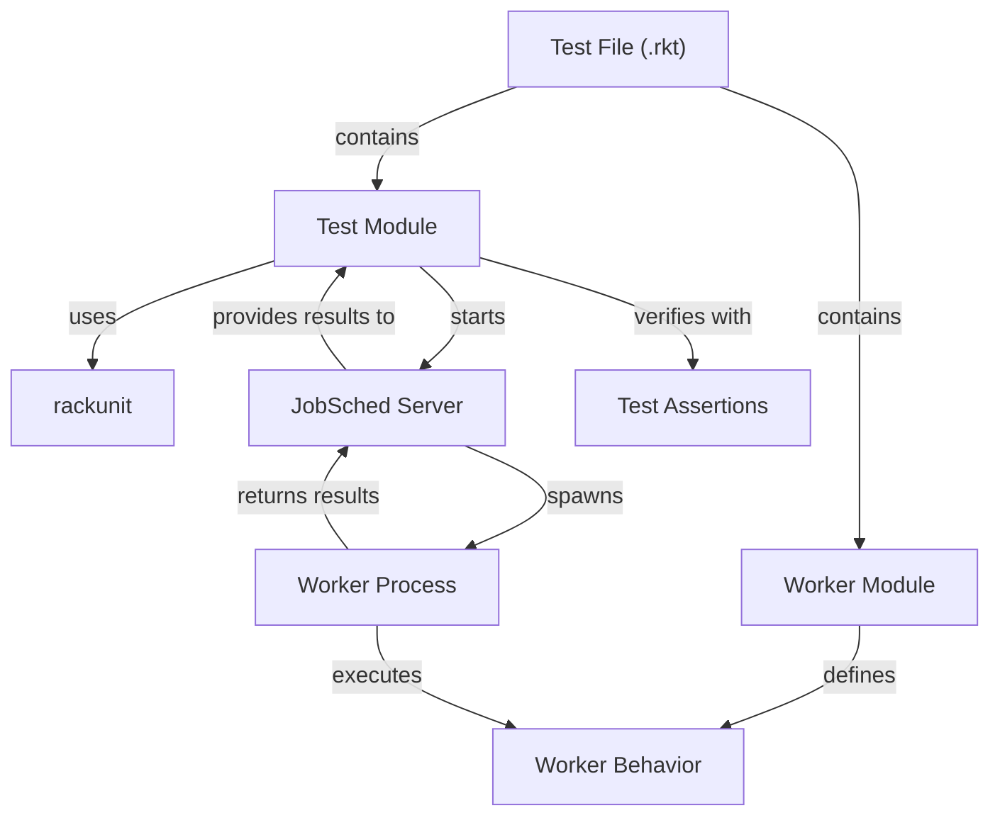
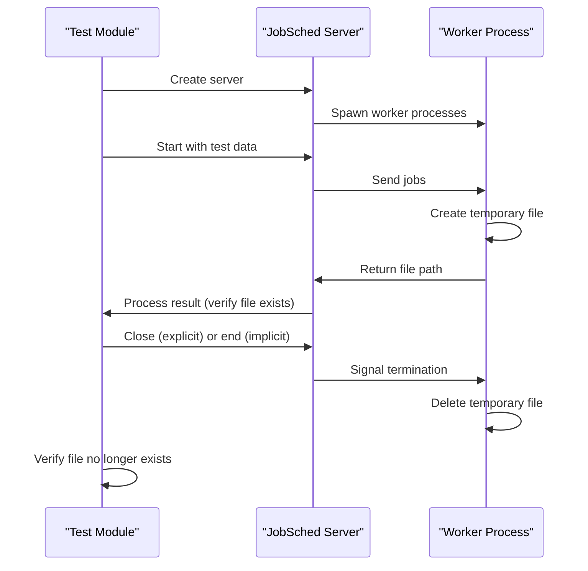

<!-- source: DeepWiki mcp.deepwiki.com · repo google-deepmind/levintreesearch_cm · page 4.4 Testing · fetched 2026-10-26 -->

# Testing

<details>
<summary>Relevant source files</summary>

The following files were used as context for generating this wiki page:

- [jobsched/info.rkt](jobsched/info.rkt)
- [jobsched/test/test-close-workers.rkt](jobsched/test/test-close-workers.rkt)
- [jobsched/test/test-return-void.rkt](jobsched/test/test-return-void.rkt)
- [jobsched/test/test-unreadable.rkt](jobsched/test/test-unreadable.rkt)

</details>


This page documents the testing infrastructure for the JobSched job scheduling system, which ensures reliable parallel job execution across multiple Racket processes. The testing framework validates worker lifecycle management, inter-process communication, and proper handling of various data types.

For information about JobSched's core architecture, see [Core Architecture](#4.1) and for usage examples, see [Examples and Usage](#4.3).

## Testing Architecture

JobSched tests use Racket's `rackunit` framework and follow a modular pattern where each test file typically contains both a worker module and a test module:



This architecture allows each test file to define both the specific worker behavior being tested and the verification logic in a self-contained manner.

Sources: [jobsched/test/test-close-workers.rkt](), [jobsched/test/test-return-void.rkt](), [jobsched/test/test-unreadable.rkt]()

## Test Categories

The JobSched testing suite covers several key areas of functionality:

### Worker Lifecycle Management

Tests in `test-close-workers.rkt` verify proper worker lifecycle management, including resource cleanup when workers terminate:



These tests validate that:
1. Workers can create and manage resources (temporary files)
2. Data flows correctly from worker to server to test module
3. When the server closes, workers gracefully terminate and clean up resources
4. Both server management patterns work properly:
   - The simpler `start-simple-server` approach
   - The more explicit `make-server`, `server-start`, `server-close` sequence

The tests also verify that when a worker is closed:
- The output port is closed, preventing further writing
- The error port remains available for error reporting back to the server

Sources: [jobsched/test/test-close-workers.rkt:18-54]()

### Data Communication Tests

Tests verify correct data handling in server-worker communication:

1. **Void Return Values** (`test-return-void.rkt`):
   - Tests workers that return `(void)` for all inputs
   - Verifies that void values are correctly serialized, transmitted, and processed
   - Ensures the server correctly collects these results

2. **Unserializable Data** (`test-unreadable.rkt`):
   - Marked with "Not ready yet" comment, indicating functionality in development
   - Creates an `unreadable` struct that cannot be serialized
   - Tests the system's fallback behavior when serialization fails
   - Verifies the server receives `(void)` instead of the unserializable data
   - Note: This test is excluded from automated testing as specified in `info.rkt`

Sources: [jobsched/test/test-return-void.rkt:4-16](), [jobsched/test/test-unreadable.rkt:4-19](), [jobsched/info.rkt:14]()

## Test Implementation Patterns

JobSched tests follow consistent implementation patterns that can be used as templates for creating new tests:

### Worker Module Pattern

```
(module+ worker
  ;; Setup worker-specific state or resources
  (define tmp (make-temporary-file))
  
  ;; Define worker behavior with start-simple-worker
  (start-simple-worker (λ (x) ...))
  
  ;; Optional cleanup (executed when worker terminates)
  (delete-file tmp))
```

This pattern defines a worker that:
1. Optionally creates resources needed during execution
2. Implements the worker function that processes input data
3. Handles cleanup operations when the worker is terminated

Sources: [jobsched/test/test-close-workers.rkt:4-16]()

### Test Module Patterns

JobSched supports two main patterns for implementing test modules:

#### Simple Testing Approach

```
(module+ test
  (require rackunit)
  
  ;; Setup test data and result storage
  (define results '())
  (define data '(a b c))
  
  ;; Start server, run workers, and collect results
  (start-simple-server #:worker-file (this-file)
                       #:data-list data
                       #:n-workers 2
                       #:process-result
                       (λ (data result) (set! results (cons result results))))
  
  ;; Verify collected results
  (check-equal? results (make-list (length data) (void))))
```

This pattern uses `start-simple-server` to handle the server lifecycle automatically and focuses on testing the results returned from workers.

Sources: [jobsched/test/test-return-void.rkt:7-16](), [jobsched/test/test-unreadable.rkt:10-19]()

#### Explicit Control Approach

```
(module+ test
  (require rackunit)
  
  ;; Setup
  (define tmp-h (make-hash))
  (define n-workers 2)
  (define server (make-server #:worker-file (this-file) #:n-workers n-workers))
  
  ;; Start server with test data
  (server-start server
                #:data-list '(a b c)
                #:process-result
                (λ (data tmp)
                  (check-true (file-exists? tmp))
                  (hash-set! tmp-h tmp #t)))
  
  ;; Verify intermediate state (files exist)
  (for ([tmp (in-dict-keys tmp-h)])
    (check-pred file-exists? tmp))
  
  ;; Explicitly close server (waits for workers to terminate)
  (server-close server) 
  
  ;; Verify final state (files deleted)
  (check-equal? (hash-count tmp-h) n-workers)
  (for ([tmp (in-dict-keys tmp-h)])
    (check-false (file-exists? tmp))))
```

This pattern provides more explicit control over the server lifecycle, allowing tests to verify intermediate states before and after server closure.

Sources: [jobsched/test/test-close-workers.rkt:38-54]()

## Running Tests

The JobSched testing infrastructure integrates with Racket's standard testing tools. To run the complete test suite:

```
raco test -c jobsched
```

### Test Configuration

The `info.rkt` file contains important testing configuration:

```
(define build-deps '("scribble-lib" "racket-doc" "rackunit-lib"))
(define test-omit-paths '("examples" "test/test-unreadable.rkt"))
```

Key configuration points:
- `rackunit-lib` is specified as a build dependency for testing
- Certain paths are excluded from automated testing:
  - The `examples` directory (contains usage examples, not tests)
  - `test/test-unreadable.rkt` (tests functionality that may be incomplete)

Sources: [jobsched/info.rkt:3-14]()

## Testing Best Practices

When creating new tests for JobSched components:

1. Create a test file with both worker and test modules
2. Use temporary resources that can be properly cleaned up 
3. Verify both successful data transmission and proper resource cleanup
4. For tests involving incomplete features or expected errors, consider adding them to `test-omit-paths` in `info.rkt`
5. Use assertions to verify expected behaviors at each stage of the worker lifecycle

These practices ensure that the JobSched system maintains reliability during parallel processing operations.