# Page: Overview

# Overview

<details>
<summary>Relevant source files</summary>

The following files were used as context for generating this wiki page:

- [README.md](README.md)
- [lts-cm/img/domains.png](lts-cm/img/domains.png)
- [lts-cm/scribblings/lts-cm.scrbl](lts-cm/scribblings/lts-cm.scrbl)

</details>


Levin Tree Search with Context Models (LTS-CM) is an algorithm and system for efficiently solving complex search problems through a combination of best-first search and learned context models. This repository provides a complete implementation of the algorithm presented in the IJCAI 2023 paper "Levin Tree Search with Context Models", allowing users to reproduce the results and apply the approach to various puzzle domains.

This page provides a high-level overview of the LTS-CM system architecture, key components, and their interactions. For installation instructions and quick start guidance, see [Installation and Quick Start](#1.1). For details about the repository structure, see [Repository Structure](#1.2).

Sources: [README.md:1-11]()

## System Architecture

### High-Level System Overview

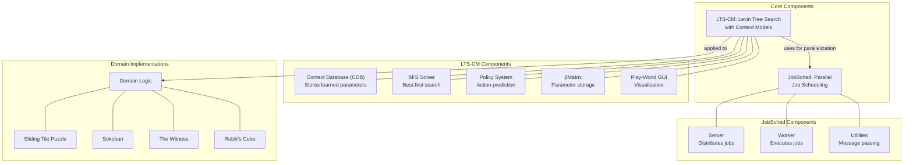

The Levin Tree Search with Context Models system consists of two primary subsystems:

1. **LTS-CM**: The core algorithm implementation that combines Levin Tree Search with contextual models for efficient problem solving
2. **JobSched**: A parallel job scheduling framework that enables distributing computation across multiple workers

These systems work together to solve complex puzzles across four domains: Sliding Tile Puzzle, Sokoban, The Witness, and Rubik's Cube.

Sources: [README.md:12-67]()

### LTS-CM Architecture and Data Flow

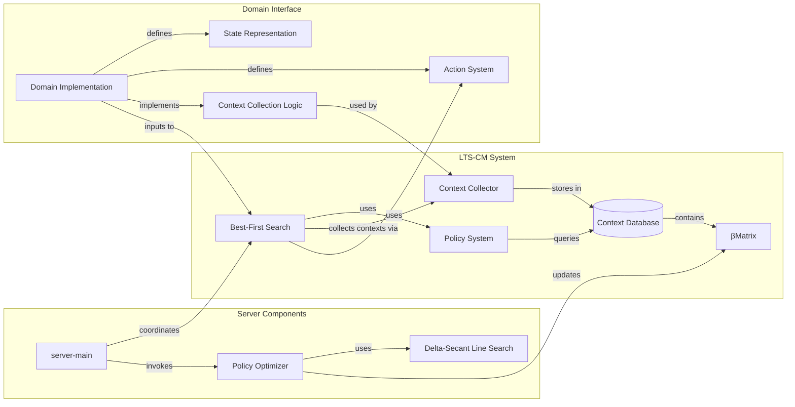

The diagram illustrates the data flow within the LTS-CM system:

1. The **Best-First Search (BFS)** algorithm forms the core search mechanism, guided by the **Policy System**
2. The **Policy System** retrieves action probabilities from the **Context Database (CDB)**
3. As the search progresses, the **Context Collector** gathers contextual information
4. The **Policy Optimizer** updates the **BetaMatrix** parameters based on solution trajectories
5. Domain-specific implementations provide state representations, actions, and context collection logic

Sources: [README.md:42-67]()

## Key Components

### LTS-CM (Levin Tree Search with Context Models)

LTS-CM combines Levin Tree Search, a variant of best-first search that balances exploration cost with solution quality, with context models that learn from experience to guide the search more efficiently. The main components of LTS-CM are:

1. **Context Database (CDB)**: Stores learned parameters and contextual information gathered during searches
2. **BFS Solver**: Implements the best-first search algorithm guided by the learned policy
3. **Policy System**: Predicts action probabilities based on contextual information
4. **BetaMatrix**: Stores the model parameters that are optimized over time
5. **GUI**: Provides visualization of states and solution trajectories

Sources: [README.md:45-56](), [README.md:82-96]()

### JobSched (Job Scheduling System)

JobSched is a parallel processing framework that enables distributing computation across multiple CPU cores. It follows a server-worker architecture:

1. **Server**: Manages job distribution and result collection
2. **Worker**: Receives jobs, executes them, and returns results
3. **Utilities**: Provides tools for message passing and communication

This framework allows LTS-CM to scale across multiple CPU cores, significantly speeding up the search and optimization process.

Sources: [README.md:58-67](), [README.md:76-78]()

### Domain Implementation Architecture

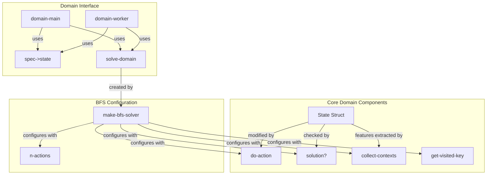

Each domain implementation (Sliding Tile Puzzle, Sokoban, The Witness, Rubik's Cube) follows a common architecture:

1. **State Representation**: Domain-specific struct representing the puzzle state
2. **Action System**: Defines legal moves and state transitions
3. **BFS Configuration**: Configures the best-first search algorithm with domain-specific functions
4. **Context Collection**: Defines how contextual information is extracted from states

This modular design allows the same LTS-CM algorithm to be applied across different puzzle domains while encapsulating the domain-specific logic.

Sources: [README.md:12-13](), [README.md:82-96]()

## Integration and Data Flow

### LTS-CM and JobSched Integration

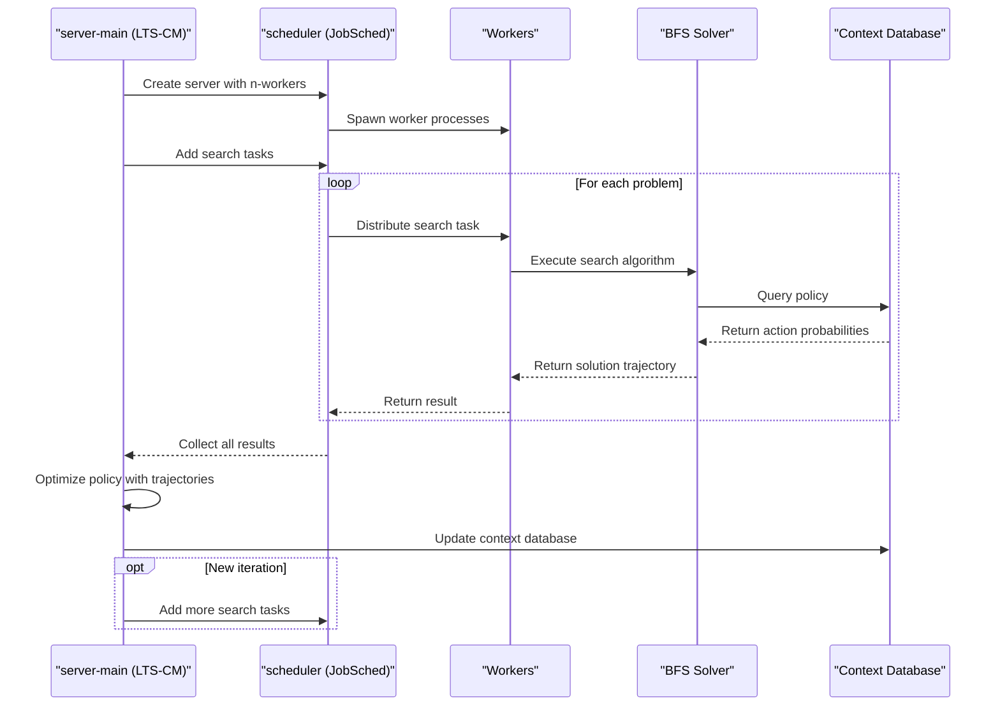

The sequence diagram illustrates the interaction between LTS-CM and JobSched components during a typical run:

1. The system begins by creating a server with multiple workers
2. Search tasks (puzzle instances) are distributed to available workers
3. Each worker executes the BFS algorithm, querying the policy for guidance
4. Solution trajectories are returned to the server
5. The policy is optimized based on the collected trajectories
6. The context database is updated with the improved policy
7. Additional search tasks may be added for further iterations

This iterative process allows the system to improve its search efficiency over time as it learns from previous solutions.

Sources: [README.md:60-80]()

## Algorithm Overview

### Levin Tree Search

Levin Tree Search is a variant of best-first search that expands nodes in order of their "Levin cost" - a combination of the cost to reach the node and an estimate of the remaining cost to reach a solution. The key innovation in this system is the addition of context models that learn to predict better cost estimates based on experience with similar problems.

### Context Models

Context models in LTS-CM learn patterns from previously solved problems to guide future searches more efficiently. The system:

1. Collects contextual information during search
2. Stores this information in the Context Database
3. Uses this information to train a policy that predicts promising actions
4. Applies the learned policy to guide future searches

The combination of Levin Tree Search with these learned context models makes the system particularly efficient at solving complex puzzles, often requiring significantly fewer node expansions than traditional methods.

### Delta-Secant Line Search

The system uses a Delta-Secant line search algorithm for policy optimization. This convex minimization technique is documented in the module `lts-cm/delta-secant`, which implements the algorithm described in the paper "Line Search for Convex Minimization".

Sources: [lts-cm/scribblings/lts-cm.scrbl:18-118]()

## Supported Problem Domains

The system has been tested on four challenging puzzle domains:

1. **Sliding Tile Puzzle**: The classic n×n grid puzzle where tiles must be rearranged to a goal configuration
2. **Sokoban**: A puzzle where a warehouse worker must push boxes to designated locations
3. **The Witness**: A path-finding puzzle based on the video game of the same name
4. **Rubik's Cube**: The well-known 3D combination puzzle

Each of these domains presents unique challenges for search algorithms, and the LTS-CM system has demonstrated strong performance across all of them.

Sources: [README.md:12-13](), [README.md:82-96]()

## Usage Examples

The system provides several examples that demonstrate its capabilities:

### Quick Start Example
```
racket -l- lts-cm/domains/sokoban/example-optim-gui
```
This example:
- Runs the solver on simple Sokoban levels
- Shows the number of expansions during search
- Collects solution trajectories
- Optimizes policy parameters
- Demonstrates improved efficiency in subsequent searches
- Opens a GUI to visualize the solution

### Server Example
```
racket -l- lts-cm/domains/stp/server-easy
```
This example:
- Runs multiple jobs in parallel using the server-worker architecture
- Solves a set of easy Sliding Tile Puzzle instances
- Demonstrates the parallel processing capabilities of the system

For reproducing the full paper results, the repository includes commands for each domain, though some may require significant computation time.

Sources: [README.md:41-80]()

## Summary

Levin Tree Search with Context Models (LTS-CM) provides a powerful framework for solving complex search problems by combining traditional best-first search with learned context models. The system's modular architecture, parallel processing capabilities, and support for multiple puzzle domains make it a versatile tool for both research and practical applications in search and planning.

The implementation demonstrates how learning from experience can significantly improve search efficiency over time, with the system requiring fewer node expansions as it gains experience with similar problems.

---

# Page: Installation and Quick Start

# Installation and Quick Start

<details>
<summary>Relevant source files</summary>

The following files were used as context for generating this wiki page:

- [README.md](README.md)
- [lts-cm/img/domains.png](lts-cm/img/domains.png)

</details>


This page provides instructions for installing the levintreesearch_cm package and running basic examples to get started with the Levin Tree Search with Context Models (LTS-CM) system. For information about the algorithm and components, see [LTS-CM: Levin Tree Search with Context Models](#2).

## System Requirements

Before installing LTS-CM, ensure you have:

- **Racket programming language**: Version 8.9.0.4 or above

Sources: [README.md:14-17]()

## Installation Process

### 1. Install Racket

Download and install Racket from the Racket website (https://racket-lang.org/). Installation steps vary by operating system:

#### Linux
- Download the installer
- In a terminal: `cd Downloads` then `sudo sh racket-….sh`
- Reply `y` to the first question (unix-like distribution)
- Press Enter for all following questions

#### Windows and MacOS
- Run the installer
- Configure the PATH environment variable to include the directory containing the `racket` and `raco` executables

Verify your installation by running `racket -v` in a terminal. Ensure the version is at least 8.9.0.4.

### 2. Install the levintreesearch_cm Package

Run the following command to install the package and all its dependencies:

```shell
raco pkg install --auto --update-deps https://github.com/google-deepmind/levintreesearch_cm.git
```

### Installation Process Diagram

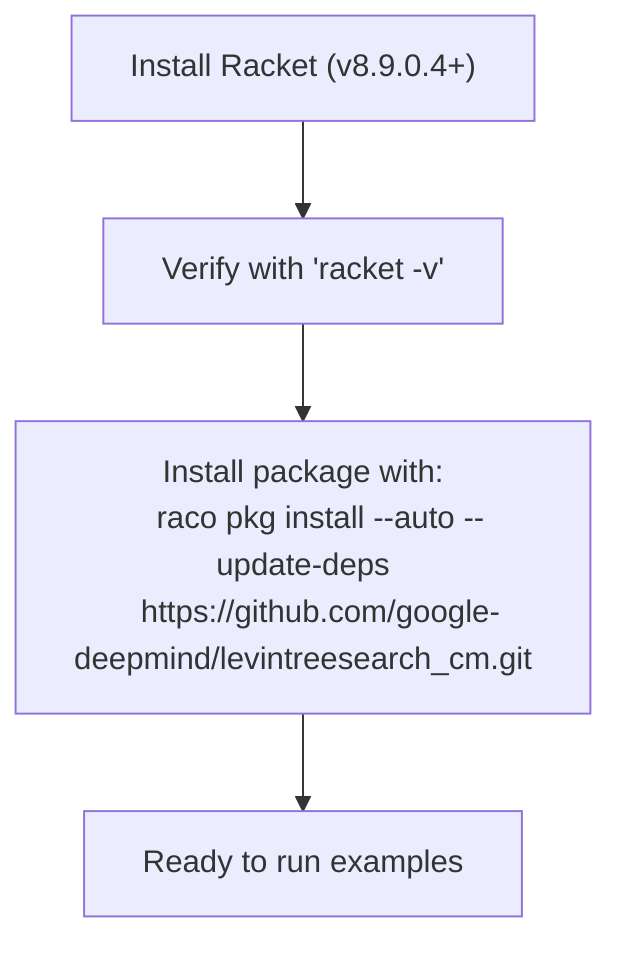

Sources: [README.md:14-39]()

## Repository Components and Examples

The following diagram shows the main components and quick start examples:

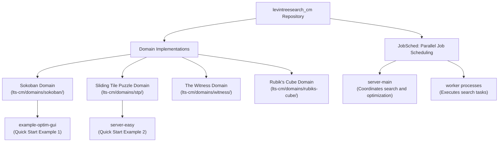

Sources: [README.md:1-13](), [README.md:40-80]()

## Quick Start Examples

### Example 1: Sokoban with Optimization and GUI

This example demonstrates solving simple Sokoban levels, optimizing the policy, and visualizing results:

```shell
racket -l- lts-cm/domains/sokoban/example-optim-gui
```

The example workflow:

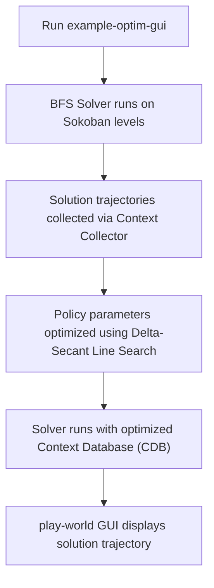

Sources: [README.md:41-56]()

### Example 2: Server-Worker Architecture with Sliding Tile Puzzle

This example demonstrates running multiple jobs in parallel using a server-worker architecture:

```shell
racket -l- lts-cm/domains/stp/server-easy
```

The execution process:

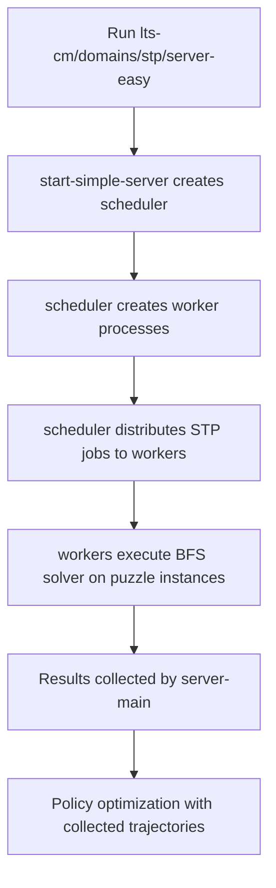

With a 4-core machine, this example typically takes less than 10 minutes to complete.

Sources: [README.md:58-69]()

## Command Line Options

The LTS-CM system supports several command line options:

| Option | Description | Default |
|--------|-------------|---------|
| `--log-base-dir <dir>` | Directory to store logs | `lts-cm-logs` in user's home directory |
| `--n-workers` | Number of workers for search | Number of CPUs divided by 2 |
| `--n-futures` | Number of workers for optimization | Number of CPUs divided by 2 |
| `--help` | Display help information | - |

Sources: [README.md:70-80]()

## Logging System

Each time a problem is solved, a file is written to the logs directory. This allows resuming from the last state if the process is interrupted. Logs are stored in a subdirectory named `lts-cm-logs` in the user's home directory, unless specified otherwise with `--log-base-dir`.

Sources: [README.md:70-74]()

## Reproducing the Paper's Results

To reproduce the results from the paper "Levin Tree Search with Context Models," run these commands in increasing order of computation time:

```shell
racket -l- lts-cm/domains/witness/server
racket -l- lts-cm/domains/sokoban/server
racket -l- lts-cm/domains/stp/server
racket -l- lts-cm/domains/sokoban/server-long
racket -l- lts-cm/domains/rubiks-cube/server
```

The first three commands take less than 2 hours each on a 64-core 2GHz machine, while the last one takes several days to complete.

Sources: [README.md:82-103]()

## Hardware Requirements

Reproducing the paper's results requires:
- Up to 2GB of RAM per worker
- Up to 5GB of free disk space per experiment

Sources: [README.md:83-85]()

## Next Steps

After getting started with these examples, you can:
1. Explore the other domain implementations
2. Try different problem instances
3. Experiment with command line options to tune performance
4. Learn about the LTS-CM architecture in the [Core Components](#2.1) page

Sources: [README.md:40-103]()

---

# Page: Repository Structure

# Repository Structure

<details>
<summary>Relevant source files</summary>

The following files were used as context for generating this wiki page:

- [.gitignore](.gitignore)
- [CONTRIBUTING.md](CONTRIBUTING.md)
- [LICENSE](LICENSE)
- [README.md](README.md)
- [lts-cm/img/domains.png](lts-cm/img/domains.png)

</details>


## Purpose and Overview

This document provides a comprehensive overview of the `levintreesearch_cm` repository organization, detailing the main components and their relationships. It serves as a guide to help developers navigate the codebase and understand how different parts interact with each other.

For detailed information about the Levin Tree Search with Context Models algorithm, see [LTS-CM: Levin Tree Search with Context Models](#2).

## Top-Level Organization

The repository is organized into two main subsystems:

1. **LTS-CM (Levin Tree Search with Context Models)** - The core algorithm implementation
2. **JobSched** - A parallel job scheduling framework

### Repository File Structure

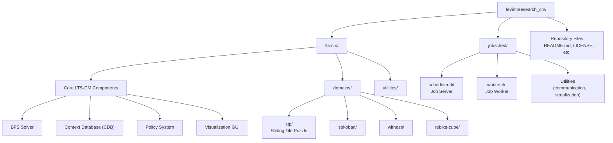

Sources: README.md

## LTS-CM: Core Components

The LTS-CM directory contains the implementation of the Levin Tree Search with Context Models algorithm. This algorithm combines best-first search with learned context models to efficiently solve problems across different domains.

### LTS-CM Architecture

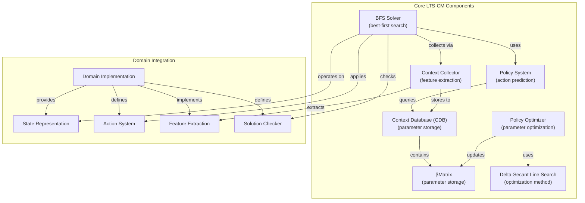

Sources: README.md

### Component Descriptions

1. **BFS Solver**: Implements the best-first search algorithm for solving problems and finding optimal paths.

2. **Context Database (CDB)**: Stores learned model parameters and contextual information used to guide the search.

3. **Policy System**: Predicts action probabilities based on contextual information, guiding the search process.

4. **βMatrix**: Stores the parameters of the context models.

5. **Context Collector**: Extracts features from states and actions for learning and policy improvement.

6. **Policy Optimizer**: Updates policy parameters based on collected trajectory data.

## Domain Implementations

The repository includes implementations for four problem domains:

1. **Sliding Tile Puzzle** (`lts-cm/domains/stp/`)
2. **Sokoban** (`lts-cm/domains/sokoban/`)
3. **The Witness** (`lts-cm/domains/witness/`)
4. **Rubik's Cube** (`lts-cm/domains/rubiks-cube/`)

### Domain Structure

Each domain implementation follows a similar structure:

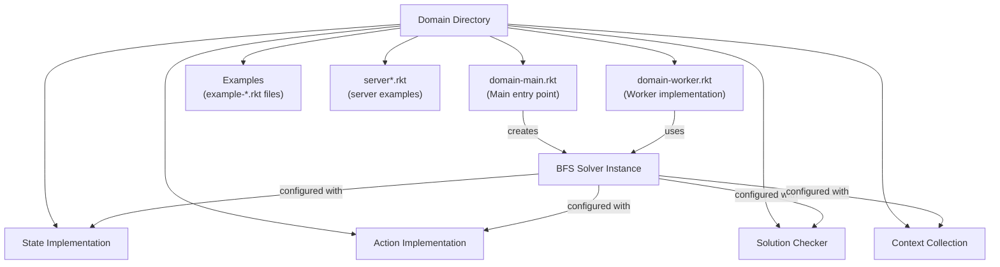

Sources: README.md

### Domain Interface Components

Each domain implements these standard components:

1. **State Representation**: A data structure representing the problem state (e.g., board configuration).

2. **Action System**: Defines available actions and their effects on states.

3. **Solution Checker**: Determines if a state is a solution to the problem.

4. **Context Collection**: Extracts features from states and actions for learning.

5. **BFS Configuration**: Domain-specific configuration for the BFS solver.

## JobSched: Job Scheduling System

The JobSched system provides parallel job execution capabilities, allowing LTS-CM to distribute computational work across multiple workers.

### JobSched Architecture

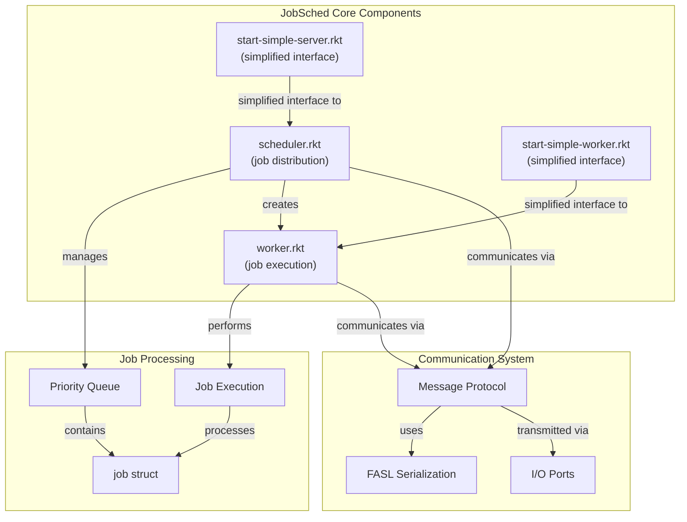

Sources: README.md

### JobSched Components

1. **Scheduler**: Central component that distributes jobs to workers and collects results.

2. **Worker**: Executes jobs received from the scheduler and returns results.

3. **Job Execution**: Mechanism for executing jobs and handling their results.

4. **Communication Protocol**: System for message passing between scheduler and workers.

## Integration Between LTS-CM and JobSched

LTS-CM uses JobSched to parallelize search and optimization tasks across multiple workers, enabling efficient processing of complex problems.

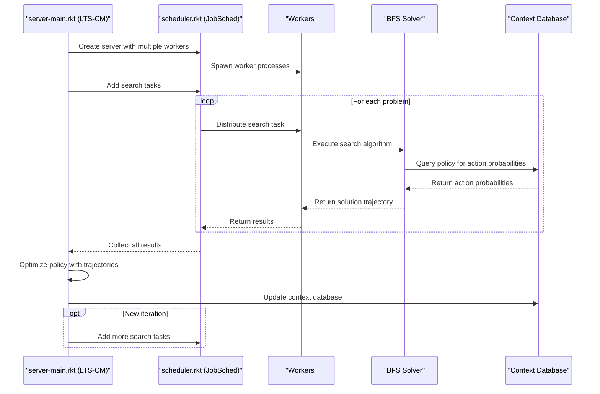

Sources: README.md

## Example Files and Entry Points

The repository contains several example files that serve as entry points for running experiments:

1. **Quick Start Example**: `lts-cm/domains/sokoban/example-optim-gui.rkt` - Demonstrates the solver, optimization, and visualization.

2. **Server Example**: `lts-cm/domains/stp/server-easy.rkt` - Shows parallel execution on Sliding Tile Puzzle instances.

3. **Paper Reproduction**: Various server files in domain directories for reproducing the paper's results:
   - `lts-cm/domains/witness/server.rkt`
   - `lts-cm/domains/sokoban/server.rkt`
   - `lts-cm/domains/stp/server.rkt`
   - `lts-cm/domains/rubiks-cube/server.rkt`

Sources: README.md

## Configuration and Logging

The system uses a logging directory to store results and checkpoints:

- Default log directory: `lts-cm-logs/` in the user's home directory
- Can be changed with the `--log-base-dir <dir>` flag
- Worker count configurable with `--n-workers` for search and `--n-futures` for optimization

Sources: README.md

## Summary

The `levintreesearch_cm` repository is organized around two main components:

1. **LTS-CM** - The core algorithm implementation for Levin Tree Search with Context Models
2. **JobSched** - A parallel job scheduling framework that enables efficient problem solving

The repository structure facilitates both research and application by providing:
- Clean separation between algorithm components and problem domains
- Parallel execution capabilities for resource-intensive tasks
- Well-defined interfaces between components
- Multiple example entry points for different use cases

For detailed information about the specific components, see their respective wiki pages:
- [Core Components](#2.1)
- [Domain Implementations](#3)
- [JobSched System](#4)

---

# Page: LTS-CM: Levin Tree Search with Context Models

# LTS-CM: Levin Tree Search with Context Models

<details>
<summary>Relevant source files</summary>

The following files were used as context for generating this wiki page:

- [lts-cm/bfs.rkt](lts-cm/bfs.rkt)
- [lts-cm/policy.rkt](lts-cm/policy.rkt)
- [lts-cm/scribblings/lts-cm.scrbl](lts-cm/scribblings/lts-cm.scrbl)
- [lts-cm/server.rkt](lts-cm/server.rkt)

</details>


## Purpose and Scope

This document explains the Levin Tree Search with Context Models (LTS-CM) algorithm implementation in the repository. LTS-CM is an algorithm that combines Levin's universal search with learned context models to efficiently solve combinatorial search problems. It provides a framework for efficiently solving puzzles and planning problems by learning from past solutions.

This page covers the core algorithm, its implementation details, and how it integrates with other components. For information about specific problem domains implemented in the system, see [Problem Domains](#3). For details about the parallel job scheduling system used by LTS-CM, see [JobSched: Job Scheduling System](#4).

## Overview of the LTS-CM Algorithm

LTS-CM is a search algorithm that uses a best-first search approach guided by learned policies. The core idea is to use a context-based policy to guide the search, and then to iteratively improve this policy based on successful solutions.

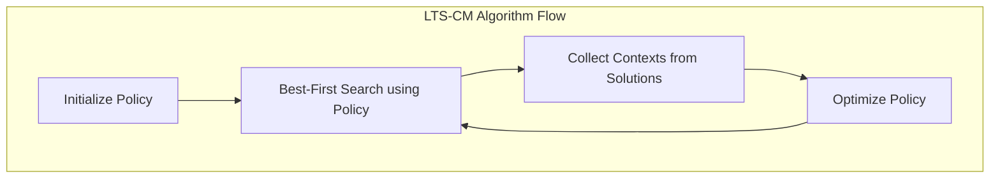

Sources: [lts-cm/bfs.rkt:119-135](), [lts-cm/server.rkt:323-380]()

The algorithm follows these key steps:
1. Initialize a policy (can be uniform at first)
2. Solve problems using best-first search guided by the policy
3. Collect contexts from successful solutions
4. Optimize the policy based on these contexts
5. Repeat with improved policy

## Core System Architecture

The LTS-CM system consists of several interconnected components that work together to implement the algorithm:

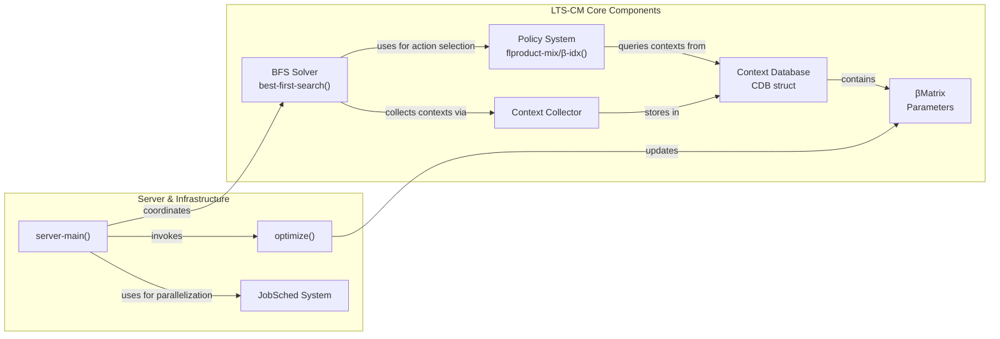

Sources: [lts-cm/bfs.rkt:27-32](), [lts-cm/server.rkt:36-46](), [lts-cm/policy.rkt:21-22]()

### Key Components

| Component | Purpose | Key Code Entities |
|-----------|---------|-------------------|
| BFS Solver | Implements best-first search algorithm | `best-first-search`, `bfs-node` struct |
| Policy System | Handles action selection using context models | `flproduct-mix/β-idx`, `mix-uniform!/flvector` |
| Context Database | Stores learned context parameters | `CDB` struct, `make-cdb` |
| βMatrix | Parameter storage for the context model | `βmatrix` |
| Context Collector | Extracts contexts from states | `collect-contexts` |
| Server | Orchestrates search and optimization | `server-main` |
| Optimizer | Improves policy based on collected contexts | `optimize` |

## Best-First Search Implementation

The best-first search algorithm is the core search component that uses learned policies to guide exploration. It's implemented in the `best-first-search` function in the BFS module.

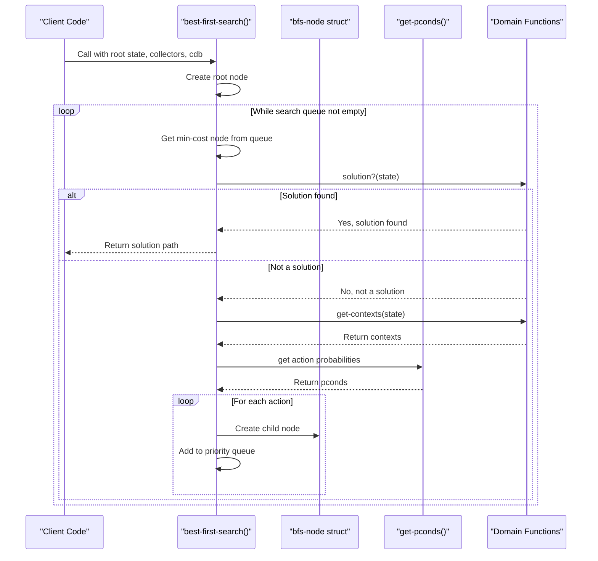

Sources: [lts-cm/bfs.rkt:137-273]()

### Key Aspects of the BFS Implementation:

1. Uses a priority queue ordered by a cost function that combines depth and action probability
2. The cost function is: `(+ (log depth) ln1/π)` where `ln1/π` is the negative log probability of the path
3. Supports transposition tables via the `visitor` struct to avoid re-expanding states
4. Collects contexts during search to enable policy learning
5. Returns a detailed result dictionary with solution information

### Search Node Structure

The search state is represented by the `bfs-node` struct defined in [lts-cm/bfs.rkt:52-54]():

```
(struct bfs-node (depth ln1/π act-seq state cost)
  #:transparent
  #:mutable)
```

Where:
- `depth`: The depth of the node in the search tree
- `ln1/π`: Negative log probability of the path to this node
- `act-seq`: Sequence of actions that led to this state (in reverse)
- `state`: The domain state
- `cost`: Combined cost used for ordering in the priority queue

## Policy System

The policy system maps contexts to action probabilities. It's implemented using a parametric model stored in a βMatrix.

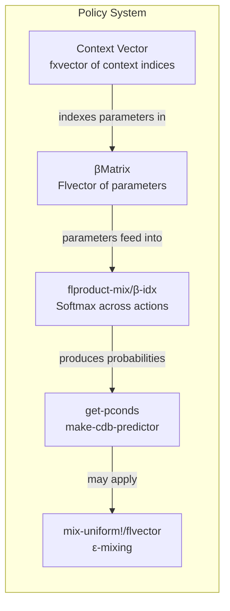

Sources: [lts-cm/policy.rkt:63-128](), [lts-cm/bfs.rkt:78-79]()

The policy works by:
1. Extracting context indices from a state using domain-specific collectors
2. Looking up parameters in the βMatrix for each context
3. Combining these parameters using a product-mixing approach (similar to softmax)
4. Optionally mixing with a uniform distribution for exploration (controlled by ε-mix)

### Key Policy Functions:

- `flproduct-mix/β-idx`: Computes action probabilities from context indices using the βMatrix
- `mix-uniform!/flvector`: Mixes the policy with a uniform distribution
- `make-cdb-predictor`: Creates a predictor function that maps contexts to probabilities

## Server Architecture and Optimization

The server orchestrates the overall LTS-CM algorithm, managing the iterative process of searching and learning.

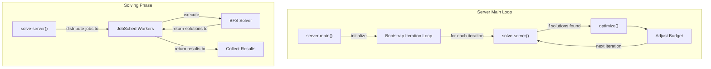

Sources: [lts-cm/server.rkt:245-385](), [lts-cm/server.rkt:103-214]()

### Server Bootstrap Process:

The server follows a bootstrap iteration process:
1. Start with an initial budget and policy (can be empty/uniform)
2. Distribute search jobs to workers for solving problems
3. Collect successful solutions and their contexts
4. Optimize the policy based on collected contexts
5. Adjust the budget based on search progress
6. Repeat until convergence or budget limit reached

### Budget Adaptation:

The system uses an adaptive budget mechanism:
- If significant progress is made, the budget may be reduced
- If progress is slow, the budget increases based on the formula:
  ```
  new_budget = α * budget + ((α - 1) * solved_expansions) / n_unsolved
  ```
- This balances exploration against exploitation of the learned policy

### Policy Optimization:

The policy is optimized using a line search approach that minimizes the expected search cost across all contexts:
1. Extracts contexts from successful solutions
2. Updates the βMatrix parameters to better predict successful actions
3. Uses regularization to avoid overfitting (controlled by *regularizer*)

## Creating a Domain-Specific Solver

LTS-CM provides a function `make-bfs-solver` that generates a domain-specific solver by configuring the generic best-first search with domain-specific functions:

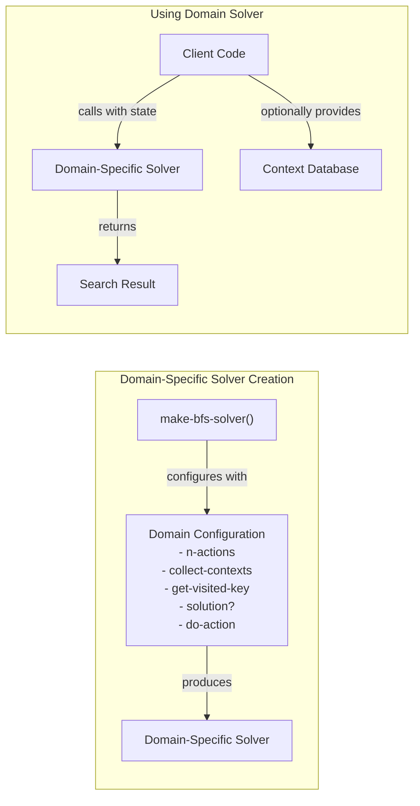

Sources: [lts-cm/bfs.rkt:276-296]()

A domain-specific solver must provide:
1. `n-actions`: Number of possible actions
2. `collect-contexts`: Function to extract contexts from states
3. `get-visited-key`: Function to generate keys for transposition tables
4. `solution?`: Function to check if a state is a solution
5. `do-action`: Function to apply an action to a state

For implementation of specific domains, see [Problem Domains](#3).

## Integration with JobSched

LTS-CM uses the JobSched system for parallel execution of search tasks. The integration allows for efficient distribution of search tasks across multiple workers.

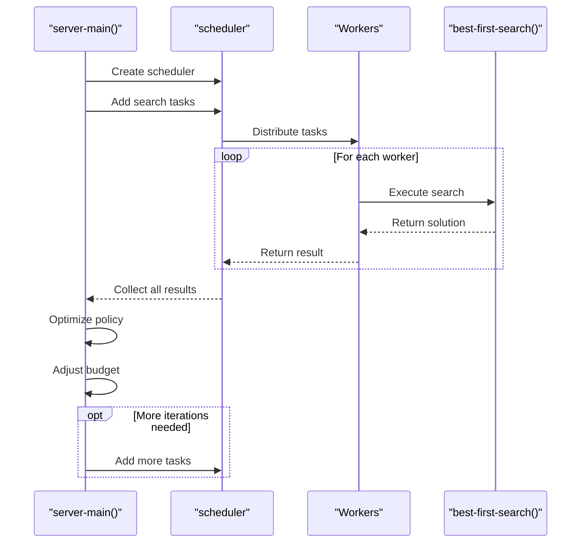

Sources: [lts-cm/server.rkt:103-214](), [lts-cm/server.rkt:323-380]()

For more details about JobSched, see [JobSched: Job Scheduling System](#4).

## Summary

LTS-CM is a powerful search algorithm that combines traditional best-first search with learned context models to efficiently solve combinatorial problems. Its key strengths are:

1. Iterative improvement of search policy through learning
2. Adaptive budget mechanism to balance exploration and exploitation
3. Parallel execution through integration with JobSched
4. Domain-agnostic framework that can be applied to various problem domains

For more detailed information about implementing specific domains, see [Problem Domains](#3).

---

# Page: Core Components

# Core Components

<details>
<summary>Relevant source files</summary>

The following files were used as context for generating this wiki page:

- [lts-cm/beta-matrix.rkt](lts-cm/beta-matrix.rkt)
- [lts-cm/bfs.rkt](lts-cm/bfs.rkt)
- [lts-cm/cdb.rkt](lts-cm/cdb.rkt)
- [lts-cm/flonum.rkt](lts-cm/flonum.rkt)

</details>


This document describes the central components of the Levin Tree Search with Context Models (LTS-CM) system. It covers the foundational elements that enable problem-solving through context-sensitive search. For information about the higher-level server architecture, see [Server Architecture](#2.2), and for details on the domains that can be solved with these components, see [Problem Domains](#3).

## Overview of Core Components

The LTS-CM system is built around four principal components that work together to enable efficient search with learned contextual information:

```mermaid
graph TD
    subgraph "LTS-CM Core Components"
        BFS["BFS Solver<br/>(bfs.rkt)"] --> |"uses"| Policy
        Policy["Policy System<br/>(policy.rkt)"] --> |"queries"| CDB
        CDB["Context Database<br/>(cdb.rkt)"] --> |"contains"| BetaMatrix
        BetaMatrix["βMatrix<br/>(beta-matrix.rkt)"] --> |"stores parameters for"| Policy
        Collector["Context Collector<br/>(collector.rkt)"] --> |"stores contexts in"| CDB
        BFS --> |"collects contexts via"| Collector
    end
    
    class BFS,Policy,CDB,BetaMatrix,Collector stroke:#333,stroke-width:2px
```

Sources: [lts-cm/cdb.rkt](1-71), [lts-cm/beta-matrix.rkt](1-143), [lts-cm/bfs.rkt](1-297)

## Context Database (CDB)

The Context Database is a central repository that stores learned parameters and context mappings. It maintains the associations between context codes and their corresponding indices in the βMatrix.

```mermaid
classDiagram
    class CDB {
        mutex-dicts : vector of hasheq
        n-rows : int
        n-cols : int
        βmatrix : flvector
        +save-cdb(file)
        +load-cdb(file)
        +CDB-empty?()
        +CDB-n-params()
    }
    
    class make-cdb-predictor {
        <<function>>
        +takes CDB as input
        +returns policy prediction function
    }
    
    CDB -- make-cdb-predictor : used by
```

The `CDB` struct ([lts-cm/cdb.rkt:40]()) contains:
- `mutex-dicts`: Vector of hash tables mapping context integers to βMatrix indices
- `n-rows`: Number of rows in the βMatrix
- `n-cols`: Number of columns (actions) in the βMatrix 
- `βmatrix`: A flvector storing all parameters

Key functions:
- `make-cdb`: Creates an empty CDB with specified number of columns
- `save-cdb`/`load-cdb`: Persistence functions using FASL serialization
- `make-cdb-predictor`: Creates a policy prediction function from a CDB

Sources: [lts-cm/cdb.rkt:24-70](1-70)

## Beta Matrix (βMatrix)

The βMatrix is the core parameter storage mechanism for the policy system. It's structured as a dense matrix (implemented as a vector) that stores flonum parameters.

```mermaid
graph TD
    subgraph "βMatrix System"
        BM["βMatrix<br/>(flvector)"]
        trajectory["Trajectory Struct<br/>act-seq, idxs-seq, log-loss"]
        new_idx["new-idx!<br/>function"]
        
        trajectory -->|"maps context codes to"| BM
        extend["extend-cdb+trajectories"] -->|"creates"| trajectory
        extend -->|"produces"| BM
        extend -->|"uses"| new_idx
    end
```

Key components:
- The βMatrix is stored as a flvector within the CDB structure
- Context codes are mapped to indices in the βMatrix using hash tables
- The `trajectory` struct ([lts-cm/beta-matrix.rkt:46-47]()) tracks:
  - `act-seq`: Sequence of actions
  - `idxs-seq`: Sequence of indices in the βMatrix
  - `log-loss`: Loss value for optimization

The `extend-cdb+trajectories` function ([lts-cm/beta-matrix.rkt:81-141]()) is critical as it:
1. Processes new trajectories
2. Maps context codes to indices in the βMatrix
3. Creates or extends the βMatrix with new parameters
4. Returns an updated CDB and trajectories for optimization

Sources: [lts-cm/beta-matrix.rkt:27-143](1-143)

## Best-First Search (BFS) Solver

The BFS solver implements the core search algorithm, exploring states based on a cost function that balances depth and policy guidance.

```mermaid
flowchart TD
    subgraph "BFS Algorithm Flow"
        init["Initialize:\n- Priority Queue\n- Root Node\n- Context Vector"] 
        loop{"Empty Queue\nor Budget Exceeded?"}
        expand["Expand Node:\n1. Get contexts\n2. Get policy from CDB\n3. Calculate costs\n4. Create child nodes"]
        solution{"Is Solution?"}
        visited{"Already Visited?"}
        
        init --> loop
        loop -->|"No"| solution
        solution -->|"Yes"| result_solved["Return Solution Trajectory"]
        solution -->|"No"| visited
        visited -->|"No"| expand
        visited -->|"Yes"| loop
        expand --> loop
    end
```

Key components:
- `bfs-node` struct ([lts-cm/bfs.rkt:52-54]()): Represents a search state with:
  - `depth`: Search depth
  - `ln1/π`: Log of inverse probability
  - `act-seq`: Action sequence
  - `state`: Domain state
  - `cost`: Search priority

- `best-first-search` function ([lts-cm/bfs.rkt:137-273]()): The main search algorithm that:
  1. Uses a priority queue to explore states
  2. Collects context information
  3. Queries the policy from CDB
  4. Applies the cost function (d/π by default)
  5. Maintains a transposition table to avoid revisiting states

- `make-bfs-solver` function ([lts-cm/bfs.rkt:276-296]()): Creates domain-specific solver instances

Sources: [lts-cm/bfs.rkt:34-296](1-296)

## Policy System and Prediction

The policy system uses the parameters stored in the CDB to predict action probabilities and guide the search process.

```mermaid
flowchart TD
    subgraph "Policy Prediction Flow"
        collectCtx["collect-contexts\n(domain-specific)"] -->|"produces"| ctxs["Context Codes\n(fxvector)"]
        ctxs -->|"input to"| predictor["make-cdb-predictor\n(from CDB)"]
        predictor -->|"produces"| probs["Action Probabilities\n(flvector)"]
        probs -->|"guides"| BFS["BFS Search"]
    end
```

The policy prediction process:
1. `collect-contexts`: Domain-specific function collects context features from a state
2. Context codes are mapped to βMatrix indices
3. `make-cdb-predictor`: Creates a function that uses the CDB to predict action probabilities
4. The resulting probability distribution guides the BFS search

Key concepts:
- Context collection is domain-specific but follows a common interface
- The policy balances exploration and exploitation through ε-mixing with uniform distribution
- The `flproduct-mix/β-idx` function computes action probabilities from the βMatrix

Sources: [lts-cm/beta-matrix.rkt:143-182](143-182), [lts-cm/bfs.rkt:162-174](162-174)

## Data Flow Between Components

The following diagram shows how data flows through the core components during search and optimization:

```mermaid
sequenceDiagram
    participant BFS as BFS Solver
    participant Policy as Policy Predictor
    participant CDB as Context Database
    participant BetaMatrix as βMatrix
    participant Collector as Context Collector
    
    BFS->>Collector: collect-contexts(state)
    Collector->>BFS: context codes
    BFS->>Policy: Request action probabilities
    Policy->>CDB: Query with context codes
    CDB->>BetaMatrix: Look up parameters
    BetaMatrix->>CDB: Return parameters
    CDB->>Policy: Return parameters
    Policy->>BFS: Return action probabilities
    BFS->>BFS: Expand nodes based on probabilities
    
    Note over BFS,BetaMatrix: After search completion:
    BFS->>CDB: Collect successful trajectories
    CDB->>BetaMatrix: Extend with new contexts
```

Sources: [lts-cm/bfs.rkt:137-273](137-273), [lts-cm/beta-matrix.rkt:81-141](81-141)

## Integration with Problem Domains

The core components are designed to work with various problem domains through a consistent interface:

| Component | Interface | Domain Implementation |
|-----------|-----------|----------------------|
| BFS Solver | `make-bfs-solver` | Provides domain-specific functions |
| Context Collection | `collect-contexts` | Extract features from domain states |
| Solution Checking | `solution?` | Domain-specific goal test |
| Action Application | `do-action` | Transition function for the domain |
| Visited State Checking | `get-visited-key` | Hash function for transposition table |

Each problem domain (Sliding Tile Puzzle, Sokoban, The Witness, Rubik's Cube) implements these interfaces to enable the core components to solve them effectively. For detailed information on specific domains, see [Problem Domains](#3).

Sources: [lts-cm/bfs.rkt:276-296](276-296)

---

# Page: Best-First Search Algorithm

# Best-First Search Algorithm

<details>
<summary>Relevant source files</summary>

The following files were used as context for generating this wiki page:

- [lts-cm/bfs.rkt](lts-cm/bfs.rkt)

</details>


This document describes the Best-First Search (BFS) algorithm implementation in the Levin Tree Search with Context Models (LTS-CM) system. The BFS algorithm serves as the core search mechanism that explores state spaces to find solutions to problem instances, guided by a learned policy.

For information about the Context Database that stores policy parameters, see [Context Database (CDB) System](#2.1.2). For details about how policies are represented and optimized, see [Policy System](#2.1.3).

## Purpose and Scope

The Best-First Search algorithm implementation provides:

1. A flexible search algorithm that prioritizes states based on a cost function
2. Integration with the Context Database to leverage learned policies
3. Support for transposition tables to avoid redundant exploration
4. A framework for collecting contexts during search for later policy optimization
5. A domain-independent interface that can be configured for specific problem domains

Sources: [lts-cm/bfs.rkt:16-32]()

## BFS Algorithm Core Concepts

### Search Node Structure

The BFS algorithm uses a node structure (`bfs-node`) to represent states in the search space. Each node contains:

- `depth`: The number of actions taken to reach this state
- `ln1/π`: The log of the inverse probability of reaching this state
- `act-seq`: The sequence of actions taken to reach this state (in reverse order)
- `state`: The domain state
- `cost`: The computed cost of the node, used for priority queue ordering

**BFS Node Structure Diagram**

```mermaid
classDiagram
    class "bfs-node" {
        depth: fixnum
        ln1/π: flonum
        act-seq: list
        state: any/c
        cost: flonum
    }
    note for "bfs-node" "The central data structure for BFS.\nStores search state and metadata."
```

Sources: [lts-cm/bfs.rkt:45-54]()

### Cost Function

The default cost function used by the BFS algorithm is:

```
cost = log(depth) + ln1/π
```

This cost function balances exploration (depth) with exploitation (probability). Lower cost values are prioritized during search, meaning the algorithm prefers nodes that are likely to lead to a solution based on the learned policy.

Sources: [lts-cm/bfs.rkt:38-39]()

## Search Algorithm Implementation

The core of the BFS implementation is the `best-first-search` function, which performs the following steps:

1. Create a root node and add it to a priority queue
2. While the queue is not empty and within budget:
   - Extract the node with lowest cost
   - Check if it's a solution
   - Check if it's already been visited with a better cost
   - If not, expand the node by generating all possible next states
   - Add new nodes to the priority queue

**BFS Algorithm Flow**

```mermaid
flowchart TD
    A["Initialize:
    - Create priority queue
    - Add root node
    - Prepare context vector"]
    B["Extract lowest-cost node"]
    C{"Is solution?"}
    D{"Visited with
    better cost?"}
    E["Expand node:
    - Get contexts
    - Compute action probabilities
    - Create child nodes"]
    F["Return solution"]
    G["Return failure"]
    H{"Queue empty or
    budget exceeded?"}
    
    A --> B
    B --> C
    C -->|"Yes"| F
    C -->|"No"| D
    D -->|"Yes"| B
    D -->|"No"| E
    E --> B
    B --> H
    H -->|"Yes"| G
    H -->|"No"| C
```

Sources: [lts-cm/bfs.rkt:137-273]()

### Transposition Table

The BFS algorithm uses a transposition table to avoid redundant exploration of states. When `get-visited-key` is provided, the algorithm checks if a state has been visited before and only expands it if:

1. The state has not been visited before, or
2. The current path to the state has a lower cost than previously found paths

This optimization significantly reduces the search space for domains with many paths to the same state.

Sources: [lts-cm/bfs.rkt:176-194]()

### Context Collection and Policy Integration

During search, the algorithm:

1. Collects contexts from each state using the domain-specific `collect-contexts` function
2. Queries the Context Database for action probabilities based on these contexts
3. Uses these probabilities to compute node costs and guide the search

This integration between search and policy allows the algorithm to leverage learned knowledge to find solutions more efficiently.

**Context and Policy Integration Diagram**

```mermaid
sequenceDiagram
    participant "BFSSearch" as bfs
    participant "Domain" as domain
    participant "ContextDB" as cdb
    
    bfs->>domain: collect_contexts(state, node)
    domain-->>bfs: contexts vector
    bfs->>cdb: get_pconds(contexts, ε-mix)
    cdb-->>bfs: action probabilities
    
    loop for each action
        bfs->>bfs: compute cost
        bfs->>bfs: create child node
        bfs->>bfs: add to priority queue
    end
```

Sources: [lts-cm/bfs.rkt:245-269]()

## Result Handling and Replay

When a solution is found or search terminates, the algorithm returns a result dictionary containing:

- `status`: 'SOLVED', 'budget', or false (if no solution found)
- `time-ms`: Search time in milliseconds
- `generations`: Number of nodes generated
- `expansions`: Number of nodes expanded
- `act-seq`: Solution action sequence (if found)
- `pcond-seq`: Probability for each action in the solution
- `ctxs-seq`: Contexts for each state in the solution
- `len`: Length of the solution

For solutions, the algorithm uses `replay-actions` to efficiently reconstruct the contexts and probabilities along the solution path without storing them during the search.

Sources: [lts-cm/bfs.rkt:66-109](), [lts-cm/bfs.rkt:201-222]()

## Domain-Specific Solver Creation

The `make-bfs-solver` function creates a domain-specific solver by configuring the BFS algorithm with domain-specific functions:

- `n-actions`: Number of possible actions in the domain
- `collect-contexts`: Function to extract contexts from a state
- `get-visited-key`: Function to compute a key for the transposition table
- `solution?`: Function to check if a state is a solution
- `do-action`: Function to apply an action to a state

**Domain-Specific Solver Configuration**

```mermaid
flowchart LR
    A["make-bfs-solver"]
    B["Domain Functions:
    - do-action
    - solution?
    - collect-contexts
    - get-visited-key"]
    C["Domain-Specific
    BFS Solver"]
    D["BFS Algorithm"]
    
    B -->|"Configure"| A
    A -->|"Creates"| C
    C -->|"Uses"| D
    
    subgraph "Domain Implementation"
        B
    end
    
    subgraph "LTS-CM Core"
        A
        D
    end
```

Sources: [lts-cm/bfs.rkt:276-296]()

## Integration with LTS-CM System

The BFS algorithm is a key component in the LTS-CM system's problem-solving pipeline:

1. The LTS-CM server creates domain-specific solvers using `make-bfs-solver`
2. These solvers use the current policy stored in the Context Database to guide search
3. Solutions found by BFS provide trajectories for policy optimization
4. Improved policies then make future searches more efficient

**BFS in LTS-CM System**

```mermaid
graph TD
    subgraph "LTS-CM System"
        A["BFS Solver"]
        B["Context Database"]
        C["Policy Optimizer"]
        
        A -->|"Queries policy"| B
        A -->|"Provides solution trajectories"| C
        C -->|"Updates policy"| B
    end
    
    subgraph "Domain Implementation"
        D["Domain Functions"]
    end
    
    D -->|"Configures"| A
    
    E["Problem Instances"] -->|"Input"| A
    A -->|"Solutions"| F["Solved Problems"]
```

Sources: [lts-cm/bfs.rkt:20-25]()

## Key Implementation Details

### Priority Queue

The BFS algorithm uses a priority queue implemented as a binary heap to efficiently extract the node with the lowest cost at each step. Nodes are ordered by their `cost` value, which is computed using the cost function.

Sources: [lts-cm/bfs.rkt:151-153](), [lts-cm/bfs.rkt:122-124]()

### Exploration Control

The algorithm includes a budget parameter that limits the number of node expansions, preventing excessive resource usage on hard problems. When the budget is exceeded, the search terminates with a 'budget' status.

Sources: [lts-cm/bfs.rkt:146-147](), [lts-cm/bfs.rkt:228-230]()

### ε-Mixing

The algorithm supports ε-mixing, which adds a small probability to each action to prevent the policy from becoming too deterministic. This helps with exploration during learning.

Sources: [lts-cm/bfs.rkt:77](), [lts-cm/bfs.rkt:147](), [lts-cm/bfs.rkt:287]()

## Conclusion

The Best-First Search algorithm provides a flexible and efficient search mechanism for the LTS-CM system. By integrating with the Context Database and leveraging learned policies, it can efficiently find solutions to problem instances across various domains. The algorithm's ability to collect contexts during search also forms a crucial part of the learning loop in LTS-CM.

---

# Page: Context Database (CDB) System

# Context Database (CDB) System

<details>
<summary>Relevant source files</summary>

The following files were used as context for generating this wiki page:

- [lts-cm/beta-matrix.rkt](lts-cm/beta-matrix.rkt)
- [lts-cm/cdb.rkt](lts-cm/cdb.rkt)
- [lts-cm/flonum.rkt](lts-cm/flonum.rkt)

</details>


## Purpose and Scope

The Context Database (CDB) System is a central component of the LTS-CM (Levin Tree Search with Context Models) architecture that stores learned model parameters and provides a mechanism for mapping problem-specific contexts to parameter values. This document explains the structure and functionality of the CDB, how it interfaces with other components, and how it enables efficient parameter storage and retrieval.

For information about how policies use the CDB for action prediction, see [Policy System](#2.1.3).

## CDB Overview

The Context Database serves as a persistent storage mechanism for learned parameters that guide the search process. It maps context codes (generated during context collection) to parameter values that influence action selection probabilities. The CDB is designed to efficiently store and retrieve these parameters while supporting continuous learning through updates from the policy optimization process.

```mermaid
flowchart TD
    subgraph "Context Database System"
        CDB["CDB Struct"]
        BetaMatrix["βMatrix (flvector)"]
        MutexDicts["Mutex Dictionaries (Vector of Hasheqs)"]
        
        CDB -->|contains| BetaMatrix
        CDB -->|contains| MutexDicts
        MutexDicts -->|map context codes to| BetaMatrix
    end
    
    subgraph "External Components"
        ContextCollector["Context Collector"]
        PolicySystem["Policy System"]
        BFSSolver["BFS Solver"]
        Optimizer["Policy Optimizer"]
        
        ContextCollector -->|stores contexts in| CDB
        PolicySystem -->|queries| CDB
        BFSSolver -->|uses| PolicySystem
        Optimizer -->|updates parameters in| BetaMatrix
    end
```

Sources: [lts-cm/cdb.rkt:40](lts-cm/cdb.rkt:40-41), [lts-cm/beta-matrix.rkt:28-35](lts-cm/beta-matrix.rkt:28-35)

## CDB Data Structure

The CDB is implemented as a prefab struct type (for serialization) with four main components:

| Component | Type | Description |
|-----------|------|-------------|
| mutex-dicts | Vector of Hasheqs | Maps context codes to indices in the βmatrix |
| n-rows | Integer | Number of rows in the βmatrix |
| n-cols | Integer | Number of columns in the βmatrix (typically equal to the number of possible actions) |
| βmatrix | flvector | Stores the actual parameter values in a flat array |

The CDB structure enables sparse context representation (via fixnums as context codes) while maintaining a dense parameter matrix for optimization efficiency.

```mermaid
classDiagram
    class CDB {
        mutex-dicts: Vector~Hasheq~
        n-rows: Integer
        n-cols: Integer
        βmatrix: flvector
    }
    
    class "Mutex Dictionary" {
        context-code₁: row-index₁
        context-code₂: row-index₂
        ...
        context-codeₙ: row-indexₙ
    }
    
    class "βMatrix" {
        row₁col₁, row₁col₂, ..., row₁colₙ
        row₂col₁, row₂col₂, ..., row₂colₙ
        ...
        rowₘcol₁, rowₘcol₂, ..., rowₘcolₙ
    }
    
    CDB --> "βMatrix" : contains
    CDB --> "Mutex Dictionary" : contains n mutex sets
```

Sources: [lts-cm/cdb.rkt:35-40](lts-cm/cdb.rkt:35-40), [lts-cm/beta-matrix.rkt:28-35](lts-cm/beta-matrix.rkt:28-35)

## Context Mapping and βMatrix Structure

### βMatrix Organization

The βmatrix is a flat flvector that stores all parameter values. It is organized logically as a matrix where:
- Each row corresponds to a specific context
- Each column corresponds to a specific action
- The value at position (row, col) represents the parameter for selecting action `col` in context `row`

The βmatrix is stored as a single flvector for efficiency, with elements accessed using the formula:
```
index = row * n-cols + col
```

### Context Mapping Mechanism

The CDB uses a collection of hash tables (mutex-dicts) to map context codes to row indices in the βmatrix:

1. Each mutex set has its own dictionary (hasheq) in the `mutex-dicts` vector
2. When querying the CDB, context codes are converted to row indices using these dictionaries
3. This allows for efficient storage and retrieval without requiring all possible context codes to be present

```mermaid
flowchart LR
    subgraph "Context Codes"
        ctx1["Context Code 1"]
        ctx2["Context Code 2"]
        ctxN["Context Code N"]
    end
    
    subgraph "Mutex Dictionaries"
        md1["Mutex Dict 1"]
        md2["Mutex Dict 2"]
        mdK["Mutex Dict K"]
    end
    
    subgraph "βMatrix"
        rowIdx["Row Indices"]
        betaVals["β Values"]
    end
    
    ctx1 --> md1
    ctx2 --> md2
    ctxN --> mdK
    
    md1 -->|maps to| rowIdx
    md2 -->|maps to| rowIdx
    mdK -->|maps to| rowIdx
    
    rowIdx -->|access| betaVals
```

Sources: [lts-cm/beta-matrix.rkt:28-35](lts-cm/beta-matrix.rkt:28-35), [lts-cm/beta-matrix.rkt:55-69](lts-cm/beta-matrix.rkt:55-69)

## Core Operations

### Creating and Initializing a CDB

A new, empty CDB is created using the `make-cdb` function, which initializes a CDB with zero rows and the specified number of columns:

```mermaid
flowchart LR
    start["make-cdb(n-cols)"] --> cdb["CDB(#f, 0, n-cols, empty-flvector)"]
```

Sources: [lts-cm/cdb.rkt:43-44](lts-cm/cdb.rkt:43-44)

### Loading and Saving a CDB

The CDB can be serialized and deserialized for persistent storage using the `save-cdb` and `load-cdb` functions, which utilize Racket's Fast-Load Serialization (FASL) for efficient I/O operations:

```mermaid
flowchart LR
    cdb["CDB instance"] -->|save-cdb| file["cdb-learn.fasl"]
    file -->|load-cdb| newCdb["Loaded CDB instance"]
```

Sources: [lts-cm/cdb.rkt:58-70](lts-cm/cdb.rkt:58-70)

### Extending a CDB with New Contexts

The CDB is extended with new contexts using the `extend-cdb+trajectories` function, which:

1. Takes an existing CDB and a collection of action and context sequences
2. Maps context codes to indices in the βmatrix (creating new entries if necessary)
3. Creates a new, larger βmatrix to accommodate the new contexts
4. Initializes new parameter values with appropriate defaults
5. Returns an extended CDB and trajectory structures for optimization

```mermaid
sequenceDiagram
    participant caller as "Caller"
    participant extendFn as "extend-cdb+trajectories"
    participant cdb as "CDB"
    participant trajectories as "Trajectories"
    
    caller->>extendFn: cdb, act+ctxs-seqs, ε-low
    extendFn->>cdb: Analyze mutex dictionaries
    extendFn->>extendFn: Create trajectories with context mapping
    extendFn->>extendFn: Count new contexts needed
    extendFn->>extendFn: Create new larger βmatrix
    extendFn->>extendFn: Initialize new parameter values
    extendFn->>extendFn: Copy existing βmatrix values
    extendFn->>caller: Return (new-cdb, trajectories)
```

Sources: [lts-cm/beta-matrix.rkt:81-141](lts-cm/beta-matrix.rkt:81-141)

### Creating Predictors from a CDB

The CDB is used to create action predictors via the `make-cdb-predictor` function, which:

1. Creates a function that takes contexts and returns action probabilities
2. Maps context codes to row indices in the βmatrix
3. Computes action probabilities by combining the parameters for each context
4. Smooths probabilities by mixing with a uniform distribution

```mermaid
flowchart TD
    subgraph "make-cdb-predictor function"
        cdbInput["CDB input"]
        extractParams["Extract βmatrix & mutex-dicts"]
        createFn["Create predictor function"]
    end
    
    subgraph "Predictor Function Usage"
        ctxsInput["Contexts vector input"]
        mapIdxs["Map contexts to βmatrix indices"]
        extractBetas["Extract β values for indices"]
        calcProbs["Calculate action probabilities"]
        mixUniform["Mix with uniform distribution"]
        returnProbs["Return probability vector"]
    end
    
    cdbInput --> extractParams
    extractParams --> createFn
    createFn --> ctxsInput
    ctxsInput --> mapIdxs
    mapIdxs --> extractBetas
    extractBetas --> calcProbs
    calcProbs --> mixUniform
    mixUniform --> returnProbs
```

Sources: [lts-cm/beta-matrix.rkt:143-182](lts-cm/beta-matrix.rkt:143-182)

## Integration with the LTS-CM System

The CDB is a critical component in the LTS-CM architecture, interfacing with several other components:

### Policy Prediction

The CDB provides action probabilities through the Policy System, which uses these probabilities to guide the search process. The mapping from contexts to action probabilities enables the system to apply learned knowledge to new problem instances.

### Context Collection

As the BFS Solver explores state spaces, it collects contexts through the Context Collector, which are then stored in the CDB. This enables the system to continuously learn from experience and improve its performance over time.

### Policy Optimization

The parameter values in the CDB's βmatrix are optimized based on solution trajectories, improving the system's ability to guide search toward solutions. The optimization process updates the βmatrix to minimize the log-loss of predicting the correct actions in the collected trajectories.

```mermaid
flowchart TD
    subgraph "LTS-CM Core Loop"
        BFS["BFS Solver"]
        Policy["Policy System"]
        Collector["Context Collector"]
        Optimizer["Policy Optimizer"]
        CDB["Context Database (CDB)"]
        
        BFS -->|uses| Policy
        Policy -->|queries| CDB
        BFS -->|collects via| Collector
        Collector -->|stores in| CDB
        BFS -->|generates| Trajectories["Solution Trajectories"]
        Trajectories -->|used by| Optimizer
        Optimizer -->|updates| CDB
    end
```

Sources: [lts-cm/beta-matrix.rkt:81-141](lts-cm/beta-matrix.rkt:81-141), [lts-cm/beta-matrix.rkt:143-182](lts-cm/beta-matrix.rkt:143-182)

## Performance Considerations

The CDB is designed with performance in mind:

1. **Sparse Context Representation**: Context codes are sparse (potentially large integers), but the βmatrix is dense for efficient computation
2. **Fast Serialization**: Uses Racket's FASL serialization for efficient loading and saving
3. **Efficient Parameter Access**: Direct indexing into the βmatrix for fast parameter retrieval
4. **Memory Efficiency**: Only stores parameters for contexts that have been observed, rather than allocating space for all possible contexts

Sources: [lts-cm/cdb.rkt:58-70](lts-cm/cdb.rkt:58-70), [lts-cm/beta-matrix.rkt:28-35](lts-cm/beta-matrix.rkt:28-35)

---

# Page: Policy System

# Policy System

<details>
<summary>Relevant source files</summary>

The following files were used as context for generating this wiki page:

- [lts-cm/beta-matrix.rkt](lts-cm/beta-matrix.rkt)
- [lts-cm/policy.rkt](lts-cm/policy.rkt)
- [lts-cm/server.rkt](lts-cm/server.rkt)

</details>


The Policy System is a core component of LTS-CM (Levin Tree Search with Context Models) that handles action probability prediction and optimization. It provides a mechanism for determining which actions are most promising to take in a given state during search, based on learned parameters from previous problem-solving experiences. This page details how policies are represented, stored, computed, and optimized within the LTS-CM framework.

For information about how the policy system interacts with the Context Database, see [Context Database (CDB) System](#2.1.2).

## Policy Architecture

The Policy System consists of three main components that work together to provide action probabilities:

1. **βMatrix**: A parameter storage mechanism that contains learned weights
2. **Context Mapping**: A system for converting context codes to βMatrix indices
3. **Probability Computation**: Functions that calculate action probabilities from β parameters

The diagram below illustrates how these components interact:

```mermaid
flowchart TD
    subgraph "Policy System"
        BetaMatrix["βMatrix<br/>Parameter Storage"]
        ContextMapping["Context Mapping<br/>ctx → idx conversion"]
        ProbComp["Probability Computation<br/>flproduct-mix/β-idx"]
    end

    subgraph "External Components"
        CDB["Context Database<br/>CDB"]
        BFS["Best-First Search<br/>BFS Solver"]
    end

    BFS -->|"Queries<br/>Policy"| ProbComp
    CDB -->|"Provides<br/>Context Indices"| ContextMapping
    ContextMapping -->|"Provides<br/>βMatrix Indices"| ProbComp
    BetaMatrix -->|"Provides<br/>β Parameters"| ProbComp
    ProbComp -->|"Returns<br/>Action Probabilities"| BFS
    CDB -->|"Contains"| BetaMatrix
```

Sources: [lts-cm/policy.rkt:1-130](), [lts-cm/beta-matrix.rkt:1-46]()

## Policy Representation

### βMatrix

The βMatrix is the core data structure that stores the learned policy parameters. It is implemented as a dense flvector (vector of floating-point numbers), where each row corresponds to a specific context and each column corresponds to an action.

```mermaid
graph TD
    subgraph "βMatrix Structure"
        Matrix["βMatrix<br/>(flvector)"]
        Row1["Row 1: Context 1"]
        Row2["Row 2: Context 2"]
        RowN["Row N: Context N"]
        
        Matrix --> Row1
        Matrix --> Row2
        Matrix --> RowN
        
        Col1["Column 1:<br/>Action 1"]
        Col2["Column 2:<br/>Action 2"] 
        ColM["Column M:<br/>Action M"]
        
        Row1 --> Col1
        Row1 --> Col2
        Row1 --> ColM
    end
```

From the code:
> "The βmatrix is just a long matrix (actually a vector) of all the flonum parameters. Context codes (calculated in collect-contexts) are turned into indices in the βmatrix using a hash (kept in the CDB)."

This design allows for sparse context codes while maintaining a dense parameter matrix for efficient computation.

Sources: [lts-cm/beta-matrix.rkt:27-36]()

### Context Mapping

Context codes are converted to indices in the βMatrix using hash tables stored in the CDB. This mapping is organized by mutex sets, where each mutex set has its own hash table (`mutex-dicts`):

```mermaid
flowchart LR
    subgraph "Context Mapping"
        ContextCodes["Context Codes<br/>fxvector"]
        HashTables["Mutex Dictionaries<br/>mutex-dicts"]
        Indices["βMatrix Indices<br/>fxvector"]
    end
    
    ContextCodes -->|"hash-ref!"| HashTables
    HashTables -->|"Convert"| Indices
```

When new contexts are encountered during search, they are added to these hash tables and assigned new rows in the βMatrix.

Sources: [lts-cm/beta-matrix.rkt:55-71](), [lts-cm/beta-matrix.rkt:96-118]()

## Policy Prediction

### Probability Computation

Action probabilities are computed using a product-mixing approach, similar to a softmax function. The primary function for this is `flproduct-mix/β-idx`, which:

1. Takes a set of context indices and the βMatrix
2. Computes the sum of β parameters for each action
3. Applies a softmax transformation to get probabilities
4. Returns a flvector of probabilities, one for each action

This implementation includes numerical stability measures to handle underflow issues:

```
θ'_i = exp(β_i - max_j β_j)
Z = ∑_i θ'_i
θ_i = θ'_i / Z
```

Sources: [lts-cm/policy.rkt:56-91]()

### ε-Mixing

To ensure exploration of all possible actions, the computed probabilities are mixed with a uniform distribution using the parameter `*ε-mix*`. This mixing is implemented by the `mix-uniform!/flvector` function:

```mermaid
flowchart LR
    PolicyProbs["Policy Probabilities<br/>flvector"]
    UniformProbs["Uniform Distribution<br/>1/n_actions"]
    MixedProbs["Mixed Probabilities<br/>flvector"]
    
    PolicyProbs -->|"1-ε"| MixedProbs
    UniformProbs -->|"ε"| MixedProbs
```

The formula used is:
```
p'(a) = ε/n_actions + (1-ε)·p(a)
```

Where:
- p(a) is the original probability of action a
- p'(a) is the mixed probability
- n_actions is the total number of possible actions
- ε is the mixing parameter (*ε-mix*)

Sources: [lts-cm/policy.rkt:122-128](), [lts-cm/policy.rkt:25-35]()

## Policy Optimizer

The policy parameters in the βMatrix are optimized based on the collected trajectories (solution paths). The optimization process involves:

1. Creating trajectories from action and context sequences
2. Extending the CDB with new contexts encountered during search
3. Optimizing the β parameters to minimize log-loss

```mermaid
sequenceDiagram
    participant BFS as BFS Solver
    participant CDB as Context Database
    participant Traj as Trajectory Collection
    participant Opt as Policy Optimizer
    
    BFS->>Traj: Provide act_seq and ctxs_seq
    Traj->>CDB: extend-cdb+trajectories
    CDB-->>Traj: Updated CDB and trajectories
    Traj->>Opt: Provide trajectories
    Opt->>CDB: Update βMatrix parameters
```

### Trajectory Structure

A trajectory represents a solution path and contains:
- `length`: The number of steps in the trajectory
- `act-seq`: A sequence of actions taken
- `idxs-seq`: A sequence of context indices in the βMatrix
- `log-loss`: The loss value for this trajectory

Trajectories are created using the `make-trajectory` function, which converts context codes to βMatrix indices using the context mapping.

Sources: [lts-cm/beta-matrix.rkt:38-71]()

### CDB Extension

When new trajectories are collected, the CDB may need to be extended with new contexts. This is done using the `extend-cdb+trajectories` function, which:
1. Takes the current CDB and action+context sequences
2. Creates trajectories with context indices
3. Extends the βMatrix with new rows for new contexts
4. Returns an updated CDB and the constructed trajectories

Sources: [lts-cm/beta-matrix.rkt:78-141]()

### Prediction Interface

The policy system provides a prediction interface through the `make-cdb-predictor` function, which returns a function that:
1. Takes context codes and an ε-mix parameter
2. Converts context codes to βMatrix indices
3. Computes action probabilities using `flproduct-mix/β-idx`
4. Mixes with the uniform distribution
5. Returns a flvector of probabilities

```mermaid
flowchart TD
    subgraph "Policy Predictor"
        Input["Input:<br/>Context Codes + ε-mix"]
        Convert["Convert Contexts<br/>to βMatrix Indices"]
        Compute["Compute Probabilities<br/>flproduct-mix/β-idx"]
        Mix["Mix with Uniform<br/>mix-uniform!/flvector"]
        Output["Output:<br/>Action Probabilities"]
    end
    
    Input --> Convert
    Convert --> Compute
    Compute --> Mix
    Mix --> Output
```

Sources: [lts-cm/beta-matrix.rkt:143-182]()

## Integration with Server Architecture

The Policy System is integrated with the LTS-CM server architecture, which orchestrates the search and optimization process:

```mermaid
flowchart TD
    subgraph "Server Architecture"
        Server["server-main"]
        Solver["solve-server"]
        Optimizer["optimize"]
    end
    
    subgraph "Policy System"
        BetaMatrix["βMatrix"]
        Predictor["Policy Predictor"]
        Trajectories["Trajectories"]
    end
    
    Server -->|"Initializes"| BetaMatrix
    Server -->|"Invokes"| Solver
    Solver -->|"Uses"| Predictor
    Solver -->|"Collects"| Trajectories
    Server -->|"Invokes"| Optimizer
    Optimizer -->|"Uses"| Trajectories
    Optimizer -->|"Updates"| BetaMatrix
```

The server performs iterative cycles of:
1. Solving problems using the current policy
2. Collecting trajectories from successful solutions
3. Optimizing the policy based on these trajectories
4. Repeating with the improved policy

This loop continues until all problems are solved or a maximum budget is reached.

Sources: [lts-cm/server.rkt:244-385]()

## Key Parameters

| Parameter | Description | Default | Source |
|-----------|-------------|---------|--------|
| `*ε-mix*` | Controls mixing with uniform distribution | 1.0e-3 | [policy.rkt:30-35]() |
| `*regularizer*` | Regularization factor for optimization | 0.0 | [server.rkt:84]() |
| `*optim-steps*` | Number of optimization steps | 1000 | [server.rkt:73-74]() |

## Performance Considerations

The Policy System includes several optimizations for performance:

1. **Dense βMatrix**: While context codes may be sparse, the βMatrix is dense for efficient computation
2. **Numerical Stability**: The probability computation includes safeguards against numerical underflow
3. **Unsafe Declarations**: The code uses `#:unsafe` declarations for speed, with appropriate caution
4. **Fixed-Length Vectors**: Pre-allocated vectors are used where possible to avoid allocations

Sources: [lts-cm/policy.rkt:23-24](), [lts-cm/policy.rkt:57-91]()

---

# Page: Server Architecture

# Server Architecture

<details>
<summary>Relevant source files</summary>

The following files were used as context for generating this wiki page:

- [lts-cm/policy.rkt](lts-cm/policy.rkt)
- [lts-cm/server.rkt](lts-cm/server.rkt)

</details>


The Server Architecture in LTS-CM is responsible for orchestrating the search and optimization process across multiple parallel workers. It coordinates problem-solving tasks, collects results, manages the context database, and optimizes the policy based on collected data. This page explains how the server component controls the overall execution flow of the LTS-CM system.

For details about the underlying job scheduling framework, see [JobSched: Job Scheduling System](#4).

## High-Level Architecture

The server architecture combines several key components that work together to manage the entire LTS-CM search and optimization pipeline.

```mermaid
graph TD
    ServerMain["server-main<br>(Main Controller)"]
    SolveServer["solve-server<br>(Search Coordination)"]
    OptimizeFunc["optimize<br>(Policy Optimization)"]
    JobSchedScheduler["JobSched Scheduler"]
    Workers["Worker Processes"]
    CDB[(Context Database)]
    LogFiles["Log Files"]
    
    ServerMain -->|"creates tasks"| SolveServer
    ServerMain -->|"invokes"| OptimizeFunc
    SolveServer -->|"creates"| JobSchedScheduler
    JobSchedScheduler -->|"distributes tasks"| Workers
    Workers -->|"return solutions"| JobSchedScheduler
    JobSchedScheduler -->|"collects results"| SolveServer
    SolveServer -->|"reports statistics"| ServerMain
    OptimizeFunc -->|"updates"| CDB
    ServerMain -->|"loads/saves"| CDB
    ServerMain -->|"writes to"| LogFiles
```

Sources: [lts-cm/server.rkt:245-385]()

The main components of the server architecture:

1. **server-main**: Entry point function that controls the bootstrap iteration process, manages the context database, and coordinates between solving and optimization phases.

2. **solve-server**: Handles parallel execution of search tasks, distributing them to workers and collecting results.

3. **optimize**: Triggers policy optimization based on collected search results.

## Bootstrap Iteration Process

The server uses a bootstrap iteration process to progressively solve problems and optimize the policy. This process is implemented in the `server-main` function as a loop that manages alternating phases of solving and optimization.

```mermaid
sequenceDiagram
    participant Server as "server-main"
    participant Solver as "solve-server"
    participant Workers as "Worker Processes"
    participant Optimizer as "optimize"
    participant CDB as "Context Database"
    
    Server->>Server: Initialize budget & parameters
    loop Bootstrap Iterations
        Server->>Solver: Create tasks with current budget
        Solver->>Workers: Distribute search tasks
        Workers->>Solver: Return solutions & contexts
        Solver->>Server: Report statistics
        alt optimize? and n-solved > 0
            Server->>Optimizer: Update policy with new contexts
            Optimizer->>CDB: Update parameters
        end
        Server->>Server: Adjust budget adaptively
        alt Stopping conditions not met
            Server->>Server: Continue to next iteration
        end
    end
```

Sources: [lts-cm/server.rkt:323-380]()

The bootstrap iteration process works as follows:

1. Initialize the search budget and parameters
2. For each iteration:
   - Create search tasks with the current budget
   - Distribute tasks to workers
   - Collect solutions and contexts 
   - If optimization is enabled and problems were solved, update the policy
   - Adjust the budget for the next iteration based on results
   - Continue until stopping conditions are met (all solvable problems solved or maximum budget reached)

### Budget Management

The server adaptively manages the search budget based on previous search results:

```
new-budget = min(budget-max,
                 if (no unsolved problems)
                     budget
                 else if (significant progress made)
                     max(budget-init, budget/2)
                 else
                     α*budget + (α-1)*solved-expansions/n-unsolved)
```

Where:
- `α` is the budget factor (`*budget-factor*`)
- `solved-expansions` is the total number of expansions from solved problems
- `n-unsolved` is the number of unsolved problems

Sources: [lts-cm/server.rkt:357-374]()

## Search Process

The search process is managed by the `solve-server` function, which handles parallel execution of search tasks.

```mermaid
graph TD
    SolveServer["solve-server"]
    MakeScheduler["make-scheduler"]
    MemGuardThread["Memory Guard Thread"]
    TasksQueue["Tasks Queue"]
    ResultsCollection["Results Collection"]
    StatisticsTracking["Statistics Tracking"]
    
    SolveServer -->|"creates"| MakeScheduler
    SolveServer -->|"starts"| MemGuardThread
    SolveServer -->|"adds jobs to"| TasksQueue
    MakeScheduler -->|"processes"| TasksQueue
    MakeScheduler -->|"generates"| ResultsCollection
    ResultsCollection -->|"tracked in"| StatisticsTracking
```

Sources: [lts-cm/server.rkt:103-214]()

The search process involves:

1. Creating a scheduler using the JobSched system
2. Starting a memory guard thread to prevent out-of-memory errors
3. Adding jobs to the scheduler for each problem
4. Tracking search statistics including:
   - Number of solved problems (`n-solved`)
   - Number of newly solved problems (`n-new-solved`)
   - Number of unsolved problems (`n-unsolved`)
   - Number of expansions (`expansions`)
   - Solving times and solution lengths

### Worker Configuration

Workers are created using the `make-solver-worker` function, which configures each worker with specific parameters:

```mermaid
graph TD
    MakeSolverWorker["make-solver-worker"]
    ProgramPath["Program Path"]
    LogDir["Log Directory"]
    VisitedHash["Visited Hash Option"]
    SaveOptions["File Save Options"]
    CDBFile["Context Database File"]
    ProblemsFile["Problems File"]
    EpsilonMix["ε-mix Parameter"]
    
    MakeSolverWorker -->|"uses"| ProgramPath
    MakeSolverWorker -->|"sets"| LogDir
    MakeSolverWorker -->|"configures"| VisitedHash
    MakeSolverWorker -->|"specifies"| SaveOptions
    MakeSolverWorker -->|"passes"| CDBFile
    MakeSolverWorker -->|"passes"| ProblemsFile
    MakeSolverWorker -->|"sets"| EpsilonMix
```

Sources: [lts-cm/server.rkt:291-304]()

## Optimization Process

The optimization process is managed by the `optimize` function defined in `server.rkt`, which works with the policy system to update the parameters in the context database.

```mermaid
graph LR
    Optimize["optimize"]
    Register["register!"]
    UpdateForServer["update-for-server"]
    PolicySystem["Policy System"]
    CDB[(Context Database)]
    
    Optimize -->|"records start time"| Register
    Optimize -->|"calls"| UpdateForServer
    UpdateForServer -->|"updates"| PolicySystem
    PolicySystem -->|"stored in"| CDB
    Optimize -->|"records stop time"| Register
```

Sources: [lts-cm/server.rkt:93-100]()

The optimization process:

1. Records the start time of optimization
2. Calls `update-for-server` with parameters:
   - log-dir: Directory for storing logs
   - Tmax: Maximum number of optimization steps (`*optim-steps*`)
   - reg: Regularization parameter (`*regularizer*`)
   - n-actions: Number of actions in the domain
3. Records the stop time when optimization completes

## Context Database Management

The server initializes and manages the Context Database (CDB), which stores the learned parameters for the policy.

```mermaid
graph TD
    ServerMain["server-main"]
    InitCDB["*init-cdb* (Initial CDB file)"]
    TestCDB["*test-cdb* (Test CDB file)"]
    CDB[(Context Database)]
    LogDir["Log Directory"]
    
    ServerMain -->|"checks"| TestCDB
    ServerMain -->|"checks"| InitCDB
    TestCDB -->|"if set, use"| CDB
    InitCDB -->|"if set, copy to log-dir"| CDB
    ServerMain -->|"if both nil, create empty"| CDB
    ServerMain -->|"saves to"| LogDir
```

Sources: [lts-cm/server.rkt:264-275]()

The context database can be:
- Loaded from an existing file specified by `*init-cdb*`
- Loaded from a test file specified by `*test-cdb*`
- Created as a new empty database if no file is specified

## Memory Management

The server includes a memory guard thread to prevent out-of-memory errors.

```mermaid
flowchart TD
    StartMemoryGuardThread["start-memory-guard-thread"]
    Thread["Thread"]
    MemInfo["/proc/meminfo"]
    CheckAvailable["Check Available Memory"]
    Terminate["Terminate if Low Memory"]
    
    StartMemoryGuardThread -->|"creates"| Thread
    Thread -->|"reads"| MemInfo
    Thread -->|"performs"| CheckAvailable
    CheckAvailable -->|"if < 5% available"| Terminate
```

Sources: [lts-cm/server.rkt:220-239]()

The memory guard thread:
1. Periodically checks available system memory (every 10 seconds by default)
2. Terminates the process if available memory falls below a threshold (5% by default)
3. Helps prevent catastrophic system failures due to memory exhaustion

## Configuration Parameters

The server's behavior is controlled by several global variables defined in `server.rkt`:

| Parameter | Description | Default |
|-----------|-------------|---------|
| `*init-cdb*` | File containing the initial CDB | `#f` (empty CDB) |
| `*test-cdb*` | File containing the CDB to test | `#f` |
| `*problems*` | File containing the list of problems | (required) |
| `*optim-steps*` | Number of optimization steps to perform | 1000 |
| `*visited-hash?*` | Use a hash table for visited states | `#t` |
| `*budget-init*` | Initial budget in number of expansions | 125 |
| `*budget-factor*` | Factor for increasing budget | 2 |
| `*budget-max*` | Maximum budget to use | 10^20 |
| `*n-workers*` | Number of workers to use | processor-count/2 |
| `*regularizer*` | Regularizer factor | 0.0 |

Sources: [lts-cm/server.rkt:51-84]()

## Integration with JobSched

The server integrates with the JobSched system for parallel execution of tasks.

```mermaid
sequenceDiagram
    participant ServerMain as "server-main"
    participant SolveServer as "solve-server"
    participant Scheduler as "JobSched scheduler"
    participant Worker as "worker processes"
    
    ServerMain->>SolveServer: Create solver with make-solver-worker
    SolveServer->>Scheduler: Create scheduler
    Scheduler->>Worker: Start n-workers (*n-workers*)
    SolveServer->>Scheduler: Add jobs for each problem
    Scheduler->>Worker: Distribute jobs
    Worker-->>Scheduler: Return search results
    Scheduler-->>SolveServer: Process results
    SolveServer-->>ServerMain: Return statistics
```

Sources: [lts-cm/server.rkt:103-214]()

The server uses JobSched to:
1. Create and manage worker processes
2. Distribute search tasks to workers
3. Collect results and statistics from workers
4. Handle worker failures and resource management

For more details on the JobSched system itself, see [JobSched: Job Scheduling System](#4).

---

# Page: Utilities

# Utilities

<details>
<summary>Relevant source files</summary>

The following files were used as context for generating this wiki page:

- [lts-cm/byte-board.rkt](lts-cm/byte-board.rkt)
- [lts-cm/collector.rkt](lts-cm/collector.rkt)
- [lts-cm/delta-secant.rkt](lts-cm/delta-secant.rkt)
- [lts-cm/gui.rkt](lts-cm/gui.rkt)
- [lts-cm/misc.rkt](lts-cm/misc.rkt)

</details>


This page provides an overview of the utility functions and tools provided by the LTS-CM system. These utilities support core functionality used throughout the system, including assertions, debugging helpers, common data manipulations, optimization algorithms, board representation, and visualization tools. For more detailed information about specific utility components, see the dedicated subpages: [GUI and Visualization](#2.3.1), [Assertions and Debugging](#2.3.2), [Line Search Optimization](#2.3.3), and [Byte Board and Context Collection](#2.3.4).

## Core Utility Components

The LTS-CM system includes several key utility components that provide essential functionality across the codebase.

```mermaid
graph TD
    subgraph "LTS-CM Utilities"
        Misc["misc.rkt<br/>Core utilities"]
        DeltaSecant["delta-secant.rkt<br/>Line search optimization"]
        ByteBoard["byte-board.rkt<br/>Board representation"]
        GUI["gui.rkt<br/>Visualization tools"]
        Collector["collector.rkt<br/>Context collection helpers"]
        
        Misc --> DeltaSecant
        Misc --> ByteBoard
        Misc --> GUI
        Misc --> Collector
    end
    
    subgraph "Usage in LTS-CM"
        BFS["BFS Solver"]
        Policy["Policy System"]
        CDB["Context Database"]
        
        DeltaSecant --> Policy
        ByteBoard --> BFS
        ByteBoard --> CDB
        GUI --> BFS
        Collector --> CDB
    end
    
    class Misc,DeltaSecant,ByteBoard,GUI,Collector fill:#ddd,stroke:#333,stroke-width:1px
```

Sources: [lts-cm/misc.rkt](), [lts-cm/delta-secant.rkt](), [lts-cm/byte-board.rkt](), [lts-cm/gui.rkt](), [lts-cm/collector.rkt]()

## Assertion and Debugging Utilities

The `misc.rkt` file provides robust assertion and debugging utilities that help with error detection and reporting throughout the codebase.

### Assert Macro

The `assert` macro provides a way to assert conditions with detailed error reporting. Unlike a simple `unless` statement, it automatically includes context information about arguments and provides readable error messages.

```mermaid
flowchart TD
    subgraph "Assert Macro Flow"
        start["assert expression"]
        check["Check condition"]
        pass["Continue execution"]
        fail["Build error message"]
        report["Raise error with context"]
        
        start --> check
        check -->|"condition = true"| pass
        check -->|"condition = false"| fail
        fail --> report
    end
```

Key features of the `assert` macro:
- Automatically extracts and displays values of arguments in the error message
- Provides contextual information to help debugging
- Uses syntax-aware error reporting for better integration with Racket tools

Example usage:
```
(assert (= x y) z #:with l (+ 2 3 4))
```

If the assertion fails, it will show the values of `x`, `y`, `z`, and calculate and show `l` (which equals 9).

Sources: [lts-cm/misc.rkt:40-133]()

### Other Debugging Utilities

Additional debugging helpers include:
- `silent`: Suppresses output on the current output port
- `ask-enter`: Displays a prompt and waits for user input
- `print-ids-table`: Prints a table of values from identifiers

Sources: [lts-cm/misc.rkt:135-259]()

## Data Structure Utilities

The LTS-CM system provides various utilities for working with common data structures.

### Association List Utilities

- `ids->assoc`: Creates an association list from identifiers and their values
- `assoc-ref`: Retrieves a value from an association list with optional default
- `define-assoc`: Unpacks values from an association list into new definitions

Example:
```
(define dico (ids->assoc x y z))
(define-assoc (y [z 4]) dico)
```

Sources: [lts-cm/misc.rkt:146-176]()

### Common Operations

- `++`, `--`: Increments/decrements a variable
- `+=`: Adds a value to a variable
- `cons!`: Prepends a value to a list variable

Sources: [lts-cm/misc.rkt:180-191]()

### Collection Utilities

- `list-of-lists->vector-of-fxvectors`: Converts a list of lists to a vector of fixed-size vectors
- `list->subvectors`: Distributes elements of a list into multiple vectors
- `path-string->string` and `build-path-string`: Utilities for path manipulation

Sources: [lts-cm/misc.rkt:194-245]()

## Text Table Utilities

These utilities help in generating and displaying tabular data:

- `print-simple-table`: Prints a table with customizable formatting
- `list-stats-table`: Creates a table with statistics about lists
- `print-list-stats`: Prints statistics about lists in a formatted table

Sources: [lts-cm/misc.rkt:246-289]()

## Line Search Optimization

The `delta-secant.rkt` file implements Delta-Secant line search algorithms for convex functions. These algorithms are used for policy optimization in the LTS-CM system.

```mermaid
graph LR
    subgraph "Line Search Components"
        IntersectionUtils["Geometric<br/>Intersection Utilities"]
        ConvexLineSearch["convex-line-search<br/>Algorithm"]
        QuasiExactSearch["quasi-exact-line-search<br/>Algorithm"]
        
        IntersectionUtils --> ConvexLineSearch
        IntersectionUtils --> QuasiExactSearch
    end
    
    subgraph "Usage in Policy Optimization"
        PolicyOptimizer["Policy Optimizer"]
        BetaMatrix["βMatrix Parameters"]
        
        ConvexLineSearch --> PolicyOptimizer
        QuasiExactSearch --> PolicyOptimizer
        PolicyOptimizer --> BetaMatrix
    end
```

Key components:
- Geometric utilities for line intersections
- `convex-line-search`: Algorithm for finding the minimum of a convex function
- `quasi-exact-line-search`: Enhanced algorithm with gradient information support

Sources: [lts-cm/delta-secant.rkt:32-292]()

## Byte Board Representation

The `byte-board.rkt` file provides a compact board representation using byte strings, which is memory-efficient for storing grid-like state representations.

```mermaid
graph TD
    subgraph "Byte Board Components"
        Board["board struct<br/>Compact grid representation"]
        BoardOps["Board operations<br/>ref, set!, copy, etc."]
        BoardConversion["Conversion functions<br/>list->board, board->table"]
        BoardTiling["Tiling utility<br/>board-relative-tiling/collect"]
        
        Board --> BoardOps
        Board --> BoardConversion
        Board --> BoardTiling
    end
    
    subgraph "Context Collection System"
        TilingCollector["Tiling-based<br/>Context Collection"]
        ContextEncoder["Context Encoding"]
        
        BoardTiling --> TilingCollector
        TilingCollector --> ContextEncoder
    end
```

Key features:
- Memory-efficient representation using byte strings
- Operations for creating, copying, and modifying boards
- Utilities for converting between boards and other data structures
- Support for context extraction through tiling

Sources: [lts-cm/byte-board.rkt:29-143]()

## GUI and Visualization

The `gui.rkt` file provides tools for visualizing states and actions during problem-solving. These tools are essential for debugging, demonstration, and analysis.

Key components:
- `play-world`: Main function for displaying interactive visualizations
- Support for user actions, stepping through action sequences, and replay
- Integration with various domain-specific state visualizers

Sources: [lts-cm/gui.rkt:33-195]()

## Context Collection Utilities

The `collector.rkt` file provides utilities for collecting and encoding contexts, which are essential for the context-based model used in LTS-CM.

```mermaid
flowchart TD
    subgraph "Context Collection Process"
        State["Problem State"]
        Extraction["Context Extraction<br/>Domain-specific"]
        Encoding["Context Encoding<br/>natural-encode1"]
        Collection["Context Collection<br/>make-list-collector/make-fxvector-collector"]
        Storage["Context Storage<br/>Context Database"]
        
        State --> Extraction
        Extraction --> Encoding
        Encoding --> Collection
        Collection --> Storage
    end
```

Key utilities:
- `make-list-collector`: Creates a collector that returns contexts as a list
- `make-fxvector-collector`: Creates a collector that stores contexts in an fxvector
- `make-fxvector-collector/auto`: Automatically sizes the fxvector based on collected contexts

Sources: [lts-cm/collector.rkt:16-71]()

## Integration with LTS-CM Core

The utilities provided in this section are integrated throughout the LTS-CM system. They support the core components like the Best-First Search algorithm, Context Database, and Policy System, providing essential functionality for their operation.

```mermaid
graph TD
    subgraph "Utility Components"
        Assertions["assert macro<br/>misc.rkt"]
        DataStructures["Data structure utilities<br/>misc.rkt"]
        LineSearch["Line search algorithms<br/>delta-secant.rkt"]
        ByteBoard["Board representation<br/>byte-board.rkt"]
        ContextTools["Context collection<br/>collector.rkt"]
        Visualization["GUI tools<br/>gui.rkt"]
    end
    
    subgraph "LTS-CM Core Components"
        BFS["BFS Solver"]
        CDB["Context Database"]
        Policy["Policy System"]
        Optimizer["Policy Optimizer"]
        
        Assertions --> BFS
        Assertions --> CDB
        Assertions --> Policy
        
        DataStructures --> BFS
        DataStructures --> CDB
        DataStructures --> Policy
        
        LineSearch --> Optimizer
        Optimizer --> Policy
        
        ByteBoard --> BFS
        ByteBoard --> CDB
        
        ContextTools --> CDB
        
        Visualization --> BFS
    end
```

The utilities described in this page provide the foundation for many of the core functions of the LTS-CM system. For more detailed information about specific utility components, please refer to the dedicated subpages.

---

# Page: GUI and Visualization

# GUI and Visualization

<details>
<summary>Relevant source files</summary>

The following files were used as context for generating this wiki page:

- [lts-cm/gui.rkt](lts-cm/gui.rkt)
- [lts-cm/misc.rkt](lts-cm/misc.rkt)

</details>


This page documents the Play-World GUI and visualization system in the LTS-CM codebase. The GUI provides interactive visualization capabilities for exploring problem domains, viewing solutions, and replaying action sequences. It serves as a crucial tool for debugging, demonstration, and analysis of the Levin Tree Search algorithm's behavior on various domains.

## Overview and Purpose

The visualization system provides:
1. Interactive playback of solution trajectories
2. Manual exploration of action spaces
3. Visual representation of problem states
4. Probability visualization for action selection

The GUI is domain-agnostic, using a pluggable architecture where domain-specific visualization functions can be supplied to render different problem types (Sliding Tile Puzzle, Sokoban, etc.).

Sources: [lts-cm/gui.rkt:1-196]()

## Architecture

The following diagram illustrates how the GUI system integrates with the rest of the LTS-CM framework:

```mermaid
flowchart TD
    subgraph "GUI System"
        play_world["play-world"]
        make_play_domain["make-play-domain+main"]
        
        play_world -->|creates| GUI_Window["GUI Window"]
        make_play_domain -->|produces| Domain_GUI["Domain-Specific GUI"]
        Domain_GUI -->|uses| play_world
    end
    
    subgraph "Domain Implementation"
        state_to_pict["state->pict"]
        do_action["do-action"]
        key_event["key-event->action"]
        solution_check["solution?"]
    end
    
    subgraph "Solution Replay"
        act_seq["Action Sequence"]
        pcond_seq["Probability Sequence"]
        log_files["Log Files"]
    end
    
    Domain_Implementation["Domain Implementation"] -->|provides| state_to_pict
    Domain_Implementation -->|provides| do_action
    Domain_Implementation -->|provides| key_event
    Domain_Implementation -->|provides| solution_check
    
    play_world -->|displays| state_to_pict
    play_world -->|executes| do_action
    play_world -->|uses| key_event
    play_world -->|checks| solution_check
    
    log_files -->|contain| act_seq
    log_files -->|contain| pcond_seq
    act_seq -->|fed to| play_world
    pcond_seq -->|visualized by| play_world

    GUI_Window -->|user controls| UI_Controls["Space: Step\nEnter: Run\nBackspace: Undo\nHome: Reset"]
```

Sources: [lts-cm/gui.rkt:35-133](), [lts-cm/gui.rkt:135-195]()

## Core Components

### play-world Function

The `play-world` function is the central component of the visualization system. It creates an interactive window displaying a problem state and allows navigation through action sequences.

```mermaid
classDiagram
    class play_world {
        +state->pict
        +do-action
        +key-event->action
        +user-actions-label
        +label
        +act-seq
        +pcond-seq
        +solution?
    }
    
    class GUI_Controls {
        +Step forward (Space)
        +Run sequence (Enter)
        +Undo action (Backspace)
        +Reset (Home)
    }
    
    class GUI_Display {
        +Header
        +State visualization
        +Time step
        +Solution status
        +Probability visualization
    }
    
    play_world --> GUI_Controls: creates
    play_world --> GUI_Display: renders
```

The function takes the following key parameters:
- `wld`: The initial state to visualize
- `state->pict`: Function to convert a state to a graphical representation
- `do-action`: Function to apply an action to a state, producing a new state
- `key-event->action`: Function that maps key presses to domain actions
- `solution?`: Predicate that determines if a state is a solution

Optional parameters:
- `act-seq`: Sequence of actions for automatic replay
- `pcond-seq`: Sequence of probabilities for visualizing model confidence
- `label`: Window title
- `user-actions-label`: Text describing available user actions

Sources: [lts-cm/gui.rkt:35-133]()

### make-play-domain+main Function

This utility function creates domain-specific visualization capabilities by packaging together:
1. A domain-specific play function
2. A main function for command-line launching

```mermaid
flowchart LR
    subgraph "make-play-domain+main"
        play_domain["play-domain"]
        play_domain_log_file["play-domain-log-file"]
        play_domain_choose_from["play-domain-choose-from"]
        main_function["main function"]
    end
    
    subgraph "Required Parameters"
        here["file location"]
        label["window label"]
        to_pict["->pict function"]
        do_action["do-action function"]
        action_codes["action-codes"]
        solution_check["solution? function"]
        spec_to_state["spec->state function"]
    end
    
    Required_Parameters -->|configures| make_play_domain+main
    
    make_play_domain+main -->|returns| play_domain
    make_play_domain+main -->|returns| main_function
    
    main_function -->|may call| play_domain_log_file
    main_function -->|may call| play_domain_choose_from
    
    play_domain_log_file -->|calls| play_domain
    play_domain_choose_from -->|calls| play_domain_log_file
    
    play_domain -->|calls| play_world["play-world"]
```

This function is used to create domain-specific visualization modules that handle the peculiarities of different problem domains.

Sources: [lts-cm/gui.rkt:135-195]()

## Replay System

The GUI includes functionality to replay solution sequences, either step-by-step or automatically:

1. **Manual stepping**: Press Space to advance one action at a time
2. **Automatic replay**: Press Enter to continuously execute the action sequence
3. **Playback speed**: Controlled by the global `*replay-speed*` parameter

The replay system also visualizes action probabilities when available, providing insight into the model's confidence in each action.

```mermaid
sequenceDiagram
    participant User
    participant GUI
    participant State
    participant ActionSeq as "Action Sequence"
    participant ProbSeq as "Probability Sequence"

    User->>GUI: Press Enter (run)
    activate GUI
    
    loop Until end of sequence
        GUI->>ActionSeq: Get next action
        ActionSeq-->>GUI: Return action
        GUI->>State: Apply action
        State-->>GUI: Return new state
        GUI->>ProbSeq: Get probability
        ProbSeq-->>GUI: Return probability
        GUI->>GUI: Update display
        GUI->>GUI: Sleep (*replay-speed*)
    end
    
    deactivate GUI
    
    User->>GUI: Press Space (step)
    GUI->>ActionSeq: Get next action
    ActionSeq-->>GUI: Return action
    GUI->>State: Apply action
    State-->>GUI: Return new state
    GUI->>GUI: Update display
    
    User->>GUI: Press Backspace (undo)
    GUI->>State: Revert to previous state
    GUI->>GUI: Update display
    
    User->>GUI: Press Home (reset)
    GUI->>State: Reset to initial state
    GUI->>GUI: Update display
```

Sources: [lts-cm/gui.rkt:48-133](), [lts-cm/misc.rkt:33]()

## Loading Solutions from Log Files

The system can load and visualize solutions from log files generated during search:

1. **Direct file specification**: Provide a log file path with the `*log*` global parameter
2. **Directory browsing**: Choose from files in a directory specified by `*log-dir*`

Log files contain:
- Problem specification
- Action sequence
- Probability sequence

```mermaid
flowchart TD
    subgraph "Log File Loading"
        log_file["Log File (.rktd)"]
        problems_file["Problems File"]
        
        log_file -->|references| problems_file
        log_file -->|contains| act_seq["Action Sequence"]
        log_file -->|contains| pcond_seq["Probability Sequence"]
        log_file -->|contains| problem_num["Problem Number"]
        
        problems_file -->|contains| problem_specs["Problem Specifications"]
        
        problem_num -->|selects| problem_spec["Specific Problem"]
        problem_specs -->|contains| problem_spec
        
        problem_spec -->|converted via| spec_to_state["spec->state"]
        spec_to_state -->|produces| initial_state["Initial State"]
        
        initial_state -->|visualized with| play_domain["play-domain"]
        act_seq -->|fed to| play_domain
        pcond_seq -->|fed to| play_domain
    end
```

Sources: [lts-cm/gui.rkt:142-179](), [lts-cm/gui.rkt:181-193]()

## Integration with Problem Domains

Domain implementations must provide several key functions to integrate with the visualization system:

| Function | Purpose |
|----------|---------|
| `state->pict` | Converts a domain state to a graphical representation |
| `do-action` | Applies an action to a state, producing a new state |
| `key-event->action` | Maps keyboard events to domain actions |
| `solution?` | Determines if a state represents a solution |
| `spec->state` | Converts a problem specification to an initial state |

This pluggable architecture allows the visualization system to work with any problem domain that can implement these interfaces.

Sources: [lts-cm/gui.rkt:135-157]()

## User Interface

The GUI provides a consistent user interface across all domains:

- **Header**: Shows available commands and domain-specific user actions
- **State visualization**: Domain-specific rendering of the current state
- **Time step counter**: Shows the current position in the action sequence
- **Solution status**: Indicates when a solution state is reached
- **Probability visualization**: Shows model confidence when available

All GUIs implement a common set of keyboard controls:
- **Space**: Step forward one action
- **Enter**: Automatically run through the action sequence
- **Backspace**: Undo the last action
- **Home**: Reset to the initial state
- **Domain-specific keys**: Perform domain-specific actions (e.g., arrow keys for movement)

Sources: [lts-cm/gui.rkt:58-80](), [lts-cm/gui.rkt:92-132]()

---

# Page: Assertions and Debugging

# Assertions and Debugging

<details>
<summary>Relevant source files</summary>

The following files were used as context for generating this wiki page:

- [lts-cm/gui.rkt](lts-cm/gui.rkt)
- [lts-cm/misc.rkt](lts-cm/misc.rkt)

</details>


This page documents the assertion and debugging utilities provided in the LTS-CM system. These utilities include a sophisticated assertion system that provides detailed error messages with contextual information, as well as tools for controlling output during debugging sessions. For information about GUI-based visualization, see [GUI and Visualization](#2.3.1).

## Assertion System

The LTS-CM system includes a powerful assertion framework that goes beyond standard assertions by automatically capturing and displaying contextual information when assertions fail.

### Core Components

```mermaid
flowchart TD
    A["assert macro"] --> B["test evaluation"]
    B -->|"test fails"| C["raise-assert-error"]
    B -->|"test passes"| D["continue execution"]
    C --> E["format error message"]
    E --> F["raise-syntax-error"]
    
    subgraph "Context Collection"
        G["extract argument values"]
        H["extract context values"]
        I["format message suffix"]
    end
    
    C --> G
    C --> H
    G --> I
    H --> I
    I --> E
```

The assertion system is composed of several key components:

1. **`assert` macro** ([lts-cm/misc.rkt:85-96]()):
   - Provides a convenient syntax for checking conditions
   - Automatically captures argument values for better error reporting
   - Supports additional context values to be displayed on failure

2. **`raise-assert-error` function** ([lts-cm/misc.rkt:40-59]()):
   - Formats detailed error messages
   - Includes values of arguments and context variables
   - Produces error messages with proper syntax location information

Sources: [lts-cm/misc.rkt:40-96]()

### Assertion Syntax and Features

The `assert` macro has two primary forms:

```mermaid
classDiagram
    class "assert macro" {
        Primary Forms
    }
    
    "assert macro" --> "Procedure Call Form"
    "assert macro" --> "Expression Form"
    
    class "Procedure Call Form" {
        (assert (op arg1 arg2 ...))
        Shows arg values automatically
    }
    
    class "Expression Form" {
        (assert test-expr)
        No automatic arg display
    }
    
    "Procedure Call Form" --> "Context Variables"
    "Expression Form" --> "Context Variables"
    
    class "Context Variables" {
        Add with variable identifiers
        Add with #:with syntax
    }
```

Key features of the assertion system include:

1. **Automatic argument value display**: When using the procedure call form `(assert (op arg1 arg2))`, the values of arguments are automatically captured and displayed if the assertion fails.

2. **Avoiding automatic display**: To avoid displaying certain values, you can wrap expressions with `or`: `(assert (or (equal? obj1 obj2)))`.

3. **Context variables**: Additional context information can be provided after the test expression:
   ```
   (assert (= x y) z #:with calculated-value (+ x y))
   ```

4. **Detailed error messages**: The error messages include argument values and context values, making it easier to diagnose failures.

Sources: [lts-cm/misc.rkt:77-96](), [lts-cm/misc.rkt:112-133]()

## Debugging Utilities

The LTS-CM system provides several utilities to aid in debugging:

### Output Control

The `silent` macro ([lts-cm/misc.rkt:136-137]()) suppresses all output to the current output port while running its body forms. This is useful for running noisy operations during debugging without cluttering the console output. Error output is still displayed as it uses a separate error port.

### Interactive Debugging

The `ask-enter` function ([lts-cm/misc.rkt:139-142]()) displays a prompt and waits for the user to press Enter. This is particularly useful for creating pause points during debugging or for step-by-step execution in complex operations.

```mermaid
sequenceDiagram
    participant User
    participant Code as "Program Execution"
    participant Debug as "Debugging Utilities"
    
    Code->>Debug: Execute (ask-enter)
    Debug->>User: "Press Enter to continue"
    User->>Debug: Press Enter key
    Debug->>Code: Resume execution
    
    Note over Code,Debug: For suppressing output
    Code->>Debug: (silent ...)
    Debug->>Code: Execute with output suppressed
```

Sources: [lts-cm/misc.rkt:136-142]()

## Integration with LTS-CM System

The assertion and debugging utilities are integrated into the broader LTS-CM system, particularly for verifying algorithm correctness and debugging complex search operations.

```mermaid
flowchart TD
    subgraph "LTS-CM System"
        BFS["Best-First Search"]
        Policy["Policy System"]
        CDB["Context Database"]
    end
    
    subgraph "Assertions and Debugging"
        Assert["assert macro"]
        Silent["silent macro"]
        AskEnter["ask-enter function"]
    end
    
    subgraph "GUI Visualization"
        GUI["play-world GUI"]
    end
    
    BFS -->|"validates with"| Assert
    Policy -->|"validates with"| Assert
    CDB -->|"validates with"| Assert
    
    BFS -->|"visualizes with"| GUI
    Policy -->|"controls output of"| Silent
    BFS -->|"pauses execution with"| AskEnter
```

The assert macro is heavily used throughout the codebase to validate:

1. Parameter constraints
2. Algorithm invariants
3. Data structure integrity
4. Result correctness

Sources: [lts-cm/misc.rkt:77-96](), [lts-cm/gui.rkt:35-181]()

## Example Usage Patterns

### Assertion Examples

Here are some common patterns for using assertions in the LTS-CM codebase:

1. **Simple condition checking**:
   ```racket
   (assert (= x y))
   ```

2. **Procedure arguments validation**:
   ```racket
   (assert (< index (vector-length v)))
   ```

3. **Complex condition with context**:
   ```racket
   (assert (valid-state? state) 
           #:with depth current-depth
           #:with parent parent-state)
   ```

### Debugging Workflow

A typical debugging workflow in the LTS-CM system might involve:

1. Adding assertions at key points to verify invariants
2. Using `ask-enter` to create breakpoints for interactive inspection
3. Using `silent` to suppress noisy output from tested components
4. If needed, using visualization tools from the GUI system for state inspection

Sources: [lts-cm/misc.rkt:98-133]()

## Best Practices

When using the assertion and debugging utilities in the LTS-CM system, consider these best practices:

1. **Use appropriate assertion form**:
   - Use procedure call form (`(assert (= x y))`) when argument values are useful
   - Use expression form (`(assert (or (complex-condition)))`) when values are unnecessary or expensive to compute

2. **Provide meaningful context**:
   - Add context variables that help diagnose the root cause of failures
   - Consider using `#:with` to include calculated values that might be relevant

3. **Strategic output control**:
   - Use `silent` for operations with noisy output
   - Place `ask-enter` calls strategically to inspect state at critical points

4. **Combine with other debugging tools**:
   - Use the assertion system alongside the visualization tools from the GUI subsystem
   - Consider logging critical information for post-mortem debugging

Sources: [lts-cm/misc.rkt:77-133]()

---

# Page: Line Search Optimization

# Line Search Optimization

<details>
<summary>Relevant source files</summary>

The following files were used as context for generating this wiki page:

- [lts-cm/delta-secant.rkt](lts-cm/delta-secant.rkt)
- [lts-cm/scribblings/lts-cm.scrbl](lts-cm/scribblings/lts-cm.scrbl)

</details>


This documentation covers the line search optimization algorithms implemented in the levintreesearch_cm repository. Line search is a critical component of the policy optimization process in the LTS-CM system, responsible for efficiently finding the minimum of convex functions. It is primarily used by the Policy Optimizer to update the βMatrix parameters based on collected contexts.

Sources: [lts-cm/delta-secant.rkt:15-37]()

## 1. Overview

The line search system implements the Δ-Secant algorithm for convex function minimization, as described in the paper "Line Search for Convex Minimization." This algorithm provides an efficient method for finding the minimum of a convex function within a specified interval with a minimal number of function evaluations.

The system provides two main functions:
- `convex-line-search`: A general-purpose line search algorithm that finds the minimum of a convex function between two points
- `quasi-exact-line-search`: An enhanced version that ensures sufficient progress is made, suitable for optimization algorithms like gradient descent

This line search implementation is particularly designed for numerical stability and efficiency, making it well-suited for policy optimization in reinforcement learning contexts.

Sources: [lts-cm/delta-secant.rkt:29-34](), [lts-cm/scribblings/lts-cm.scrbl:18-24]()

## 2. System Architecture

### Line Search in the LTS-CM System

```mermaid
flowchart LR
    subgraph "Policy Optimization System"
        PolicyOpt["Policy Optimizer"]
        LineSearch["Delta-Secant Line Search"]
        BetaMatrix["βMatrix Parameters"]
        
        PolicyOpt -->|"uses for parameter\noptimization"| LineSearch
        LineSearch -->|"computes optimal\nparameter updates"| PolicyOpt
        PolicyOpt -->|"updates"| BetaMatrix
    end
    
    subgraph "Core Algorithm Components"
        ConvexLS["convex-line-search"]
        QuasiExactLS["quasi-exact-line-search"]
        GeometryFuncs["Geometry Functions"]
        
        LineSearch -->|"implements"| ConvexLS
        LineSearch -->|"implements"| QuasiExactLS
        ConvexLS -->|"uses"| GeometryFuncs
        QuasiExactLS -->|"extends"| ConvexLS
    end
```

Sources: [lts-cm/delta-secant.rkt:33-34](), [lts-cm/delta-secant.rkt:178-186](), [lts-cm/delta-secant.rkt:242-255]()

### Data Flow in Line Search Optimization

```mermaid
sequenceDiagram
    participant PO as "Policy Optimizer"
    participant LS as "Line Search"
    participant F as "Objective Function"
    
    PO->>LS: Initialize with objective function f
    LS->>F: Query f(xleft)
    F-->>LS: Return yleft
    LS->>F: Query f(xmid)
    F-->>LS: Return ymid
    LS->>F: Query f(xright)
    F-->>LS: Return yright
    
    loop Until stopping criterion met
        LS->>LS: Calculate x* interval bounds
        LS->>LS: Determine next query point xq
        LS->>F: Query f(xq)
        F-->>LS: Return yq
        LS->>LS: Update five-point model
        LS->>LS: Check stopping criterion
    end
    
    LS-->>PO: Return optimal point and bounds
    PO->>PO: Update parameters
```

Sources: [lts-cm/delta-secant.rkt:178-202](), [lts-cm/delta-secant.rkt:220-236]()

## 3. Key Components and Data Structures

### 3.1 Point Representations

The line search algorithm uses two point structures:

1. `pt`: Basic point structure containing x and y coordinates
2. `ptg`: Extended point structure that also stores gradient information

```mermaid
classDiagram
    class pt {
        +real x
        +real y
    }
    
    class ptg {
        +real x
        +real y
        +real g
    }
    
    pt <|-- ptg
```

The gradient information in `ptg` allows the algorithm to use derivative information when available, potentially speeding up the search process.

Sources: [lts-cm/delta-secant.rkt:35-36](), [lts-cm/scribblings/lts-cm.scrbl:118-124]()

### 3.2 Five-Point Model

The algorithm maintains a five-point model around the minimum, which provides both upper and lower bounds on the minimum value and its location.

```mermaid
flowchart LR
    subgraph "Five-Point Model"
        direction LR
        P0["p0 (x0,y0)"]
        P1["p1 (x1,y1)"]
        P2["p2 (x2,y2)"] 
        P3["p3 (x3,y3)"]
        P4["p4 (x4,y4)"]
        
        P0 --- P1 --- P2 --- P3 --- P4
    end
    
    OptimalityT["Optimality Triangles"]
    Bounds["x* and y* Bounds"]
    
    P0 & P1 & P2 & P3 & P4 -->|"form"| OptimalityT
    OptimalityT -->|"provide"| Bounds
```

The five points are maintained in increasing order of x-coordinates, with the middle point (p2) having the minimum y-value among the five points.

Sources: [lts-cm/delta-secant.rkt:136-150](), [lts-cm/delta-secant.rkt:152-165]()

## 4. Core Algorithms

### 4.1 Convex Line Search

The `convex-line-search` function is the main implementation of the Delta-Secant algorithm. It takes a convex function `f` and an interval `[xleft, xright]` and returns the approximate minimum of `f` in that interval, along with bounds on the approximation error.

The algorithm progresses by:
1. Maintaining a five-point model around the minimum
2. Computing the x* gap (Δx) and y* gap (Δy)
3. Querying the function at new points to refine the bounds
4. Stopping when a specified criterion is met

The function returns a dictionary containing:
- `'xlow`, `'ylow`: The lowest point found (approximation of the minimum)
- `'xgap`, `'ygap`: Bounds on the error in x and y
- `'x-`, `'x+`: The interval containing the minimum
- `'iter`: Number of iterations performed
- Other diagnostic information

Sources: [lts-cm/delta-secant.rkt:178-236](), [lts-cm/scribblings/lts-cm.scrbl:34-68]()

### 4.2 Quasi-Exact Line Search

The `quasi-exact-line-search` function builds upon `convex-line-search` to provide a more robust algorithm for use within optimization loops. It has several enhancements:

1. Uses initial gradient information when available to speed up the search
2. Adaptively expands the search interval if the minimum is at the boundary
3. Ensures "sufficient decrease" relative to the starting point
4. Automatically adjusts to the strong-convexity parameter of the function

The function terminates when:
```
yleft - ylow ≥ c × ygap
```
where `c` is a parameter controlling how close to the exact minimum the result should be.

Sources: [lts-cm/delta-secant.rkt:242-292](), [lts-cm/scribblings/lts-cm.scrbl:82-109]()

## 5. Geometric Operations

The line search algorithm relies on several geometric operations to maintain the five-point model and compute the bounds:

```mermaid
flowchart TD
    subgraph "Geometric Operations"
        direction LR
        Slope["slope/gradient"]
        Intersection["intersection"]
        RepulsionXmid["xmid-repulsion"]
        XIntersection["ppy-x-intersection"]
        YIntersection["p4-y-intersection"]
    end
    
    subgraph "Primary Usages"
        ComputeBounds["Compute x*/y* Bounds"]
        NextQuery["Determine Next Query Point"]
        UpdateModel["Update Five-Point Model"]
    end
    
    Slope -->|"used for"| Intersection
    Intersection -->|"enables"| ComputeBounds
    XIntersection & YIntersection -->|"used in"| ComputeBounds
    RepulsionXmid -->|"ensures numerical\nstability in"| NextQuery
    ComputeBounds & NextQuery -->|"support"| UpdateModel
```

Key geometric operations include:
- `slope/gradient`: Calculates the slope between two points or uses the gradient if available
- `intersection`: Computes the intersection of two lines
- `xmid-repulsion`: Ensures numerical stability by keeping query points away from existing points
- `ppy-x-intersection` and `p4-y-intersection`: Helper functions for computing bounds

Sources: [lts-cm/delta-secant.rkt:47-130]()

## 6. Numerical Stability Considerations

The line search implementation includes several techniques to ensure numerical stability:

1. Handling of infinite and NaN values [lts-cm/delta-secant.rkt:42]()
2. Preventing query points from being too close to existing points [lts-cm/delta-secant.rkt:54-59]()
3. Iterative refinement for computing line intersections [lts-cm/delta-secant.rkt:117-124]()
4. Special handling of edge cases such as parallel lines [lts-cm/delta-secant.rkt:102-111]()

These measures ensure that the algorithm remains stable even for challenging functions with steep gradients or near-flat regions.

Sources: [lts-cm/delta-secant.rkt:42-124]()

## 7. Usage in Policy Optimization

In the LTS-CM system, line search optimization is primarily used for policy parameter optimization. The process typically follows these steps:

1. The Policy Optimizer constructs an objective function based on collected contexts
2. This function is passed to the line search algorithm along with current parameters
3. The line search finds the optimal parameter update direction and magnitude
4. The βMatrix parameters are updated accordingly
5. The updated policy is then used for further search and context collection

This iterative process allows the policy to improve over time based on the contexts collected during search.

Sources: [lts-cm/delta-secant.rkt:16-26]()

## 8. Performance Characteristics

The Delta-Secant algorithm provides several performance guarantees:

1. **Bounded queries**: The algorithm finds an ε-approximate minimum using at most O(ln(1/ε)) function evaluations
2. **Adaptivity**: Automatically adapts to the strong-convexity parameter of the function
3. **Practical efficiency**: Performs well on a variety of convex functions, as shown in the test cases [lts-cm/delta-secant.rkt:304-337]()

Test functions include linear functions, absolute value, squared functions, and more complex composite functions, demonstrating the algorithm's versatility.

Sources: [lts-cm/delta-secant.rkt:298-337]()

## Summary

The Line Search Optimization system provides efficient algorithms for finding the minimum of convex functions. Through the Delta-Secant algorithm implementation, it offers robust performance with theoretical guarantees while maintaining numerical stability. This component plays a crucial role in the policy optimization process of the LTS-CM system, enabling efficient parameter updates based on collected contexts.

---

# Page: Byte Board and Context Collection

# Byte Board and Context Collection

<details>
<summary>Relevant source files</summary>

The following files were used as context for generating this wiki page:

- [lts-cm/byte-board.rkt](lts-cm/byte-board.rkt)
- [lts-cm/collector.rkt](lts-cm/collector.rkt)

</details>


This page documents the Byte Board data structure and the Context Collection mechanism in the LTS-CM system. These components work together to represent domain states as efficient 2D grids and extract features from these states for use in the policy system.

For information about how these features are used in the policy system, see [Policy System](#2.1.3).

## Byte Board

The Byte Board is a memory-efficient two-dimensional grid data structure where each cell holds a byte value (0-255). It provides a standardized way to represent states for various domains while enabling efficient processing and feature extraction.

### Structure and Implementation

```mermaid
classDiagram
    class board {
        vec: "bytes?"
        n-rows: "fixnum"
        n-cols: "fixnum"
    }
    note for board "A 2D grid where each cell\ncontains a byte value (0-255)"
```

The `board` struct is defined in [lts-cm/byte-board.rkt:33-34]() and contains three fields:
- `vec`: A byte string containing the raw data
- `n-rows`: Number of rows in the board
- `n-cols`: Number of columns in the board

Sources: [lts-cm/byte-board.rkt:29-34]()

### Core Operations

#### Creation and Access

```mermaid
flowchart TD
    Creation["Creation Functions"]
    Access["Access Functions"]
    Conversion["Conversion Functions"]
    
    Creation -->|"make-board"| board["board struct"]
    Creation -->|"board-copy"| board
    Creation -->|"list->board"| board
    
    board -->|"board-ref"| Access
    board -->|"board-set!"| Access
    board -->|"board-in-bounds?"| Access
    board -->|"board-find"| Access
    
    board -->|"board->list"| Conversion
    board -->|"board->bytes"| Conversion
    board -->|"board->table"| Conversion
    board -->|"board->string"| Conversion
```

The Byte Board system provides several key functions:

| Function | Description |
|----------|-------------|
| `make-board` | Creates a new board with specified dimensions and initial value |
| `board-copy` | Creates a deep copy of a board |
| `board-ref` | Gets the value of a cell at specified coordinates |
| `board-set!` | Sets the value of a cell at specified coordinates |
| `board-in-bounds?` | Checks if coordinates are within the board boundaries |
| `board-find` | Finds the coordinates of a specific value in the board |
| `list->board` | Converts a list to a board |
| `board->list` | Converts a board to a list |
| `board->bytes` | Extracts the raw byte string |
| `board->table` | Converts a board to a 2D list |
| `board->string` | Converts a board to a string representation |

Sources: [lts-cm/byte-board.rkt:47-94]()

## Context Collection

Context Collection is the process of extracting features from board states, encoding them as fixed-size integers (fixnums), and collecting them for use in learning and policy optimization. The encoded contexts serve as feature representations that the LTS-CM system uses to learn patterns and make decisions.

### Concepts and Purpose

```mermaid
flowchart LR
    subgraph "Context Collection Process"
        Board["Byte Board"]
        Tiling["Relative Tiling"]
        Encoding["Context Encoding"]
        Collection["Context Collection"]
    
        Board -->|"sliding window"| Tiling
        Tiling -->|"encode values"| Encoding
        Encoding -->|"collect!"| Collection
    end
    
    Collection -->|"feeds into"| CDB["Context Database"]
```

In LTS-CM, "contexts" are encoded features extracted from problem states. These contexts are used to learn patterns and optimize search strategies. Each context represents a local pattern in the board state.

Sources: [lts-cm/byte-board.rkt:99-102](), [lts-cm/collector.rkt:23-42]()

### Relative Tiling Mechanism

The core of context collection is the `board-relative-tiling/collect` function defined in [lts-cm/byte-board.rkt:118-143](), which:

1. Takes a board and a collection function (`collect!`)
2. Creates rectangular "tiles" of the board, centered around a specified position
3. For each tile, computes an encoded value based on the values of the cells
4. Passes this encoded value to the collection function

```mermaid
flowchart TD
    subgraph "board-relative-tiling/collect"
        Board["Byte Board"]
        
        subgraph "Tiling Process"
            Tile1["Tile at position (i,j)"]
            Tile2["Tile at position (i+1,j)"]
            Tile3["Tile at position (i,j+1)"]
        end
        
        Code1["Encoded Context 1"]
        Code2["Encoded Context 2"]
        Code3["Encoded Context 3"]
        Collector["Context Collector"]
        
        Board -->|"extract"| Tile1
        Board -->|"extract"| Tile2
        Board -->|"extract"| Tile3
        Tile1 -->|"natural-encode1"| Code1
        Tile2 -->|"natural-encode1"| Code2
        Tile3 -->|"natural-encode1"| Code3
        Code1 -->|"collect!"| Collector
        Code2 -->|"collect!"| Collector
        Code3 -->|"collect!"| Collector
    end
```

Key parameters for the relative tiling function:
- `row0`, `col0`: Center position for the tiling
- `row-dist`, `col-dist`: Maximum distance from center for tile placement
- `row-span`, `col-span`: Size of each rectangular tile
- `max-value`: Maximum value that a cell can have (default: 255)
- `pad-value`: Value assigned to cells outside the board (default: max-value)

Sources: [lts-cm/byte-board.rkt:103-143]()

### Collector Implementations

The system provides several collector implementations in [lts-cm/collector.rkt]():

| Collector | Description |
|-----------|-------------|
| `make-list-collector` | Creates a simple collector that returns a list of contexts |
| `make-fxvector-collector` | Stores contexts in a provided fixed-size vector |
| `make-fxvector-collector/auto` | Automatically creates and manages a vector for contexts |

These collectors can be passed to the `board-relative-tiling/collect` function to gather the encoded contexts in different ways depending on the needs of the domain or application.

Sources: [lts-cm/collector.rkt:44-70]()

## Integration with LTS-CM

The Byte Board and Context Collection system integrates with the broader LTS-CM framework as follows:

```mermaid
flowchart LR
    Domain["Domain Implementation"]
    State["Domain State"]
    ByteBoard["Byte Board"]
    ContextCollection["Context Collection"]
    CDB["Context Database (CDB)"]
    Policy["Policy System"]
    BFS["BFS Solver"]
    
    Domain -->|"implements"| State
    State -->|"represented as"| ByteBoard
    ByteBoard -->|"board-relative-tiling/collect"| ContextCollection
    ContextCollection -->|"stores in"| CDB
    CDB -->|"informs"| Policy
    Policy -->|"guides"| BFS
    BFS -->|"solves"| Domain
```

1. **Domain to Byte Board**: Problem domains represent their states as byte boards, providing a standardized way to process different types of problems.

2. **Byte Board to Contexts**: The context collection system extracts features from these byte boards, converting spatial patterns into encoded contexts.

3. **Contexts to Policy**: These contexts are stored in the Context Database (CDB) and used to inform the policy system, which guides the BFS solver.

4. **Learning Loop**: As the BFS solver explores problem spaces, new contexts are collected, enabling continuous learning and optimization.

Sources: [lts-cm/byte-board.rkt](), [lts-cm/collector.rkt]()

## Encoding Limitations

When designing context encodings, it's important to ensure that the encoded values fit within a fixnum (fixed-size integer). The encoding function `natural-encode1` combines multiple cell values into a single number, which has limitations based on the size of the tile and the maximum value of cells.

For example:
- A 3×2 tile with max-value 5 fits within a fixnum: (5+1)^(3×2) < most-positive-fixnum
- A 5×5 tile with max-value 5 exceeds fixnum capacity: (5+1)^(5×5) > most-positive-fixnum

This limitation must be considered when implementing domain-specific context collection logic.

Sources: [lts-cm/collector.rkt:23-42]()

---

# Page: Problem Domains

# Problem Domains

<details>
<summary>Relevant source files</summary>

The following files were used as context for generating this wiki page:

- [README.md](README.md)
- [lts-cm/domains/rubiks-cube/rubiks-cube.rkt](lts-cm/domains/rubiks-cube/rubiks-cube.rkt)
- [lts-cm/domains/sokoban/sokoban.rkt](lts-cm/domains/sokoban/sokoban.rkt)
- [lts-cm/domains/stp/sliding-tile.rkt](lts-cm/domains/stp/sliding-tile.rkt)
- [lts-cm/domains/witness/witness.rkt](lts-cm/domains/witness/witness.rkt)
- [lts-cm/img/domains.png](lts-cm/img/domains.png)

</details>


This page provides a technical overview of the problem domains implemented in the levintreesearch_cm repository. These domains serve as benchmark problems for evaluating the Levin Tree Search with Context Models (LTS-CM) algorithm. For information about the core LTS-CM algorithm itself, see [LTS-CM: Levin Tree Search with Context Models](#2).

## Domain Implementation Overview

Each problem domain follows a consistent implementation pattern to integrate with the LTS-CM framework. This allows the search algorithm to operate across different domains using a unified interface.

```mermaid
flowchart TD
    subgraph "Domain Interface Requirements"
        state["State Struct"]
        doAction["do-action"]
        solutionCheck["solution?"]
        collectContexts["collect-contexts"]
        visitedKey["get-visited-key"]
        makeSolver["make-bfs-solver"]
    end
    
    subgraph "LTS-CM System"
        bfs["BFS Solver"]
        policy["Policy System"]
        cdb["Context Database"]
    end
    
    state -->|"Used by"| doAction
    state -->|"Checked by"| solutionCheck
    state -->|"Features extracted by"| collectContexts
    state -->|"Hashed by"| visitedKey
    
    doAction -->|"Integrated into"| bfs
    solutionCheck -->|"Termination condition for"| bfs
    collectContexts -->|"Feeds data to"| cdb
    visitedKey -->|"Deduplication in"| bfs
    
    bfs -->|"Guided by"| policy
    collectContexts -->|"Informs"| policy
    policy -->|"Updates"| cdb
    
    makeSolver -->|"Creates domain-specific"| bfs
```

Sources: [lts-cm/domains/stp/sliding-tile.rkt:204-209](), [lts-cm/domains/sokoban/sokoban.rkt:276-280](), [lts-cm/domains/witness/witness.rkt:251-256](), [lts-cm/domains/rubiks-cube/rubiks-cube.rkt:225-230]()

## Key Domain Components

Each domain implementation includes the following core components:

| Component | Purpose | Implementation Pattern |
|-----------|---------|------------------------|
| State Representation | Define the problem state | Custom struct with board or bytes representation |
| Action Function | Apply moves to generate new states | `do-action` function that returns a new state |
| Solution Check | Verify if a state is a solution | `solution?` predicate function |
| Context Collection | Extract features for policy learning | `collect-contexts` function |
| Visited Key | Generate keys for state deduplication | `get-visited-key` function |
| Domain Solver | Configure the BFS solver | Use `make-bfs-solver` with domain functions |

These components are combined in a domain-specific solver that the LTS-CM system can use to solve problems and learn improved policies.

## Implemented Problem Domains

The repository implements four classic problem domains:

```mermaid
flowchart TD
    Domains["Problem Domains"]
    
    Domains --> STP["1. Sliding Tile Puzzle"]
    Domains --> Sokoban["2. Sokoban"]
    Domains --> Witness["3. The Witness"]
    Domains --> Rubik["4. Rubik's Cube"]
    
    STP -->|"State"| stpState["stp-state struct\nGrid with tiles\nEmpty position tracking"]
    STP -->|"Actions"| stpActions["Move empty space\nUp, down, left, right"]
    STP -->|"Goal"| stpGoal["All tiles in correct positions"]
    
    Sokoban -->|"State"| sokState["sokoban struct\nGrid with walls, boxes, goals\nPlayer position tracking"]
    Sokoban -->|"Actions"| sokActions["Move player\nPush boxes"]
    Sokoban -->|"Goal"| sokGoal["All boxes on goal positions"]
    
    Witness -->|"State"| witState["witness struct\nColor grid and path grid\nStart and goal positions"]
    Witness -->|"Actions"| witActions["Extend path\nUp, down, left, right"]
    Witness -->|"Goal"| witGoal["Path reaches goal\nColor constraints satisfied"]
    
    Rubik -->|"State"| rubState["cube struct\n20 cubies with positions/orientations"]
    Rubik -->|"Actions"| rubActions["12 face rotations\nClockwise/counterclockwise"]
    Rubik -->|"Goal"| rubGoal["Return to solved state"]
```

Sources: [lts-cm/domains/stp/sliding-tile.rkt:26-34](), [lts-cm/domains/sokoban/sokoban.rkt:29-34](), [lts-cm/domains/witness/witness.rkt:29-34](), [lts-cm/domains/rubiks-cube/rubiks-cube.rkt:27-33]()

### 1. Sliding Tile Puzzle (STP)

The Sliding Tile Puzzle consists of numbered tiles arranged on a grid with one empty space. The goal is to rearrange the tiles from a scrambled configuration to the correct ordered configuration by sliding tiles adjacent to the empty space.

#### State Representation

```racket
(struct stp-state board ([row0 #:mutable] [col0 #:mutable] [n-solved #:mutable])
  #:transparent)
```

- `board`: Grid representation with tile positions
- `row0`, `col0`: Position of the empty space
- `n-solved`: Number of tiles in their correct positions

#### Actions and Solution

The puzzle has 4 possible actions (up, down, left, right), which move the empty space in the corresponding direction. A solution is found when all tiles are in their correct positions.

#### Context Collection

The STP implementation uses relative tiling to extract features around the empty space:

```racket
(board-relative-tiling/collect stp
                              #:collect! collect-context!
                              #:row row0 #:col col0 #:pad-value N² #:max-value N²
                              #:row-dist 3 #:col-dist 3
                              #:row-span 2 #:col-span 2)
```

This collects patterns from multiple window sizes around the empty space to inform the policy.

Sources: [lts-cm/domains/stp/sliding-tile.rkt:32-34](), [lts-cm/domains/stp/sliding-tile.rkt:141-163](), [lts-cm/domains/stp/sliding-tile.rkt:198-202]()

### 2. Sokoban

Sokoban is a puzzle game where the player pushes boxes to target locations. The player can only push one box at a time and cannot pull boxes or push if there's another box or wall behind.

#### State Representation

```racket
(struct sokoban board ([player-row #:mutable]
                       [player-col #:mutable]
                       [n-solved #:mutable]
                       n-boxes
                       [undo-action #:mutable])
  #:transparent)
```

- `board`: Grid with walls, boxes, goals, and player positions
- `player-row`, `player-col`: Player position
- `n-solved`: Number of boxes on goal positions
- `n-boxes`: Total number of boxes
- `undo-action`: Action that would undo the last action (if possible)

#### Cell Encoding

Sokoban uses a bitwise encoding for different cell types:

```
empty-cell  #b0000
goal        #b0001
box         #b0010
goal+box    #b0011
player      #b0100
goal+player #b0101
wall        #b1000
```

#### Context Collection

Similar to STP, Sokoban uses relative tiling around the player position, plus information about which action would undo the previous move.

Sources: [lts-cm/domains/sokoban/sokoban.rkt:35-42](), [lts-cm/domains/sokoban/sokoban.rkt:55-60](), [lts-cm/domains/sokoban/sokoban.rkt:203-239]()

### 3. The Witness

The Witness is based on a puzzle game where the player draws a path through a grid. The implementation involves finding a path from a start to a goal position while satisfying constraints related to colored regions.

#### State Representation

```racket
(struct witness (colors dots [row0 #:mutable] [col0 #:mutable] rowg colg)
  #:transparent)
```

- `colors`: Grid with colored regions
- `dots`: Grid representing the path drawn so far
- `row0`, `col0`: Current position (tip of the snake)
- `rowg`, `colg`: Goal position

#### Path Representation

The path is represented using segment types:

```
NO_SEG #b00   ; No segment
V_SEG  #b01   ; Vertical segment
H_SEG  #b10   ; Horizontal segment
HV_SEG #b11   ; Both horizontal and vertical segments
```

#### Solution Check

A solution requires:
1. The path ends at the goal position
2. The path correctly separates colored regions according to the puzzle constraints

Sources: [lts-cm/domains/witness/witness.rkt:35-41](), [lts-cm/domains/witness/witness.rkt:44-45](), [lts-cm/domains/witness/witness.rkt:150-187]()

### 4. Rubik's Cube

The classic 3D combination puzzle where each face can be rotated, and the goal is to return to a state where each face has a single color.

#### State Representation

```racket
(struct cube (bytes)
  #:transparent)
```

The state is a single byte vector of 20 elements:
- First 8 elements: corner indices and orientations (1 in 3)
- Last 12 elements: edge indices and orientations (1 in 2)

#### Actions

12 actions representing clockwise and counterclockwise rotations of the 6 faces:
- Face U (Up): actions 0 and 6
- Face F (Front): actions 1 and 7
- Face R (Right): actions 2 and 8
- Face D (Down): actions 3 and 9
- Face L (Left): actions 4 and 10
- Face B (Back): actions 5 and 11

#### Context Collection

The implementation extracts features from pairs of cubies:

```racket
(define state-contexts
  (list-of-lists->vector-of-fxvectors
   (combinations (range n-cubies) 2)))
```

Sources: [lts-cm/domains/rubiks-cube/rubiks-cube.rkt:83-86](), [lts-cm/domains/rubiks-cube/rubiks-cube.rkt:95-96](), [lts-cm/domains/rubiks-cube/rubiks-cube.rkt:196-202]()

## Domain Integration with LTS-CM

```mermaid
sequenceDiagram
    participant Domain as "Domain Implementation"
    participant Solver as "make-bfs-solver"
    participant BFS as "BFS Search Algorithm"
    participant Policy as "Policy System"
    participant CDB as "Context Database"
    
    Domain->>Solver: Provide domain functions
    Solver->>BFS: Create domain-specific solver
    
    loop For each state in search
        BFS->>Policy: Request action probabilities
        Policy->>CDB: Query contexts
        CDB-->>Policy: Return parameters
        Policy-->>BFS: Return action probabilities
        
        BFS->>Domain: Apply do-action
        Domain-->>BFS: Return new state
        BFS->>Domain: Check solution?
        Domain-->>BFS: Return solution status
        
        alt State is solution
            BFS->>Domain: Collect contexts along solution path
            Domain->>CDB: Store contexts
        end
    end
```

Sources: [lts-cm/domains/stp/sliding-tile.rkt:204-209](), [lts-cm/domains/sokoban/sokoban.rkt:276-280](), [lts-cm/domains/witness/witness.rkt:251-256](), [lts-cm/domains/rubiks-cube/rubiks-cube.rkt:225-230]()

## Domain Worker Architecture

Each domain implements a common worker architecture for distributed problem-solving:

```mermaid
flowchart LR
    subgraph "Domain Worker System"
        domain_main["domain-main"]
        domain_worker["domain-worker"]
        spec_to_state["spec->state"]
        solve_domain["solve-domain"]
    end
    
    subgraph "JobSched System"
        server["scheduler"]
        worker["worker"]
    end
    
    domain_main -->|"Uses"| spec_to_state
    domain_main -->|"Configures"| server
    domain_worker -->|"Uses"| spec_to_state
    domain_worker -->|"Executes"| solve_domain
    spec_to_state -->|"Creates initial state"| solve_domain
    
    worker -->|"Invokes"| domain_worker
    server -->|"Distributes problems to"| worker
```

Each domain module exports:
1. A `domain-main` function for server configuration
2. A `domain-worker` function for problem-solving
3. A `spec->state` function to create the initial state
4. A domain-specific solver created with `make-bfs-solver`

Sources: [lts-cm/domains/stp/sliding-tile.rkt:215-221](), [lts-cm/domains/sokoban/sokoban.rkt:286-292](), [lts-cm/domains/witness/witness.rkt:262-268](), [lts-cm/domains/rubiks-cube/rubiks-cube.rkt:236-242]()

## Problem Datasets

The repository includes benchmark datasets for each domain:

- **Sliding Tile Puzzle**: Datasets from h-levin (Apache-2.0 license)
- **Sokoban**: Datasets from Boxoban (Apache-2.0 license)
- **The Witness**: Datasets from h-levin (Apache-2.0 license)
- **Rubik's Cube**: New datasets included in the repository

These datasets allow for performance evaluation of the LTS-CM algorithm across multiple difficulties and problem types.

Sources: [README.md:113-120]()

---

# Page: Sliding Tile Puzzle

# Sliding Tile Puzzle

<details>
<summary>Relevant source files</summary>

The following files were used as context for generating this wiki page:

- [lts-cm/domains/stp/server-easy.rkt](lts-cm/domains/stp/server-easy.rkt)
- [lts-cm/domains/stp/sliding-tile.rkt](lts-cm/domains/stp/sliding-tile.rkt)

</details>


This document describes the implementation of the Sliding Tile Puzzle (STP) domain within the Levin Tree Search with Context Models (LTS-CM) framework. The STP is one of the primary domains used to evaluate the LTS-CM algorithm's capabilities in solving combinatorial puzzles.

## 1. Overview of the Sliding Tile Puzzle

The Sliding Tile Puzzle consists of a grid of numbered tiles with one empty space (represented by 0). The goal is to rearrange the tiles from an initial scrambled state to a target ordered state by sliding tiles into the empty space. In this implementation, the puzzle can be of arbitrary size N×N, with the most common being 3×3, 4×4, and 5×5.

```mermaid
graph TD
    subgraph "Sliding Tile Puzzle Structure"
        InitialState["Initial Scrambled State"] --> SearchProcess["Search Process"]
        SearchProcess --> GoalState["Goal State (Ordered)"]
        
        subgraph "State Components"
            Board["Board representation"]
            EmptyTile["Empty tile position (row0, col0)"]
            NSolved["Number of tiles in correct position"]
        end
        
        subgraph "Available Actions"
            Action1["Move empty up"]
            Action2["Move empty down"]
            Action3["Move empty left"]
            Action4["Move empty right"]
        end
    end
```

Sources: [lts-cm/domains/stp/sliding-tile.rkt:26-34]()

## 2. State Representation

The STP state is implemented as a structure called `stp-state` that inherits from the `board` type and includes additional attributes for the empty tile position and the count of correctly placed tiles.

```mermaid
classDiagram
    class board {
        board-vec: bytes
        board-n-rows: int
        board-n-cols: int
    }
    
    class "stp-state" {
        Inherits: board
        row0: int (mutable)
        col0: int (mutable)
        n-solved: int (mutable)
    }
    
    board <|-- "stp-state"
    
    note for "stp-state" "row0, col0: position of empty tile (0)\nn-solved: count of tiles in correct positions"
```

Sources: [lts-cm/domains/stp/sliding-tile.rkt:32-33]()

### 2.1 State Creation and Manipulation

Several functions are provided to create and manipulate STP states:

- `list->stp`: Converts a list of tile values to an STP state
- `make-stp`: Creates an STP of size N×N with optional scrambling
- `make-random-stp`: Creates a truly random STP puzzle
- `stp-state-copy`: Creates a deep copy of an STP state

The system also includes a validation function `valid-stp-list?` that verifies whether a given tile arrangement is solvable using parity checking. This is crucial because not all random arrangements of tiles can be solved.

```mermaid
flowchart TD
    subgraph "STP State Creation"
        list["Tile List"] --> list2stp["list->stp"]
        list2stp --> initialState["STP State"]
        
        makeRandom["make-random-stp"] --> validCheck["valid-stp-list?"]
        validCheck -->|"If valid"| initialState
        validCheck -->|"If invalid"| makeRandom
        
        makeSTP["make-stp"] --> scramble["scramble!"]
        scramble --> initialState
    end
```

Sources: [lts-cm/domains/stp/sliding-tile.rkt:37-100](), [lts-cm/domains/stp/sliding-tile.rkt:169-175]()

### 2.2 Actions and State Transitions

The STP domain defines 4 possible actions (n-actions = 4), corresponding to moving the empty tile up, down, left, or right. The `do-action` function applies an action to an STP state, creating a new state if the action is valid:

```mermaid
flowchart LR
    subgraph "Action Application"
        State["Current State"] --> doAction["do-action"]
        Action[Action: 0-3] --> doAction
        doAction -->|"Valid move"| NewState["New State"]
        doAction -->|"Invalid move"| State
    end
    
    subgraph "Valid Action Effects"
        DirVectors["Direction Vectors
        drows/dcols"] --> Move["move()"]
        Move -->|"Updates board"| UpdateBoard["Update board tiles"]
        Move -->|"Updates counters"| UpdateSolved["Update n-solved"]
        UpdatePos["Update row0, col0"] 
    end
```

Sources: [lts-cm/domains/stp/sliding-tile.rkt:30](), [lts-cm/domains/stp/sliding-tile.rkt:177-193](), [lts-cm/domains/stp/sliding-tile.rkt:49-59]()

## 3. Context Collection for Learning

A key aspect of the LTS-CM system is its ability to learn from context patterns. For the STP domain, the `collect-contexts` function extracts relevant features from the puzzle state that help the model learn effective policies.

The context collection process uses a "relative tiling" approach, where features are collected based on the position of the empty tile. This captures local patterns around the empty space that are relevant for decision-making.

```mermaid
flowchart TD
    subgraph "Context Collection"
        State["STP State"] --> GetEmptyPos["Get empty position (row0, col0)"]
        GetEmptyPos --> Extract["Extract contexts"]
        
        subgraph "Context Types"
            C1["3×3 area contexts"]
            C2["2×2 area contexts"]
            C3["2×1 area contexts"]
            C4["1×2 area contexts"]
            C5["1×1 contexts"]
            C6["Last action context"]
        end
        
        Extract --> C1
        Extract --> C2
        Extract --> C3
        Extract --> C4
        Extract --> C5
        Extract --> C6
    end
```

Sources: [lts-cm/domains/stp/sliding-tile.rkt:135-163]()

## 4. Search Implementation

The STP domain implements the components needed for best-first search (BFS) within the LTS-CM framework:

- `stp-solution?`: Checks if a state is a solution (all tiles in correct positions)
- `get-visited-key`: Generates a key for tracking visited states
- `solve-stp`: The BFS solver configured for STP problems

```mermaid
flowchart TD
    subgraph "BFS Solver for STP"
        MakeSolver["make-bfs-solver"] --> SolveSTP["solve-stp"]
        
        subgraph "Solver Components"
            Actions["n-actions: 4"]
            CollectContexts["collect-contexts"]
            GetVisitedKey["get-visited-key"]
            SolutionCheck["stp-solution?"]
            DoAction["do-action"]
        end
        
        Actions --> MakeSolver
        CollectContexts --> MakeSolver
        GetVisitedKey --> MakeSolver
        SolutionCheck --> MakeSolver
        DoAction --> MakeSolver
    end
```

Sources: [lts-cm/domains/stp/sliding-tile.rkt:196-209]()

## 5. Integration with LTS-CM Framework

The STP domain integrates with the broader LTS-CM framework through domain-specific entry points:

- `domain-main`: Main entry point for running STP experiments
- `domain-worker`: Worker entry point for distributed solving

```mermaid
flowchart LR
    subgraph "Integration with LTS-CM"
        Main["domain-main"] -->|"Uses"| SpecToState["list->stp"]
        Main -->|"Uses"| Solver["solve-stp"]
        
        Worker["domain-worker"] -->|"Uses"| SpecToState
        Worker -->|"Uses"| Solver
        
        LTS["LTS-CM System"] -->|"Invokes"| Main
        LTS -->|"Distributes to"| Worker
    end
```

Sources: [lts-cm/domains/stp/sliding-tile.rkt:214-221]()

## 6. Training and Testing Configuration

The STP domain includes a server configuration for training and testing the LTS-CM system on sliding tile puzzles. The `server-easy.rkt` file defines training sets with varying difficulty levels and a test set for evaluation.

```mermaid
flowchart TD
    subgraph "Training Process"
        TrainFiles["Training Files
        (varying difficulty)"] --> ServerChain["server-chain-main"]
        TestFiles["Test Files
        (harder problems)"] --> ServerChain
        
        subgraph "Configuration Parameters"
            Epsilon["ε-mix, ε-low"]
            Regularizer["regularizer"]
            Budget["budget-init, budget-test"]
            OptimSteps["optim-steps"]
        end
        
        Epsilon --> ServerChain
        Regularizer --> ServerChain
        Budget --> ServerChain
        OptimSteps --> ServerChain
    end
```

Sources: [lts-cm/domains/stp/server-easy.rkt:46-59](), [lts-cm/domains/stp/server-easy.rkt:35-41]()

## 7. Utility Functions

The implementation includes various utility functions for displaying and manipulating STP states:

- `stp->string`: Converts an STP state to a formatted string for display
- `stp->list`: Converts an STP state to a list representation
- `stp-n-solved`: Counts the number of tiles in their correct positions

Sources: [lts-cm/domains/stp/sliding-tile.rkt:120-129](), [lts-cm/domains/stp/sliding-tile.rkt:35-36]()

## 8. Example Usage

The STP implementation includes a DrRacket module that demonstrates the basic usage:

1. Create a 5×5 puzzle with 5 scramble moves
2. Display the puzzle
3. Solve the puzzle using the BFS solver
4. Analyze the results, including contexts and action sequences

This example can serve as a starting point for experimenting with the sliding tile puzzle implementation.

Sources: [lts-cm/domains/stp/sliding-tile.rkt:227-239]()

## 9. Relation to Other System Components

The Sliding Tile Puzzle is one of several domains implemented within the LTS-CM framework. It follows the domain interface pattern established for all problem domains in the system, making it compatible with the overall architecture.

For information about other problem domains, see:
- [Sokoban](#3.2)
- [The Witness](#3.3)
- [Rubik's Cube](#3.4)

For details about the LTS-CM system that provides the search and learning capabilities, see [LTS-CM: Levin Tree Search with Context Models](#2).

---

# Page: Sokoban

# Sokoban

<details>
<summary>Relevant source files</summary>

The following files were used as context for generating this wiki page:

- [lts-cm/domains/sokoban/sokoban.rkt](lts-cm/domains/sokoban/sokoban.rkt)

</details>


This document provides a detailed explanation of the Sokoban implementation in the levintreesearch_cm repository. Sokoban is one of the puzzle domains used to evaluate the Levin Tree Search with Context Models (LTS-CM) algorithm, along with other domains like the Sliding Tile Puzzle ([3.1](#3.1)), The Witness ([3.3](#3.3)), and Rubik's Cube ([3.4](#3.4)).

## Overview

Sokoban (倉庫番, "warehouse keeper") is a classic puzzle game where the player pushes boxes onto designated goal locations. This implementation provides:

1. A state representation for Sokoban puzzles
2. Movement mechanics including box pushing
3. Context collection for the LTS-CM algorithm
4. Problem-solving capabilities using best-first search

Sources: [lts-cm/domains/sokoban/sokoban.rkt:29-31]()

## State Representation

### Board Structure

The Sokoban state is represented by the `sokoban` struct, which extends the `board` struct from the byte-board system.

```mermaid
classDiagram
    class "board" {
        vec: bytes
        n-rows: integer
        n-cols: integer
    }
    
    class "sokoban" {
        +player-row: integer (mutable)
        +player-col: integer (mutable)
        +n-solved: integer (mutable)
        +n-boxes: integer
        +undo-action: integer (mutable)
    }
    
    board <|-- sokoban
```

The `sokoban` struct tracks:
- Player position (`player-row`, `player-col`)
- Number of boxes on goal positions (`n-solved`)
- Total number of boxes (`n-boxes`)
- Previous action to undo (`undo-action`)

Sources: [lts-cm/domains/sokoban/sokoban.rkt:55-60]()

### Cell Representation

Each cell on the board is represented by a byte value using a bit pattern:

| Binary Value | Decimal | Description  | Character |
|--------------|---------|--------------|-----------|
| `#b0000`     | 0       | Empty cell   | (space)   |
| `#b0001`     | 1       | Goal         | `.`       |
| `#b0010`     | 2       | Box          | `$`       |
| `#b0011`     | 3       | Box on goal  | `*`       |
| `#b0100`     | 4       | Player       | `@`       |
| `#b0101`     | 5       | Player on goal | `+`     |
| `#b1000`     | 8       | Wall         | `#`       |

The implementation provides helper functions to check cell contents:
- `has-goal?`: Checks if a cell has a goal (bit 0)
- `has-box?`: Checks if a cell has a box (bit 1)
- `has-player?`: Checks if a cell has a player (bit 2)

Sources: [lts-cm/domains/sokoban/sokoban.rkt:35-50]()

## Game Mechanics

### Actions

Sokoban has 4 possible actions, represented numerically:
- 0: Move up
- 1: Move left
- 2: Move down
- 3: Move right

```mermaid
flowchart TD
    S["Sokoban State"] --> A0["Action 0 (up)"]
    S --> A1["Action 1 (left)"]
    S --> A2["Action 2 (down)"]
    S --> A3["Action 3 (right)"]
    
    A0 --> M["move!"]
    A1 --> M
    A2 --> M
    A3 --> M
    
    M --> R1["#true: Player moved freely"]
    M --> R2["'box: Player pushed a box"]
    M --> R3["#false: Invalid move (wall or blocked)"]
    
    R1 --> NS1["New State (can be undone)"]
    R2 --> NS2["New State (cannot be undone)"]
    R3 --> NS3["Same State (no change)"]
```

Sources: [lts-cm/domains/sokoban/sokoban.rkt:33](), [lts-cm/domains/sokoban/sokoban.rkt:147-197]()

### Movement Logic

The movement logic is implemented in the `move!` function, which:
1. Takes the player's current position and movement direction
2. Checks the target cell
3. Handles three cases:
   - Player hitting a wall (no movement)
   - Player pushing a box (if possible)
   - Player moving to an empty space

When a player pushes a box:
- The function checks if there is space behind the box
- Updates the score if a box moves onto or off a goal
- Returns `'box` to indicate a box was pushed

When a player moves freely:
- The function updates player position
- Returns `#true` to indicate the action can be undone

When movement is blocked:
- The function returns `#false` and doesn't change the state

Sources: [lts-cm/domains/sokoban/sokoban.rkt:147-184]()

### Solution Condition

A Sokoban puzzle is considered solved when all boxes are on goal positions:

```racket
(define (sokoban-solution? soko)
  (fx= (sokoban-n-boxes soko)
       (sokoban-n-solved soko)))
```

Sources: [lts-cm/domains/sokoban/sokoban.rkt:140-142]()

## Implementation Details

### Puzzle Initialization

Sokoban puzzles are initialized from string representations using standard Sokoban notation:

```mermaid
flowchart TD
    S["String Puzzle"] --> N["Normalize lines<br/>(pad with walls)"]
    N --> C["Convert characters to cell values"]
    C --> CR["Count boxes and solved boxes"]
    CR --> F["Find player position"]
    F --> SO["Sokoban object"]
```

The function `string->sokoban` converts a text representation to a `sokoban` struct:
- Splits the input string into lines
- Normalizes line lengths by padding with walls
- Converts characters to cell values
- Counts boxes and solved boxes
- Finds the player's position

Sources: [lts-cm/domains/sokoban/sokoban.rkt:83-115]()

### State Modification

The `do-action` function creates a new Sokoban state by:
1. Making a copy of the current state
2. Calling `move!` to update the copy based on the action
3. Recording the undo action if applicable
4. Returning the new state

This approach preserves the original state for search algorithms.

Sources: [lts-cm/domains/sokoban/sokoban.rkt:187-197]()

## Context Collection

The LTS-CM algorithm requires context information from states to learn and improve its policy. For Sokoban, contexts are collected through:

```mermaid
flowchart LR
    S["Sokoban State"] --> UA["Undo Action<br/>(single value)"]
    S --> T1["Tiling 4×4<br/>(3×3 spans)"]
    S --> T2["Tiling 3×2<br/>(4×2 spans)"]
    S --> T3["Tiling 2×3<br/>(2×4 spans)"]
    S --> T4["Tiling 2×2<br/>(2×2 spans)"]
    S --> T5["Tiling 1×1<br/>(1×2 spans)"]
    S --> T6["Tiling 1×1<br/>(2×1 spans)"]
    
    UA --> C["Context<br/>Collection"]
    T1 --> C
    T2 --> C
    T3 --> C
    T4 --> C
    T5 --> C
    T6 --> C
```

The `collect-contexts` function:
1. Records the undo action (which action would undo the previous move)
2. Collects multiple tiling patterns centered around the player
   - Each tiling has different row/column distances and spans
   - Uses the `board-relative-tiling/collect` function from the byte-board module

The various tiling patterns capture different spatial relationships and features at multiple scales.

Sources: [lts-cm/domains/sokoban/sokoban.rkt:203-239]()

## Search Process

### Compact State Representation

For efficient state tracking during search, the implementation uses a compact representation:

```mermaid
flowchart TD
    S["Sokoban State"] --> CS["sokoban->compact-state"]
    CS --> P["Store player position<br/>(first 2 bytes)"]
    CS --> B["Store box positions<br/>(remaining bytes)"]
    B --> BS["Compact bytes representation<br/>(for visited state tracking)"]
```

The `sokoban->compact-state` function:
- Creates a bytes vector with player position first (2 bytes)
- Followed by box positions (2 bytes per box)
- Used for tracking visited states during search

Sources: [lts-cm/domains/sokoban/sokoban.rkt:252-270]()

### BFS Solver

The Sokoban solver is created using `make-bfs-solver` with domain-specific functions:

```racket
(define solve-sokoban
  (make-bfs-solver #:n-actions n-actions
                   #:collect-contexts collect-contexts
                   #:get-visited-key get-visited-key
                   #:solution? sokoban-solution?
                   #:do-action do-action))
```

The solver uses:
- `n-actions`: Number of possible actions (4)
- `collect-contexts`: Function to collect contexts for learning
- `get-visited-key`: Function to generate keys for visited state tracking
- `solution?`: Function to check if a state is a solution
- `do-action`: Function to apply an action to a state

Sources: [lts-cm/domains/sokoban/sokoban.rkt:275-280]()

## Module Structure

The implementation includes main and worker modules that integrate with the LTS-CM system:

```mermaid
graph TD
    subgraph "Sokoban Domain"
        SM["sokoban.rkt"]
        
        subgraph "Main Module"
            DM["domain-main"]
            S2S["string->sokoban"]
            SS["solve-sokoban"]
            
            DM -->|uses| S2S
            DM -->|uses| SS
        end
        
        subgraph "Worker Module"
            DW["domain-worker"]
            S2SW["string->sokoban"]
            SSW["solve-sokoban"]
            
            DW -->|uses| S2SW
            DW -->|uses| SSW
        end
        
        SM -->|provides| DM
        SM -->|provides| DW
    end
    
    LTS["LTS-CM System"] ---|interfaces with| DM
    LTS ---|interfaces with| DW
```

The main and worker modules use:
- `domain-main`: Entry point for solving problems directly
- `domain-worker`: Entry point for solving problems through the job scheduling system
- Both use `string->sokoban` to create states and `solve-sokoban` to solve them

Sources: [lts-cm/domains/sokoban/sokoban.rkt:286-292]()

## Testing

The implementation includes test cases that verify:
- State initialization from strings
- Movement mechanics including box pushing
- Solution checking
- Compact state representation

These tests ensure the Sokoban implementation works correctly with the LTS-CM algorithm.

Sources: [lts-cm/domains/sokoban/sokoban.rkt:312-361]()

---

# Page: The Witness

# The Witness

<details>
<summary>Relevant source files</summary>

The following files were used as context for generating this wiki page:

- [lts-cm/domains/witness/witness.rkt](lts-cm/domains/witness/witness.rkt)

</details>


This document provides a detailed explanation of The Witness puzzle implementation in the levintreesearch_cm repository. The Witness is one of the problem domains used to evaluate the performance of the Levin Tree Search with Context Models (LTS-CM) algorithm.

## Overview

The Witness implementation represents a simplified version of a puzzle inspired by the video game "The Witness." In this puzzle, the player controls a "snake" that must navigate through a grid from a starting point to a goal position while satisfying certain constraints related to colored regions.

```mermaid
flowchart LR
    subgraph "Witness Puzzle Domain"
        direction TB
        WitState["witness struct"]
        DotsGrid["dots grid\n(segments)"]
        ColorsGrid["colors grid\n(regions)"]
        Snake["snake position\n(row0,col0)"]
        Goal["goal position\n(rowg,colg)"]
        
        WitState --- DotsGrid
        WitState --- ColorsGrid
        WitState --- Snake
        WitState --- Goal
    end
    
    subgraph "LTS-CM Integration"
        BFSSolver["solve-witness\n(BFS solver)"]
        ContextColl["collect-contexts"]
        ActionSys["do-action"]
        SolutionCheck["witness-solution?"]
        VisitedKey["get-visited-key"]
    end
    
    WitState --> BFSSolver
    BFSSolver --> ContextColl
    BFSSolver --> ActionSys
    BFSSolver --> SolutionCheck
    BFSSolver --> VisitedKey
```

Sources: [lts-cm/domains/witness/witness.rkt:28-31](), [lts-cm/domains/witness/witness.rkt:44-45](), [lts-cm/domains/witness/witness.rkt:251-256]()

## Puzzle Mechanics

The Witness puzzle is played on a grid where:

1. A "snake" must navigate from a starting position to a goal
2. The snake creates segments (horizontal and vertical) as it moves
3. These segments separate colored regions on the grid
4. A solution is valid when:
   - The snake reaches the goal
   - The segments properly separate different colored regions

```mermaid
graph TD
    subgraph "Puzzle Components"
        Start["Starting Position"]
        Goal["Goal Position"]
        Snake["Snake Path"]
        ColorRegions["Colored Regions"]
        
        Start --> Snake
        Snake --> Goal
        Snake -.separates.-> ColorRegions
    end
    
    subgraph "Segments Representation"
        NO_SEG["NO_SEG (00)"]
        V_SEG["V_SEG (01)"]
        H_SEG["H_SEG (10)"]
        HV_SEG["HV_SEG (11)"]
    end
```

Sources: [lts-cm/domains/witness/witness.rkt:35-40](), [lts-cm/domains/witness/witness.rkt:150-187]()

## State Representation

The puzzle state is represented by the `witness` struct, which contains all the information needed to track the current state of the puzzle.

```mermaid
classDiagram
    class witness {
        colors: board
        dots: board
        row0: int (mutable)
        col0: int (mutable)
        rowg: int
        colg: int
    }
    
    class board {
        bytes
        n-rows
        n-cols
    }
    
    witness --> board : contains
```

| Field | Description |
|-------|-------------|
| `colors` | A grid representing colored regions (values are color indices) |
| `dots` | A grid tracking segments between dots (bit flags for H_SEG, V_SEG) |
| `row0, col0` | Current position of the snake's tip (mutable) |
| `rowg, colg` | Goal position the snake must reach |

The dots grid uses bit flags to represent different types of segments:
- `NO_SEG` (00): No segment
- `V_SEG` (01): Vertical segment
- `H_SEG` (10): Horizontal segment
- `HV_SEG` (11): Both horizontal and vertical segments

Sources: [lts-cm/domains/witness/witness.rkt:35-40](), [lts-cm/domains/witness/witness.rkt:44-45]()

## Action System

The Witness puzzle has four possible actions corresponding to the four cardinal directions:

| Action Index | Direction | Description |
|--------------|-----------|-------------|
| 0 | Up | Move the snake up |
| 1 | Left | Move the snake left |
| 2 | Down | Move the snake down |
| 3 | Right | Move the snake right |

The `move!` function implements the action logic, with several constraints:
- The target cell must be within bounds
- No segment should already exist in the target cell
- The target cell should not have any segment ending in it

```mermaid
flowchart TD
    Start["move!(wit, act)"] --> Check{"Is move\nvalid?"}
    Check -->|"No"| NoChange["Return false\n(no change)"]
    Check -->|"Yes"| Direction{"Which\ndirection?"}
    
    Direction -->|"Up (0)"| AddVSeg["Add V_SEG to\ntarget cell"]
    Direction -->|"Left (1)"| AddHSeg["Add H_SEG to\ntarget cell"]
    Direction -->|"Down (2)"| AddVSegCurr["Add V_SEG to\ncurrent cell"]
    Direction -->|"Right (3)"| AddHSegCurr["Add H_SEG to\ncurrent cell"]
    
    AddVSeg --> UpdatePos["Update snake position\n(row0, col0)"]
    AddHSeg --> UpdatePos
    AddVSegCurr --> UpdatePos
    AddHSegCurr --> UpdatePos
    
    UpdatePos --> Return["Return true"]
```

Sources: [lts-cm/domains/witness/witness.rkt:32](), [lts-cm/domains/witness/witness.rkt:115-148]()

## Solution Checking

The `witness-solution?` function determines whether the current state represents a valid solution to the puzzle:

1. Checks if the snake has reached the goal position
2. Verifies that all colored regions are properly separated by segments

```mermaid
flowchart TD
    Start["witness-solution?(wit)"] --> CheckGoal{"Snake at\ngoal position?"}
    CheckGoal -->|"No"| ReturnFalse["Return false"]
    CheckGoal -->|"Yes"| InitVisited["Initialize visited-colors board"]
    
    InitVisited --> ProcessColors["Process each colored cell"]
    ProcessColors --> CheckRegions["Check if regions are\nproperly separated"]
    
    CheckRegions -->|"Regions mixed"| ReturnFalse
    CheckRegions -->|"Regions properly\nseparated"| ReturnTrue["Return true"]
```

The algorithm uses a flood-fill approach to check if:
- All cells of the same color are connected
- No cells of different colors are connected
- All connections respect the segments placed by the snake

Sources: [lts-cm/domains/witness/witness.rkt:150-187]()

## Context Collection

The context collection system extracts features from the puzzle state for use by the LTS-CM policy. This is implemented in the `collect-contexts` function.

```mermaid
flowchart TD
    Start["collect-contexts(wit, sstate, collect-context!)"] --> CollectDotsBoard["Collect codes for\ndots board"]
    CollectDotsBoard --> CollectColorsBoard["Collect codes for\ncolors board"]
    CollectColorsBoard --> MergeCodes["Merge codes using\nnaturals->fixnum*"]
    MergeCodes --> CollectGoalPos["Encode goal position"]
    
    CollectGoalPos --> Tiling1["Collect 3x3 tiling\n(row-dist=4, col-dist=4)"]
    Tiling1 --> Tiling2["Collect 2x2 tiling\n(row-dist=4, col-dist=4)"]
    Tiling2 --> Tiling3["Collect 2x1 tiling\n(row-dist=1, col-dist=1)"]
    Tiling3 --> Tiling4["Collect 1x2 tiling\n(row-dist=1, col-dist=1)"]
```

The context collection process:
1. Creates relative tilings of both the dots and colors boards
2. Encodes the goal position
3. Collects various sized tilings at different sampling rates
4. Merges these codes to create context vectors for the policy

This process uses the byte-board relative tiling collection provided by the LTS-CM system.

Sources: [lts-cm/domains/witness/witness.rkt:197-231]()

## Search Implementation

The search implementation uses the BFS solver from the LTS-CM system, configured specifically for The Witness puzzle domain.

```mermaid
flowchart LR
    subgraph "solve-witness"
        BFSSolver["make-bfs-solver"]
        
        NActions["n-actions: 4"]
        Contexts["collect-contexts"]
        VisitedKey["get-visited-key"]
        Solution["witness-solution?"]
        DoAction["do-action"]
        
        BFSSolver --- NActions
        BFSSolver --- Contexts
        BFSSolver --- VisitedKey
        BFSSolver --- Solution
        BFSSolver --- DoAction
    end
    
    DomainMain["domain-main"] -->|"uses"| SolveWitness["solve-witness"]
    DomainWorker["domain-worker"] -->|"uses"| SolveWitness
```

The key components of the search implementation:

1. **State Transitions**: The `do-action` function creates a new state by copying the current state and applying an action.

2. **Visited State Tracking**: The `get-visited-key` function converts the dots board to bytes to track visited states efficiently.

3. **Solution Checking**: The `witness-solution?` function verifies if a state represents a valid solution.

4. **Context Collection**: The `collect-contexts` function extracts features for the policy.

5. **Integration**: The implementation includes `main` and `worker` modules for integration with the LTS-CM job scheduling system.

Sources: [lts-cm/domains/witness/witness.rkt:233-256](), [lts-cm/domains/witness/witness.rkt:262-268]()

## Example Usage and Testing

The implementation includes a testing module that demonstrates how to:
1. Create a witness puzzle from a specification
2. Apply a sequence of moves
3. Check if a state is a solution

A puzzle specification includes:
- Grid dimensions
- Starting position
- Goal position
- Color values for the grid

```
'((4 4) (0 0) (4 2) (4 2 0 0 4 0 2 2 0 0 2 2 0 0 0 0))
```

The module also includes test cases to verify the behavior of the puzzle mechanics and solution checking.

Sources: [lts-cm/domains/witness/witness.rkt:274-323]()

## Visualization

The Witness implementation includes functionality to convert a puzzle state to a string representation for visualization purposes. The `witness->string` function creates a text-based visualization showing:
- The snake's path as line segments (`│`, `─`, `┌`, `┐`, `└`, `┘`)
- The goal position as an asterisk (`*`)
- Color values as numbers

This visualization is useful for debugging and understanding the current state of the puzzle.

Sources: [lts-cm/domains/witness/witness.rkt:58-109]()

---

# Page: Rubik's Cube

# Rubik's Cube

<details>
<summary>Relevant source files</summary>

The following files were used as context for generating this wiki page:

- [lts-cm/domains/rubiks-cube/rubiks-cube.rkt](lts-cm/domains/rubiks-cube/rubiks-cube.rkt)

</details>


This page documents the Rubik's Cube implementation in the levintreesearch_cm repository. It covers the state representation, action space, transformation functions, and search mechanisms specific to the Rubik's Cube domain. The implementation serves as one of the problem domains for evaluating the Levin Tree Search with Context Models (LTS-CM) algorithm.

## State Representation

The Rubik's Cube state is represented as a single byte vector of 20 elements:
- The first 8 elements represent corner cubies and their orientations (3 possible orientations)
- The last 12 elements represent edge cubies and their orientations (2 possible orientations)

Each element in the vector encodes both the cubie index and its orientation into a single byte value.

```mermaid
graph TD
    subgraph "Rubik's Cube State"
        CubeState["cube struct"]
        ByteVector["bytes (20 elements)"]
        
        CubeState -->|"contains"| ByteVector
        
        subgraph "First 8 Elements"
            Corners["Corner cubies"]
            CornerOrientation["3 possible orientations"]
            Corners --- CornerOrientation
        end
        
        subgraph "Last 12 Elements"
            Edges["Edge cubies"]
            EdgeOrientation["2 possible orientations"]
            Edges --- EdgeOrientation
        end
        
        ByteVector -->|"first 8"| Corners
        ByteVector -->|"last 12"| Edges
    end
```

Sources: [lts-cm/domains/rubiks-cube/rubiks-cube.rkt:30-81](), [lts-cm/domains/rubiks-cube/rubiks-cube.rkt:95-96]()

The cube layout follows a specific indexing scheme for faces and cubies as described in the code comments:

```mermaid
graph TD
    subgraph "Cube Face Layout"
        direction TB
        
        Up["UP Face (0)"]
        Front["FRONT Face (1)"]
        Right["RIGHT Face (2)"]
        Back["BACK Face (3)"]
        Left["LEFT Face (4)"]
        Down["DOWN Face (5)"]
        
        Up --- Front
        Front --- Down
        Up --- Right
        Right --- Down
        Up --- Back
        Back --- Down
        Up --- Left
        Left --- Down
    end
```

Sources: [lts-cm/domains/rubiks-cube/rubiks-cube.rkt:36-47]()

### Encoding State

The state uses an efficient encoding system where both the cubie position and orientation are combined into a single byte value:

```mermaid
graph LR
    subgraph "State Encoding"
        C["cubie index (0-19)"]
        O["orientation (0-2)"]
        Number["single byte value"]
        
        C -->|"combined via"| Number
        O -->|"combined via"| Number
    end
```

The `cubie+orientation->number` function encodes these values, while `number->cubie+orientation` decodes them:

Sources: [lts-cm/domains/rubiks-cube/rubiks-cube.rkt:101-106]()

## Actions and Transformations

The Rubik's Cube domain defines 12 possible actions:
- Actions 0-5: Clockwise rotations of the 6 faces (U, F, R, B, L, D)
- Actions 6-11: Counter-clockwise rotations of the same faces (U', F', R', B', L', D')

The reverse of any action is computed by adding or subtracting 6 (modulo 12).

Sources: [lts-cm/domains/rubiks-cube/rubiks-cube.rkt:83-92]()

### Transformation Matrices

The implementation uses precomputed transformation matrices to efficiently apply cube rotations:

```mermaid
graph TD
    subgraph "Transformation System"
        Action["action (0-11)"]
        FaceToRotate["face to rotate (0-5)"]
        Direction["direction (clockwise/counter-clockwise)"]
        
        Action -->|"determines"| FaceToRotate
        Action -->|"determines"| Direction
        
        FaceToRotate -->|"selects"| TransformMatrix["transformation matrix"]
        Direction -->|"affects application of"| TransformMatrix
        
        TransformMatrix -->|"applied to"| CubeState["cube state"]
        CubeState -->|"produces"| NewState["new cube state"]
    end
```

The `all-transf` data structure contains the transformation information for each face rotation, detailing which cubies change position and how their orientations change.

Sources: [lts-cm/domains/rubiks-cube/rubiks-cube.rkt:119-129](), [lts-cm/domains/rubiks-cube/rubiks-cube.rkt:132-147]()

## Core Operations

### State Manipulation

The implementation provides several functions for manipulating cube states:

- `make-solved-cube`: Creates a new solved cube state
- `cube-copy`: Creates a deep copy of a cube state
- `do-action`: Applies a single action to a cube state
- `move*`: Applies a sequence of actions to a cube state
- `scramble-cube`: Applies random actions to generate a scrambled cube

```mermaid
sequenceDiagram
    participant Solved as "make-solved-cube()"
    participant Copy as "cube-copy(cube)"
    participant Action as "do-action(cube, action)"
    participant Seq as "move*(cube, actions)"
    participant Scramble as "scramble-cube(cube, n)"
    
    Solved ->> Copy: Creates initial state
    Copy ->> Action: Provides state copy
    Action ->> Seq: Used by
    Seq ->> Scramble: Used by
    
    Note over Action: Applies transformations<br>based on action
```

Sources: [lts-cm/domains/rubiks-cube/rubiks-cube.rkt:108-181]()

### Checking for Solution

The `cube-solution?` function checks if a cube state is solved by comparing its byte vector with the byte vector of a solved cube:

```
(define (cube-solution? cub)
  (bytes=? (cube-bytes cub) solved-cube-bytes))
```

Sources: [lts-cm/domains/rubiks-cube/rubiks-cube.rkt:187-190]()

## Context Collection

The implementation extracts contexts from cube states to inform the LTS-CM learning system. Contexts are features that help the system learn effective policies.

```mermaid
graph TD
    subgraph "Context Collection"
        Cube["cube state"]
        Contexts["extracted contexts"]
        
        Cube -->|"collect-contexts"| Contexts
        
        subgraph "Types of Contexts"
            Pairs["pairs of cubies"]
            LastAction["last action taken"]
        end
        
        Contexts -->|"includes"| Pairs
        Contexts -->|"includes"| LastAction
    end
```

The `collect-contexts` function extracts two types of context information:
1. Pairwise relationships between cubies (position and orientation)
2. The last action taken to reach the current state

Sources: [lts-cm/domains/rubiks-cube/rubiks-cube.rkt:196-216]()

## Search Algorithm

The Rubik's Cube domain uses a Best-First Search (BFS) solver configured with domain-specific functions:

```mermaid
graph TD
    subgraph "Rubik's Cube BFS Solver"
        SolveCube["solve-cube function"]
        
        subgraph "Configuration Components"
            Actions["n-actions = 12"]
            Contexts["collect-contexts function"]
            VisitedKey["get-visited-key function"]
            SolutionCheck["cube-solution? function"]
            DoAction["do-action function"]
        end
        
        SolveCube -->|"configured with"| Actions
        SolveCube -->|"configured with"| Contexts
        SolveCube -->|"configured with"| VisitedKey
        SolveCube -->|"configured with"| SolutionCheck
        SolveCube -->|"configured with"| DoAction
    end
```

The `get-visited-key` function ensures the search doesn't revisit already-seen states by using the cube's bytes as a unique identifier.

Sources: [lts-cm/domains/rubiks-cube/rubiks-cube.rkt:222-230]()

## Visualization

The implementation includes functionality to convert cube states into a representation suitable for visualization:

```mermaid
graph LR
    subgraph "Visualization Pipeline"
        CubeState["cube state"]
        FaceBoards["face boards"]
        Visualization["visual representation"]
        
        CubeState -->|"cube->face-boards"| FaceBoards
        FaceBoards -->|"rendered by"| Visualization
    end
```

The `cube->face-boards` function translates the compact state representation into a more visualization-friendly format that represents each face as a 3×3 board.

Sources: [lts-cm/domains/rubiks-cube/rubiks-cube.rkt:248-307]()

## Integration with LTS-CM

The Rubik's Cube domain integrates with the LTS-CM system through standardized domain worker interfaces:

```mermaid
graph TB
    subgraph "Domain Integration"
        Main["domain-main"]
        Worker["domain-worker"]
        
        Main -->|"uses"| SpecToState["bytes->cube"]
        Main -->|"uses"| Solver["solve-cube"]
        
        Worker -->|"uses"| SpecToState
        Worker -->|"uses"| Solver
    end
```

The `module+` sections define entry points that allow the Rubik's Cube domain to be used by the LTS-CM system for experiments and evaluations.

Sources: [lts-cm/domains/rubiks-cube/rubiks-cube.rkt:236-241]()

## Testing

The implementation includes unit tests to verify:
1. Action reversibility (applying an action followed by its reverse returns to the original state)
2. Sequence reversibility (applying a sequence of actions followed by its reverse sequence)
3. Fixed action sequence outcomes
4. BFS solver correctness on moderately scrambled cubes

Sources: [lts-cm/domains/rubiks-cube/rubiks-cube.rkt:313-336]()

---

# Page: JobSched: Job Scheduling System

# JobSched: Job Scheduling System

<details>
<summary>Relevant source files</summary>

The following files were used as context for generating this wiki page:

- [jobsched/scribblings/jobsched.scrbl](jobsched/scribblings/jobsched.scrbl)
- [jobsched/server.rkt](jobsched/server.rkt)

</details>


## Purpose and Scope

JobSched is a job scheduling system designed for parallel task execution using a server-worker architecture on a single machine. It enables efficient distribution of computational tasks across multiple Racket instances, allowing for true parallelism by running each worker as a separate OS process with its own Racket instance. This approach overcomes the limitations of single-instance multithreading, particularly for CPU-intensive workloads.

This document covers the architecture, components, workflow, and usage of the JobSched system. For information about how JobSched integrates with the LTS-CM framework, see [LTS-CM and JobSched Integration](#1.2).

Sources: [jobsched/scribblings/jobsched.scrbl:13-48]()

## Architecture Overview

JobSched employs a server-worker architecture where the server dispatches jobs to multiple worker processes. Each worker runs as an independent Racket instance, communicating with the server through I/O ports.

### Architecture Diagram

```mermaid
flowchart TB
    subgraph "JobSched System"
        direction TB
        Server["scheduler (Server)"]
        Queue["job queue (heap)"]
        
        Server -->|"manages"| Queue
        
        subgraph "Workers"
            Worker1["worker 1"]
            Worker2["worker 2"]
            WorkerN["worker N"]
        end
        
        Server -->|"starts/manages"| Worker1
        Server -->|"starts/manages"| Worker2
        Server -->|"starts/manages"| WorkerN
        
        Queue -->|"jobs dispatched"| Worker1
        Queue -->|"jobs dispatched"| Worker2
        Queue -->|"jobs dispatched"| WorkerN
        
        Worker1 -->|"results"| Server
        Worker2 -->|"results"| Server
        WorkerN -->|"results"| Server
    end
```

Sources: [jobsched/scribblings/jobsched.scrbl:20-48](), [jobsched/server.rkt:51-58]()

### Job Distribution and Communication

```mermaid
sequenceDiagram
    participant Server as "scheduler"
    participant Queue as "job queue"
    participant Worker as "worker"
    
    Note over Server: Initialize
    Server->>Queue: Add jobs (scheduler-add-job!)
    Server->>Worker: Start worker process
    
    Note over Worker: Worker startup
    Worker->>Server: Send "ready" message
    
    loop For each job
        Server->>Queue: Extract minimum cost job
        Server->>Worker: Send job data
        Note over Worker: Process job
        Worker->>Server: Send job result
        Server->>Server: Process result (after-stop callback)
    end
    
    Note over Server: Completion
    Server->>Worker: Send "close-worker" message
    Worker->>Worker: Terminate gracefully
```

Sources: [jobsched/scribblings/jobsched.scrbl:30-48](), [jobsched/server.rkt:183-311]()

## Core Components

### Scheduler and Server

The `scheduler` is the central component of JobSched, managing the job queue and workers. It maintains a priority queue of jobs ordered by their cost and dispatches them to available workers.

Key fields of the `scheduler` struct:
- `queue`: A heap-based priority queue for jobs
- `K`: Number of jobs added so far
- `make-worker-command`: Function to create worker command lines
- `workers`: List of active workers
- `n-active-jobs`: Number of currently active jobs

The server functionality is built on top of the scheduler, providing higher-level interfaces for creating and managing job scheduling.

Sources: [jobsched/server.rkt:51-58](), [jobsched/server.rkt:60-67]()

### Worker

The `worker` struct represents a worker process that executes jobs. Workers are independent Racket instances that communicate with the server through I/O ports.

Key fields of the `worker` struct:
- `index`: Worker identifier
- `cmd`: Command line used to start the worker
- `in`, `out`, `err`: I/O ports for communication
- `pid`: Process ID
- `job`: Current job being processed
- `state`: Current state of the worker (starting, ready, running, etc.)

Worker states include:
- `state:starting`: Worker process is starting up
- `state:ready?-sent`: Server has asked if worker is ready
- `state:ready`: Worker is ready to receive a job
- `state:running`: Worker is processing a job
- `state:closing`, `state:closed`, `state:killed`: Various termination states

Sources: [jobsched/server.rkt:102-117](), [jobsched/server.rkt:120-158]()

### Job

The `job` struct represents a task to be executed by a worker. Jobs are organized in a priority queue based on their cost.

Key fields of the `job` struct:
- `index`: Unique job identifier
- `cost`: Cost value used for priority ordering
- `data`: The data to be processed (must be readable)
- `start-ms`, `stop-ms`: Timestamps for job execution

Sources: [jobsched/scribblings/jobsched.scrbl:160-174]()

## Component Relationships

```mermaid
classDiagram
    class scheduler {
        queue
        K
        make-worker-command
        workers
        worker-idx
        n-active-jobs
    }
    
    class worker {
        index
        cmd
        in
        out
        err
        pid
        handler
        start-ms
        job
        state
    }
    
    class job {
        index
        cost
        data
        start-ms
        stop-ms
    }
    
    scheduler "1" --> "0..*" worker: manages
    worker "1" --> "0..1" job: processes
    scheduler "1" --> "0..*" job: queues
```

Sources: [jobsched/server.rkt:51-58](), [jobsched/server.rkt:102-117](), [jobsched/scribblings/jobsched.scrbl:160-174]()

## Job Processing Workflow

1. **Server Initialization**:
   - Create a scheduler with `make-scheduler` or `make-server`
   - Add jobs to the queue with `scheduler-add-job!`
   - Start workers with `scheduler-start` or `server-start`

2. **Worker Initialization**:
   - Start worker processes using `start-worker` or `start-simple-worker`
   - Workers signal they're ready to receive jobs

3. **Job Distribution**:
   - Server extracts the minimum cost job from the queue
   - Server sends the job to an available worker
   - Worker's state changes to `state:running`

4. **Job Execution**:
   - Worker processes the job using the provided `run-job` function
   - Worker sends the result back to the server
   - Server processes the result and can add new jobs

5. **Completion**:
   - When all jobs are finished, the server can be closed with `server-close`
   - Workers are terminated gracefully

Sources: [jobsched/server.rkt:183-311](), [jobsched/scribblings/jobsched.scrbl:30-48]()

## API Overview

### Server API

```mermaid
flowchart LR
    subgraph "High-level API"
        start_simple_server["start-simple-server"]
        make_server["make-server"]
        server_start["server-start"]
        server_close["server-close"]
    end
    
    subgraph "Low-level API"
        make_scheduler["make-scheduler"]
        scheduler_add_job["scheduler-add-job!"]
        scheduler_start["scheduler-start"]
        scheduler_close["scheduler-close"]
    end
    
    start_simple_server -->|"uses"| make_server
    make_server -->|"creates"| make_scheduler
    start_simple_server -->|"calls"| server_start
    server_start -->|"calls"| scheduler_start
    start_simple_server -->|"calls"| server_close
    server_close -->|"calls"| scheduler_close
```

Sources: [jobsched/server.rkt:326-375](), [jobsched/server.rkt:183-320]()

### Simple Interface Functions

JobSched provides simplified interfaces for common use cases:

- `start-simple-server`: Creates and starts a server with a single function call
- `start-simple-worker`: Simplified worker interface that hides the job object

Key parameters for `start-simple-server`:
- `worker-file`: Path to the worker implementation file
- `data-list`: List of data items to be processed as jobs
- `process-result`: Function to process job results
- `n-workers`: Number of worker processes to start (defaults to min of job count and processor count)

Sources: [jobsched/scribblings/jobsched.scrbl:76-111](), [jobsched/server.rkt:362-375]()

## Communication Protocol

Communication between server and workers happens through I/O ports using a message protocol:

1. **Worker Ready Signal**: Worker sends `message:ready` to indicate it's ready for a job
2. **Job Dispatch**: Server sends job data to worker
3. **Result Return**: Worker sends job result back to server
4. **Worker Control**: Server can send `message:ask-ready` to check worker readiness or `message:close-worker` to terminate a worker

Sources: [jobsched/server.rkt:127-128](), [jobsched/server.rkt:134-135](), [jobsched/server.rkt:306]()

## Usage Examples

### Basic Server-Worker Pattern

1. Define a worker implementation that processes jobs
2. Create a server that manages workers and dispatches jobs
3. Add jobs to the server's queue
4. Start the server, which will distribute jobs to workers
5. Process the results as they come in

A complete example can be found in the repository at [jobsched/examples/server-worker-simple.rkt]()

Sources: [jobsched/scribblings/jobsched.scrbl:117-119]()

### Using the Simple Interface

```
(start-simple-server
  #:worker-file "path/to/worker.rkt"
  #:data-list '(data1 data2 data3)
  #:process-result (lambda (data result) (process-result data result))
  #:n-workers 4)
```

In the worker file:
```
(start-simple-worker
  (lambda (data) (process-data data)))
```

Sources: [jobsched/scribblings/jobsched.scrbl:88-111]()

## Advantages and Comparison

JobSched offers several advantages over other Racket parallelism mechanisms:

| Mechanism | Shared Memory | Multiple GCs | Full Racket Support | Remote Execution |
|-----------|---------------|--------------|---------------------|-----------------|
| JobSched | No | Yes | Yes | No |
| Futures | Yes | No | Limited | No |
| Places | Yes | No | Yes | No |
| Distributed Places | No | Yes | Yes | Yes |

The key advantage of JobSched is that it uses separate Racket instances for each worker, which:
- Avoids garbage collection bottlenecks
- Allows for true parallelism
- Supports full Racket features without limitations

JobSched has been successfully used with more than 120 workers in parallel, handling over 100,000 fast-paced jobs.

Sources: [jobsched/scribblings/jobsched.scrbl:286-303](), [jobsched/scribblings/jobsched.scrbl:45-48]()

## Integration with LTS-CM

In the levintreesearch_cm project, JobSched is used to parallelize the Levin Tree Search with Context Models algorithm. It distributes search tasks across multiple workers, allowing for efficient exploration of the search space.

Sources: [jobsched/scribblings/jobsched.scrbl:20-48]()

---

# Page: Core Architecture

# Core Architecture

<details>
<summary>Relevant source files</summary>

The following files were used as context for generating this wiki page:

- [jobsched/scribblings/jobsched.scrbl](jobsched/scribblings/jobsched.scrbl)
- [jobsched/server.rkt](jobsched/server.rkt)
- [jobsched/worker.rkt](jobsched/worker.rkt)

</details>


This document explains the core architecture of the JobSched system, which is a parallel job scheduling framework in the `levintreesearch_cm` repository. JobSched facilitates distributing computational tasks across multiple Racket instances, each running in its own process. For details about how this system is used in the LTS-CM algorithm, see [LTS-CM and JobSched Integration](#4).

## System Purpose

JobSched implements a server-worker architecture that enables true parallelism by running multiple Racket instances on a single machine. This approach overcomes the limitations of single-process concurrency in Racket (such as garbage collection bottlenecks), enabling better performance for CPU-intensive tasks like tree search.

## Core Components Overview

JobSched consists of several interconnected components that work together to schedule and execute jobs in parallel.

```mermaid
graph TD
    subgraph "JobSched System"
        Scheduler["Scheduler (Server)"]
        JobQueue["Job Priority Queue"]
        Worker1["Worker Process 1"]
        Worker2["Worker Process 2"]
        WorkerN["Worker Process N"]
        
        Scheduler -->|"manages"| JobQueue
        Scheduler -->|"starts/manages"| Worker1
        Scheduler -->|"starts/manages"| Worker2
        Scheduler -->|"starts/manages"| WorkerN
        
        JobQueue -->|"provides jobs to"| Scheduler
        Scheduler -->|"dispatches jobs to"| Worker1
        Scheduler -->|"dispatches jobs to"| Worker2
        Scheduler -->|"dispatches jobs to"| WorkerN
        
        Worker1 -->|"returns results to"| Scheduler
        Worker2 -->|"returns results to"| Scheduler
        WorkerN -->|"returns results to"| Scheduler
    end
```

Sources: [jobsched/scribblings/jobsched.scrbl:20-49](), [jobsched/server.rkt:50-70]()

## Data Model and Structures

The JobSched system uses three primary data structures:

```mermaid
classDiagram
    class scheduler {
        queue : heap
        K : integer
        make-worker-command : function
        workers : list
        worker-idx : integer
        n-active-jobs : integer
    }
    
    class worker {
        index : any
        cmd : any
        in : port
        out : port
        err : port
        pid : integer
        handler : function
        start-ms : integer
        job : job or #f
        state : symbol
    }
    
    class job {
        index : integer
        cost : number
        data : any
        start-ms : integer
        stop-ms : integer
    }
    
    scheduler "1" --> "*" worker : manages
    worker "0..1" --> "1" job : executes
    scheduler "1" --> "*" job : queues
```

Sources: [jobsched/server.rkt:50-59](), [jobsched/server.rkt:102-105](), [jobsched/scribblings/jobsched.scrbl:160-174]()

### Job Structure

The `job` structure represents a task to be executed. It contains:
- `index`: A unique identifier for the job
- `cost`: Used for prioritization in the queue (lower cost jobs execute first)
- `data`: The actual data needed to execute the job
- `start-ms`: Timestamp when job execution started
- `stop-ms`: Timestamp when job execution finished

Jobs are stored in a priority queue based on their `cost` field.

Sources: [jobsched/scribblings/jobsched.scrbl:160-174]()

## Scheduler Component

The scheduler is the central component of the JobSched system, implemented in `server.rkt`. It manages:
- A priority queue of jobs
- Worker processes
- Job distribution
- Result processing

### Scheduler Functionality

The scheduler provides several key functions:

| Function | Purpose |
|----------|---------|
| `make-scheduler` | Creates a new scheduler |
| `scheduler-add-job!` | Adds a job to the queue |
| `scheduler-start` | Starts the scheduler and workers |
| `scheduler-close` | Terminates all workers |
| `make-server` | Creates a scheduler with specific worker configuration |
| `server-start` | Starts the server with a list of jobs |
| `server-close` | Terminates workers gracefully |

Sources: [jobsched/server.rkt:60-70](), [jobsched/server.rkt:93-98](), [jobsched/server.rkt:183-320]()

### Worker Management States

Workers are managed through a state machine:

```mermaid
stateDiagram-v2
    [*] --> "state:starting" : Worker process starts
    "state:starting" --> "state:ready?-sent" : Server asks if ready
    "state:ready?-sent" --> "state:ready" : Worker responds ready
    "state:ready" --> "state:running" : Server assigns job
    "state:running" --> "state:ready" : Job completed
    "state:ready" --> "state:closing" : Server closes worker
    "state:closing" --> "state:closed" : Worker process terminates
    "state:running" --> "state:killed" : Worker killed (error)
    "state:starting" --> "state:killed" : Worker killed (error)
    "state:ready?-sent" --> "state:killed" : Worker killed (error)
    "state:killed" --> [*]
    "state:closed" --> [*]
```

Sources: [jobsched/server.rkt:110-117](), [jobsched/server.rkt:130-158]()

## Worker Component

Workers are separate Racket processes that execute jobs assigned by the scheduler. The worker component is implemented in `worker.rkt`.

### Worker Functionality

The main worker functions are:
- `start-worker`: Initializes a worker and processes jobs
- `start-simple-worker`: A simplified version that works directly with job data

The worker follows this processing flow:

```mermaid
flowchart TD
    Start["start-worker"] --> SendReady["Send ready message"]
    SendReady --> ReceiveMsg["Receive message"]
    ReceiveMsg --> CheckMsg{"Message type?"}
    CheckMsg -->|"EOF"| Exit["Exit worker"]
    CheckMsg -->|"message:close-worker"| Exit
    CheckMsg -->|"message:ask-ready"| SendReady
    CheckMsg -->|"Job data"| CreateJob["Create job structure"]
    CreateJob --> ExecuteJob["Execute job (run-job)"]
    ExecuteJob --> SendResult["Send result"]
    SendResult --> ReceiveMsg
```

Sources: [jobsched/worker.rkt:35-71](), [jobsched/worker.rkt:73-74]()

## Communication Protocol

JobSched uses a message-passing protocol for communication between the server and workers through Racket's input/output ports.

### Message Types

The following messages are exchanged:
- `message:ready`: Worker signals it's ready to receive a job
- `message:ask-ready`: Server asks worker if it's ready
- `message:close-worker`: Server instructs worker to shut down
- Job data: Sent from server to worker (as a list)
- Job results: Sent from worker to server

Sources: [jobsched/server.rkt:127-128](), [jobsched/server.rkt:251-272](), [jobsched/worker.rkt:36-52]()

## Execution Flow

The typical execution flow in JobSched:

```mermaid
sequenceDiagram
    participant S as Scheduler
    participant W as Worker
    
    Note over S: Initialize job queue
    S->>W: Start worker process
    W->>S: message:ready
    
    loop Until no more jobs
        S->>W: Job data
        Note over W: Execute job
        W->>S: Result
        S->>W: message:ask-ready
        W->>S: message:ready
    end
    
    S->>W: message:close-worker
    Note over W: Terminate gracefully
```

Sources: [jobsched/scribblings/jobsched.scrbl:30-42](), [jobsched/server.rkt:246-309]()

## API Layers

JobSched provides two API layers:

### Simple API

The simple API hides the complexity of scheduler and job objects:
- `start-simple-server`: Creates server, processes jobs, then terminates
- `start-simple-worker`: Processes job data directly without exposing job structure

This is useful for straightforward parallel processing tasks.

Sources: [jobsched/scribblings/jobsched.scrbl:76-116](), [jobsched/server.rkt:362-375](), [jobsched/worker.rkt:73-74]()

### Advanced API

The advanced API provides more control:
- `make-scheduler`/`make-server`: Creates a scheduler with specific configuration
- `scheduler-add-job!`: Adds individual jobs to the queue
- `scheduler-start`: Starts processing with callbacks for job events
- `scheduler-close`: Terminates workers when done

This allows for dynamic job addition and more complex job processing workflows.

Sources: [jobsched/server.rkt:60-70](), [jobsched/server.rkt:93-98](), [jobsched/server.rkt:183-320](), [jobsched/server.rkt:326-358]()

## Integration with LTS-CM

JobSched is a critical component that enables LTS-CM to parallelize tree search across multiple processes. For detailed information on this integration, see the [LTS-CM and JobSched Integration](#4) section of the wiki.

Sources: [jobsched/scribblings/jobsched.scrbl:45-48]()

---

# Page: Server Component

# Server Component

<details>
<summary>Relevant source files</summary>

The following files were used as context for generating this wiki page:

- [jobsched/scribblings/jobsched.scrbl](jobsched/scribblings/jobsched.scrbl)
- [jobsched/server.rkt](jobsched/server.rkt)

</details>


This document provides a detailed explanation of the Server Component in the JobSched job scheduling system. The Server Component is responsible for managing the job queue, dispatching jobs to workers, and collecting results. For information about the Worker Component, see [Worker Component](#4.1.2).

## Overview

The Server Component is the central coordination mechanism in JobSched's parallel processing framework. It maintains a priority queue of jobs, starts and manages multiple worker processes, distributes jobs to available workers, and collects results when jobs are completed.

```mermaid
flowchart TD
    subgraph "Server Component"
        scheduler["scheduler struct"]
        queue["job priority queue"]
        workermgmt["worker management"]
        jobdistribution["job distribution"]
    end
    
    subgraph "External Components"
        workers["Worker Processes"]
        client["Client Application"]
    end
    
    client -->|"adds jobs\nvia scheduler-add-job!"| queue
    client -->|"starts execution\nvia scheduler-start"| scheduler
    scheduler -->|"maintains"| queue
    scheduler -->|"creates/manages"| workermgmt
    workermgmt -->|"spawns"| workers
    jobdistribution -->|"sends jobs to"| workers
    workers -->|"returns results to"| scheduler
    queue -->|"provides jobs to"| jobdistribution
```

Sources: [jobsched/server.rkt:50-98](), [jobsched/scribblings/jobsched.scrbl:21-49]()

## Core Data Structures

### Scheduler Structure

The `scheduler` struct is the main data structure that encapsulates the server component's state:

```mermaid
classDiagram
    class scheduler {
        queue : heap
        K : integer
        make-worker-command : function
        workers : list
        worker-idx : integer
        n-active-jobs : integer
    }
    
    class worker {
        index : any
        cmd : any
        in : port
        out : port
        err : port
        pid : integer
        handler : function
        start-ms : integer
        job : job
        state : symbol
    }
    
    class job {
        index : integer
        cost : number
        data : any
        start-ms : integer
        stop-ms : integer
    }
    
    scheduler "1" --> "*" worker : manages
    worker "0..1" --> "1" job : processes
```

Sources: [jobsched/server.rkt:51-67](), [jobsched/server.rkt:102-117](), [jobsched/scribblings/jobsched.scrbl:160-174]()

The scheduler struct's fields include:

- `queue`: A priority queue of jobs (implemented with a heap)
- `K`: Number of jobs that have been added
- `make-worker-command`: Function to create the command for starting a worker
- `workers`: List of active worker structures
- `worker-idx`: Index for assigning IDs to new workers
- `n-active-jobs`: Count of currently running jobs

### Worker States

Workers are managed through a state machine with the following states:

| State | Description |
|-------|-------------|
| `state:starting` | Worker process is starting up |
| `state:ready?-sent` | Server sent "ready?" message to worker |
| `state:ready` | Worker is ready to receive jobs |
| `state:running` | Worker is processing a job |
| `state:killed` | Worker has been terminated |
| `state:closing` | Worker is in the process of closing |
| `state:closed` | Worker has closed successfully |

Sources: [jobsched/server.rkt:110-117]()

## Server Operations

### Creating a Scheduler

The server component begins with creating a scheduler using `make-scheduler`, which initializes the scheduler with a job queue and a function to create worker commands:

```mermaid
sequenceDiagram
    participant Client
    participant Scheduler as "scheduler"
    participant Queue as "priority queue"
    
    Client->>Scheduler: make-scheduler(make-worker-command)
    Scheduler->>Queue: make-heap(comparator)
    Note over Queue: Creates priority queue ordered by job cost
    Scheduler-->>Client: Returns new scheduler
```

Sources: [jobsched/server.rkt:60-67]()

### Adding Jobs

Jobs are added to the scheduler's queue using `scheduler-add-job!`, which assigns a unique index to each job and adds it to the priority queue:

```mermaid
sequenceDiagram
    participant Client
    participant Scheduler as "scheduler"
    participant Queue as "priority queue"
    
    Client->>Scheduler: scheduler-add-job!(sched, data, cost)
    Scheduler->>Scheduler: scheduler-next-job-index!
    Scheduler->>Scheduler: Create job struct
    Scheduler->>Queue: heap-add!(queue, job)
    Queue-->>Scheduler: Job added to queue
```

Sources: [jobsched/server.rkt:93-98]()

### Starting the Scheduler

The `scheduler-start` function is the main entry point for starting the server operation. It:

1. Verifies there are no active jobs
2. Adjusts the number of workers to match the requested number
3. Initializes communication with workers
4. Enters the main execution loop to process jobs

```mermaid
flowchart TD
    start["scheduler-start"]
    checkJobs["Check no active jobs"]
    adjustWorkers["Adjust worker count"]
    initComm["Initialize worker communication"]
    mainLoop["Enter main execution loop"]
    finish["Optionally close workers"]
    
    start --> checkJobs
    checkJobs --> adjustWorkers
    adjustWorkers --> initComm
    initComm --> mainLoop
    mainLoop --> finish
    
    subgraph "Main Execution Loop"
        waitWorker["Wait for worker event"]
        processResponse["Process worker response"]
        checkReady["Is worker ready?"]
        sendJob["Send next job to worker"]
        moreJobs["More active jobs?"]
        
        waitWorker --> processResponse
        processResponse --> checkReady
        checkReady -->|"Yes"| sendJob
        sendJob --> moreJobs
        checkReady -->|"No"| moreJobs
        moreJobs -->|"Yes"| waitWorker
    end
```

Sources: [jobsched/server.rkt:183-311]()

#### Main Execution Loop

The server's main execution loop handles three primary cases:

1. **Worker is ready**: When a worker signals it's ready, the server assigns it a job from the queue
2. **Worker completed job**: When a worker returns a job result, the server processes it and marks the worker as ready
3. **Worker terminated**: If a worker unexpectedly terminates, the server requeues its job and starts a new worker

Sources: [jobsched/server.rkt:246-311]()

### Managing Workers

The server creates workers using `start-worker`, which spawns a new OS process for each worker:

```mermaid
sequenceDiagram
    participant Server
    participant OS
    participant Worker
    
    Server->>OS: process*/ports(cmd)
    OS->>Worker: Start worker process
    OS-->>Server: Return communication ports & process info
    Server->>Server: Create worker struct
```

Workers can be closed gracefully using `worker-close` or forcibly terminated using `worker-kill`.

Sources: [jobsched/server.rkt:120-158]()

## Higher-Level APIs

The server component provides several higher-level APIs for common use cases:

### make-server

`make-server` creates a scheduler with a specified worker file:

```mermaid
flowchart LR
    makeServer["make-server"]
    makeWorkerCmd["create worker command function"]
    makeScheduler["make-scheduler"]
    startServer["server-start (optional)"]
    
    makeServer --> makeWorkerCmd
    makeWorkerCmd --> makeScheduler
    makeScheduler --> startServer
```

Sources: [jobsched/server.rkt:326-341]()

### server-start

`server-start` provides a simpler interface for starting a scheduler with a list of job data:

```mermaid
flowchart LR
    serverStart["server-start"]
    addJobs["Add jobs from data-list"]
    schedStart["scheduler-start"]
    
    serverStart --> addJobs
    addJobs --> schedStart
```

Sources: [jobsched/server.rkt:344-354]()

### start-simple-server

`start-simple-server` combines `make-server`, `server-start`, and `server-close` into a single function for the most common use case:

```mermaid
flowchart LR
    simpleServer["start-simple-server"]
    makeServer["make-server"]
    serverStart["server-start"]
    serverClose["server-close"]
    
    simpleServer --> makeServer
    makeServer --> serverStart
    serverStart --> serverClose
```

Sources: [jobsched/server.rkt:362-375](), [jobsched/scribblings/jobsched.scrbl:88-112]()

## Communication Protocol

The server component communicates with workers through input/output ports using a message-based protocol:

| Message Type | Direction | Purpose |
|--------------|-----------|---------|
| `message:ask-ready` | Server → Worker | Ask if worker is ready to receive jobs |
| `message:ready` | Worker → Server | Indicate worker is ready for jobs |
| `message:close-worker` | Server → Worker | Instruct worker to close |
| Job data | Server → Worker | Send job to worker for processing |
| Job result | Worker → Server | Return job result to server |

Sources: [jobsched/server.rkt:127-136](), [jobsched/server.rkt:254-288]()

## Integration with LTS-CM

Within the levintreesearch_cm system, the server component is used to distribute search tasks and coordinate optimization:

```mermaid
sequenceDiagram
    participant Main as "server-main (LTS-CM)"
    participant Sched as "scheduler (JobSched)"
    participant Workers as "Workers"
    
    Main->>Sched: make-server(worker-file)
    Main->>Sched: server-start(data-list)
    Sched->>Workers: Spawn worker processes
    Sched->>Workers: Distribute search tasks
    Workers-->>Sched: Return solution results
    Sched-->>Main: Process results
    Main->>Sched: server-close()
```

Sources: [jobsched/scribblings/jobsched.scrbl:177-234]()

## Error Handling and Recovery

The server component includes mechanisms for handling worker failures:

1. If a worker terminates unexpectedly, the server:
   - Detects the EOF on the worker's output port
   - Retrieves the job that was assigned to the worker
   - Returns the job to the queue
   - Starts a new worker process to replace the failed one

Sources: [jobsched/server.rkt:254-265]()

---

# Page: Worker Component

# Worker Component

<details>
<summary>Relevant source files</summary>

The following files were used as context for generating this wiki page:

- [jobsched/scribblings/jobsched.scrbl](jobsched/scribblings/jobsched.scrbl)
- [jobsched/worker.rkt](jobsched/worker.rkt)

</details>


This document covers the Worker Component of the JobSched job scheduling system. The Worker Component executes jobs dispatched by the scheduler server in independent Racket processes, enabling true parallelism across multiple CPU cores. For information about the server that distributes jobs to workers, see [Server Component](#4.1.1).

## Worker Lifecycle

The worker follows a specific lifecycle from startup to termination:

```mermaid
sequenceDiagram
    participant S as "Server"
    participant W as "Worker"
    participant RJ as "run-job function"
    
    W->>S: send-msg message:ready
    S->>W: receive-msg job data
    W->>RJ: run-job(job)
    RJ-->>W: result
    W->>S: send-msg result
    
    loop Until termination
        S->>W: receive-msg message
        alt message is job data
            W->>RJ: run-job(job)
            RJ-->>W: result
            W->>S: send-msg result
        else message is message:close-worker
            Note over W: Exit gracefully
        else message is message:ask-ready
            W->>S: send-msg message:ready
        end
    end
```

The worker:
1. Signals readiness to the server
2. Enters a message processing loop
3. Processes jobs using the provided function
4. Sends results back to the server
5. Exits when instructed by the server

Sources: [jobsched/worker.rkt:35-71]()

## Worker API

The Worker Component provides two main functions for starting workers:

### start-worker

The `start-worker` function is the primary way to start a worker. It takes a function that processes a job and returns a result.

```mermaid
flowchart TD
    StartWorker["start-worker"]
    StartSimpleWorker["start-simple-worker"]
    RunJob["run-job function"]
    JobData["job-data"]
    JobStruct["job struct"]
    Result["result"]
    SendMsg["send-msg"]
    ReceiveMsg["receive-msg"]
    
    StartSimpleWorker -->|"wraps run with"| JobData
    StartSimpleWorker -->|"calls"| StartWorker
    StartWorker -->|"calls"| SendMsg
    StartWorker -->|"calls"| ReceiveMsg
    StartWorker -->|"passes job to"| RunJob
    RunJob -->|"processes"| JobStruct
    RunJob -->|"produces"| Result
    StartWorker -->|"sends via"| SendMsg
```

Function signature:
```
(start-worker run-job #:silent? [silent? #f])
```

Parameters:
- `run-job`: A function that takes a job struct and returns a readable value
- `silent?`: Boolean flag that controls whether worker output is suppressed

The function:
1. Signals readiness to the server with `send-msg message:ready`
2. Enters a message processing loop
3. For each job received, creates a custodian to manage resources
4. Calls the provided `run-job` function with the job
5. Sends the result back to the server
6. Continues until a termination message is received

Sources: [jobsched/worker.rkt:35-71]()

### start-simple-worker

The `start-simple-worker` function is a simplified wrapper around `start-worker`. It takes a function that only needs the job data, rather than the entire job struct.

Function signature:
```
(start-simple-worker run #:silent? [silent? #f])
```

Parameters:
- `run`: A function that takes the job data (not the full job struct) and returns a readable value
- `silent?`: Boolean flag that controls whether worker output is suppressed

Implementation details: This function wraps the provided `run` function to extract the job data using `job-data` before passing it to `run`.

Sources: [jobsched/worker.rkt:73-74]()

## Worker-Server Communication

Workers communicate with the server using a message protocol:

```mermaid
flowchart TD
    subgraph "Worker"
        StartWorker["start-worker"]
        SendMsg["send-msg"]
        ReceiveMsg["receive-msg"]
        RunJob["run-job"]
    end
    
    subgraph "Server"
        ReceiveMsgServer["receive-msg"]
        SendMsgServer["send-msg"]
        JobQueue["job queue"]
    end
    
    StartWorker -->|"initializes"| SendMsg
    SendMsg -->|"message:ready"| ReceiveMsgServer
    ReceiveMsgServer -->|"signals worker ready"| JobQueue
    JobQueue -->|"next job"| SendMsgServer
    SendMsgServer -->|"job data"| ReceiveMsg
    ReceiveMsg -->|"job data"| RunJob
    RunJob -->|"result"| SendMsg
    SendMsg -->|"result"| ReceiveMsgServer
```

The key messages in this protocol are:

| Message | Description | Direction |
|---------|-------------|-----------|
| `message:ready` | Worker signals readiness to receive a job | Worker → Server |
| `message:close-worker` | Server signals the worker to terminate | Server → Worker |
| `message:ask-ready` | Server asks if the worker is ready | Server → Worker |
| Job data | Data for a job to be processed | Server → Worker |
| Result | Result of job processing | Worker → Server |

Sources: [jobsched/worker.rkt:35-71]()

## Worker Execution Environment

When processing a job, the worker creates a controlled execution environment using a custodian:

```mermaid
flowchart TD
    StartJob["Job received"]
    CreateCustodian["make-custodian"]
    RedirectOutput["Redirect output"]
    RunJob["run-job"]
    GetResult["Get result"]
    CleanupResources["custodian-shutdown-all"]
    SendResult["Send result to server"]
    
    StartJob -->|"1. Create custodian"| CreateCustodian
    CreateCustodian -->|"2. Redirect output"| RedirectOutput
    RedirectOutput -->|"3. Run job"| RunJob
    RunJob -->|"4. Get result"| GetResult
    GetResult -->|"5. Cleanup resources"| CleanupResources
    CleanupResources -->|"6. Send result"| SendResult
```

This ensures that:
1. All resources (like open files) are properly tracked
2. Output is redirected to avoid interference with server communication
3. All resources are cleaned up after job processing, preventing leaks

The actual implementation uses parameterization to set up this execution environment:

```
(define cust (make-custodian))
(define res
  (parameterize ([current-custodian cust]
                [current-output-port (if silent?
                                         (open-output-nowhere)
                                         (current-error-port))])
    (run-job nd)))
(custodian-shutdown-all cust)
```

Sources: [jobsched/worker.rkt:58-69]()

## Important Implementation Notes

When using the Worker Component, keep in mind:

1. **Communication Constraints**: The worker uses standard input/output ports for communication with the server. Any output before calling `start-worker` may interfere with this communication.

2. **Return Value Requirements**: The `run-job` function must return a value that can be serialized (readable?). Note that `(void)` is not a readable value.

3. **Resource Management**: The worker uses a custodian to manage resources, but your code should still properly close any resources it opens.

4. **Output Handling**: Use the `silent?` parameter if you want to suppress worker output during job processing.

Sources: [jobsched/scribblings/jobsched.scrbl:243-260]()

## Usage Example

Workers are typically used in conjunction with a server. A simple worker implementation looks like:

```
#lang racket
(require jobsched)

(define (process-data data)
  ;; Process the job data and return a result
  (+ data 1))

(module+ worker
  (start-simple-worker process-data))
```

The worker function receives job data from the server, processes it, and returns a result. The server then handles that result according to its implementation.

Sources: [jobsched/scribblings/jobsched.scrbl:63-69]()

---

# Page: Job Execution and Communication

# Job Execution and Communication

<details>
<summary>Relevant source files</summary>

The following files were used as context for generating this wiki page:

- [jobsched/fun-call.rkt](jobsched/fun-call.rkt)
- [jobsched/utils.rkt](jobsched/utils.rkt)

</details>


This page explains how jobs are executed and how workers communicate with the server in the JobSched system. It covers the message passing protocol, job execution process, and communication mechanisms that enable parallel job processing in the levintreesearch_cm repository.

For information about the core server and worker architecture, see [Core Architecture](#4.1). For details on the utility functions, see [Utilities](#4.2.1), and for a deep dive into function call jobs, see [Function Call Jobs](#4.2.2).

## Message Protocol

The JobSched system uses a well-defined message protocol to facilitate communication between server and worker processes.

### Standard Message Types

```mermaid
graph TD
    A["Message Types"] --> B["message:ask-ready<br>(JOBSCHED:WORKER-READY?)"]
    A --> C["message:ready<br>(JOBSCHED:READY)"]
    A --> D["message:close-worker<br>(JOBSCHED:CLOSE-WORKER)"]
    B -->|"Server to Worker"| E["Check if worker is ready"]
    C -->|"Worker to Server"| F["Confirm worker is ready"]
    D -->|"Server to Worker"| G["Instruct worker to terminate"]
```

Sources: [jobsched/utils.rkt:54-56]()

### Message Serialization and Transport

Messages between server and workers are serialized using Racket's FASL (Fast Association List) serialization mechanism. The system provides two key functions for message handling:

| Function | Purpose | Implementation Details |
|----------|---------|------------------------|
| `send-msg` | Serializes a value and sends it to an output port | Uses `s-exp->fasl` with `#:keep-mutable? #true` to maintain mutable data structures |
| `receive-msg` | Receives and deserializes a value from an input port | Uses `fasl->s-exp` with `#:datum-intern? #false` |

Sources: [jobsched/utils.rkt:94-101]()

## Job Execution Flow

The complete flow of job execution in the JobSched system involves several steps from job creation to result processing:

```mermaid
sequenceDiagram
    participant Server as "Scheduler Server"
    participant Queue as "Priority Queue"
    participant Worker as "Worker Process"
    participant Job as "Job Execution"
    
    Server->>Queue: Add job with priority
    Server->>Worker: Send message:ask-ready
    Worker->>Server: Send message:ready
    Server->>Queue: Get highest priority job
    Server->>Worker: Send job via send-msg
    Worker->>Worker: Receive job via receive-msg
    Worker->>Job: Execute job function
    Job-->>Worker: Return result
    Worker-->>Server: Send result via send-msg
    Server->>Server: Process result via receive-msg
    Server->>Queue: Remove completed job
    
    Note over Server,Worker: Communication loop continues<br>until no more jobs or server shutdown
```

Sources: Based on overall system architecture as described in the diagrams

## Communication Mechanism

```mermaid
sequenceDiagram
    participant Sender
    participant OP as "Output Port"
    participant IP as "Input Port"
    participant Receiver
    
    Sender->>OP: send-msg(value)
    Note over OP: s-exp->fasl serialization
    OP->>IP: Data transmitted over port
    IP->>Receiver: receive-msg()
    Note over IP: fasl->s-exp deserialization
    
    Note over Sender,Receiver: For worker-to-server communication,<br>the worker is the sender and the server is the receiver.<br>For server-to-worker communication,<br>the server is the sender and the worker is the receiver.
```

Sources: [jobsched/utils.rkt:94-101]()

## Function Call Jobs

A key job type in the JobSched system is the function call job, which allows remote execution of functions on worker processes.

### Function Call Structure

```mermaid
classDiagram
    class jobsched_fun_call {
        +symbol fun-sym
        +list kw-dict
        +list pos-args
    }
    
    note for jobsched_fun_call "Prefab structure for remote function calls"
```

Sources: [jobsched/fun-call.rkt:14]()

### Function Call Worker

The `start-fun-call-worker` function creates a specialized worker that can execute function call jobs:

```mermaid
sequenceDiagram
    participant Server
    participant Worker as "Function Call Worker"
    participant Module as "Module System"
    
    Server->>Worker: start-fun-call-worker(module-path)
    Worker->>Worker: Create job handler function
    Worker->>Worker: start-simple-worker with job handler
    
    Server->>Worker: Send jobsched:fun-call job
    Worker->>Worker: Match jobsched:fun-call pattern
    Worker->>Module: dynamic-require(module-path, fun-sym)
    Module-->>Worker: Return function
    Worker->>Worker: keyword-apply/dict(function, kw-dict, pos-args)
    Worker-->>Server: Return function result
```

Sources: [jobsched/fun-call.rkt:33-45]()

## Worker Process Creation

The JobSched system creates worker processes by launching new Racket instances. This is facilitated by the `make-racket-cmd` function that constructs the appropriate command line:

```mermaid
graph TD
    A["make-racket-cmd"] --> B["Construct command line array"]
    B --> C["Include Racket executable path"]
    B --> D["Set proper collection path"]
    B --> E["Add optional errortrace if needed"]
    B --> F["Load specified program file"]
    B --> G["Add command line arguments"]
    
    H["Worker Creation Process"] --> I["Construct command with make-racket-cmd"]
    I --> J["Launch subprocess with command"]
    J --> K["Establish input/output ports for communication"]
    K --> L["Begin message protocol exchange"]
```

Sources: [jobsched/utils.rkt:74-90]()

## Debugging and Verbosity

The JobSched system includes a debugging mechanism to facilitate development and troubleshooting:

| Component | Purpose |
|-----------|---------|
| `*jobsched-verb?*` | Global boolean flag controlling verbosity |
| `when-verb` | Macro that conditionally executes debugging code |

When verbosity is enabled, the system will output diagnostic messages prefixed with "jobsched: " to help track the flow of execution and communication.

Sources: [jobsched/utils.rkt:25-31]()

## Summary

The JobSched job execution and communication system provides:

1. A well-defined message protocol for server-worker communication
2. Efficient serialization for message passing
3. A clear flow for job execution and result collection
4. Support for function call jobs that enable remote function execution
5. Debugging capabilities for development and troubleshooting

This infrastructure enables the LTS-CM system to efficiently parallelize computation-intensive tasks across multiple processes, improving overall performance for search algorithms and other operations.

---

# Page: Utilities

# Utilities

<details>
<summary>Relevant source files</summary>

The following files were used as context for generating this wiki page:

- [jobsched/utils.rkt](jobsched/utils.rkt)

</details>


This page documents the utility functions and helpers provided by the JobSched system for parallel job scheduling in the levintreesearch_cm repository. These utilities facilitate communication between the server and worker components, control verbosity, handle paths, and construct commands for launching Racket processes. For information about job execution specifics, see [Job Execution and Communication](#4.2).

## Overview

The JobSched utilities provide essential infrastructure for the parallel job execution framework. They handle inter-process communication, process management, and debugging, serving as the connective tissue between the server and worker components of the system.

```mermaid
flowchart TD
    subgraph "JobSched Communication Utilities"
        sendMsg["send-msg"]
        receiveMsg["receive-msg"]
        messageConstants["Message Constants"]
        
        sendMsg -->|"Uses"| fasl["racket/fasl"]
        receiveMsg -->|"Uses"| fasl
        messageConstants -->|"Used by"| serverWorkerComm["Server-Worker Communication"]
    end
    
    subgraph "Process Management"
        makeRacketCmd["make-racket-cmd"]
        execPath["current-executable-path"]
        collectsPath["current-collects-path"]
        
        makeRacketCmd -->|"Uses"| execPath
        makeRacketCmd -->|"Uses"| collectsPath
    end
    
    subgraph "Debugging & Path Utilities"
        verbosity["*jobsched-verb?*"]
        whenVerb["when-verb macro"]
        syntaxPath["syntax->path"]
        thisFile["this-file macro"]
        topModule["top-module macro"]
        
        verbosity -->|"Controls"| whenVerb
        syntaxPath -->|"Used by"| thisFile
    end
    
    serverWorkerComm -->|"Connects"| server["Server Component"]
    serverWorkerComm -->|"Connects"| worker["Worker Component"]
```

Sources: [jobsched/utils.rkt:1-101]()

## Communication Utilities

The JobSched system uses a message-passing architecture for communication between the server and worker processes. The utilities module provides functions for serializing, sending, and receiving messages.

### Message Protocol

JobSched defines a simple protocol with predefined message constants:

| Message Constant | Purpose |
|-----------------|---------|
| `message:ask-ready` | Server checking if worker is ready |
| `message:ready` | Worker responding that it's ready to receive jobs |
| `message:close-worker` | Server instructing worker to terminate |

These constants are defined as Racket symbols in [jobsched/utils.rkt:54-56]()

### Message Serialization

Two core functions handle message serialization and transmission:

- `send-msg`: Serializes a value using FASL (Fast Application Serialization for Lisp) and sends it to an output port
- `receive-msg`: Reads and deserializes a value from an input port using FASL

```mermaid
sequenceDiagram
    participant S as "Server"
    participant SP as "Server Port"
    participant WP as "Worker Port" 
    participant W as "Worker"
    
    S->>SP: send-msg(job-data)
    Note over SP: s-exp->fasl serialization
    SP->>WP: Binary data transfer
    WP->>W: receive-msg()
    Note over WP: fasl->s-exp deserialization
    
    W->>WP: send-msg(result)
    Note over WP: s-exp->fasl serialization
    WP->>SP: Binary data transfer
    SP->>S: receive-msg()
    Note over SP: fasl->s-exp deserialization
```

Sources: [jobsched/utils.rkt:94-101]()

## Process Management

JobSched requires the ability to launch and manage Racket processes. The utilities module provides functions to construct command-line arguments for spawning Racket processes.

### Racket Process Creation

The `make-racket-cmd` function generates command-line arguments for launching a Racket process with specific parameters:

- Path to the program file
- Optional submodule to load
- Error trace flag for debugging
- Additional command-line arguments

This function uses helper functions to determine the paths to the Racket executable and collections directory:

- `current-executable-path`: Finds the path to the current Racket executable
- `current-collects-path`: Determines the path to Racket's collections directory

Sources: [jobsched/utils.rkt:60-90]()

## Path and Module Utilities

JobSched provides utilities for handling file paths and module references:

### Path Utilities

- `syntax->path`: Converts a syntax object to a file path by extracting the source directory and file name
- `this-file`: Macro that resolves to the path of the file where it's used (not where it's defined)
- `top-module`: Macro that provides a reference to the current module

These utilities help with resolving file paths and modules, which is essential for dynamic loading of code.

Sources: [jobsched/utils.rkt:33-52]()

## Debugging Utilities

The utilities module includes mechanisms for controlling the verbosity of JobSched's output:

### Verbosity Control

- `*jobsched-verb?*`: A global boolean flag that controls whether JobSched displays verbose information
- `when-verb`: A macro that conditionally executes logging code based on the verbosity setting

When verbosity is enabled, the system prefixes output with "jobsched: " to identify the source of the message.

Sources: [jobsched/utils.rkt:25-31]()

## Integration with JobSched System

The utilities module provides the foundation for the JobSched system's operation. Here's how these utilities integrate with the server and worker components:

```mermaid
graph TD
    subgraph "JobSched System"
        Server["scheduler"]
        Worker["worker"]
        
        subgraph "Utilities"
            Messaging["Message Protocol"]
            Serialization["Serialization (send-msg/receive-msg)"]
            ProcessMgmt["Process Management"]
            PathUtils["Path Utilities"]
            Debug["Debugging Utilities"]
        end
        
        Server -->|"Creates workers using"| ProcessMgmt
        Server -->|"Communicates via"| Messaging
        Server -->|"Uses"| Serialization
        Server -->|"Uses"| PathUtils
        
        Worker -->|"Communicates via"| Messaging
        Worker -->|"Uses"| Serialization
        Worker -->|"Uses"| PathUtils
        
        Server -->|"Uses"| Debug
        Worker -->|"Uses"| Debug
    end
    
    JobExec["Job Execution"] -->|"Uses"| Server
    JobExec -->|"Uses"| Worker
```

Sources: [jobsched/utils.rkt:1-101]()

## Usage Examples

The utilities are primarily used internally by the JobSched system rather than being directly invoked by user code. However, understanding these utilities is essential for extending or modifying the JobSched system.

For example, to create a new worker process, the server would:

1. Use `make-racket-cmd` to construct the command for launching a Racket process
2. Establish communication channels with the new process
3. Use `send-msg` and `receive-msg` to exchange messages with the worker
4. Use message constants like `message:ask-ready` to follow the communication protocol

For concrete examples of JobSched usage, see [Simple Server-Worker Example](#4.3.1) and [Function Call Example](#4.3.2).

---

# Page: Function Call Jobs

# Function Call Jobs

<details>
<summary>Relevant source files</summary>

The following files were used as context for generating this wiki page:

- [jobsched/examples/server-worker-fun-call.rkt](jobsched/examples/server-worker-fun-call.rkt)
- [jobsched/fun-call.rkt](jobsched/fun-call.rkt)

</details>


## Overview

Function Call Jobs is a feature within the JobSched parallel processing framework that enables remote function execution across worker processes. This system allows jobs to be defined as function calls, with the function arguments evaluated on the server side and the actual function execution taking place on worker processes.

For information about the overall JobSched architecture, see [Core Architecture](#4.1). For information about general job execution, see [Job Execution and Communication](#4.2).

Sources: [jobsched/fun-call.rkt:1-46](), [jobsched/examples/server-worker-fun-call.rkt:1-35]()

## Core Components

The Function Call Jobs system consists of three main components:

1. **`jobsched:fun-call` struct**: Represents a function call job with function name and arguments
2. **`job:fun-call` macro**: Creates a function call job with syntax checking
3. **`start-fun-call-worker` function**: Initializes a worker that can execute function call jobs

### Function Call Job Structure

```mermaid
classDiagram
    class "jobsched:fun-call" {
        fun-sym: Symbol
        kw-dict: List of Pairs
        pos-args: List
    }
    
    note for "jobsched:fun-call" "Contains all information\nneeded to execute\na function call remotely"
```

Sources: [jobsched/fun-call.rkt:14]()

The `jobsched:fun-call` struct is defined as a prefab structure with three fields:
- `fun-sym`: Symbol representing the function name
- `kw-dict`: Dictionary of keyword arguments (as key-value pairs)
- `pos-args`: List of positional arguments

## How Function Call Jobs Work

The Function Call Jobs system allows for seamless remote function execution where:
1. Functions are defined in a module
2. The server creates function call jobs
3. Workers dynamically load the required modules and execute the functions

### Function Call Job Execution Flow

```mermaid
sequenceDiagram
    participant Server
    participant Worker
    participant "Target Module" as Module
    
    Server->>Server: Create jobsched:fun-call object
    Server->>Worker: Send function call job
    Worker->>Module: dynamic-require to load function
    Module-->>Worker: Return function
    Worker->>Worker: Apply function with arguments
    Worker-->>Server: Return serialized result
    
    note over Server,Worker: All data must be serializable
```

Sources: [jobsched/fun-call.rkt:33-45](), [jobsched/examples/server-worker-fun-call.rkt:20-34]()

## Setting Up Function Call Jobs

### Worker Setup

To create a worker that can execute function call jobs:

```mermaid
flowchart TD
    A["start-fun-call-worker"] -->|"Takes module path"| B["Create worker"]
    B --> C["Set up job handling function"]
    C --> D["Process jobsched:fun-call jobs"]
    D --> E["dynamic-require to load function"]
    E --> F["keyword-apply/dict to call function"]
    F --> G["Return result"]
```

Sources: [jobsched/fun-call.rkt:33-45]()

The worker setup is straightforward using the `start-fun-call-worker` function which takes a module path argument. This function:
1. Validates the module path
2. Creates a worker with a job handler that:
   - Takes `jobsched:fun-call` objects
   - Dynamically loads the requested function from the specified module
   - Applies the function with the provided arguments
   - Returns the result

### Creating Function Call Jobs

The `job:fun-call` macro provides a syntax that makes creating function call jobs look similar to regular function calls:

```mermaid
flowchart LR
    A["job:fun-call"] -->|"Syntax transformation"| B["jobsched:fun-call"]
    A -->|"Provides compile-time\nsyntax checking"| C["Verify function signature"]
    A -->|"Collects arguments"| D["Evaluate arguments\non server side"]
    D --> E["Package into jobsched:fun-call"]
```

Sources: [jobsched/fun-call.rkt:16-31]()

The macro:
- Performs syntax checking similar to regular function calls
- Evaluates the arguments on the server side
- Creates a `jobsched:fun-call` struct with the function symbol and evaluated arguments

## Example Usage

Below is an overview of how to use Function Call Jobs in practice:

### Server and Worker Configuration

```mermaid
flowchart TD
    subgraph "Module Definition"
        A["Define functions\n(must be provided)"]
        B["Set up worker submodule"]
    end
    
    subgraph "Server Setup"
        C["Create server with\nstart-simple-server"]
        D["Specify worker file"]
        E["Create function call jobs\nwith job:fun-call"]
        F["Process results"]
    end
    
    A --> B
    B --> D
    C --> D
    D --> E
    E --> F
```

Sources: [jobsched/examples/server-worker-fun-call.rkt:6-34]()

### Code Organization

The example in `server-worker-fun-call.rkt` demonstrates the typical organization:

1. Define and provide functions that will be called remotely
2. Create a worker submodule that calls `start-fun-call-worker`
3. In the main module, set up a server with:
   - Reference to the worker file
   - List of function call jobs
   - Result processing function

## Important Considerations

When working with Function Call Jobs, keep in mind:

1. **All return values must be serializable** via the `fasl` serialization system
2. **Functions must be provided** by the module specified to the worker
3. **Syntax checking** happens at compile time for function calls
4. **Argument evaluation** occurs on the server side before sending to workers
5. **Dynamic loading** of functions happens on the worker side

Sources: [jobsched/examples/server-worker-fun-call.rkt:9-14](), [jobsched/fun-call.rkt:40-45]()

## Integration with LTS-CM

In the context of the larger levintreesearch_cm repository, Function Call Jobs enable parallel execution of computationally intensive tasks like searching for solutions in various problem domains:

```mermaid
flowchart TD
    subgraph "LTS-CM System"
        A["server-main"]
        B["BFS Solver"]
    end
    
    subgraph "JobSched"
        C["scheduler"]
        D["Function Call Jobs"]
        E["workers"]
    end
    
    A -->|"Creates jobs for"| C
    C -->|"Uses"| D
    D -->|"Executed by"| E
    E -->|"Run"| B
    B -->|"Return results to"| A
```

This allows the LTS-CM system to distribute search tasks across multiple workers, with the workers executing the appropriate domain-specific functions to find solutions to computational problems.

Sources: [jobsched/fun-call.rkt:1-46]()

---

# Page: Examples and Usage

# Examples and Usage

<details>
<summary>Relevant source files</summary>

The following files were used as context for generating this wiki page:

- [jobsched/examples/adder-server.rkt](jobsched/examples/adder-server.rkt)
- [jobsched/examples/adder-worker.rkt](jobsched/examples/adder-worker.rkt)
- [jobsched/examples/server-worker-fun-call.rkt](jobsched/examples/server-worker-fun-call.rkt)
- [jobsched/examples/server-worker-simple.rkt](jobsched/examples/server-worker-simple.rkt)

</details>


This page provides practical examples of how to use the JobSched system for parallel job scheduling and execution. JobSched enables distributing computational tasks across multiple worker processes, making it an efficient solution for parallelizable problems. For detailed information about the JobSched architecture, see [Core Architecture](#4.1) and for information about job execution mechanisms, see [Job Execution and Communication](#4.2).

## Overview of Examples

The JobSched library comes with several example implementations that demonstrate different usage patterns:

1. **Simple Server-Worker**: Basic pattern for distributing data processing tasks
2. **Function Call Example**: Remote function execution pattern 
3. **Adder Example**: A minimal but complete server-worker implementation

## Simple Server-Worker Example

The simplest way to use JobSched is with a server that distributes data to workers, which process the data and return results.

### Architecture

```mermaid
flowchart TD
    subgraph "Server Process"
        server["start-simple-server"]
        data_list["data-list (pairs of numbers)"]
        process_result["process-result function"]
    end
    
    subgraph "Worker Process(es)"
        worker["start-simple-worker"]
        worker_run["worker-run function"]
    end
    
    data_list --> server
    server -->|"sends job data"| worker
    worker -->|"processes data"| worker_run
    worker_run -->|"returns result"| worker
    worker -->|"sends result"| server
    server -->|"processes result"| process_result
```

Sources: [jobsched/examples/server-worker-simple.rkt:1-28]()

### Implementation Details

The simple server-worker example implements multiplication of number pairs:

1. **Worker Implementation**:
   - Defines a `worker-run` function that multiplies two numbers
   - Uses `start-simple-worker` to initialize the worker

```mermaid
flowchart LR
    input["Input: [x y]"] --> worker_run["worker-run"]
    worker_run --> output["Output: x * y"]
```

Sources: [jobsched/examples/server-worker-simple.rkt:6-12]()

2. **Server Implementation**:
   - Creates a list of data pairs (x, y) for all combinations of numbers 0-4
   - Defines a `process-result` function to handle worker results
   - Uses `start-simple-server` to initialize the server and distribute jobs

Sources: [jobsched/examples/server-worker-simple.rkt:16-27]()

### Usage Pattern

To use the simple server-worker pattern:

1. Define a worker function that processes input data
2. Create a worker submodule that calls `start-simple-worker`
3. Create a server that:
   - Prepares a list of data items to process
   - Defines a result handler
   - Calls `start-simple-server` with appropriate parameters

## Function Call Example

The function call example demonstrates a more sophisticated pattern where workers remotely execute functions defined on the server.

### Architecture

```mermaid
flowchart TD
    subgraph "Server Process"
        server["start-simple-server"]
        fun_calls["job:fun-call expressions"]
        functions["foo, bar functions"]
        process_result["process-result function"]
    end
    
    subgraph "Worker Process(es)"
        worker["start-fun-call-worker"]
    end
    
    functions -.->|"defined in"| server
    fun_calls -->|"serialized function calls"| server
    server -->|"sends serialized functions"| worker
    worker -->|"deserializes and executes"| worker
    worker -->|"returns result"| server
    server -->|"processes result"| process_result
```

Sources: [jobsched/examples/server-worker-fun-call.rkt:1-34]()

### Implementation Details

1. **Function Definitions**:
   - `foo` and `bar` functions are defined and provided
   - Functions accept various parameter types including keyword arguments

Sources: [jobsched/examples/server-worker-fun-call.rkt:10-14]()

2. **Worker Implementation**:
   - Uses `start-fun-call-worker` with a reference to the file containing the functions

Sources: [jobsched/examples/server-worker-fun-call.rkt:17]()

3. **Server Implementation**:
   - Creates function call requests using `job:fun-call`
   - Starts the server with the function call data

Sources: [jobsched/examples/server-worker-fun-call.rkt:22-34]()

### Key Feature: Remote Function Execution

The function call example showcases how to remotely execute functions with their arguments:

```mermaid
sequenceDiagram
    participant Server
    participant Worker
    
    Note over Server: Creates job:fun-call expressions
    Server->>Worker: Serialized function call (foo 3 #:b 2 'c #:plop 9)
    Note over Worker: Deserializes and executes function
    Worker->>Server: Returns function result
    Note over Server: Processes result with process-result
```

Sources: [jobsched/examples/server-worker-fun-call.rkt:30-32]()

## Adder Example

The adder example is a minimalistic implementation that demonstrates the core components needed for a complete JobSched application.

### Architecture

```mermaid
flowchart TD
    subgraph "Server (adder-server.rkt)"
        server["start-simple-server"]
        data_list["data-list (number pairs)"]
        process_result["process-result (print sum)"]
    end
    
    subgraph "Worker (adder-worker.rkt)"
        worker["start-simple-worker"]
        run_worker["run-worker function"]
    end
    
    data_list --> server
    server -->|"sends number pairs"| worker
    worker -->|"processes data"| run_worker
    run_worker -->|"returns sum"| worker
    worker -->|"sends result"| server
    server -->|"prints result"| process_result
```

Sources: [jobsched/examples/adder-server.rkt:1-35](), [jobsched/examples/adder-worker.rkt:1-24]()

### Server Implementation

The server component:
- Creates pairs of numbers to be added
- Defines a result handler that prints the results
- Starts the server with the worker file path

Sources: [jobsched/examples/adder-server.rkt:22-35]()

### Worker Implementation

The worker component:
- Defines a function to add two numbers
- Starts a simple worker with this function

Sources: [jobsched/examples/adder-worker.rkt:16-23]()

### Separation of Server and Worker

Unlike the first two examples where the server and worker are defined in the same file, the adder example separates them into different files:

```mermaid
flowchart LR
    subgraph "Files"
        adder_server["adder-server.rkt"]
        adder_worker["adder-worker.rkt"]
    end
    
    adder_server -->|"references"| adder_worker
    adder_server -->|"contains"| server_code["Server logic"]
    adder_worker -->|"contains"| worker_code["Worker logic"]
```

Sources: [jobsched/examples/adder-server.rkt:19]()

## Common Patterns and Best Practices

Based on the examples, here are some common patterns for using JobSched:

### Data Processing Pattern

| Component | Implementation |
|-----------|----------------|
| Worker function | Define a function that takes input data and returns processed result |
| Worker initialization | Call `start-simple-worker` with the worker function |
| Data preparation | Create a list of data items to process |
| Result handling | Define a function to process results from workers |
| Server initialization | Call `start-simple-server` with appropriate parameters |

Sources: [jobsched/examples/server-worker-simple.rkt:6-27]()

### Function Call Pattern

| Component | Implementation |
|-----------|----------------|
| Function definitions | Define and provide functions to be called remotely |
| Worker initialization | Call `start-fun-call-worker` with reference to function definitions |
| Job creation | Use `job:fun-call` to create serialized function calls |
| Result handling | Define a function to process results from workers |
| Server initialization | Call `start-simple-server` with function call jobs |

Sources: [jobsched/examples/server-worker-fun-call.rkt:10-34]()

### Key Parameters for `start-simple-server`

The `start-simple-server` function accepts several important parameters:

- `#:worker-file`: Path to the file containing the worker code
- `#:data-list`: List of data items to be processed
- `#:process-result`: Function that processes results from workers
- `#:n-workers`: (Optional) Number of worker processes to start

Sources: [jobsched/examples/server-worker-simple.rkt:24-27](), [jobsched/examples/server-worker-fun-call.rkt:22-34](), [jobsched/examples/adder-server.rkt:33-35]()

---

# Page: Simple Server-Worker Example

# Simple Server-Worker Example

<details>
<summary>Relevant source files</summary>

The following files were used as context for generating this wiki page:

- [jobsched/examples/server-worker-simple.rkt](jobsched/examples/server-worker-simple.rkt)

</details>


## Purpose and Scope

This document explains the simple server-worker example provided in the JobSched system, which demonstrates the basic usage pattern for distributed job processing. This example shows how to set up a minimal server that distributes multiplication tasks to workers and processes the results. For more advanced usage patterns, see [Function Call Example](#4.3.2) or [Adder Example](#4.3.3).

## Overview

The simple server-worker example demonstrates a minimal implementation of the JobSched framework, showcasing how to:

1. Define a worker function that processes data
2. Configure a worker to execute that function
3. Create a server that distributes tasks to workers
4. Process results returned from workers

This example multiplies pairs of numbers in parallel, demonstrating the fundamental pattern of distributed computation in JobSched.

Sources: [jobsched/examples/server-worker-simple.rkt:1-28]()

## Example Structure

The example is contained in a single file that defines both server and worker components:

```mermaid
graph TD
    subgraph "server-worker-simple.rkt"
        WF["worker-run function"] --> WM["worker module"]
        MM["main module"] --> PR["process-result function"]
        MM --> DL["data-list generation"]
        MM --> SS["start-simple-server"]
    end
    
    SS -->|"distributes tasks"| WM
    WM -->|"processes tasks"| WF
    WF -->|"returns results"| SS
    SS -->|"processes results"| PR
```

The file is structured to define both the worker logic and server logic in a single file, making it self-contained and easy to understand.

Sources: [jobsched/examples/server-worker-simple.rkt:1-28]()

## Worker Component

The worker component consists of:

1. A worker function that processes data
2. A worker module that initializes the worker

```mermaid
flowchart LR
    subgraph "Worker Component"
        W["worker-run function"]
        W -->|"receives"| D["data (x, y)"]
        W -->|"returns"| R["result (x * y)"]
        WM["worker module"] -->|"initializes with"| SSW["start-simple-worker"]
        SSW -->|"uses"| W
    end
```

### Worker Function

The worker function `worker-run` receives a data list containing two numbers and returns their product:

Sources: [jobsched/examples/server-worker-simple.rkt:6-9]()

### Worker Module

The worker module simply initializes a worker using the `start-simple-worker` function, passing the `worker-run` function to be executed for each task:

Sources: [jobsched/examples/server-worker-simple.rkt:11-12]()

## Server Component

The server component consists of:

1. A `process-result` function that handles the results from workers
2. A data list that defines the tasks to be distributed
3. A server configuration using `start-simple-server`

```mermaid
flowchart LR
    subgraph "Server Component"
        DL["data-list generation"]
        PR["process-result function"]
        SS["start-simple-server"]
        
        DL -->|"provides tasks"| SS
        SS -->|"distributes tasks"| W["Workers"]
        W -->|"return results"| SS
        SS -->|"sends results to"| PR
        PR -->|"formats & displays"| OUT["Output"]
    end
```

### Process Result Function

The `process-result` function formats and displays the multiplication result:

Sources: [jobsched/examples/server-worker-simple.rkt:18-19]()

### Data List Generation

The example generates all pairs of numbers (x, y) where x and y both range from 0 to 4:

Sources: [jobsched/examples/server-worker-simple.rkt:21-22]()

### Server Configuration

The server is initialized with:
- The current file as the worker file
- The generated data list
- The process-result function

Sources: [jobsched/examples/server-worker-simple.rkt:24-27]()

## Execution Flow

The following diagram illustrates the execution flow when running this example:

```mermaid
sequenceDiagram
    participant Server as "Server (main module)"
    participant Worker as "Worker (worker module)"
    
    Note over Server: Generate data list<br>of number pairs
    
    Server->>Server: Initialize with start-simple-server
    Server->>Worker: Spawn worker process
    
    loop For each pair (x,y) in data-list
        Server->>Worker: Send pair (x,y)
        Worker->>Worker: Execute worker-run(x,y)
        Worker->>Worker: Calculate x * y
        Worker->>Server: Return result
        Server->>Server: Execute process-result
        Server->>Server: Print "x × y = result"
    end
```

Sources: [jobsched/examples/server-worker-simple.rkt:1-28]()

## Running the Example

To run this example:

1. Execute the file as a Racket program
2. The server will start and spawn a worker process
3. The worker will calculate the product of each pair of numbers
4. The server will print the results as they are completed

## Expected Output

When running this example, you should see output similar to:

```
0 × 0 = 0
0 × 1 = 0
0 × 2 = 0
0 × 3 = 0
0 × 4 = 0
1 × 0 = 0
1 × 1 = 1
...
4 × 3 = 12
4 × 4 = 16
```

Note that the actual order of output may vary since tasks are processed in parallel.

## Key Concepts

This example demonstrates several key concepts in JobSched:

| Concept | Implementation | Purpose |
|---------|---------------|---------|
| Worker Function | `worker-run` | Defines the computation to be performed on each data item |
| Worker Initialization | `start-simple-worker` | Sets up a worker process to execute the worker function |
| Data Distribution | `data-list` | Defines the set of tasks to be distributed to workers |
| Result Processing | `process-result` | Handles the results returned from workers |
| Server Configuration | `start-simple-server` | Initializes the server with worker file, data, and result processing |

This simple pattern forms the foundation for more complex distributed computation systems built with JobSched.

Sources: [jobsched/examples/server-worker-simple.rkt:1-28]()

---

# Page: Function Call Example

# Function Call Example

<details>
<summary>Relevant source files</summary>

The following files were used as context for generating this wiki page:

- [jobsched/examples/server-worker-fun-call.rkt](jobsched/examples/server-worker-fun-call.rkt)

</details>


This document explains the function call job feature of the JobSched system, which allows you to execute functions remotely on worker processes using a clean, type-checked interface. For information about other job types and general JobSched usage, see [Simple Server-Worker Example](#4.3.1) and [Job Execution and Communication](#4.2).

## Overview of Function Call Jobs

Function call jobs provide a way to invoke functions on remote worker processes with syntax that closely resembles regular function calls. This feature handles the serialization, transport, execution, and result collection automatically, making distributed computation straightforward.

```mermaid
flowchart TD
    subgraph "Server Process"
        S["Server"]
        J["job:fun-call"]
        SD["Serialized Data"]
    end

    subgraph "Worker Process"
        W["fun-call-worker"]
        F["Function Lookup"]
        E["Function Execution"]
        R["Result"]
    end

    S -->|"Creates"| J
    J -->|"Serialized via fasl"| SD
    SD -->|"Transmitted to"| W
    W -->|"Looks up"| F
    F -->|"Invokes"| E
    E -->|"Produces"| R
    R -->|"Returns to"| S
```

Sources: [jobsched/examples/server-worker-fun-call.rkt:18-34]()

## Key Components

The function call feature consists of the following main components:

1. **Function definitions** - Regular functions defined and provided by your module
2. **Function call worker** - Worker process that receives function calls and executes them
3. **Function call jobs** - Jobs created using the `job:fun-call` constructor
4. **FASL serialization** - System for serializing function calls and their results

```mermaid
classDiagram
    class "Server Module" {
        +Define functions
        +Create job:fun-call
        +Start server
        +Process results
    }
    
    class "Worker Module" {
        +start-fun-call-worker()
        +Function lookup
        +Function execution
    }
    
    class "job:fun-call" {
        +Function reference
        +Arguments
        +Serialized form
    }
    
    class "Function" {
        +Parameters
        +Body
        +Return value
    }
    
    "Server Module" --> "Function" : defines
    "Server Module" --> "job:fun-call" : creates
    "job:fun-call" --> "Function" : references
    "Worker Module" --> "Function" : executes
```

Sources: [jobsched/examples/server-worker-fun-call.rkt:1-17](), [jobsched/examples/server-worker-fun-call.rkt:19-34]()

## Implementation Walkthrough

Let's examine how the function call feature is implemented in the example:

### 1. Function Definitions

First, we define the functions that will be executed remotely:

```
(provide foo bar)

(define (foo a #:? [b #f] c #:plop plip)
  (list a b plip c))

(define (bar argh)
  (list argh))
```

These functions must be provided by the module so they can be accessed by the worker. Return values must be serializable via FASL.

Sources: [jobsched/examples/server-worker-fun-call.rkt:7-14]()

### 2. Worker Setup

The worker module is set up with a simple call to `start-fun-call-worker`, which tells it where to find the functions:

```
(module+ worker (start-fun-call-worker (this-file)))
```

This single line configures the worker to handle function call jobs by looking up functions defined in the same file.

Sources: [jobsched/examples/server-worker-fun-call.rkt:17]()

### 3. Server Setup

The server is configured with the worker file, the jobs to run, and a callback to process results:

```
(start-simple-server
 #:worker-file (this-file)
 #:data-list (list (job:fun-call (foo 3 #:b 2 'c #:plop (+ 2 3 4)))
                   (job:fun-call (foo 'a 'cc #:plop 'oh))
                   (job:fun-call (bar 'bah)))
 #:process-result (λ (data result) (writeln result))
 #:n-workers n-workers)
```

Sources: [jobsched/examples/server-worker-fun-call.rkt:22-34]()

## Creating Function Call Jobs

The `job:fun-call` constructor creates a job that represents a function call. It captures:

1. The function to be called
2. The arguments to pass to the function
3. Any keyword arguments

The syntax for creating function call jobs exactly mirrors regular function calls, including type checking and error reporting at compile time:

```mermaid
flowchart LR
    subgraph "Compile Time"
        SC["Syntax Checking"]
        TC["Type Checking"]
    end
    
    subgraph "Runtime"
        JC["job:fun-call Creation"]
        S["Serialization"]
        W["Worker Execution"]
        D["Deserialization"]
    end
    
    SC -->|"Validates"| TC
    TC -->|"Ensures correct args"| JC
    JC -->|"Creates job"| S
    S -->|"Sends to worker"| W
    W -->|"Returns result"| D
```

Sources: [jobsched/examples/server-worker-fun-call.rkt:24-32]()

## Example Usage Details

In the example, three function call jobs are created:

1. `(job:fun-call (foo 3 #:b 2 'c #:plop (+ 2 3 4)))` - Calls `foo` with numeric and symbolic arguments
2. `(job:fun-call (foo 'a 'cc #:plop 'oh))` - Calls `foo` with symbolic arguments
3. `(job:fun-call (bar 'bah))` - Calls `bar` with a symbolic argument

When executed, these jobs will:
1. Be serialized and sent to available workers
2. The workers will look up the appropriate function
3. Execute the function with the provided arguments
4. Serialize and return the result to the server
5. The server will process the result using the provided callback (printing it in this case)

The expected output would be:
```
'(3 2 9 c)
'(a #f oh cc)
'(bah)
```

Sources: [jobsched/examples/server-worker-fun-call.rkt:30-32]()

## Important Considerations

When using function call jobs, keep in mind:

1. **Serialization Requirements**: Both arguments and return values must be serializable via FASL
2. **Function Availability**: Functions must be provided by the module and accessible to workers
3. **Argument Evaluation**: Arguments are evaluated on the server before being sent to workers
4. **Syntax Checking**: The `define2` library provides compile-time syntax checking for function calls

### Advantages of Function Call Jobs

| Feature | Benefit |
|---------|---------|
| Syntax checking | Errors are caught at compile time rather than runtime |
| Familiar syntax | Resembles regular function calls, easy to use |
| Type safety | Arguments are checked against function signatures |
| Serialization handling | Automatic serialization of arguments and results |
| Distributed execution | Functions execute on worker processes |

Sources: [jobsched/examples/server-worker-fun-call.rkt:24-29]()

## Complete Data Flow

```mermaid
sequenceDiagram
    participant S as Server
    participant W as Worker
    
    Note over S: Define functions foo and bar
    Note over S: Create function call jobs
    S->>S: Evaluate job arguments
    S->>S: Create job:fun-call objects
    S->>W: Send serialized function calls
    W->>W: Deserialize function call
    W->>W: Look up function (foo/bar)
    W->>W: Execute function with arguments
    W->>W: Serialize result
    W->>S: Return serialized result
    S->>S: Deserialize result
    S->>S: Process result (writeln)
```

Sources: [jobsched/examples/server-worker-fun-call.rkt:1-34]()

This example demonstrates how JobSched's function call feature provides a convenient and type-safe way to distribute function execution across multiple worker processes, with minimal boilerplate code required.

---

# Page: Adder Example

# Adder Example

<details>
<summary>Relevant source files</summary>

The following files were used as context for generating this wiki page:

- [jobsched/examples/adder-server.rkt](jobsched/examples/adder-server.rkt)
- [jobsched/examples/adder-worker.rkt](jobsched/examples/adder-worker.rkt)

</details>


## Purpose and Scope

This document explains the Adder Example, which demonstrates a simple use case of the JobSched job scheduling system. The example implements a basic distributed addition service where the server distributes pairs of numbers and workers compute their sums. This example showcases the simplest possible use of JobSched with minimal setup.

For more comprehensive examples, see [Simple Server-Worker Example](#4.3.1) and [Function Call Example](#4.3.2).

## Overview

The Adder Example consists of two main components:
1. A server that generates pairs of numbers to add
2. A worker that performs the addition and returns the result

This example demonstrates:
- How to set up a simple server-worker architecture
- How to distribute jobs across workers
- How to collect and process results

```mermaid
graph TD
    subgraph "Adder Example Architecture"
        Server["adder-server.rkt"]
        Worker["adder-worker.rkt"]
        
        Server -->|"Sends data (num1, num2)"| Worker
        Worker -->|"Returns result (num1 + num2)"| Server
    end
```

Sources: [jobsched/examples/adder-server.rkt:1-36](), [jobsched/examples/adder-worker.rkt:1-24]()

## Implementation Details

### Server Component

The server component is defined in `adder-server.rkt`. It:
1. Creates job data consisting of pairs of numbers
2. Defines how to process results
3. Starts a simple server that distributes jobs to workers

```mermaid
flowchart TD
    A["start-simple-server"] --> B["Create job data"]
    B --> C["For each pair of numbers (0-9)"]
    C --> D["Send to worker"]
    D --> E["Receive result"]
    E --> F["Process result<br>Print: num1 + num2 = result"]
```

Sources: [jobsched/examples/adder-server.rkt:21-35]()

The server generates 100 jobs representing all combinations of pairs of numbers from 0 to 9:

```
data-list = [(0,0), (0,1), ..., (9,8), (9,9)]
```

When a worker returns a result, the server prints the calculation in the format: `num1 + num2 = result`.

### Worker Component

The worker component is defined in `adder-worker.rkt`. It consists of:
1. A function that takes a pair of numbers and returns their sum
2. A worker module setup that processes incoming jobs

```mermaid
flowchart TD
    A["start-simple-worker"] --> B["Receive data from server"]
    B --> C["Extract num1, num2 from data"]
    C --> D["Calculate num1 + num2"]
    D --> E["Return result to server"]
```

Sources: [jobsched/examples/adder-worker.rkt:16-23]()

## Code Breakdown

### Server Code

The server code creates the list of job data using a list comprehension that generates all combinations of numbers from 0 to 9:

```
(define data-list
  (for/list ([num1 (in-range 10)] [num2 (in-range 10)])
    (list num1 num2)))
```

The `process-result` function handles each result:

```
(define (process-result data result)
  (match data
    [(list num1 num2)
     (printf "~a + ~a = ~a\n" num1 num2 result)]))
```

The server is started with the `start-simple-server` function:

```
(start-simple-server #:worker-file worker-file
                     #:data-list data-list
                     #:process-result process-result)
```

Sources: [jobsched/examples/adder-server.rkt:22-35]()

### Worker Code

The worker is extremely simple, consisting of a function that adds two numbers:

```
(define (run-worker data)
  (match data
    [(list num1 num2) (+ num1 num2)]
    [else 0]))
```

The worker module starts a simple worker with this function:

```
(module+ worker
  (require jobsched)
  (start-simple-worker run-worker))
```

Sources: [jobsched/examples/adder-worker.rkt:16-23]()

## Data Flow

The following diagram illustrates the complete data flow in the Adder Example:

```mermaid
sequenceDiagram
    participant Server as "adder-server.rkt"
    participant Worker as "adder-worker.rkt"
    
    Server->>Server: Generate pairs (0,0) to (9,9)
    
    loop For each pair (num1, num2)
        Server->>Worker: Send [num1, num2]
        Worker->>Worker: Calculate num1 + num2
        Worker->>Server: Return result
        Server->>Server: Print "num1 + num2 = result"
    end
    
    Server->>Server: All jobs completed
```

Sources: [jobsched/examples/adder-server.rkt:1-36](), [jobsched/examples/adder-worker.rkt:1-24]()

## Code to System Mapping

This diagram maps code entities to system components:

```mermaid
graph TD
    subgraph "System Components"
        ServerComponent["Server Component"]
        WorkerComponent["Worker Component"]
        JobData["Job Data"]
        ResultProcessor["Result Processor"]
    end
    
    subgraph "Code Entities"
        StartSimpleServer["start-simple-server function"]
        DataList["data-list variable"]
        ProcessResult["process-result function"]
        RunWorker["run-worker function"]
        StartSimpleWorker["start-simple-worker function"]
    end
    
    ServerComponent -->|"implemented by"| StartSimpleServer
    JobData -->|"defined as"| DataList
    ResultProcessor -->|"implemented by"| ProcessResult
    WorkerComponent -->|"implemented by"| RunWorker
    WorkerComponent -->|"starts with"| StartSimpleWorker
```

Sources: [jobsched/examples/adder-server.rkt:21-35](), [jobsched/examples/adder-worker.rkt:16-23]()

## Running the Example

To run the Adder Example:

1. Start the server by running `adder-server.rkt`
2. The server will automatically start worker processes
3. The server will distribute pairs of numbers to workers
4. Workers will compute sums and return results
5. The server will print the results

Expected output will be 100 lines in the format:
```
0 + 0 = a0
0 + 1 = 1
...
9 + 8 = 17
9 + 9 = 18
```

## Summary

The Adder Example demonstrates a minimal implementation of JobSched's parallel job processing capabilities. It shows:

1. How to define job data (pairs of numbers)
2. How to implement worker logic (addition)
3. How to process results (printing)
4. How to use the simplified server and worker interfaces

This example serves as a starting point for understanding how JobSched can be used for more complex distributed computation tasks.

Sources: [jobsched/examples/adder-server.rkt:1-36](), [jobsched/examples/adder-worker.rkt:1-24]()

---

# Page: Testing

# Testing

<details>
<summary>Relevant source files</summary>

The following files were used as context for generating this wiki page:

- [jobsched/info.rkt](jobsched/info.rkt)
- [jobsched/test/test-close-workers.rkt](jobsched/test/test-close-workers.rkt)
- [jobsched/test/test-return-void.rkt](jobsched/test/test-return-void.rkt)
- [jobsched/test/test-unreadable.rkt](jobsched/test/test-unreadable.rkt)

</details>


This page documents the testing infrastructure for the JobSched job scheduling system, which ensures reliable parallel job execution across multiple Racket processes. The testing framework validates worker lifecycle management, inter-process communication, and proper handling of various data types.

For information about JobSched's core architecture, see [Core Architecture](#4.1) and for usage examples, see [Examples and Usage](#4.3).

## Testing Architecture

JobSched tests use Racket's `rackunit` framework and follow a modular pattern where each test file typically contains both a worker module and a test module:

```mermaid
graph TD
    TestFile["Test File (.rkt)"]
    TestFile -->|"contains"| WorkerModule["Worker Module"]
    TestFile -->|"contains"| TestModule["Test Module"]
    
    WorkerModule -->|"defines"| WorkerBehavior["Worker Behavior"]
    TestModule -->|"uses"| RackUnit["rackunit"]
    TestModule -->|"starts"| Server["JobSched Server"]
    
    Server -->|"spawns"| WorkerProcess["Worker Process"]
    WorkerProcess -->|"executes"| WorkerBehavior
    WorkerProcess -->|"returns results"| Server
    Server -->|"provides results to"| TestModule
    TestModule -->|"verifies with"| Assertions["Test Assertions"]
```

This architecture allows each test file to define both the specific worker behavior being tested and the verification logic in a self-contained manner.

Sources: [jobsched/test/test-close-workers.rkt](), [jobsched/test/test-return-void.rkt](), [jobsched/test/test-unreadable.rkt]()

## Test Categories

The JobSched testing suite covers several key areas of functionality:

### Worker Lifecycle Management

Tests in `test-close-workers.rkt` verify proper worker lifecycle management, including resource cleanup when workers terminate:

```mermaid
sequenceDiagram
    participant Test as "Test Module"
    participant Server as "JobSched Server"
    participant Worker as "Worker Process"
    
    Test->>Server: Create server
    Server->>Worker: Spawn worker processes
    Test->>Server: Start with test data
    Server->>Worker: Send jobs
    Worker->>Worker: Create temporary file
    Worker->>Server: Return file path
    Server->>Test: Process result (verify file exists)
    Test->>Server: Close (explicit) or end (implicit)
    Server->>Worker: Signal termination
    Worker->>Worker: Delete temporary file
    Test->>Test: Verify file no longer exists
```

These tests validate that:
1. Workers can create and manage resources (temporary files)
2. Data flows correctly from worker to server to test module
3. When the server closes, workers gracefully terminate and clean up resources
4. Both server management patterns work properly:
   - The simpler `start-simple-server` approach
   - The more explicit `make-server`, `server-start`, `server-close` sequence

The tests also verify that when a worker is closed:
- The output port is closed, preventing further writing
- The error port remains available for error reporting back to the server

Sources: [jobsched/test/test-close-workers.rkt:18-54]()

### Data Communication Tests

Tests verify correct data handling in server-worker communication:

1. **Void Return Values** (`test-return-void.rkt`):
   - Tests workers that return `(void)` for all inputs
   - Verifies that void values are correctly serialized, transmitted, and processed
   - Ensures the server correctly collects these results

2. **Unserializable Data** (`test-unreadable.rkt`):
   - Marked with "Not ready yet" comment, indicating functionality in development
   - Creates an `unreadable` struct that cannot be serialized
   - Tests the system's fallback behavior when serialization fails
   - Verifies the server receives `(void)` instead of the unserializable data
   - Note: This test is excluded from automated testing as specified in `info.rkt`

Sources: [jobsched/test/test-return-void.rkt:4-16](), [jobsched/test/test-unreadable.rkt:4-19](), [jobsched/info.rkt:14]()

## Test Implementation Patterns

JobSched tests follow consistent implementation patterns that can be used as templates for creating new tests:

### Worker Module Pattern

```
(module+ worker
  ;; Setup worker-specific state or resources
  (define tmp (make-temporary-file))
  
  ;; Define worker behavior with start-simple-worker
  (start-simple-worker (λ (x) ...))
  
  ;; Optional cleanup (executed when worker terminates)
  (delete-file tmp))
```

This pattern defines a worker that:
1. Optionally creates resources needed during execution
2. Implements the worker function that processes input data
3. Handles cleanup operations when the worker is terminated

Sources: [jobsched/test/test-close-workers.rkt:4-16]()

### Test Module Patterns

JobSched supports two main patterns for implementing test modules:

#### Simple Testing Approach

```
(module+ test
  (require rackunit)
  
  ;; Setup test data and result storage
  (define results '())
  (define data '(a b c))
  
  ;; Start server, run workers, and collect results
  (start-simple-server #:worker-file (this-file)
                       #:data-list data
                       #:n-workers 2
                       #:process-result
                       (λ (data result) (set! results (cons result results))))
  
  ;; Verify collected results
  (check-equal? results (make-list (length data) (void))))
```

This pattern uses `start-simple-server` to handle the server lifecycle automatically and focuses on testing the results returned from workers.

Sources: [jobsched/test/test-return-void.rkt:7-16](), [jobsched/test/test-unreadable.rkt:10-19]()

#### Explicit Control Approach

```
(module+ test
  (require rackunit)
  
  ;; Setup
  (define tmp-h (make-hash))
  (define n-workers 2)
  (define server (make-server #:worker-file (this-file) #:n-workers n-workers))
  
  ;; Start server with test data
  (server-start server
                #:data-list '(a b c)
                #:process-result
                (λ (data tmp)
                  (check-true (file-exists? tmp))
                  (hash-set! tmp-h tmp #t)))
  
  ;; Verify intermediate state (files exist)
  (for ([tmp (in-dict-keys tmp-h)])
    (check-pred file-exists? tmp))
  
  ;; Explicitly close server (waits for workers to terminate)
  (server-close server) 
  
  ;; Verify final state (files deleted)
  (check-equal? (hash-count tmp-h) n-workers)
  (for ([tmp (in-dict-keys tmp-h)])
    (check-false (file-exists? tmp))))
```

This pattern provides more explicit control over the server lifecycle, allowing tests to verify intermediate states before and after server closure.

Sources: [jobsched/test/test-close-workers.rkt:38-54]()

## Running Tests

The JobSched testing infrastructure integrates with Racket's standard testing tools. To run the complete test suite:

```
raco test -c jobsched
```

### Test Configuration

The `info.rkt` file contains important testing configuration:

```
(define build-deps '("scribble-lib" "racket-doc" "rackunit-lib"))
(define test-omit-paths '("examples" "test/test-unreadable.rkt"))
```

Key configuration points:
- `rackunit-lib` is specified as a build dependency for testing
- Certain paths are excluded from automated testing:
  - The `examples` directory (contains usage examples, not tests)
  - `test/test-unreadable.rkt` (tests functionality that may be incomplete)

Sources: [jobsched/info.rkt:3-14]()

## Testing Best Practices

When creating new tests for JobSched components:

1. Create a test file with both worker and test modules
2. Use temporary resources that can be properly cleaned up 
3. Verify both successful data transmission and proper resource cleanup
4. For tests involving incomplete features or expected errors, consider adding them to `test-omit-paths` in `info.rkt`
5. Use assertions to verify expected behaviors at each stage of the worker lifecycle

These practices ensure that the JobSched system maintains reliability during parallel processing operations.