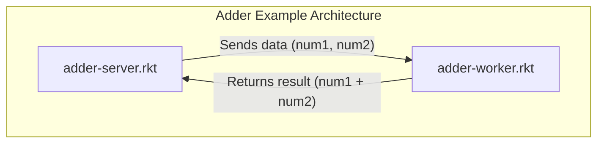
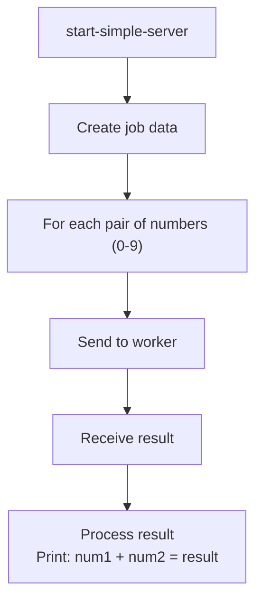
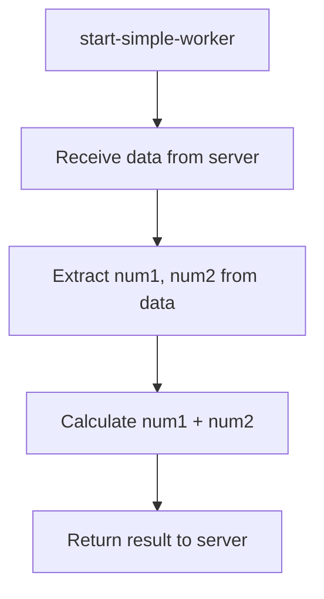
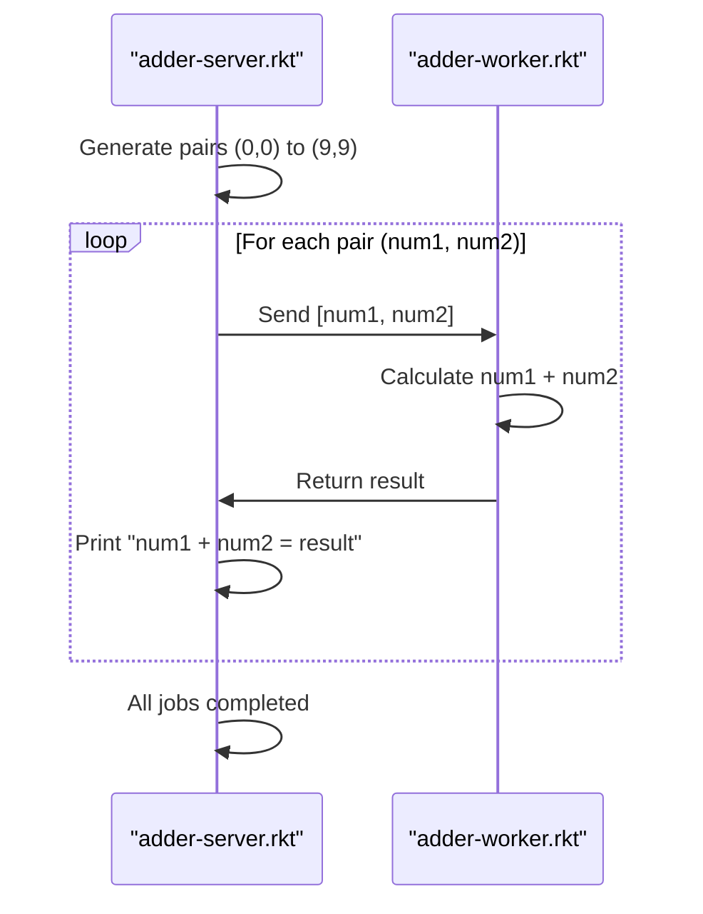
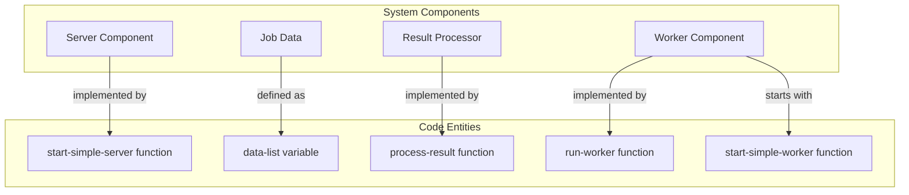

<!-- source: DeepWiki mcp.deepwiki.com · repo google-deepmind/levintreesearch_cm · extra page Adder Example · fetched 2026-10-26 -->

# Adder Example

<details>
<summary>Relevant source files</summary>

The following files were used as context for generating this wiki page:

- [jobsched/examples/adder-server.rkt](jobsched/examples/adder-server.rkt)
- [jobsched/examples/adder-worker.rkt](jobsched/examples/adder-worker.rkt)

</details>


## Purpose and Scope

This document explains the Adder Example, which demonstrates a simple use case of the JobSched job scheduling system. The example implements a basic distributed addition service where the server distributes pairs of numbers and workers compute their sums. This example showcases the simplest possible use of JobSched with minimal setup.

For more comprehensive examples, see [Simple Server-Worker Example](#4.3.1) and [Function Call Example](#4.3.2).

## Overview

The Adder Example consists of two main components:
1. A server that generates pairs of numbers to add
2. A worker that performs the addition and returns the result

This example demonstrates:
- How to set up a simple server-worker architecture
- How to distribute jobs across workers
- How to collect and process results



Sources: [jobsched/examples/adder-server.rkt:1-36](), [jobsched/examples/adder-worker.rkt:1-24]()

## Implementation Details

### Server Component

The server component is defined in `adder-server.rkt`. It:
1. Creates job data consisting of pairs of numbers
2. Defines how to process results
3. Starts a simple server that distributes jobs to workers



Sources: [jobsched/examples/adder-server.rkt:21-35]()

The server generates 100 jobs representing all combinations of pairs of numbers from 0 to 9:

```
data-list = [(0,0), (0,1), ..., (9,8), (9,9)]
```

When a worker returns a result, the server prints the calculation in the format: `num1 + num2 = result`.

### Worker Component

The worker component is defined in `adder-worker.rkt`. It consists of:
1. A function that takes a pair of numbers and returns their sum
2. A worker module setup that processes incoming jobs



Sources: [jobsched/examples/adder-worker.rkt:16-23]()

## Code Breakdown

### Server Code

The server code creates the list of job data using a list comprehension that generates all combinations of numbers from 0 to 9:

```
(define data-list
  (for/list ([num1 (in-range 10)] [num2 (in-range 10)])
    (list num1 num2)))
```

The `process-result` function handles each result:

```
(define (process-result data result)
  (match data
    [(list num1 num2)
     (printf "~a + ~a = ~a\n" num1 num2 result)]))
```

The server is started with the `start-simple-server` function:

```
(start-simple-server #:worker-file worker-file
                     #:data-list data-list
                     #:process-result process-result)
```

Sources: [jobsched/examples/adder-server.rkt:22-35]()

### Worker Code

The worker is extremely simple, consisting of a function that adds two numbers:

```
(define (run-worker data)
  (match data
    [(list num1 num2) (+ num1 num2)]
    [else 0]))
```

The worker module starts a simple worker with this function:

```
(module+ worker
  (require jobsched)
  (start-simple-worker run-worker))
```

Sources: [jobsched/examples/adder-worker.rkt:16-23]()

## Data Flow

The following diagram illustrates the complete data flow in the Adder Example:



Sources: [jobsched/examples/adder-server.rkt:1-36](), [jobsched/examples/adder-worker.rkt:1-24]()

## Code to System Mapping

This diagram maps code entities to system components:



Sources: [jobsched/examples/adder-server.rkt:21-35](), [jobsched/examples/adder-worker.rkt:16-23]()

## Running the Example

To run the Adder Example:

1. Start the server by running `adder-server.rkt`
2. The server will automatically start worker processes
3. The server will distribute pairs of numbers to workers
4. Workers will compute sums and return results
5. The server will print the results

Expected output will be 100 lines in the format:
```
0 + 0 = a0
0 + 1 = 1
...
9 + 8 = 17
9 + 9 = 18
```

## Summary

The Adder Example demonstrates a minimal implementation of JobSched's parallel job processing capabilities. It shows:

1. How to define job data (pairs of numbers)
2. How to implement worker logic (addition)
3. How to process results (printing)
4. How to use the simplified server and worker interfaces

This example serves as a starting point for understanding how JobSched can be used for more complex distributed computation tasks.

Sources: [jobsched/examples/adder-server.rkt:1-36](), [jobsched/examples/adder-worker.rkt:1-24]()

---

