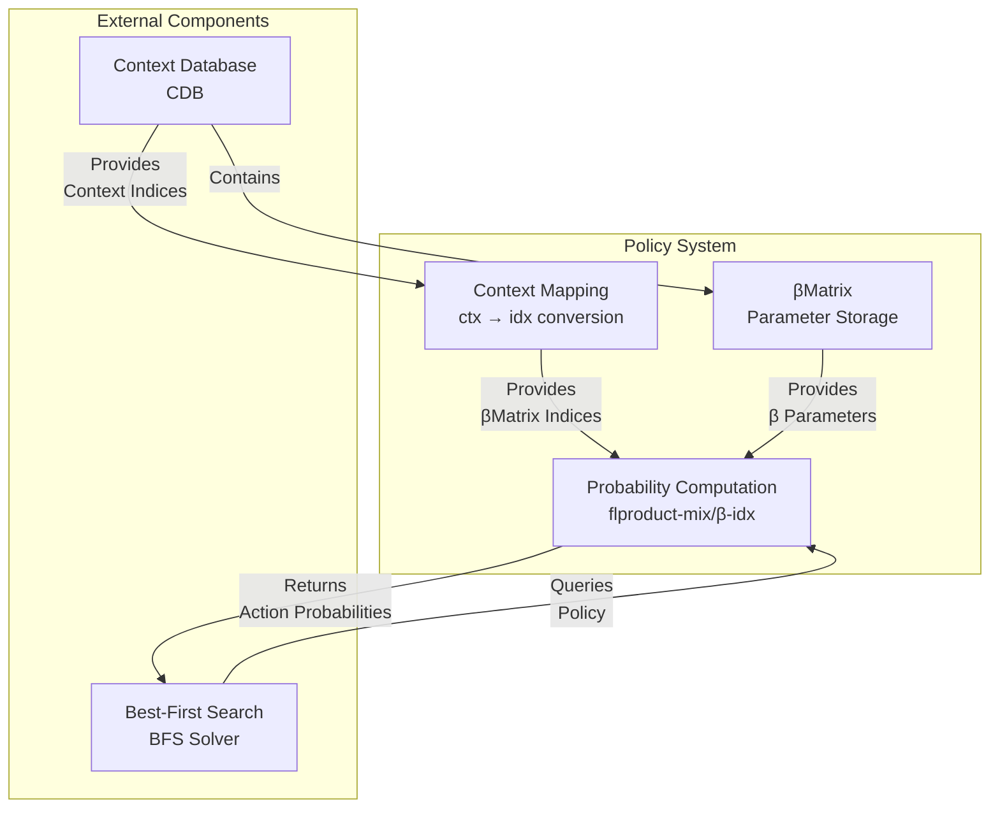
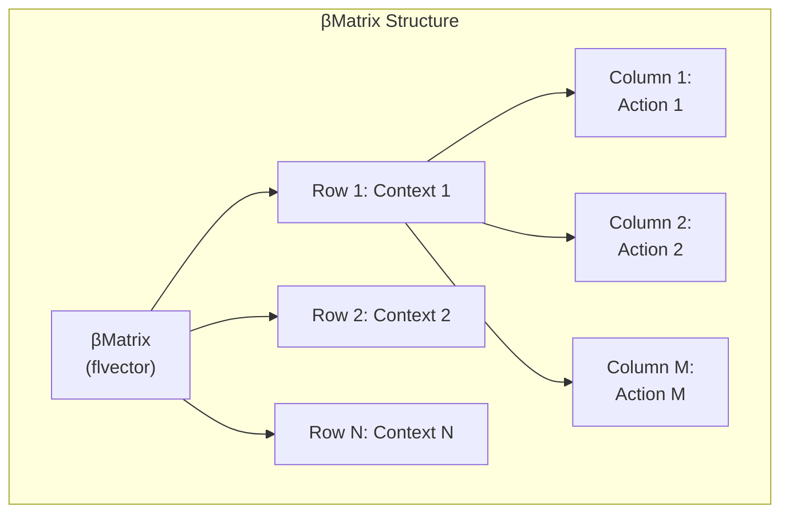
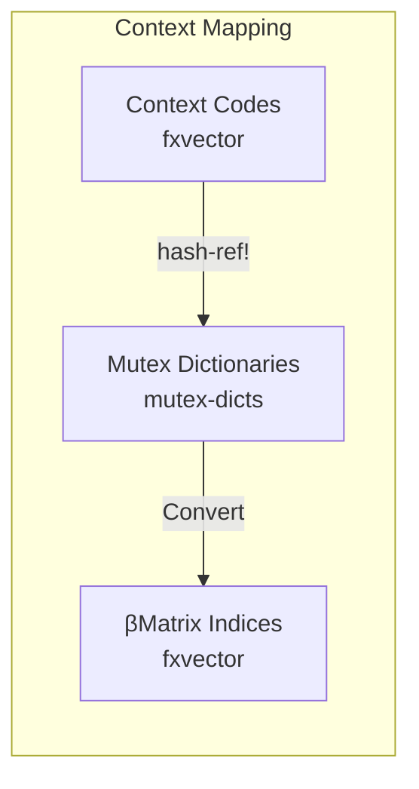
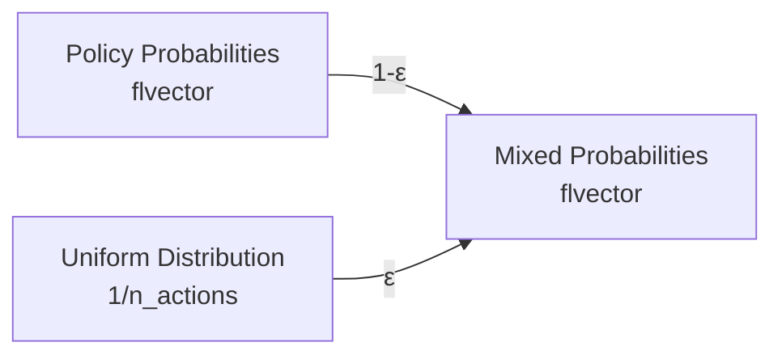
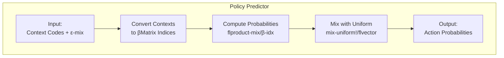
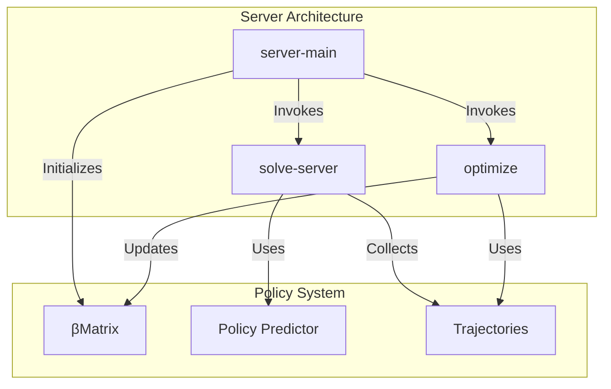

<!-- source: DeepWiki mcp.deepwiki.com · repo google-deepmind/levintreesearch_cm · extra page Policy System · fetched 2026-10-26 -->

# Policy System

<details>
<summary>Relevant source files</summary>

The following files were used as context for generating this wiki page:

- [lts-cm/beta-matrix.rkt](lts-cm/beta-matrix.rkt)
- [lts-cm/policy.rkt](lts-cm/policy.rkt)
- [lts-cm/server.rkt](lts-cm/server.rkt)

</details>


The Policy System is a core component of LTS-CM (Levin Tree Search with Context Models) that handles action probability prediction and optimization. It provides a mechanism for determining which actions are most promising to take in a given state during search, based on learned parameters from previous problem-solving experiences. This page details how policies are represented, stored, computed, and optimized within the LTS-CM framework.

For information about how the policy system interacts with the Context Database, see [Context Database (CDB) System](#2.1.2).

## Policy Architecture

The Policy System consists of three main components that work together to provide action probabilities:

1. **βMatrix**: A parameter storage mechanism that contains learned weights
2. **Context Mapping**: A system for converting context codes to βMatrix indices
3. **Probability Computation**: Functions that calculate action probabilities from β parameters

The diagram below illustrates how these components interact:



Sources: [lts-cm/policy.rkt:1-130](), [lts-cm/beta-matrix.rkt:1-46]()

## Policy Representation

### βMatrix

The βMatrix is the core data structure that stores the learned policy parameters. It is implemented as a dense flvector (vector of floating-point numbers), where each row corresponds to a specific context and each column corresponds to an action.



From the code:
> "The βmatrix is just a long matrix (actually a vector) of all the flonum parameters. Context codes (calculated in collect-contexts) are turned into indices in the βmatrix using a hash (kept in the CDB)."

This design allows for sparse context codes while maintaining a dense parameter matrix for efficient computation.

Sources: [lts-cm/beta-matrix.rkt:27-36]()

### Context Mapping

Context codes are converted to indices in the βMatrix using hash tables stored in the CDB. This mapping is organized by mutex sets, where each mutex set has its own hash table (`mutex-dicts`):



When new contexts are encountered during search, they are added to these hash tables and assigned new rows in the βMatrix.

Sources: [lts-cm/beta-matrix.rkt:55-71](), [lts-cm/beta-matrix.rkt:96-118]()

## Policy Prediction

### Probability Computation

Action probabilities are computed using a product-mixing approach, similar to a softmax function. The primary function for this is `flproduct-mix/β-idx`, which:

1. Takes a set of context indices and the βMatrix
2. Computes the sum of β parameters for each action
3. Applies a softmax transformation to get probabilities
4. Returns a flvector of probabilities, one for each action

This implementation includes numerical stability measures to handle underflow issues:

```
θ'_i = exp(β_i - max_j β_j)
Z = ∑_i θ'_i
θ_i = θ'_i / Z
```

Sources: [lts-cm/policy.rkt:56-91]()

### ε-Mixing

To ensure exploration of all possible actions, the computed probabilities are mixed with a uniform distribution using the parameter `*ε-mix*`. This mixing is implemented by the `mix-uniform!/flvector` function:



The formula used is:
```
p'(a) = ε/n_actions + (1-ε)·p(a)
```

Where:
- p(a) is the original probability of action a
- p'(a) is the mixed probability
- n_actions is the total number of possible actions
- ε is the mixing parameter (*ε-mix*)

Sources: [lts-cm/policy.rkt:122-128](), [lts-cm/policy.rkt:25-35]()

## Policy Optimizer

The policy parameters in the βMatrix are optimized based on the collected trajectories (solution paths). The optimization process involves:

1. Creating trajectories from action and context sequences
2. Extending the CDB with new contexts encountered during search
3. Optimizing the β parameters to minimize log-loss

```mermaid
sequenceDiagram
    participant BFS as BFS Solver
    participant CDB as Context Database
    participant Traj as Trajectory Collection
    participant Opt as Policy Optimizer
    
    BFS->>Traj: Provide act_seq and ctxs_seq
    Traj->>CDB: extend-cdb+trajectories
    CDB-->>Traj: Updated CDB and trajectories
    Traj->>Opt: Provide trajectories
    Opt->>CDB: Update βMatrix parameters
```

### Trajectory Structure

A trajectory represents a solution path and contains:
- `length`: The number of steps in the trajectory
- `act-seq`: A sequence of actions taken
- `idxs-seq`: A sequence of context indices in the βMatrix
- `log-loss`: The loss value for this trajectory

Trajectories are created using the `make-trajectory` function, which converts context codes to βMatrix indices using the context mapping.

Sources: [lts-cm/beta-matrix.rkt:38-71]()

### CDB Extension

When new trajectories are collected, the CDB may need to be extended with new contexts. This is done using the `extend-cdb+trajectories` function, which:
1. Takes the current CDB and action+context sequences
2. Creates trajectories with context indices
3. Extends the βMatrix with new rows for new contexts
4. Returns an updated CDB and the constructed trajectories

Sources: [lts-cm/beta-matrix.rkt:78-141]()

### Prediction Interface

The policy system provides a prediction interface through the `make-cdb-predictor` function, which returns a function that:
1. Takes context codes and an ε-mix parameter
2. Converts context codes to βMatrix indices
3. Computes action probabilities using `flproduct-mix/β-idx`
4. Mixes with the uniform distribution
5. Returns a flvector of probabilities



Sources: [lts-cm/beta-matrix.rkt:143-182]()

## Integration with Server Architecture

The Policy System is integrated with the LTS-CM server architecture, which orchestrates the search and optimization process:



The server performs iterative cycles of:
1. Solving problems using the current policy
2. Collecting trajectories from successful solutions
3. Optimizing the policy based on these trajectories
4. Repeating with the improved policy

This loop continues until all problems are solved or a maximum budget is reached.

Sources: [lts-cm/server.rkt:244-385]()

## Key Parameters

| Parameter | Description | Default | Source |
|-----------|-------------|---------|--------|
| `*ε-mix*` | Controls mixing with uniform distribution | 1.0e-3 | [policy.rkt:30-35]() |
| `*regularizer*` | Regularization factor for optimization | 0.0 | [server.rkt:84]() |
| `*optim-steps*` | Number of optimization steps | 1000 | [server.rkt:73-74]() |

## Performance Considerations

The Policy System includes several optimizations for performance:

1. **Dense βMatrix**: While context codes may be sparse, the βMatrix is dense for efficient computation
2. **Numerical Stability**: The probability computation includes safeguards against numerical underflow
3. **Unsafe Declarations**: The code uses `#:unsafe` declarations for speed, with appropriate caution
4. **Fixed-Length Vectors**: Pre-allocated vectors are used where possible to avoid allocations

Sources: [lts-cm/policy.rkt:23-24](), [lts-cm/policy.rkt:57-91]()

---

