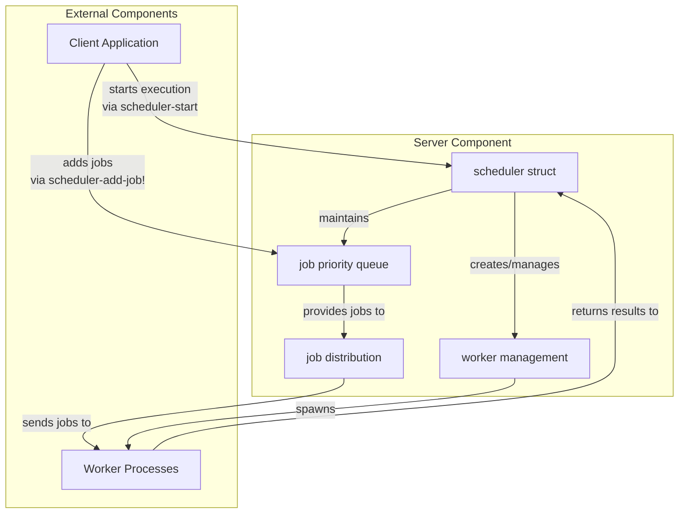
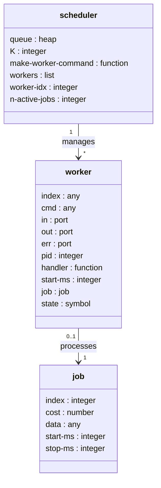
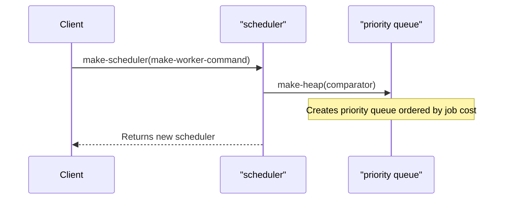
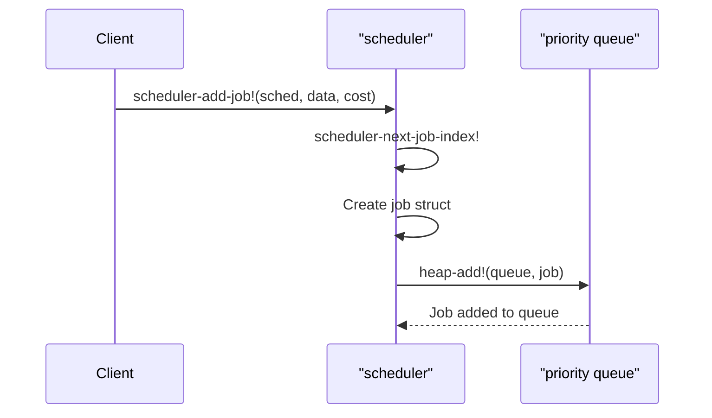
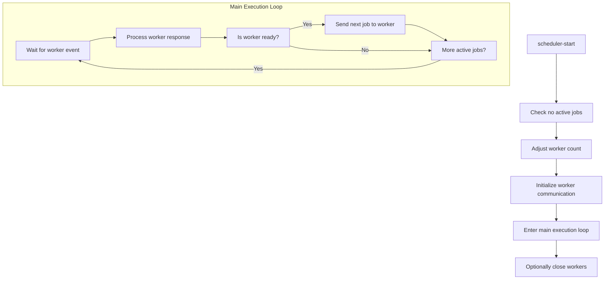
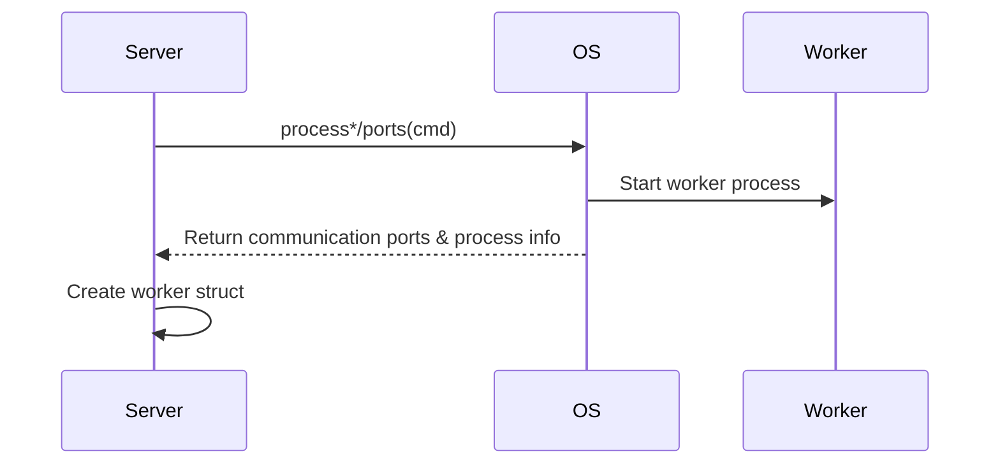
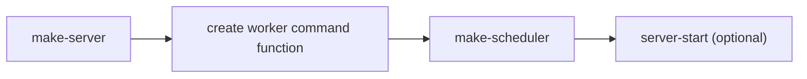
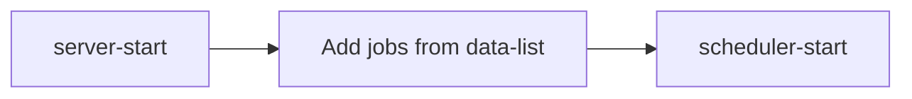
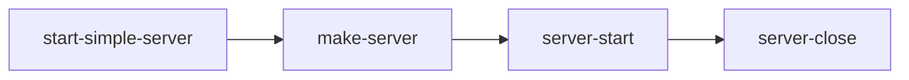
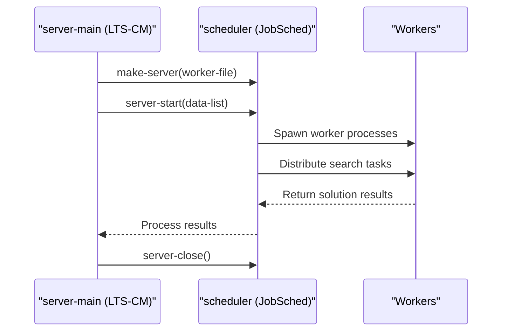

<!-- source: DeepWiki mcp.deepwiki.com · repo google-deepmind/levintreesearch_cm · extra page Server Component · fetched 2026-10-26 -->

# Server Component

Relevant source files

The following files were used as context for generating this wiki page:

- [jobsched/scribblings/jobsched.scrbl](jobsched/scribblings/jobsched.scrbl)
- [jobsched/server.rkt](jobsched/server.rkt)

This document provides a detailed explanation of the Server Component in the JobSched job scheduling system. The Server Component is responsible for managing the job queue, dispatching jobs to workers, and collecting results. For information about the Worker Component, see [Worker Component](#4.1.2).

## Overview

The Server Component is the central coordination mechanism in JobSched's parallel processing framework. It maintains a priority queue of jobs, starts and manages multiple worker processes, distributes jobs to available workers, and collects results when jobs are completed.

Sources: [jobsched/server.rkt:50-98](), [jobsched/scribblings/jobsched.scrbl:21-49]()

## Core Data Structures

### Scheduler Structure

The `scheduler` struct is the main data structure that encapsulates the server component's state:

Sources: [jobsched/server.rkt:51-67](), [jobsched/server.rkt:102-117](), [jobsched/scribblings/jobsched.scrbl:160-174]()

The scheduler struct's fields include:

- `queue`: A priority queue of jobs (implemented with a heap)
- `K`: Number of jobs that have been added
- `make-worker-command`: Function to create the command for starting a worker
- `workers`: List of active worker structures
- `worker-idx`: Index for assigning IDs to new workers
- `n-active-jobs`: Count of currently running jobs

### Worker States

Workers are managed through a state machine with the following states:

| State | Description |
|-------|-------------|
| `state:starting` | Worker process is starting up |
| `state:ready?-sent` | Server sent "ready?" message to worker |
| `state:ready` | Worker is ready to receive jobs |
| `state:running` | Worker is processing a job |
| `state:killed` | Worker has been terminated |
| `state:closing` | Worker is in the process of closing |
| `state:closed` | Worker has closed successfully |

Sources: [jobsched/server.rkt:110-117]()

## Server Operations

### Creating a Scheduler

The server component begins with creating a scheduler using `make-scheduler`, which initializes the scheduler with a job queue and a function to create worker commands:

Sources: [jobsched/server.rkt:60-67]()

### Adding Jobs

Jobs are added to the scheduler's queue using `scheduler-add-job!`, which assigns a unique index to each job and adds it to the priority queue:

Sources: [jobsched/server.rkt:93-98]()

### Starting the Scheduler

The `scheduler-start` function is the main entry point for starting the server operation. It:

1. Verifies there are no active jobs
2. Adjusts the number of workers to match the requested number
3. Initializes communication with workers
4. Enters the main execution loop to process jobs

Sources: [jobsched/server.rkt:183-311]()

#### Main Execution Loop

The server's main execution loop handles three primary cases:

1. **Worker is ready**: When a worker signals it's ready, the server assigns it a job from the queue
2. **Worker completed job**: When a worker returns a job result, the server processes it and marks the worker as ready
3. **Worker terminated**: If a worker unexpectedly terminates, the server requeues its job and starts a new worker

Sources: [jobsched/server.rkt:246-311]()

### Managing Workers

The server creates workers using `start-worker`, which spawns a new OS process for each worker:

Workers can be closed gracefully using `worker-close` or forcibly terminated using `worker-kill`.

Sources: [jobsched/server.rkt:120-158]()

## Higher-Level APIs

The server component provides several higher-level APIs for common use cases:

### make-server

`make-server` creates a scheduler with a specified worker file:

Sources: [jobsched/server.rkt:326-341]()

### server-start

`server-start` provides a simpler interface for starting a scheduler with a list of job data:

Sources: [jobsched/server.rkt:344-354]()

### start-simple-server

`start-simple-server` combines `make-server`, `server-start`, and `server-close` into a single function for the most common use case:

Sources: [jobsched/server.rkt:362-375](), [jobsched/scribblings/jobsched.scrbl:88-112]()

## Communication Protocol

The server component communicates with workers through input/output ports using a message-based protocol:

| Message Type | Direction | Purpose |
|--------------|-----------|---------|
| `message:ask-ready` | Server → Worker | Ask if worker is ready to receive jobs |
| `message:ready` | Worker → Server | Indicate worker is ready for jobs |
| `message:close-worker` | Server → Worker | Instruct worker to close |
| Job data | Server → Worker | Send job to worker for processing |
| Job result | Worker → Server | Return job result to server |

Sources: [jobsched/server.rkt:127-136](), [jobsched/server.rkt:254-288]()

## Integration with LTS-CM

Within the levintreesearch_cm system, the server component is used to distribute search tasks and coordinate optimization:

Sources: [jobsched/scribblings/jobsched.scrbl:177-234]()

## Error Handling and Recovery

The server component includes mechanisms for handling worker failures:

1. If a worker terminates unexpectedly, the server:
   - Detects the EOF on the worker's output port
   - Retrieves the job that was assigned to the worker
   - Returns the job to the queue
   - Starts a new worker process to replace the failed one

Sources: [jobsched/server.rkt:254-265]()

---

