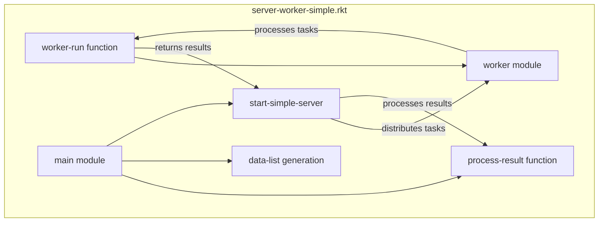
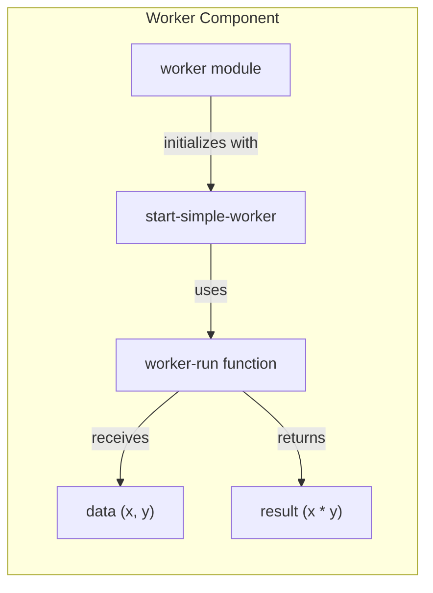
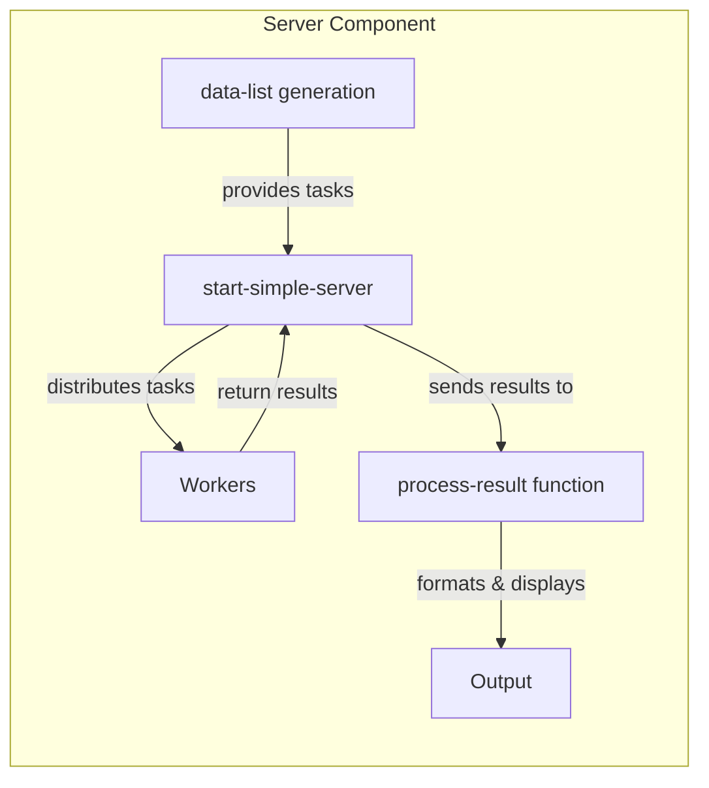
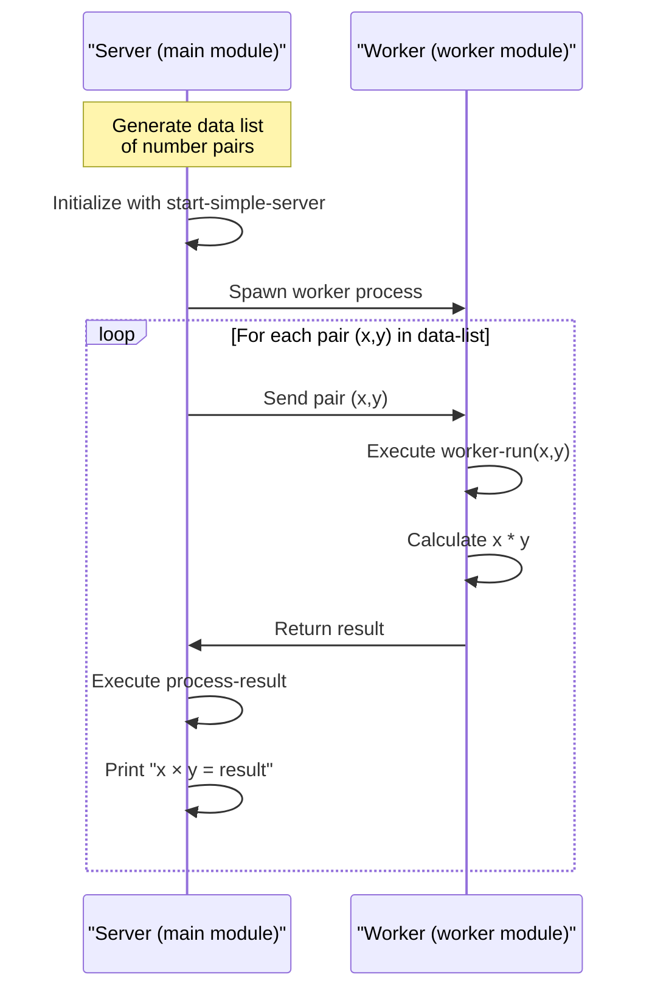

<!-- source: DeepWiki mcp.deepwiki.com · repo google-deepmind/levintreesearch_cm · extra page Simple Server-Worker Example · fetched 2026-10-26 -->

# Simple Server-Worker Example

<details>
<summary>Relevant source files</summary>

The following files were used as context for generating this wiki page:

- [jobsched/examples/server-worker-simple.rkt](jobsched/examples/server-worker-simple.rkt)

</details>


## Purpose and Scope

This document explains the simple server-worker example provided in the JobSched system, which demonstrates the basic usage pattern for distributed job processing. This example shows how to set up a minimal server that distributes multiplication tasks to workers and processes the results. For more advanced usage patterns, see [Function Call Example](#4.3.2) or [Adder Example](#4.3.3).

## Overview

The simple server-worker example demonstrates a minimal implementation of the JobSched framework, showcasing how to:

1. Define a worker function that processes data
2. Configure a worker to execute that function
3. Create a server that distributes tasks to workers
4. Process results returned from workers

This example multiplies pairs of numbers in parallel, demonstrating the fundamental pattern of distributed computation in JobSched.

Sources: [jobsched/examples/server-worker-simple.rkt:1-28]()

## Example Structure

The example is contained in a single file that defines both server and worker components:



The file is structured to define both the worker logic and server logic in a single file, making it self-contained and easy to understand.

Sources: [jobsched/examples/server-worker-simple.rkt:1-28]()

## Worker Component

The worker component consists of:

1. A worker function that processes data
2. A worker module that initializes the worker



### Worker Function

The worker function `worker-run` receives a data list containing two numbers and returns their product:

Sources: [jobsched/examples/server-worker-simple.rkt:6-9]()

### Worker Module

The worker module simply initializes a worker using the `start-simple-worker` function, passing the `worker-run` function to be executed for each task:

Sources: [jobsched/examples/server-worker-simple.rkt:11-12]()

## Server Component

The server component consists of:

1. A `process-result` function that handles the results from workers
2. A data list that defines the tasks to be distributed
3. A server configuration using `start-simple-server`



### Process Result Function

The `process-result` function formats and displays the multiplication result:

Sources: [jobsched/examples/server-worker-simple.rkt:18-19]()

### Data List Generation

The example generates all pairs of numbers (x, y) where x and y both range from 0 to 4:

Sources: [jobsched/examples/server-worker-simple.rkt:21-22]()

### Server Configuration

The server is initialized with:
- The current file as the worker file
- The generated data list
- The process-result function

Sources: [jobsched/examples/server-worker-simple.rkt:24-27]()

## Execution Flow

The following diagram illustrates the execution flow when running this example:



Sources: [jobsched/examples/server-worker-simple.rkt:1-28]()

## Running the Example

To run this example:

1. Execute the file as a Racket program
2. The server will start and spawn a worker process
3. The worker will calculate the product of each pair of numbers
4. The server will print the results as they are completed

## Expected Output

When running this example, you should see output similar to:

```
0 × 0 = 0
0 × 1 = 0
0 × 2 = 0
0 × 3 = 0
0 × 4 = 0
1 × 0 = 0
1 × 1 = 1
...
4 × 3 = 12
4 × 4 = 16
```

Note that the actual order of output may vary since tasks are processed in parallel.

## Key Concepts

This example demonstrates several key concepts in JobSched:

| Concept | Implementation | Purpose |
|---------|---------------|---------|
| Worker Function | `worker-run` | Defines the computation to be performed on each data item |
| Worker Initialization | `start-simple-worker` | Sets up a worker process to execute the worker function |
| Data Distribution | `data-list` | Defines the set of tasks to be distributed to workers |
| Result Processing | `process-result` | Handles the results returned from workers |
| Server Configuration | `start-simple-server` | Initializes the server with worker file, data, and result processing |

This simple pattern forms the foundation for more complex distributed computation systems built with JobSched.

Sources: [jobsched/examples/server-worker-simple.rkt:1-28]()

---

