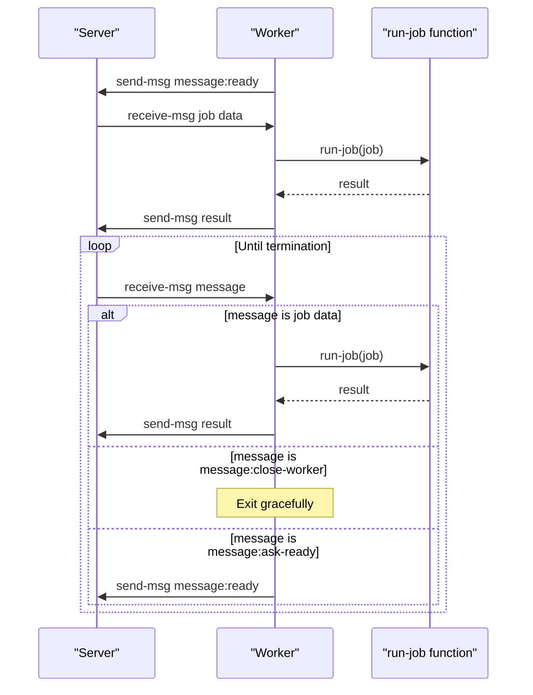
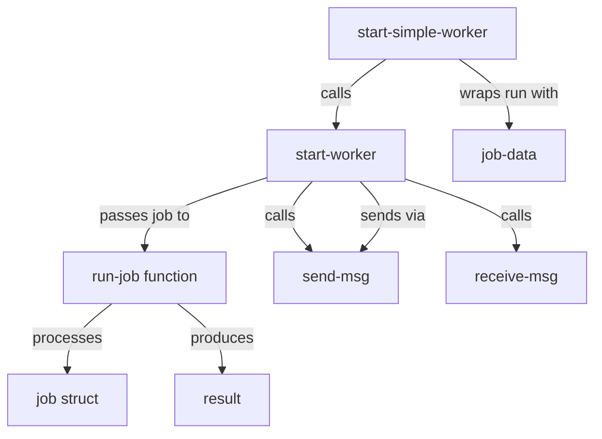
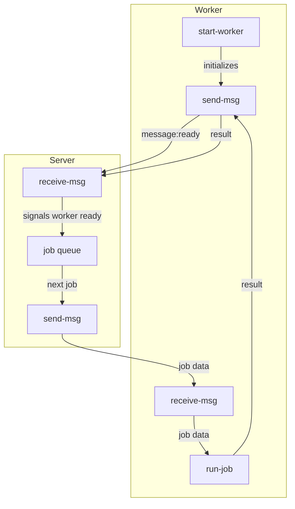
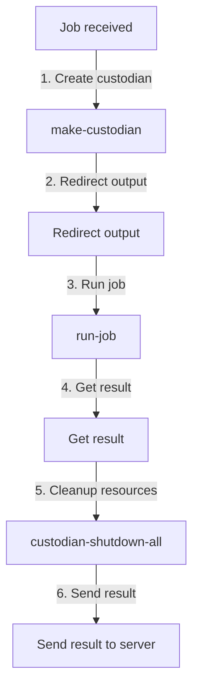

<!-- source: DeepWiki mcp.deepwiki.com · repo google-deepmind/levintreesearch_cm · extra page Worker Component · fetched 2026-10-26 -->

# Worker Component

<details>
<summary>Relevant source files</summary>

The following files were used as context for generating this wiki page:

- [jobsched/scribblings/jobsched.scrbl](jobsched/scribblings/jobsched.scrbl)
- [jobsched/worker.rkt](jobsched/worker.rkt)

</details>


This document covers the Worker Component of the JobSched job scheduling system. The Worker Component executes jobs dispatched by the scheduler server in independent Racket processes, enabling true parallelism across multiple CPU cores. For information about the server that distributes jobs to workers, see [Server Component](#4.1.1).

## Worker Lifecycle

The worker follows a specific lifecycle from startup to termination:



The worker:
1. Signals readiness to the server
2. Enters a message processing loop
3. Processes jobs using the provided function
4. Sends results back to the server
5. Exits when instructed by the server

Sources: [jobsched/worker.rkt:35-71]()

## Worker API

The Worker Component provides two main functions for starting workers:

### start-worker

The `start-worker` function is the primary way to start a worker. It takes a function that processes a job and returns a result.



Function signature:
```
(start-worker run-job #:silent? [silent? #f])
```

Parameters:
- `run-job`: A function that takes a job struct and returns a readable value
- `silent?`: Boolean flag that controls whether worker output is suppressed

The function:
1. Signals readiness to the server with `send-msg message:ready`
2. Enters a message processing loop
3. For each job received, creates a custodian to manage resources
4. Calls the provided `run-job` function with the job
5. Sends the result back to the server
6. Continues until a termination message is received

Sources: [jobsched/worker.rkt:35-71]()

### start-simple-worker

The `start-simple-worker` function is a simplified wrapper around `start-worker`. It takes a function that only needs the job data, rather than the entire job struct.

Function signature:
```
(start-simple-worker run #:silent? [silent? #f])
```

Parameters:
- `run`: A function that takes the job data (not the full job struct) and returns a readable value
- `silent?`: Boolean flag that controls whether worker output is suppressed

Implementation details: This function wraps the provided `run` function to extract the job data using `job-data` before passing it to `run`.

Sources: [jobsched/worker.rkt:73-74]()

## Worker-Server Communication

Workers communicate with the server using a message protocol:



The key messages in this protocol are:

| Message | Description | Direction |
|---------|-------------|-----------|
| `message:ready` | Worker signals readiness to receive a job | Worker → Server |
| `message:close-worker` | Server signals the worker to terminate | Server → Worker |
| `message:ask-ready` | Server asks if the worker is ready | Server → Worker |
| Job data | Data for a job to be processed | Server → Worker |
| Result | Result of job processing | Worker → Server |

Sources: [jobsched/worker.rkt:35-71]()

## Worker Execution Environment

When processing a job, the worker creates a controlled execution environment using a custodian:



This ensures that:
1. All resources (like open files) are properly tracked
2. Output is redirected to avoid interference with server communication
3. All resources are cleaned up after job processing, preventing leaks

The actual implementation uses parameterization to set up this execution environment:

```
(define cust (make-custodian))
(define res
  (parameterize ([current-custodian cust]
                [current-output-port (if silent?
                                         (open-output-nowhere)
                                         (current-error-port))])
    (run-job nd)))
(custodian-shutdown-all cust)
```

Sources: [jobsched/worker.rkt:58-69]()

## Important Implementation Notes

When using the Worker Component, keep in mind:

1. **Communication Constraints**: The worker uses standard input/output ports for communication with the server. Any output before calling `start-worker` may interfere with this communication.

2. **Return Value Requirements**: The `run-job` function must return a value that can be serialized (readable?). Note that `(void)` is not a readable value.

3. **Resource Management**: The worker uses a custodian to manage resources, but your code should still properly close any resources it opens.

4. **Output Handling**: Use the `silent?` parameter if you want to suppress worker output during job processing.

Sources: [jobsched/scribblings/jobsched.scrbl:243-260]()

## Usage Example

Workers are typically used in conjunction with a server. A simple worker implementation looks like:

```
#lang racket
(require jobsched)

(define (process-data data)
  ;; Process the job data and return a result
  (+ data 1))

(module+ worker
  (start-simple-worker process-data))
```

The worker function receives job data from the server, processes it, and returns a result. The server then handles that result according to its implementation.

Sources: [jobsched/scribblings/jobsched.scrbl:63-69]()

---

