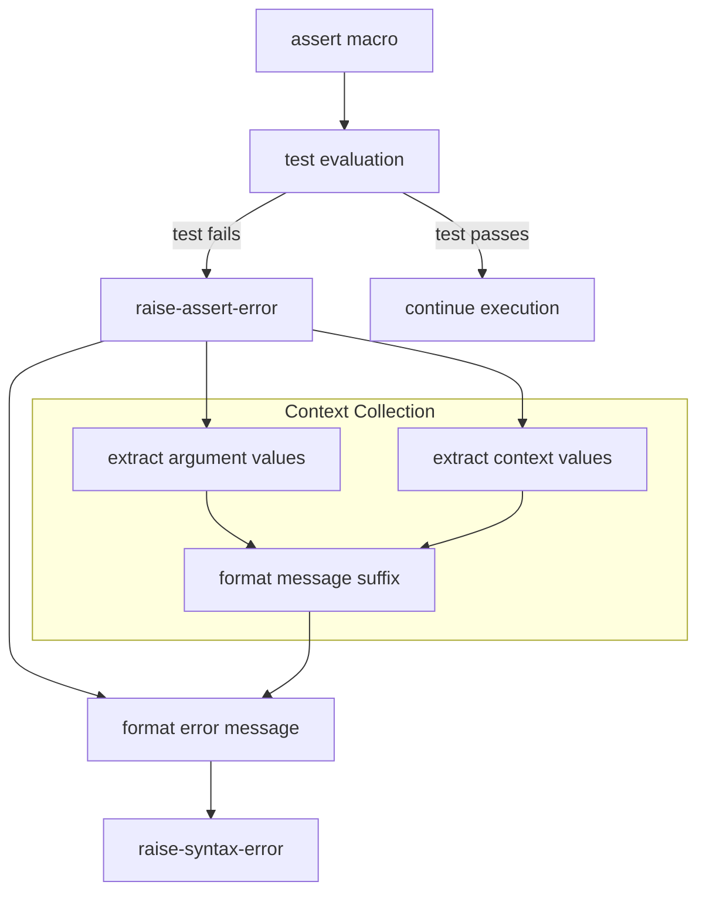
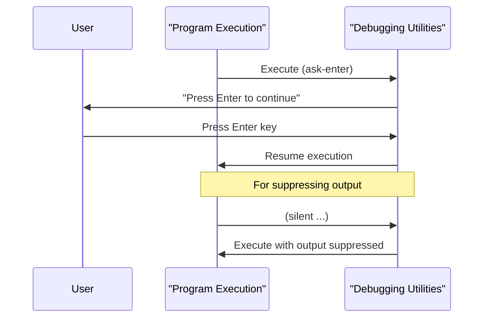
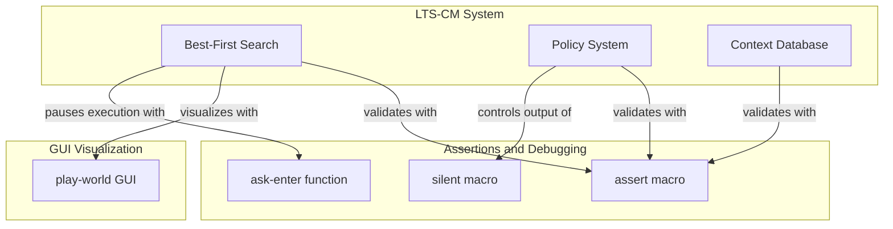

<!-- source: DeepWiki mcp.deepwiki.com · repo google-deepmind/levintreesearch_cm · extra page Assertions and Debugging · fetched 2026-10-26 -->

# Assertions and Debugging

<details>
<summary>Relevant source files</summary>

The following files were used as context for generating this wiki page:

- [lts-cm/gui.rkt](lts-cm/gui.rkt)
- [lts-cm/misc.rkt](lts-cm/misc.rkt)

</details>


This page documents the assertion and debugging utilities provided in the LTS-CM system. These utilities include a sophisticated assertion system that provides detailed error messages with contextual information, as well as tools for controlling output during debugging sessions. For information about GUI-based visualization, see [GUI and Visualization](#2.3.1).

## Assertion System

The LTS-CM system includes a powerful assertion framework that goes beyond standard assertions by automatically capturing and displaying contextual information when assertions fail.

### Core Components



The assertion system is composed of several key components:

1. **`assert` macro** ([lts-cm/misc.rkt:85-96]()):
   - Provides a convenient syntax for checking conditions
   - Automatically captures argument values for better error reporting
   - Supports additional context values to be displayed on failure

2. **`raise-assert-error` function** ([lts-cm/misc.rkt:40-59]()):
   - Formats detailed error messages
   - Includes values of arguments and context variables
   - Produces error messages with proper syntax location information

Sources: [lts-cm/misc.rkt:40-96]()

### Assertion Syntax and Features

The `assert` macro has two primary forms:

```mermaid
classDiagram
    class "assert macro" {
        Primary Forms
    }
    
    "assert macro" --> "Procedure Call Form"
    "assert macro" --> "Expression Form"
    
    class "Procedure Call Form" {
        (assert (op arg1 arg2 ...))
        Shows arg values automatically
    }
    
    class "Expression Form" {
        (assert test-expr)
        No automatic arg display
    }
    
    "Procedure Call Form" --> "Context Variables"
    "Expression Form" --> "Context Variables"
    
    class "Context Variables" {
        Add with variable identifiers
        Add with #:with syntax
    }
```

Key features of the assertion system include:

1. **Automatic argument value display**: When using the procedure call form `(assert (op arg1 arg2))`, the values of arguments are automatically captured and displayed if the assertion fails.

2. **Avoiding automatic display**: To avoid displaying certain values, you can wrap expressions with `or`: `(assert (or (equal? obj1 obj2)))`.

3. **Context variables**: Additional context information can be provided after the test expression:
   ```
   (assert (= x y) z #:with calculated-value (+ x y))
   ```

4. **Detailed error messages**: The error messages include argument values and context values, making it easier to diagnose failures.

Sources: [lts-cm/misc.rkt:77-96](), [lts-cm/misc.rkt:112-133]()

## Debugging Utilities

The LTS-CM system provides several utilities to aid in debugging:

### Output Control

The `silent` macro ([lts-cm/misc.rkt:136-137]()) suppresses all output to the current output port while running its body forms. This is useful for running noisy operations during debugging without cluttering the console output. Error output is still displayed as it uses a separate error port.

### Interactive Debugging

The `ask-enter` function ([lts-cm/misc.rkt:139-142]()) displays a prompt and waits for the user to press Enter. This is particularly useful for creating pause points during debugging or for step-by-step execution in complex operations.



Sources: [lts-cm/misc.rkt:136-142]()

## Integration with LTS-CM System

The assertion and debugging utilities are integrated into the broader LTS-CM system, particularly for verifying algorithm correctness and debugging complex search operations.



The assert macro is heavily used throughout the codebase to validate:

1. Parameter constraints
2. Algorithm invariants
3. Data structure integrity
4. Result correctness

Sources: [lts-cm/misc.rkt:77-96](), [lts-cm/gui.rkt:35-181]()

## Example Usage Patterns

### Assertion Examples

Here are some common patterns for using assertions in the LTS-CM codebase:

1. **Simple condition checking**:
   ```racket
   (assert (= x y))
   ```

2. **Procedure arguments validation**:
   ```racket
   (assert (< index (vector-length v)))
   ```

3. **Complex condition with context**:
   ```racket
   (assert (valid-state? state) 
           #:with depth current-depth
           #:with parent parent-state)
   ```

### Debugging Workflow

A typical debugging workflow in the LTS-CM system might involve:

1. Adding assertions at key points to verify invariants
2. Using `ask-enter` to create breakpoints for interactive inspection
3. Using `silent` to suppress noisy output from tested components
4. If needed, using visualization tools from the GUI system for state inspection

Sources: [lts-cm/misc.rkt:98-133]()

## Best Practices

When using the assertion and debugging utilities in the LTS-CM system, consider these best practices:

1. **Use appropriate assertion form**:
   - Use procedure call form (`(assert (= x y))`) when argument values are useful
   - Use expression form (`(assert (or (complex-condition)))`) when values are unnecessary or expensive to compute

2. **Provide meaningful context**:
   - Add context variables that help diagnose the root cause of failures
   - Consider using `#:with` to include calculated values that might be relevant

3. **Strategic output control**:
   - Use `silent` for operations with noisy output
   - Place `ask-enter` calls strategically to inspect state at critical points

4. **Combine with other debugging tools**:
   - Use the assertion system alongside the visualization tools from the GUI subsystem
   - Consider logging critical information for post-mortem debugging

Sources: [lts-cm/misc.rkt:77-133]()

---

