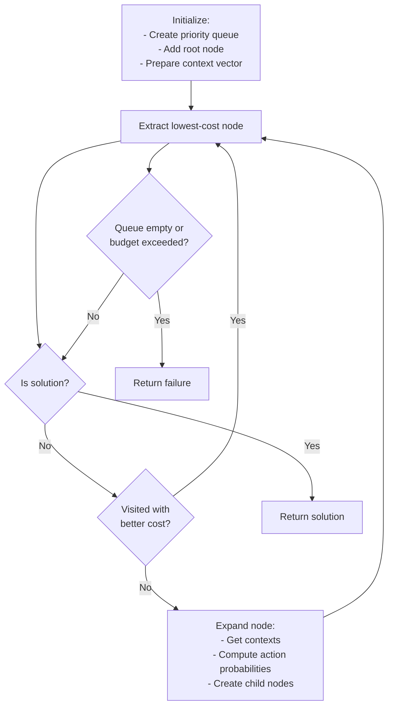
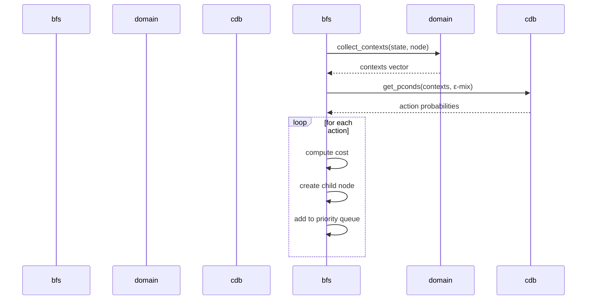
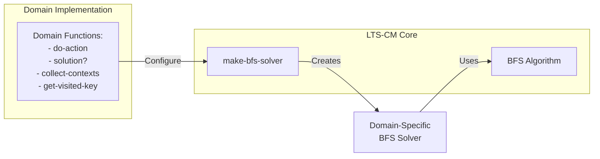
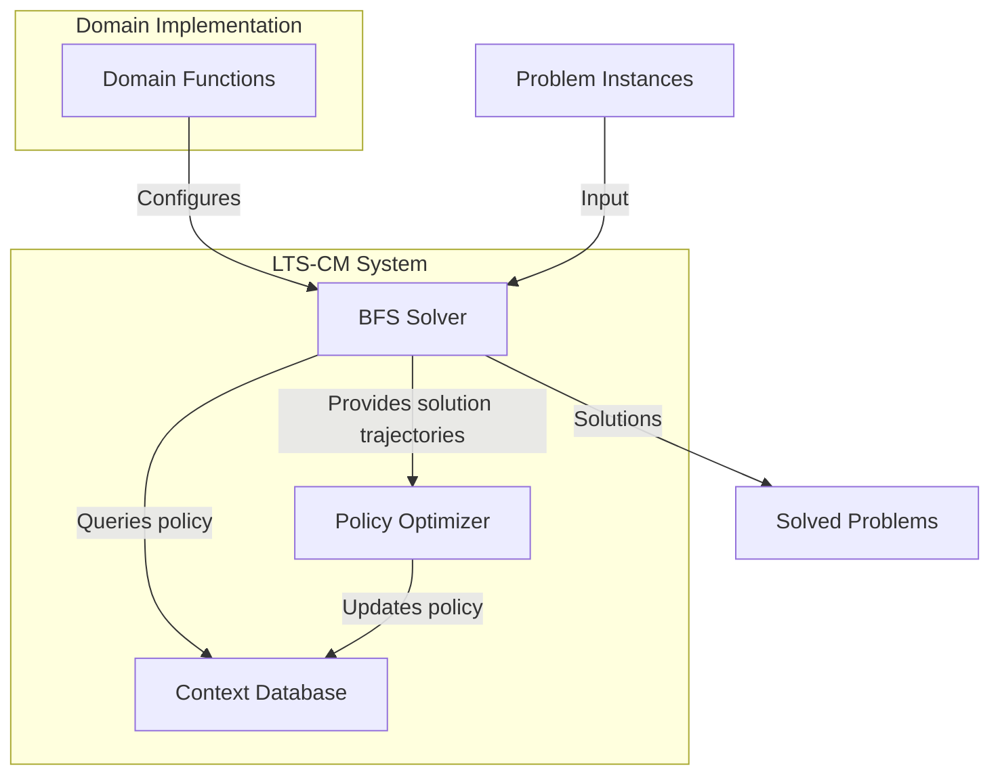

<!-- source: DeepWiki mcp.deepwiki.com · repo google-deepmind/levintreesearch_cm · extra page Best-First Search Algorithm · fetched 2026-10-26 -->

# Best-First Search Algorithm

<details>
<summary>Relevant source files</summary>

The following files were used as context for generating this wiki page:

- [lts-cm/bfs.rkt](lts-cm/bfs.rkt)

</details>


This document describes the Best-First Search (BFS) algorithm implementation in the Levin Tree Search with Context Models (LTS-CM) system. The BFS algorithm serves as the core search mechanism that explores state spaces to find solutions to problem instances, guided by a learned policy.

For information about the Context Database that stores policy parameters, see [Context Database (CDB) System](#2.1.2). For details about how policies are represented and optimized, see [Policy System](#2.1.3).

## Purpose and Scope

The Best-First Search algorithm implementation provides:

1. A flexible search algorithm that prioritizes states based on a cost function
2. Integration with the Context Database to leverage learned policies
3. Support for transposition tables to avoid redundant exploration
4. A framework for collecting contexts during search for later policy optimization
5. A domain-independent interface that can be configured for specific problem domains

Sources: [lts-cm/bfs.rkt:16-32]()

## BFS Algorithm Core Concepts

### Search Node Structure

The BFS algorithm uses a node structure (`bfs-node`) to represent states in the search space. Each node contains:

- `depth`: The number of actions taken to reach this state
- `ln1/π`: The log of the inverse probability of reaching this state
- `act-seq`: The sequence of actions taken to reach this state (in reverse order)
- `state`: The domain state
- `cost`: The computed cost of the node, used for priority queue ordering

**BFS Node Structure Diagram**

```mermaid
classDiagram
    class "bfs-node" {
        depth: fixnum
        ln1/π: flonum
        act-seq: list
        state: any/c
        cost: flonum
    }
    note for "bfs-node" "The central data structure for BFS.\nStores search state and metadata."
```

Sources: [lts-cm/bfs.rkt:45-54]()

### Cost Function

The default cost function used by the BFS algorithm is:

```
cost = log(depth) + ln1/π
```

This cost function balances exploration (depth) with exploitation (probability). Lower cost values are prioritized during search, meaning the algorithm prefers nodes that are likely to lead to a solution based on the learned policy.

Sources: [lts-cm/bfs.rkt:38-39]()

## Search Algorithm Implementation

The core of the BFS implementation is the `best-first-search` function, which performs the following steps:

1. Create a root node and add it to a priority queue
2. While the queue is not empty and within budget:
   - Extract the node with lowest cost
   - Check if it's a solution
   - Check if it's already been visited with a better cost
   - If not, expand the node by generating all possible next states
   - Add new nodes to the priority queue

**BFS Algorithm Flow**



Sources: [lts-cm/bfs.rkt:137-273]()

### Transposition Table

The BFS algorithm uses a transposition table to avoid redundant exploration of states. When `get-visited-key` is provided, the algorithm checks if a state has been visited before and only expands it if:

1. The state has not been visited before, or
2. The current path to the state has a lower cost than previously found paths

This optimization significantly reduces the search space for domains with many paths to the same state.

Sources: [lts-cm/bfs.rkt:176-194]()

### Context Collection and Policy Integration

During search, the algorithm:

1. Collects contexts from each state using the domain-specific `collect-contexts` function
2. Queries the Context Database for action probabilities based on these contexts
3. Uses these probabilities to compute node costs and guide the search

This integration between search and policy allows the algorithm to leverage learned knowledge to find solutions more efficiently.

**Context and Policy Integration Diagram**



Sources: [lts-cm/bfs.rkt:245-269]()

## Result Handling and Replay

When a solution is found or search terminates, the algorithm returns a result dictionary containing:

- `status`: 'SOLVED', 'budget', or false (if no solution found)
- `time-ms`: Search time in milliseconds
- `generations`: Number of nodes generated
- `expansions`: Number of nodes expanded
- `act-seq`: Solution action sequence (if found)
- `pcond-seq`: Probability for each action in the solution
- `ctxs-seq`: Contexts for each state in the solution
- `len`: Length of the solution

For solutions, the algorithm uses `replay-actions` to efficiently reconstruct the contexts and probabilities along the solution path without storing them during the search.

Sources: [lts-cm/bfs.rkt:66-109](), [lts-cm/bfs.rkt:201-222]()

## Domain-Specific Solver Creation

The `make-bfs-solver` function creates a domain-specific solver by configuring the BFS algorithm with domain-specific functions:

- `n-actions`: Number of possible actions in the domain
- `collect-contexts`: Function to extract contexts from a state
- `get-visited-key`: Function to compute a key for the transposition table
- `solution?`: Function to check if a state is a solution
- `do-action`: Function to apply an action to a state

**Domain-Specific Solver Configuration**



Sources: [lts-cm/bfs.rkt:276-296]()

## Integration with LTS-CM System

The BFS algorithm is a key component in the LTS-CM system's problem-solving pipeline:

1. The LTS-CM server creates domain-specific solvers using `make-bfs-solver`
2. These solvers use the current policy stored in the Context Database to guide search
3. Solutions found by BFS provide trajectories for policy optimization
4. Improved policies then make future searches more efficient

**BFS in LTS-CM System**



Sources: [lts-cm/bfs.rkt:20-25]()

## Key Implementation Details

### Priority Queue

The BFS algorithm uses a priority queue implemented as a binary heap to efficiently extract the node with the lowest cost at each step. Nodes are ordered by their `cost` value, which is computed using the cost function.

Sources: [lts-cm/bfs.rkt:151-153](), [lts-cm/bfs.rkt:122-124]()

### Exploration Control

The algorithm includes a budget parameter that limits the number of node expansions, preventing excessive resource usage on hard problems. When the budget is exceeded, the search terminates with a 'budget' status.

Sources: [lts-cm/bfs.rkt:146-147](), [lts-cm/bfs.rkt:228-230]()

### ε-Mixing

The algorithm supports ε-mixing, which adds a small probability to each action to prevent the policy from becoming too deterministic. This helps with exploration during learning.

Sources: [lts-cm/bfs.rkt:77](), [lts-cm/bfs.rkt:147](), [lts-cm/bfs.rkt:287]()

## Conclusion

The Best-First Search algorithm provides a flexible and efficient search mechanism for the LTS-CM system. By integrating with the Context Database and leveraging learned policies, it can efficiently find solutions to problem instances across various domains. The algorithm's ability to collect contexts during search also forms a crucial part of the learning loop in LTS-CM.

---

