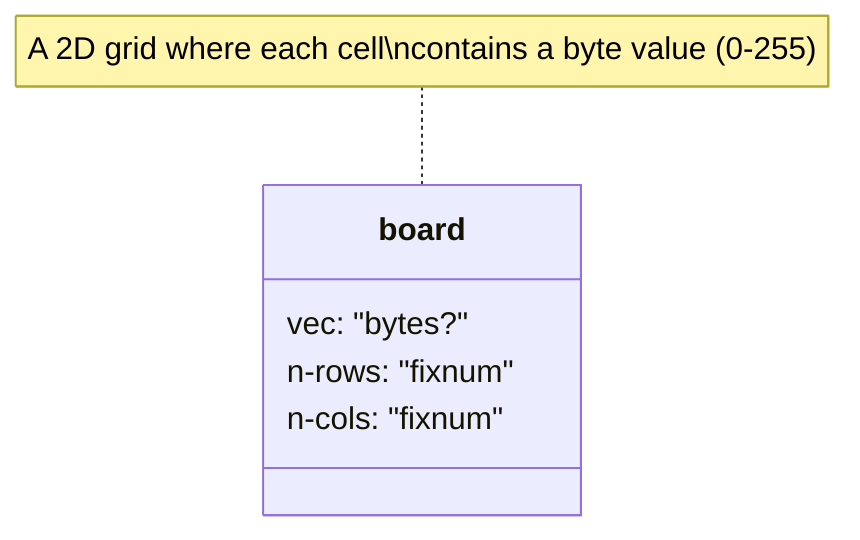
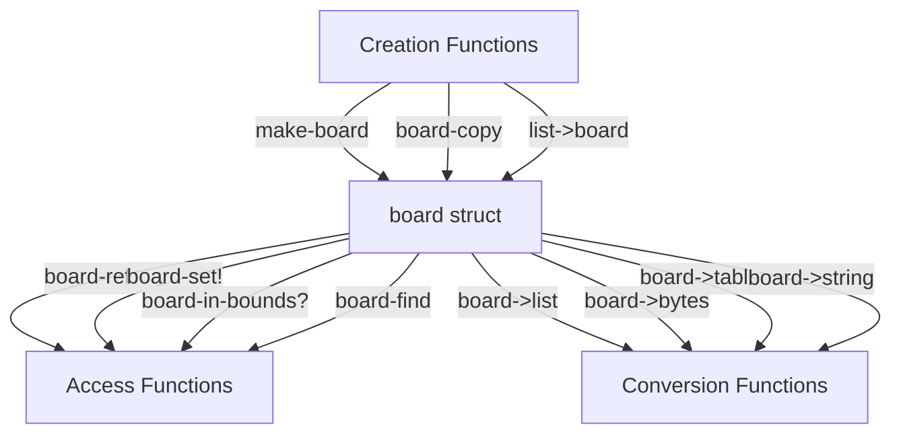
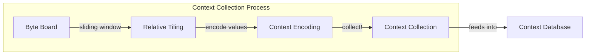
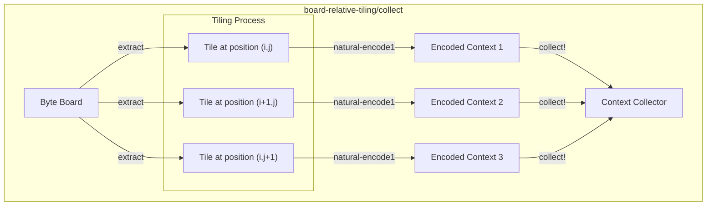
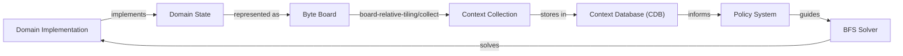

<!-- source: DeepWiki mcp.deepwiki.com · repo google-deepmind/levintreesearch_cm · extra page Byte Board and Context Collection · fetched 2026-10-26 -->

# Byte Board and Context Collection

Relevant source files

The following files were used as context for generating this wiki page:

- [lts-cm/byte-board.rkt](lts-cm/byte-board.rkt)
- [lts-cm/collector.rkt](lts-cm/collector.rkt)

This page documents the Byte Board data structure and the Context Collection mechanism in the LTS-CM system. These components work together to represent domain states as efficient 2D grids and extract features from these states for use in the policy system.

For information about how these features are used in the policy system, see [Policy System](#2.1.3).

## Byte Board

The Byte Board is a memory-efficient two-dimensional grid data structure where each cell holds a byte value (0-255). It provides a standardized way to represent states for various domains while enabling efficient processing and feature extraction.

### Structure and Implementation

The `board` struct is defined in [lts-cm/byte-board.rkt:33-34]() and contains three fields:
- `vec`: A byte string containing the raw data
- `n-rows`: Number of rows in the board
- `n-cols`: Number of columns in the board

Sources: [lts-cm/byte-board.rkt:29-34]()

### Core Operations

#### Creation and Access

The Byte Board system provides several key functions:

| Function | Description |
|----------|-------------|
| `make-board` | Creates a new board with specified dimensions and initial value |
| `board-copy` | Creates a deep copy of a board |
| `board-ref` | Gets the value of a cell at specified coordinates |
| `board-set!` | Sets the value of a cell at specified coordinates |
| `board-in-bounds?` | Checks if coordinates are within the board boundaries |
| `board-find` | Finds the coordinates of a specific value in the board |
| `list->board` | Converts a list to a board |
| `board->list` | Converts a board to a list |
| `board->bytes` | Extracts the raw byte string |
| `board->table` | Converts a board to a 2D list |
| `board->string` | Converts a board to a string representation |

Sources: [lts-cm/byte-board.rkt:47-94]()

## Context Collection

Context Collection is the process of extracting features from board states, encoding them as fixed-size integers (fixnums), and collecting them for use in learning and policy optimization. The encoded contexts serve as feature representations that the LTS-CM system uses to learn patterns and make decisions.

### Concepts and Purpose

In LTS-CM, "contexts" are encoded features extracted from problem states. These contexts are used to learn patterns and optimize search strategies. Each context represents a local pattern in the board state.

Sources: [lts-cm/byte-board.rkt:99-102](), [lts-cm/collector.rkt:23-42]()

### Relative Tiling Mechanism

The core of context collection is the `board-relative-tiling/collect` function defined in [lts-cm/byte-board.rkt:118-143](), which:

1. Takes a board and a collection function (`collect!`)
2. Creates rectangular "tiles" of the board, centered around a specified position
3. For each tile, computes an encoded value based on the values of the cells
4. Passes this encoded value to the collection function

Key parameters for the relative tiling function:
- `row0`, `col0`: Center position for the tiling
- `row-dist`, `col-dist`: Maximum distance from center for tile placement
- `row-span`, `col-span`: Size of each rectangular tile
- `max-value`: Maximum value that a cell can have (default: 255)
- `pad-value`: Value assigned to cells outside the board (default: max-value)

Sources: [lts-cm/byte-board.rkt:103-143]()

### Collector Implementations

The system provides several collector implementations in [lts-cm/collector.rkt]():

| Collector | Description |
|-----------|-------------|
| `make-list-collector` | Creates a simple collector that returns a list of contexts |
| `make-fxvector-collector` | Stores contexts in a provided fixed-size vector |
| `make-fxvector-collector/auto` | Automatically creates and manages a vector for contexts |

These collectors can be passed to the `board-relative-tiling/collect` function to gather the encoded contexts in different ways depending on the needs of the domain or application.

Sources: [lts-cm/collector.rkt:44-70]()

## Integration with LTS-CM

The Byte Board and Context Collection system integrates with the broader LTS-CM framework as follows:

1. **Domain to Byte Board**: Problem domains represent their states as byte boards, providing a standardized way to process different types of problems.

2. **Byte Board to Contexts**: The context collection system extracts features from these byte boards, converting spatial patterns into encoded contexts.

3. **Contexts to Policy**: These contexts are stored in the Context Database (CDB) and used to inform the policy system, which guides the BFS solver.

4. **Learning Loop**: As the BFS solver explores problem spaces, new contexts are collected, enabling continuous learning and optimization.

Sources: [lts-cm/byte-board.rkt](), [lts-cm/collector.rkt]()

## Encoding Limitations

When designing context encodings, it's important to ensure that the encoded values fit within a fixnum (fixed-size integer). The encoding function `natural-encode1` combines multiple cell values into a single number, which has limitations based on the size of the tile and the maximum value of cells.

For example:
- A 3×2 tile with max-value 5 fits within a fixnum: (5+1)^(3×2) < most-positive-fixnum
- A 5×5 tile with max-value 5 exceeds fixnum capacity: (5+1)^(5×5) > most-positive-fixnum

This limitation must be considered when implementing domain-specific context collection logic.

Sources: [lts-cm/collector.rkt:23-42]()

---

