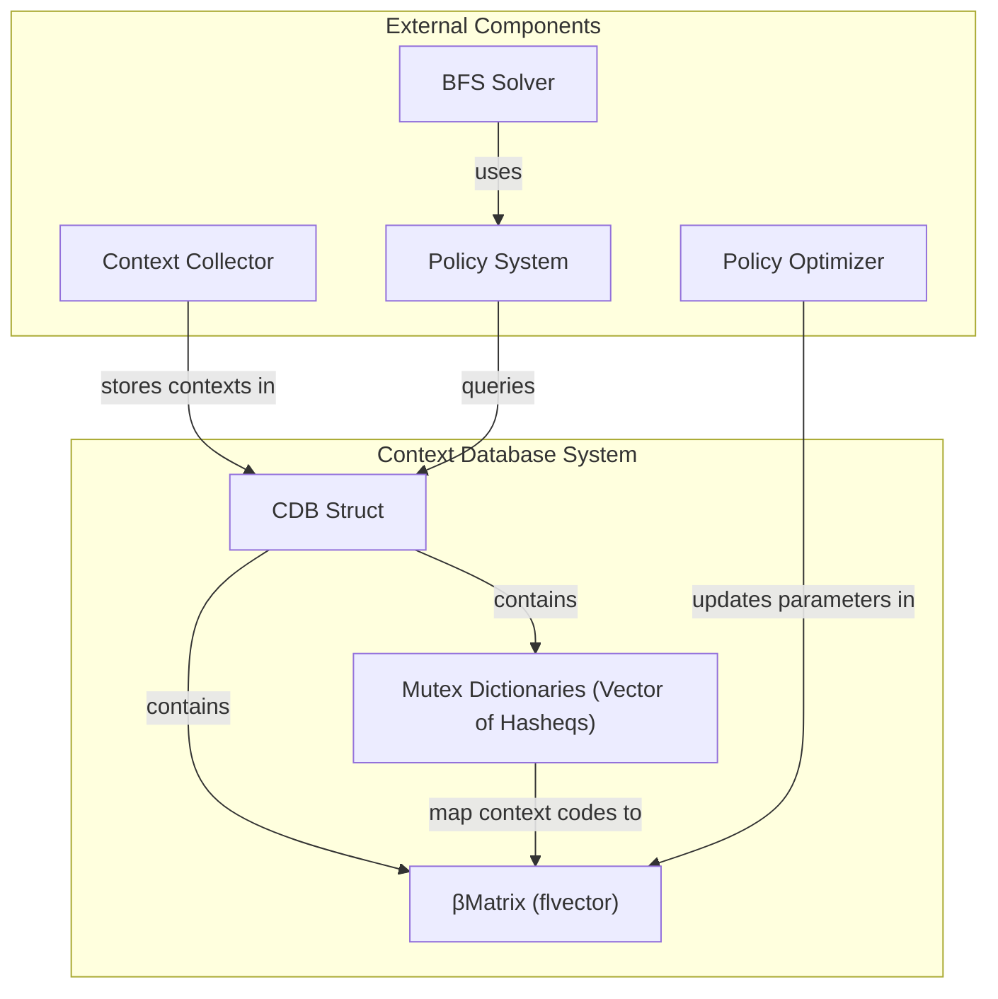
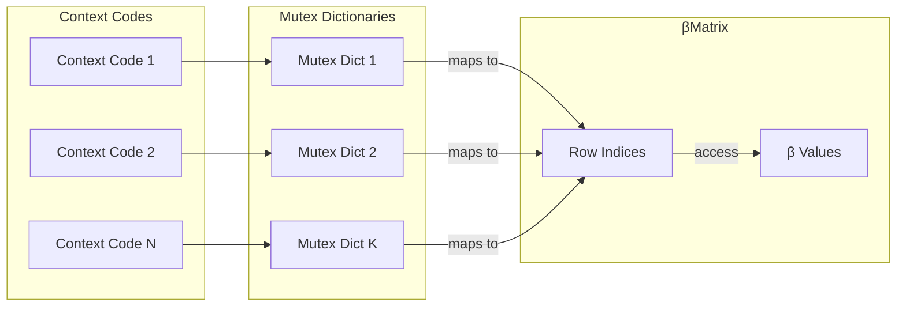
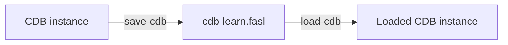
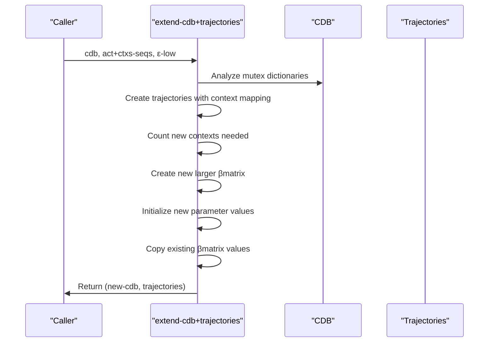
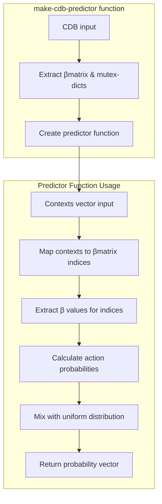
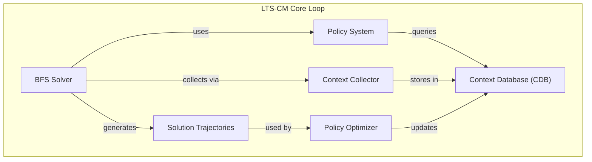

<!-- source: DeepWiki mcp.deepwiki.com · repo google-deepmind/levintreesearch_cm · extra page Context Database (CDB) System · fetched 2026-10-26 -->

# Context Database (CDB) System

<details>
<summary>Relevant source files</summary>

The following files were used as context for generating this wiki page:

- [lts-cm/beta-matrix.rkt](lts-cm/beta-matrix.rkt)
- [lts-cm/cdb.rkt](lts-cm/cdb.rkt)
- [lts-cm/flonum.rkt](lts-cm/flonum.rkt)

</details>


## Purpose and Scope

The Context Database (CDB) System is a central component of the LTS-CM (Levin Tree Search with Context Models) architecture that stores learned model parameters and provides a mechanism for mapping problem-specific contexts to parameter values. This document explains the structure and functionality of the CDB, how it interfaces with other components, and how it enables efficient parameter storage and retrieval.

For information about how policies use the CDB for action prediction, see [Policy System](#2.1.3).

## CDB Overview

The Context Database serves as a persistent storage mechanism for learned parameters that guide the search process. It maps context codes (generated during context collection) to parameter values that influence action selection probabilities. The CDB is designed to efficiently store and retrieve these parameters while supporting continuous learning through updates from the policy optimization process.



Sources: [lts-cm/cdb.rkt:40](lts-cm/cdb.rkt:40-41), [lts-cm/beta-matrix.rkt:28-35](lts-cm/beta-matrix.rkt:28-35)

## CDB Data Structure

The CDB is implemented as a prefab struct type (for serialization) with four main components:

| Component | Type | Description |
|-----------|------|-------------|
| mutex-dicts | Vector of Hasheqs | Maps context codes to indices in the βmatrix |
| n-rows | Integer | Number of rows in the βmatrix |
| n-cols | Integer | Number of columns in the βmatrix (typically equal to the number of possible actions) |
| βmatrix | flvector | Stores the actual parameter values in a flat array |

The CDB structure enables sparse context representation (via fixnums as context codes) while maintaining a dense parameter matrix for optimization efficiency.

```mermaid
classDiagram
    class CDB {
        mutex-dicts: Vector~Hasheq~
        n-rows: Integer
        n-cols: Integer
        βmatrix: flvector
    }
    
    class "Mutex Dictionary" {
        context-code₁: row-index₁
        context-code₂: row-index₂
        ...
        context-codeₙ: row-indexₙ
    }
    
    class "βMatrix" {
        row₁col₁, row₁col₂, ..., row₁colₙ
        row₂col₁, row₂col₂, ..., row₂colₙ
        ...
        rowₘcol₁, rowₘcol₂, ..., rowₘcolₙ
    }
    
    CDB --> "βMatrix" : contains
    CDB --> "Mutex Dictionary" : contains n mutex sets
```

Sources: [lts-cm/cdb.rkt:35-40](lts-cm/cdb.rkt:35-40), [lts-cm/beta-matrix.rkt:28-35](lts-cm/beta-matrix.rkt:28-35)

## Context Mapping and βMatrix Structure

### βMatrix Organization

The βmatrix is a flat flvector that stores all parameter values. It is organized logically as a matrix where:
- Each row corresponds to a specific context
- Each column corresponds to a specific action
- The value at position (row, col) represents the parameter for selecting action `col` in context `row`

The βmatrix is stored as a single flvector for efficiency, with elements accessed using the formula:
```
index = row * n-cols + col
```

### Context Mapping Mechanism

The CDB uses a collection of hash tables (mutex-dicts) to map context codes to row indices in the βmatrix:

1. Each mutex set has its own dictionary (hasheq) in the `mutex-dicts` vector
2. When querying the CDB, context codes are converted to row indices using these dictionaries
3. This allows for efficient storage and retrieval without requiring all possible context codes to be present



Sources: [lts-cm/beta-matrix.rkt:28-35](lts-cm/beta-matrix.rkt:28-35), [lts-cm/beta-matrix.rkt:55-69](lts-cm/beta-matrix.rkt:55-69)

## Core Operations

### Creating and Initializing a CDB

A new, empty CDB is created using the `make-cdb` function, which initializes a CDB with zero rows and the specified number of columns:


Sources: [lts-cm/cdb.rkt:43-44](lts-cm/cdb.rkt:43-44)

### Loading and Saving a CDB

The CDB can be serialized and deserialized for persistent storage using the `save-cdb` and `load-cdb` functions, which utilize Racket's Fast-Load Serialization (FASL) for efficient I/O operations:



Sources: [lts-cm/cdb.rkt:58-70](lts-cm/cdb.rkt:58-70)

### Extending a CDB with New Contexts

The CDB is extended with new contexts using the `extend-cdb+trajectories` function, which:

1. Takes an existing CDB and a collection of action and context sequences
2. Maps context codes to indices in the βmatrix (creating new entries if necessary)
3. Creates a new, larger βmatrix to accommodate the new contexts
4. Initializes new parameter values with appropriate defaults
5. Returns an extended CDB and trajectory structures for optimization



Sources: [lts-cm/beta-matrix.rkt:81-141](lts-cm/beta-matrix.rkt:81-141)

### Creating Predictors from a CDB

The CDB is used to create action predictors via the `make-cdb-predictor` function, which:

1. Creates a function that takes contexts and returns action probabilities
2. Maps context codes to row indices in the βmatrix
3. Computes action probabilities by combining the parameters for each context
4. Smooths probabilities by mixing with a uniform distribution



Sources: [lts-cm/beta-matrix.rkt:143-182](lts-cm/beta-matrix.rkt:143-182)

## Integration with the LTS-CM System

The CDB is a critical component in the LTS-CM architecture, interfacing with several other components:

### Policy Prediction

The CDB provides action probabilities through the Policy System, which uses these probabilities to guide the search process. The mapping from contexts to action probabilities enables the system to apply learned knowledge to new problem instances.

### Context Collection

As the BFS Solver explores state spaces, it collects contexts through the Context Collector, which are then stored in the CDB. This enables the system to continuously learn from experience and improve its performance over time.

### Policy Optimization

The parameter values in the CDB's βmatrix are optimized based on solution trajectories, improving the system's ability to guide search toward solutions. The optimization process updates the βmatrix to minimize the log-loss of predicting the correct actions in the collected trajectories.



Sources: [lts-cm/beta-matrix.rkt:81-141](lts-cm/beta-matrix.rkt:81-141), [lts-cm/beta-matrix.rkt:143-182](lts-cm/beta-matrix.rkt:143-182)

## Performance Considerations

The CDB is designed with performance in mind:

1. **Sparse Context Representation**: Context codes are sparse (potentially large integers), but the βmatrix is dense for efficient computation
2. **Fast Serialization**: Uses Racket's FASL serialization for efficient loading and saving
3. **Efficient Parameter Access**: Direct indexing into the βmatrix for fast parameter retrieval
4. **Memory Efficiency**: Only stores parameters for contexts that have been observed, rather than allocating space for all possible contexts

Sources: [lts-cm/cdb.rkt:58-70](lts-cm/cdb.rkt:58-70), [lts-cm/beta-matrix.rkt:28-35](lts-cm/beta-matrix.rkt:28-35)

---

