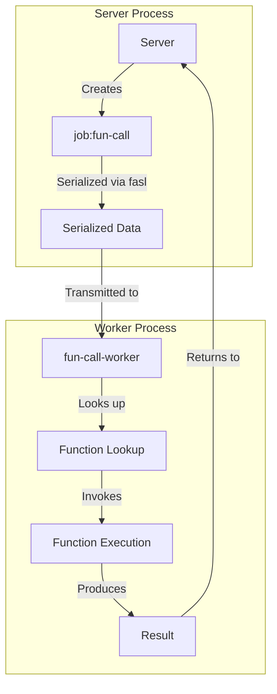
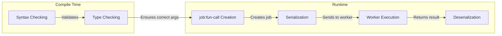
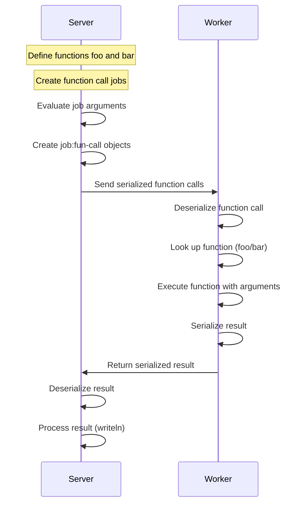

<!-- source: DeepWiki mcp.deepwiki.com · repo google-deepmind/levintreesearch_cm · extra page Function Call Example · fetched 2026-10-26 -->

# Function Call Example

<details>
<summary>Relevant source files</summary>

The following files were used as context for generating this wiki page:

- [jobsched/examples/server-worker-fun-call.rkt](jobsched/examples/server-worker-fun-call.rkt)

</details>


This document explains the function call job feature of the JobSched system, which allows you to execute functions remotely on worker processes using a clean, type-checked interface. For information about other job types and general JobSched usage, see [Simple Server-Worker Example](#4.3.1) and [Job Execution and Communication](#4.2).

## Overview of Function Call Jobs

Function call jobs provide a way to invoke functions on remote worker processes with syntax that closely resembles regular function calls. This feature handles the serialization, transport, execution, and result collection automatically, making distributed computation straightforward.



Sources: [jobsched/examples/server-worker-fun-call.rkt:18-34]()

## Key Components

The function call feature consists of the following main components:

1. **Function definitions** - Regular functions defined and provided by your module
2. **Function call worker** - Worker process that receives function calls and executes them
3. **Function call jobs** - Jobs created using the `job:fun-call` constructor
4. **FASL serialization** - System for serializing function calls and their results

```mermaid
classDiagram
    class "Server Module" {
        +Define functions
        +Create job:fun-call
        +Start server
        +Process results
    }
    
    class "Worker Module" {
        +start-fun-call-worker()
        +Function lookup
        +Function execution
    }
    
    class "job:fun-call" {
        +Function reference
        +Arguments
        +Serialized form
    }
    
    class "Function" {
        +Parameters
        +Body
        +Return value
    }
    
    "Server Module" --> "Function" : defines
    "Server Module" --> "job:fun-call" : creates
    "job:fun-call" --> "Function" : references
    "Worker Module" --> "Function" : executes
```

Sources: [jobsched/examples/server-worker-fun-call.rkt:1-17](), [jobsched/examples/server-worker-fun-call.rkt:19-34]()

## Implementation Walkthrough

Let's examine how the function call feature is implemented in the example:

### 1. Function Definitions

First, we define the functions that will be executed remotely:

```
(provide foo bar)

(define (foo a #:? [b #f] c #:plop plip)
  (list a b plip c))

(define (bar argh)
  (list argh))
```

These functions must be provided by the module so they can be accessed by the worker. Return values must be serializable via FASL.

Sources: [jobsched/examples/server-worker-fun-call.rkt:7-14]()

### 2. Worker Setup

The worker module is set up with a simple call to `start-fun-call-worker`, which tells it where to find the functions:

```
(module+ worker (start-fun-call-worker (this-file)))
```

This single line configures the worker to handle function call jobs by looking up functions defined in the same file.

Sources: [jobsched/examples/server-worker-fun-call.rkt:17]()

### 3. Server Setup

The server is configured with the worker file, the jobs to run, and a callback to process results:

```
(start-simple-server
 #:worker-file (this-file)
 #:data-list (list (job:fun-call (foo 3 #:b 2 'c #:plop (+ 2 3 4)))
                   (job:fun-call (foo 'a 'cc #:plop 'oh))
                   (job:fun-call (bar 'bah)))
 #:process-result (λ (data result) (writeln result))
 #:n-workers n-workers)
```

Sources: [jobsched/examples/server-worker-fun-call.rkt:22-34]()

## Creating Function Call Jobs

The `job:fun-call` constructor creates a job that represents a function call. It captures:

1. The function to be called
2. The arguments to pass to the function
3. Any keyword arguments

The syntax for creating function call jobs exactly mirrors regular function calls, including type checking and error reporting at compile time:



Sources: [jobsched/examples/server-worker-fun-call.rkt:24-32]()

## Example Usage Details

In the example, three function call jobs are created:

1. `(job:fun-call (foo 3 #:b 2 'c #:plop (+ 2 3 4)))` - Calls `foo` with numeric and symbolic arguments
2. `(job:fun-call (foo 'a 'cc #:plop 'oh))` - Calls `foo` with symbolic arguments
3. `(job:fun-call (bar 'bah))` - Calls `bar` with a symbolic argument

When executed, these jobs will:
1. Be serialized and sent to available workers
2. The workers will look up the appropriate function
3. Execute the function with the provided arguments
4. Serialize and return the result to the server
5. The server will process the result using the provided callback (printing it in this case)

The expected output would be:
```
'(3 2 9 c)
'(a #f oh cc)
'(bah)
```

Sources: [jobsched/examples/server-worker-fun-call.rkt:30-32]()

## Important Considerations

When using function call jobs, keep in mind:

1. **Serialization Requirements**: Both arguments and return values must be serializable via FASL
2. **Function Availability**: Functions must be provided by the module and accessible to workers
3. **Argument Evaluation**: Arguments are evaluated on the server before being sent to workers
4. **Syntax Checking**: The `define2` library provides compile-time syntax checking for function calls

### Advantages of Function Call Jobs

| Feature | Benefit |
|---------|---------|
| Syntax checking | Errors are caught at compile time rather than runtime |
| Familiar syntax | Resembles regular function calls, easy to use |
| Type safety | Arguments are checked against function signatures |
| Serialization handling | Automatic serialization of arguments and results |
| Distributed execution | Functions execute on worker processes |

Sources: [jobsched/examples/server-worker-fun-call.rkt:24-29]()

## Complete Data Flow



Sources: [jobsched/examples/server-worker-fun-call.rkt:1-34]()

This example demonstrates how JobSched's function call feature provides a convenient and type-safe way to distribute function execution across multiple worker processes, with minimal boilerplate code required.

---

