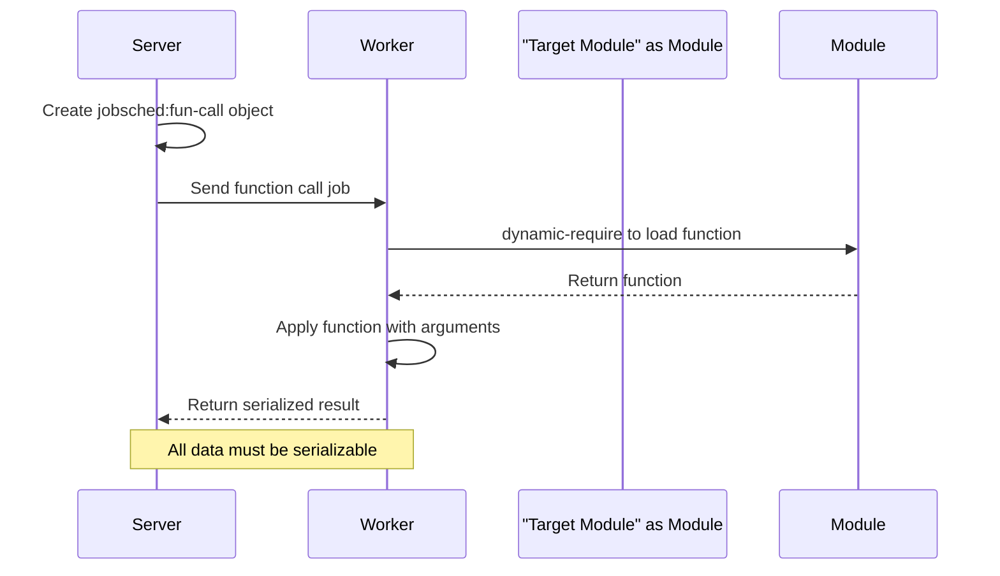
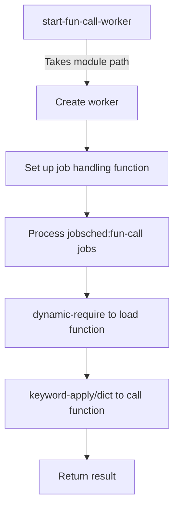
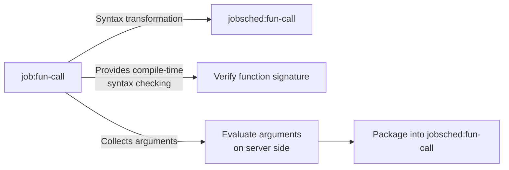
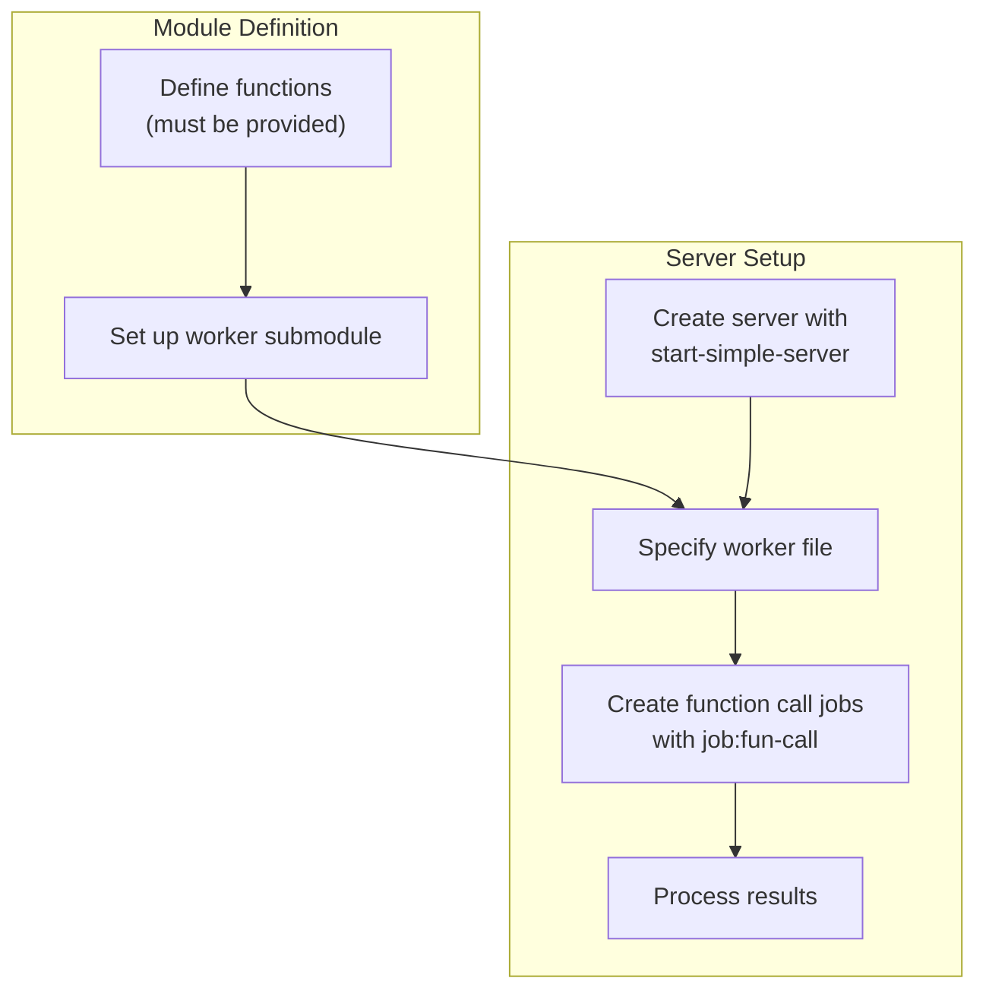
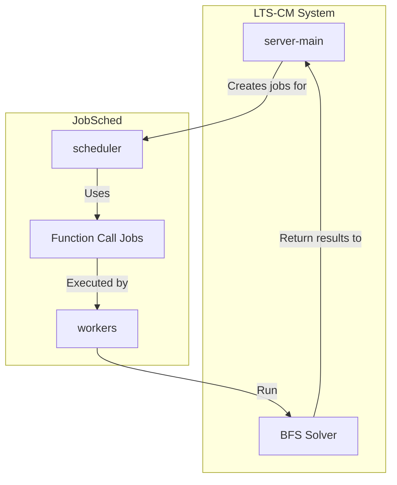

<!-- source: DeepWiki mcp.deepwiki.com · repo google-deepmind/levintreesearch_cm · extra page Function Call Jobs · fetched 2026-10-26 -->

# Function Call Jobs

<details>
<summary>Relevant source files</summary>

The following files were used as context for generating this wiki page:

- [jobsched/examples/server-worker-fun-call.rkt](jobsched/examples/server-worker-fun-call.rkt)
- [jobsched/fun-call.rkt](jobsched/fun-call.rkt)

</details>


## Overview

Function Call Jobs is a feature within the JobSched parallel processing framework that enables remote function execution across worker processes. This system allows jobs to be defined as function calls, with the function arguments evaluated on the server side and the actual function execution taking place on worker processes.

For information about the overall JobSched architecture, see [Core Architecture](#4.1). For information about general job execution, see [Job Execution and Communication](#4.2).

Sources: [jobsched/fun-call.rkt:1-46](), [jobsched/examples/server-worker-fun-call.rkt:1-35]()

## Core Components

The Function Call Jobs system consists of three main components:

1. **`jobsched:fun-call` struct**: Represents a function call job with function name and arguments
2. **`job:fun-call` macro**: Creates a function call job with syntax checking
3. **`start-fun-call-worker` function**: Initializes a worker that can execute function call jobs

### Function Call Job Structure

```mermaid
classDiagram
    class "jobsched:fun-call" {
        fun-sym: Symbol
        kw-dict: List of Pairs
        pos-args: List
    }
    
    note for "jobsched:fun-call" "Contains all information\nneeded to execute\na function call remotely"
```

Sources: [jobsched/fun-call.rkt:14]()

The `jobsched:fun-call` struct is defined as a prefab structure with three fields:
- `fun-sym`: Symbol representing the function name
- `kw-dict`: Dictionary of keyword arguments (as key-value pairs)
- `pos-args`: List of positional arguments

## How Function Call Jobs Work

The Function Call Jobs system allows for seamless remote function execution where:
1. Functions are defined in a module
2. The server creates function call jobs
3. Workers dynamically load the required modules and execute the functions

### Function Call Job Execution Flow



Sources: [jobsched/fun-call.rkt:33-45](), [jobsched/examples/server-worker-fun-call.rkt:20-34]()

## Setting Up Function Call Jobs

### Worker Setup

To create a worker that can execute function call jobs:



Sources: [jobsched/fun-call.rkt:33-45]()

The worker setup is straightforward using the `start-fun-call-worker` function which takes a module path argument. This function:
1. Validates the module path
2. Creates a worker with a job handler that:
   - Takes `jobsched:fun-call` objects
   - Dynamically loads the requested function from the specified module
   - Applies the function with the provided arguments
   - Returns the result

### Creating Function Call Jobs

The `job:fun-call` macro provides a syntax that makes creating function call jobs look similar to regular function calls:



Sources: [jobsched/fun-call.rkt:16-31]()

The macro:
- Performs syntax checking similar to regular function calls
- Evaluates the arguments on the server side
- Creates a `jobsched:fun-call` struct with the function symbol and evaluated arguments

## Example Usage

Below is an overview of how to use Function Call Jobs in practice:

### Server and Worker Configuration



Sources: [jobsched/examples/server-worker-fun-call.rkt:6-34]()

### Code Organization

The example in `server-worker-fun-call.rkt` demonstrates the typical organization:

1. Define and provide functions that will be called remotely
2. Create a worker submodule that calls `start-fun-call-worker`
3. In the main module, set up a server with:
   - Reference to the worker file
   - List of function call jobs
   - Result processing function

## Important Considerations

When working with Function Call Jobs, keep in mind:

1. **All return values must be serializable** via the `fasl` serialization system
2. **Functions must be provided** by the module specified to the worker
3. **Syntax checking** happens at compile time for function calls
4. **Argument evaluation** occurs on the server side before sending to workers
5. **Dynamic loading** of functions happens on the worker side

Sources: [jobsched/examples/server-worker-fun-call.rkt:9-14](), [jobsched/fun-call.rkt:40-45]()

## Integration with LTS-CM

In the context of the larger levintreesearch_cm repository, Function Call Jobs enable parallel execution of computationally intensive tasks like searching for solutions in various problem domains:



This allows the LTS-CM system to distribute search tasks across multiple workers, with the workers executing the appropriate domain-specific functions to find solutions to computational problems.

Sources: [jobsched/fun-call.rkt:1-46]()

---

