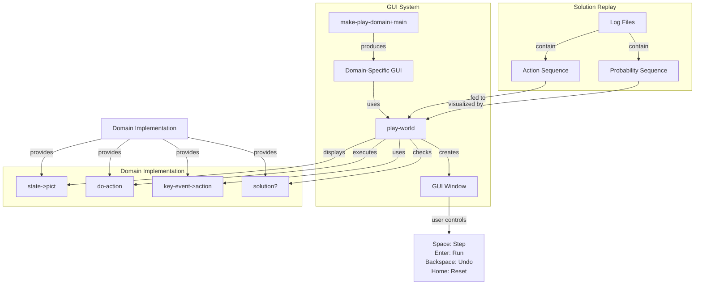
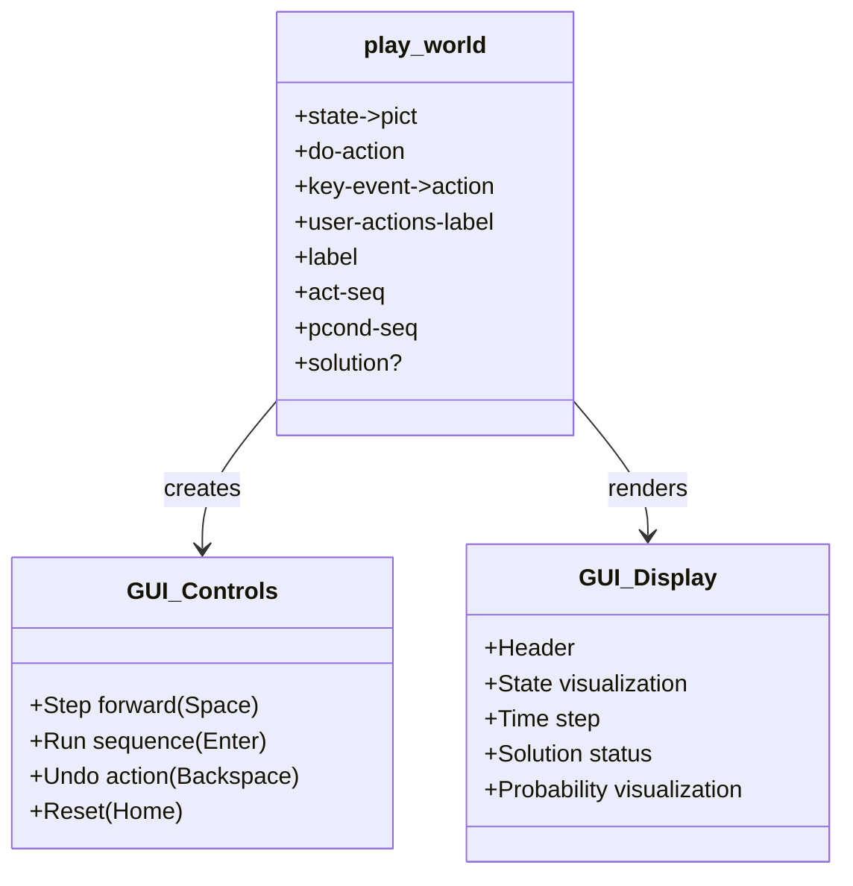
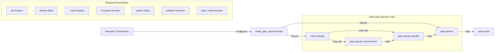
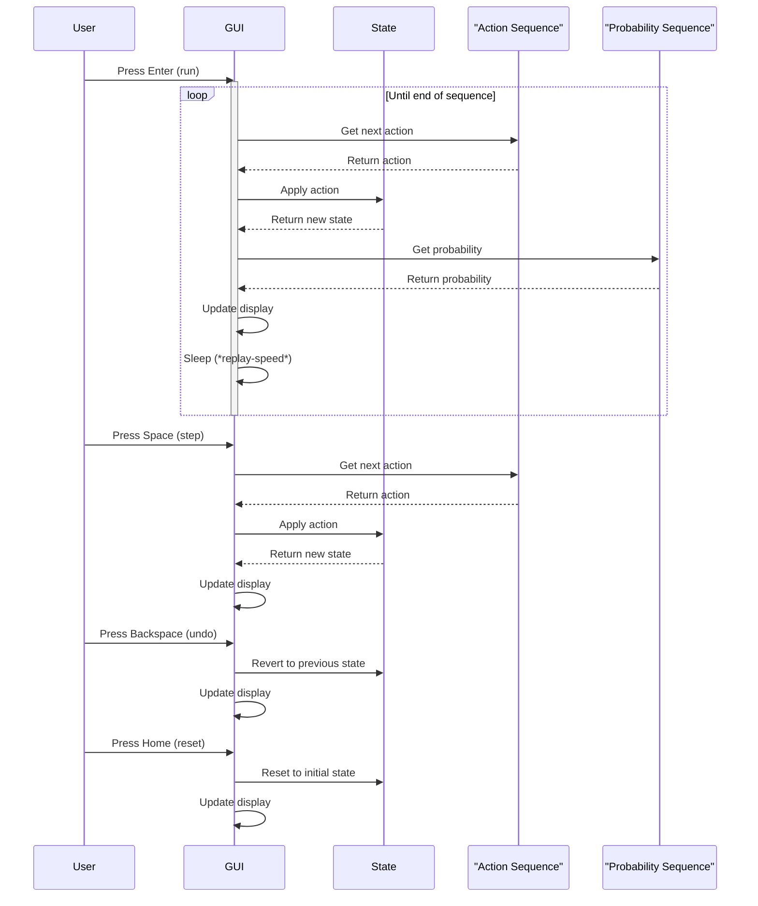
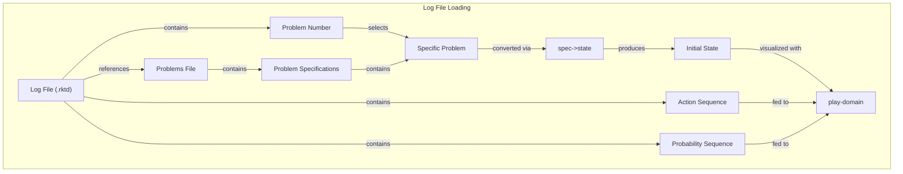

<!-- source: DeepWiki mcp.deepwiki.com · repo google-deepmind/levintreesearch_cm · extra page GUI and Visualization · fetched 2026-10-26 -->

# GUI and Visualization

Relevant source files

The following files were used as context for generating this wiki page:

- [lts-cm/gui.rkt](lts-cm/gui.rkt)
- [lts-cm/misc.rkt](lts-cm/misc.rkt)

This page documents the Play-World GUI and visualization system in the LTS-CM codebase. The GUI provides interactive visualization capabilities for exploring problem domains, viewing solutions, and replaying action sequences. It serves as a crucial tool for debugging, demonstration, and analysis of the Levin Tree Search algorithm's behavior on various domains.

## Overview and Purpose

The visualization system provides:
1. Interactive playback of solution trajectories
2. Manual exploration of action spaces
3. Visual representation of problem states
4. Probability visualization for action selection

The GUI is domain-agnostic, using a pluggable architecture where domain-specific visualization functions can be supplied to render different problem types (Sliding Tile Puzzle, Sokoban, etc.).

Sources: [lts-cm/gui.rkt:1-196]()

## Architecture

The following diagram illustrates how the GUI system integrates with the rest of the LTS-CM framework:

Sources: [lts-cm/gui.rkt:35-133](), [lts-cm/gui.rkt:135-195]()

## Core Components

### play-world Function

The `play-world` function is the central component of the visualization system. It creates an interactive window displaying a problem state and allows navigation through action sequences.

The function takes the following key parameters:
- `wld`: The initial state to visualize
- `state->pict`: Function to convert a state to a graphical representation
- `do-action`: Function to apply an action to a state, producing a new state
- `key-event->action`: Function that maps key presses to domain actions
- `solution?`: Predicate that determines if a state is a solution

Optional parameters:
- `act-seq`: Sequence of actions for automatic replay
- `pcond-seq`: Sequence of probabilities for visualizing model confidence
- `label`: Window title
- `user-actions-label`: Text describing available user actions

Sources: [lts-cm/gui.rkt:35-133]()

### make-play-domain+main Function

This utility function creates domain-specific visualization capabilities by packaging together:
1. A domain-specific play function
2. A main function for command-line launching

This function is used to create domain-specific visualization modules that handle the peculiarities of different problem domains.

Sources: [lts-cm/gui.rkt:135-195]()

## Replay System

The GUI includes functionality to replay solution sequences, either step-by-step or automatically:

1. **Manual stepping**: Press Space to advance one action at a time
2. **Automatic replay**: Press Enter to continuously execute the action sequence
3. **Playback speed**: Controlled by the global `*replay-speed*` parameter

The replay system also visualizes action probabilities when available, providing insight into the model's confidence in each action.

Sources: [lts-cm/gui.rkt:48-133](), [lts-cm/misc.rkt:33]()

## Loading Solutions from Log Files

The system can load and visualize solutions from log files generated during search:

1. **Direct file specification**: Provide a log file path with the `*log*` global parameter
2. **Directory browsing**: Choose from files in a directory specified by `*log-dir*`

Log files contain:
- Problem specification
- Action sequence
- Probability sequence

Sources: [lts-cm/gui.rkt:142-179](), [lts-cm/gui.rkt:181-193]()

## Integration with Problem Domains

Domain implementations must provide several key functions to integrate with the visualization system:

| Function | Purpose |
|----------|---------|
| `state->pict` | Converts a domain state to a graphical representation |
| `do-action` | Applies an action to a state, producing a new state |
| `key-event->action` | Maps keyboard events to domain actions |
| `solution?` | Determines if a state represents a solution |
| `spec->state` | Converts a problem specification to an initial state |

This pluggable architecture allows the visualization system to work with any problem domain that can implement these interfaces.

Sources: [lts-cm/gui.rkt:135-157]()

## User Interface

The GUI provides a consistent user interface across all domains:

- **Header**: Shows available commands and domain-specific user actions
- **State visualization**: Domain-specific rendering of the current state
- **Time step counter**: Shows the current position in the action sequence
- **Solution status**: Indicates when a solution state is reached
- **Probability visualization**: Shows model confidence when available

All GUIs implement a common set of keyboard controls:
- **Space**: Step forward one action
- **Enter**: Automatically run through the action sequence
- **Backspace**: Undo the last action
- **Home**: Reset to the initial state
- **Domain-specific keys**: Perform domain-specific actions (e.g., arrow keys for movement)

Sources: [lts-cm/gui.rkt:58-80](), [lts-cm/gui.rkt:92-132]()

---

