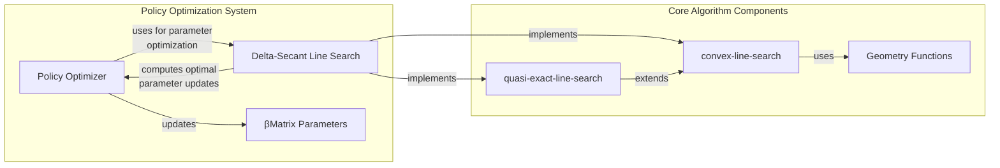
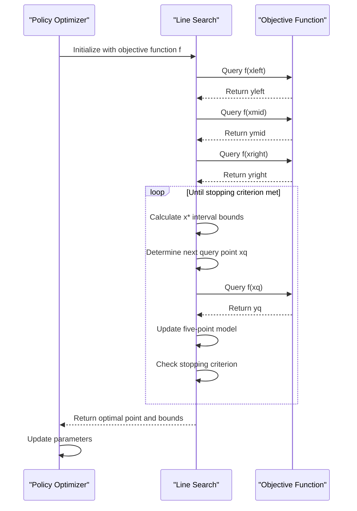
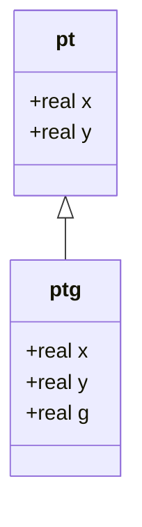
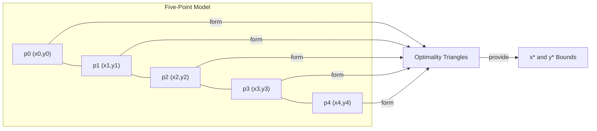
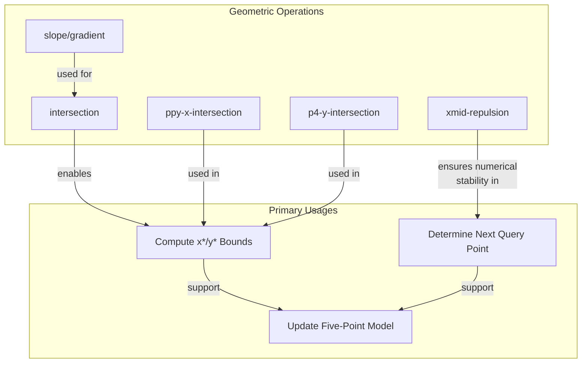

<!-- source: DeepWiki mcp.deepwiki.com · repo google-deepmind/levintreesearch_cm · extra page Line Search Optimization · fetched 2026-10-26 -->

# Line Search Optimization

<details>
<summary>Relevant source files</summary>

The following files were used as context for generating this wiki page:

- [lts-cm/delta-secant.rkt](lts-cm/delta-secant.rkt)
- [lts-cm/scribblings/lts-cm.scrbl](lts-cm/scribblings/lts-cm.scrbl)

</details>


This documentation covers the line search optimization algorithms implemented in the levintreesearch_cm repository. Line search is a critical component of the policy optimization process in the LTS-CM system, responsible for efficiently finding the minimum of convex functions. It is primarily used by the Policy Optimizer to update the βMatrix parameters based on collected contexts.

Sources: [lts-cm/delta-secant.rkt:15-37]()

## 1. Overview

The line search system implements the Δ-Secant algorithm for convex function minimization, as described in the paper "Line Search for Convex Minimization." This algorithm provides an efficient method for finding the minimum of a convex function within a specified interval with a minimal number of function evaluations.

The system provides two main functions:
- `convex-line-search`: A general-purpose line search algorithm that finds the minimum of a convex function between two points
- `quasi-exact-line-search`: An enhanced version that ensures sufficient progress is made, suitable for optimization algorithms like gradient descent

This line search implementation is particularly designed for numerical stability and efficiency, making it well-suited for policy optimization in reinforcement learning contexts.

Sources: [lts-cm/delta-secant.rkt:29-34](), [lts-cm/scribblings/lts-cm.scrbl:18-24]()

## 2. System Architecture

### Line Search in the LTS-CM System



Sources: [lts-cm/delta-secant.rkt:33-34](), [lts-cm/delta-secant.rkt:178-186](), [lts-cm/delta-secant.rkt:242-255]()

### Data Flow in Line Search Optimization



Sources: [lts-cm/delta-secant.rkt:178-202](), [lts-cm/delta-secant.rkt:220-236]()

## 3. Key Components and Data Structures

### 3.1 Point Representations

The line search algorithm uses two point structures:

1. `pt`: Basic point structure containing x and y coordinates
2. `ptg`: Extended point structure that also stores gradient information



The gradient information in `ptg` allows the algorithm to use derivative information when available, potentially speeding up the search process.

Sources: [lts-cm/delta-secant.rkt:35-36](), [lts-cm/scribblings/lts-cm.scrbl:118-124]()

### 3.2 Five-Point Model

The algorithm maintains a five-point model around the minimum, which provides both upper and lower bounds on the minimum value and its location.



The five points are maintained in increasing order of x-coordinates, with the middle point (p2) having the minimum y-value among the five points.

Sources: [lts-cm/delta-secant.rkt:136-150](), [lts-cm/delta-secant.rkt:152-165]()

## 4. Core Algorithms

### 4.1 Convex Line Search

The `convex-line-search` function is the main implementation of the Delta-Secant algorithm. It takes a convex function `f` and an interval `[xleft, xright]` and returns the approximate minimum of `f` in that interval, along with bounds on the approximation error.

The algorithm progresses by:
1. Maintaining a five-point model around the minimum
2. Computing the x* gap (Δx) and y* gap (Δy)
3. Querying the function at new points to refine the bounds
4. Stopping when a specified criterion is met

The function returns a dictionary containing:
- `'xlow`, `'ylow`: The lowest point found (approximation of the minimum)
- `'xgap`, `'ygap`: Bounds on the error in x and y
- `'x-`, `'x+`: The interval containing the minimum
- `'iter`: Number of iterations performed
- Other diagnostic information

Sources: [lts-cm/delta-secant.rkt:178-236](), [lts-cm/scribblings/lts-cm.scrbl:34-68]()

### 4.2 Quasi-Exact Line Search

The `quasi-exact-line-search` function builds upon `convex-line-search` to provide a more robust algorithm for use within optimization loops. It has several enhancements:

1. Uses initial gradient information when available to speed up the search
2. Adaptively expands the search interval if the minimum is at the boundary
3. Ensures "sufficient decrease" relative to the starting point
4. Automatically adjusts to the strong-convexity parameter of the function

The function terminates when:
```
yleft - ylow ≥ c × ygap
```
where `c` is a parameter controlling how close to the exact minimum the result should be.

Sources: [lts-cm/delta-secant.rkt:242-292](), [lts-cm/scribblings/lts-cm.scrbl:82-109]()

## 5. Geometric Operations

The line search algorithm relies on several geometric operations to maintain the five-point model and compute the bounds:



Key geometric operations include:
- `slope/gradient`: Calculates the slope between two points or uses the gradient if available
- `intersection`: Computes the intersection of two lines
- `xmid-repulsion`: Ensures numerical stability by keeping query points away from existing points
- `ppy-x-intersection` and `p4-y-intersection`: Helper functions for computing bounds

Sources: [lts-cm/delta-secant.rkt:47-130]()

## 6. Numerical Stability Considerations

The line search implementation includes several techniques to ensure numerical stability:

1. Handling of infinite and NaN values [lts-cm/delta-secant.rkt:42]()
2. Preventing query points from being too close to existing points [lts-cm/delta-secant.rkt:54-59]()
3. Iterative refinement for computing line intersections [lts-cm/delta-secant.rkt:117-124]()
4. Special handling of edge cases such as parallel lines [lts-cm/delta-secant.rkt:102-111]()

These measures ensure that the algorithm remains stable even for challenging functions with steep gradients or near-flat regions.

Sources: [lts-cm/delta-secant.rkt:42-124]()

## 7. Usage in Policy Optimization

In the LTS-CM system, line search optimization is primarily used for policy parameter optimization. The process typically follows these steps:

1. The Policy Optimizer constructs an objective function based on collected contexts
2. This function is passed to the line search algorithm along with current parameters
3. The line search finds the optimal parameter update direction and magnitude
4. The βMatrix parameters are updated accordingly
5. The updated policy is then used for further search and context collection

This iterative process allows the policy to improve over time based on the contexts collected during search.

Sources: [lts-cm/delta-secant.rkt:16-26]()

## 8. Performance Characteristics

The Delta-Secant algorithm provides several performance guarantees:

1. **Bounded queries**: The algorithm finds an ε-approximate minimum using at most O(ln(1/ε)) function evaluations
2. **Adaptivity**: Automatically adapts to the strong-convexity parameter of the function
3. **Practical efficiency**: Performs well on a variety of convex functions, as shown in the test cases [lts-cm/delta-secant.rkt:304-337]()

Test functions include linear functions, absolute value, squared functions, and more complex composite functions, demonstrating the algorithm's versatility.

Sources: [lts-cm/delta-secant.rkt:298-337]()

## Summary

The Line Search Optimization system provides efficient algorithms for finding the minimum of convex functions. Through the Delta-Secant algorithm implementation, it offers robust performance with theoretical guarantees while maintaining numerical stability. This component plays a crucial role in the policy optimization process of the LTS-CM system, enabling efficient parameter updates based on collected contexts.

---

