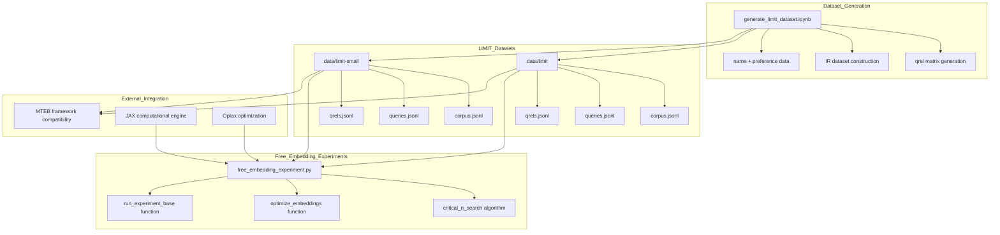
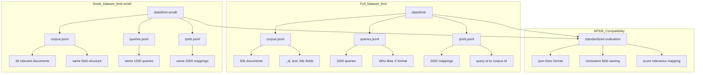
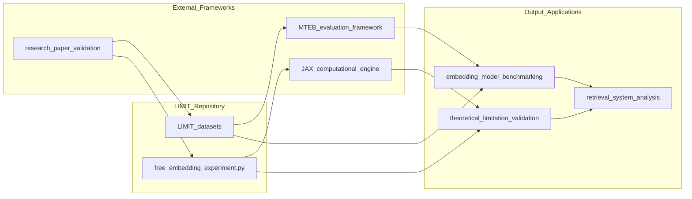

<!-- source: DeepWiki mcp.deepwiki.com · repo google-deepmind/limit · page 1 Overview · fetched 2026-10-26 -->

# Overview

Relevant source files

The following files were used as context for generating this wiki page:

- [README.md](README.md)
- [assets/LIMIT.png](assets/LIMIT.png)

## Purpose and Scope

This document provides an overview of the LIMIT repository, which contains resources for studying the theoretical limitations of embedding-based retrieval systems. The repository implements research findings that demonstrate fundamental constraints in single-vector embedding approaches and provides both datasets and experimental tools to validate these theoretical limitations.

For detailed information about dataset generation and structure, see [Dataset Structure and Format](#2.1). For experimental methodology and computational infrastructure, see [Free Embedding Experiments](#3).

## Theoretical Foundation

The LIMIT repository is built on the theoretical principle that embedding-based retrieval systems have fundamental mathematical limitations. For any given embedding dimension `d`, there exist combinations of documents that cannot be retrieved by any query using single-vector representations. This theoretical insight drives both the dataset construction and experimental validation approaches implemented in this codebase.

The research demonstrates that state-of-the-art embedding models struggle with specifically constructed document combinations, highlighting inherent constraints in the single-vector embedding paradigm used by modern retrieval systems.

**Sources:** [README.md:6-10]()

## System Architecture

The LIMIT repository consists of three primary components that work together to validate theoretical limitations of embedding systems:

#### Core System Components

**Sources:** [README.md:24-47]()

## Dataset Architecture

The LIMIT dataset implements a structured approach to expose theoretical limitations through carefully constructed query-document relationships:

#### LIMIT Dataset File Structure

The dataset structure follows MTEB framework conventions, enabling standardized evaluation across different embedding models. The full dataset contains 50,000 documents while the small variant includes only the 46 documents that are relevant to the test queries, providing different scales for experimentation.

**Sources:** [README.md:26-36]()

## Experimental Framework

The repository includes a comprehensive experimental system for validating theoretical predictions through free embedding optimization:

| Component | Purpose | Implementation |
|-----------|---------|----------------|
| `free_embedding_experiment.py` | Critical N search algorithm | Three-phase search with JAX optimization |
| `optimize_embeddings` | Embedding optimization | InfoNCE loss with Adam optimizer |
| `run_experiment_base` | Single experiment execution | Combinatorial qrel generation and evaluation |
| Critical N Search | Find maximum retrievable documents | Galloping + binary search + sweep phases |

The experimental framework uses JAX for high-performance computation and implements a sophisticated search algorithm to identify the critical number of documents that can be simultaneously retrieved given embedding dimension constraints.

**Sources:** [README.md:46-47]()

## Dependencies and Requirements

The system requires specific computational dependencies for both dataset generation and experimental validation:

- **Dataset Generation**: Jupyter notebook environment with standard data science libraries
- **Free Embedding Experiments**: JAX, Optax, and CUDA 12 support for GPU acceleration
- **Evaluation Integration**: MTEB framework compatibility for standardized benchmarking

Installation follows the `uv` package manager workflow with requirements specified in `code/requirements.txt`.

**Sources:** [README.md:50-67]()

## Integration Ecosystem

The LIMIT repository integrates with established evaluation frameworks and computational tools:

This integration enables researchers to evaluate embedding models using standardized metrics while validating theoretical predictions about fundamental limitations in embedding-based retrieval systems.

**Sources:** [README.md:67](), [README.md:3-10]()

---

