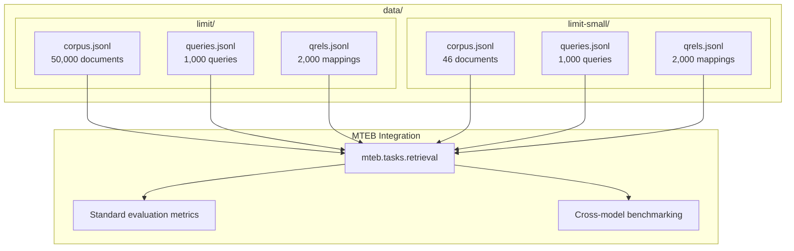
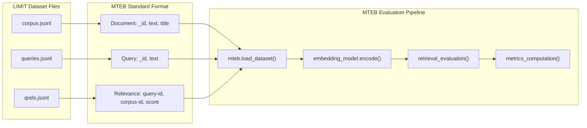

<!-- source: DeepWiki mcp.deepwiki.com · repo google-deepmind/limit · page 2 LIMIT Dataset · fetched 2026-10-26 -->

# LIMIT Dataset

<details>
<summary>Relevant source files</summary>

The following files were used as context for generating this wiki page:

- [README.md](README.md)

</details>


This document covers the structure, organization, and usage of the LIMIT dataset - a theoretically-grounded information retrieval dataset designed to expose fundamental limitations of single-vector embedding models. The dataset demonstrates that for any given embedding dimension, there exist combinations of documents that cannot be retrieved by any query using current embedding paradigms.

For information about generating the LIMIT dataset from scratch, see [Dataset Generation](#2.2). For details about the experimental validation using free embeddings, see [Free Embedding Experiments](#3).

## Overview and Theoretical Foundation

The LIMIT dataset implements theoretical principles showing that embedding-based retrieval systems have fundamental mathematical limitations. The dataset construction follows a combinatorial approach where documents represent people with preferences, and queries ask "Who likes X?" - creating scenarios where certain document combinations become theoretically unretrievable given embedding dimension constraints.

The dataset serves as a stress test for state-of-the-art embedding models, demonstrating practical manifestations of these theoretical limitations through empirical evaluation.

## Dataset Architecture

### File Organization Structure



**Dataset File Structure**

Sources: [README.md:24-36]()

### Dataset Variants

The LIMIT dataset provides two variants optimized for different use cases:

| Variant | Documents | Queries | Relevance Mappings | Use Case |
|---------|-----------|---------|-------------------|----------|
| **Full** (`data/limit/`) | 50,000 | 1,000 | 2,000 | Complete evaluation, production testing |
| **Small** (`data/limit-small/`) | 46 | 1,000 | 2,000 | Development, debugging, fast iteration |

The small variant contains only the documents that are relevant to at least one query, making it ideal for rapid prototyping and development workflows while maintaining the same query and relevance structure.

Sources: [README.md:32-36]()

## MTEB Compatibility and Integration

### Standard Format Compliance



**MTEB Integration Flow**

The LIMIT dataset follows MTEB conventions exactly, ensuring compatibility with the standard evaluation framework. Each file uses JSON Lines format with specific field requirements that align with MTEB's expectations for retrieval tasks.

Sources: [README.md:24-31](), [README.md:67-68]()

## Data Format Specifications

### Corpus Document Structure

Each document in `corpus.jsonl` represents a person with specific preferences:

```json
{
  "_id": "doc_12345",
  "text": "Person profile with preference information",
  "title": ""
}
```

The `title` field remains empty as per MTEB requirements, with all content contained in the `text` field.

### Query Structure

Each query in `queries.jsonl` follows the pattern "Who likes X?":

```json
{
  "_id": "query_001", 
  "text": "Who likes [specific item]?"
}
```

### Relevance Mappings

The `qrels.jsonl` file contains query-document relevance mappings:

```json
{
  "query-id": "query_001",
  "corpus-id": "doc_12345", 
  "score": 1
}
```

The `score` field indicates binary relevance (1 = relevant, 0 = not relevant).

Sources: [README.md:28-31]()

## Dataset Statistics and Scale

### Numerical Overview

```mermaid
graph TD
    subgraph QuerySpace["Query Space"]
        A["1,000 queries<br/>Who likes X? format"]
    end
    
    subgraph DocumentSpace["Document Space"] 
        B["Full: 50,000 documents<br/>Small: 46 documents"]
        C["Person profiles<br/>Preference information"]
    end
    
    subgraph RelevanceSpace["Relevance Space"]
        D["2,000 query-document<br/>relevance mappings"]
        E["Binary relevance scoring<br/>score ∈ {0, 1}"]
    end
    
    subgraph TheoreticalFoundation["Theoretical Constraints"]
        F["Embedding dimension limits<br/>Combinatorial impossibility"]
        G["Critical N discovery<br/>Maximum retrievable docs"]
    end
    
    A --> D
    B --> D
    D --> E
    
    F --> A
    F --> B
    G --> F
```

**Dataset Scale and Theoretical Constraints**

The dataset's scale is specifically designed to demonstrate theoretical limitations while remaining computationally tractable for evaluation. The 2,000 relevance mappings create scenarios where embedding models must handle complex preference combinations that exceed their representational capacity.

Sources: [README.md:6-10](), [README.md:28-31]()

## Integration with Experimental Framework

The LIMIT dataset serves as input for both standard MTEB evaluation and specialized free embedding experiments. The dataset's structure enables direct integration with the experimental pipeline for discovering critical N values - the maximum number of documents that can be theoretically retrieved given embedding dimension constraints.

The consistent file format across both variants ensures seamless switching between development (small) and production (full) evaluation scenarios without requiring code changes in evaluation pipelines.

Sources: [README.md:41-47](), [README.md:67-68]()

---

