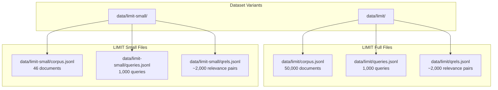
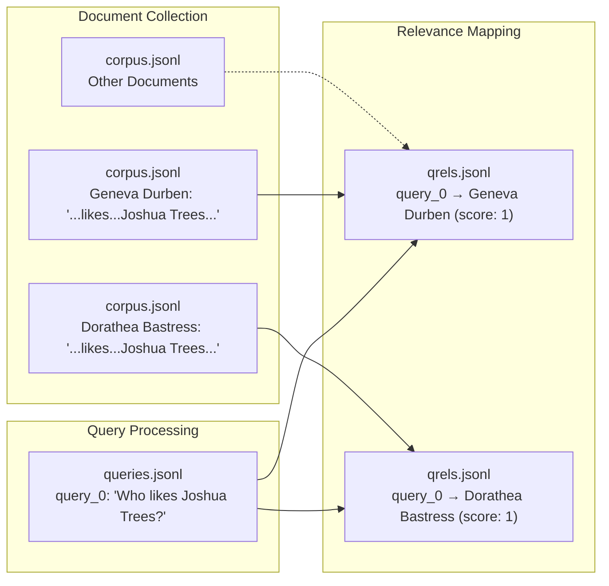
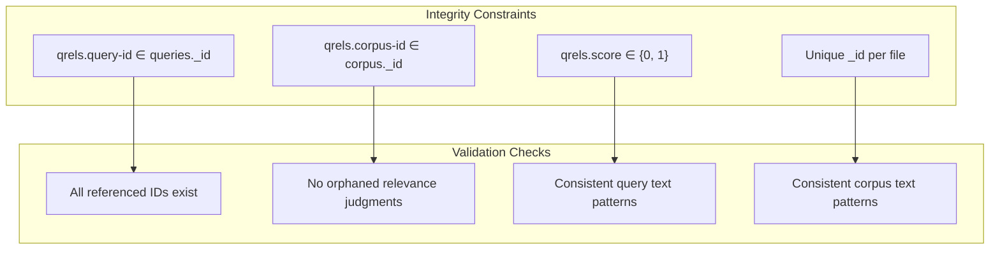

<!-- source: DeepWiki mcp.deepwiki.com · repo google-deepmind/limit · page 2.1 Dataset Structure and Format · fetched 2026-10-26 -->

# Dataset Structure and Format

<details>
<summary>Relevant source files</summary>

The following files were used as context for generating this wiki page:

- [data/limit-small/corpus.jsonl](data/limit-small/corpus.jsonl)
- [data/limit-small/qrels.jsonl](data/limit-small/qrels.jsonl)
- [data/limit-small/queries.jsonl](data/limit-small/queries.jsonl)
- [data/limit/corpus.jsonl](data/limit/corpus.jsonl)
- [data/limit/qrels.jsonl](data/limit/qrels.jsonl)
- [data/limit/queries.jsonl](data/limit/queries.jsonl)

</details>


This document describes the file formats, structure, and relationships within the LIMIT dataset. The LIMIT dataset is designed as an information retrieval benchmark that exposes theoretical limitations of embedding-based retrieval systems.

For information about how the dataset is generated, see [Dataset Generation](#2.2). For documentation of the experimental framework that uses this dataset, see [Free Embedding Experiments](#3).

## Dataset Overview

The LIMIT dataset follows the MTEB (Massive Text Embedding Benchmark) standard format and consists of three primary components stored as JSONL files:

- **corpus.jsonl**: Document collection containing person profiles with preference lists
- **queries.jsonl**: Information retrieval queries asking "Who likes X?"  
- **qrels.jsonl**: Query-document relevance judgments mapping queries to relevant documents

The dataset is available in two variants:
- **LIMIT Full** (`data/limit/`): 50,000 documents, 1,000 queries, ~2,000 relevance judgments
- **LIMIT Small** (`data/limit-small/`): 46 documents, 1,000 queries, ~2,000 relevance judgments

## Dataset File Structure



Sources: [data/limit-small/corpus.jsonl:1-47](), [data/limit-small/queries.jsonl:1-1000](), [data/limit-small/qrels.jsonl:1-2000](), [data/limit/corpus.jsonl:1-50]()

## Corpus Format

The `corpus.jsonl` file contains document records, with each line representing a single JSON object following this schema:

| Field | Type | Description | Required |
|-------|------|-------------|----------|
| `_id` | string | Unique document identifier (person name) | Yes |
| `title` | string | Document title (empty in LIMIT dataset) | Yes |
| `text` | string | Document content describing person's preferences | Yes |

### Example Corpus Entry

```json
{
  "_id": "Geneva Durben",
  "title": "",
  "text": "Geneva Durben likes Quokkas, River Otters, Tapirs, Asymmetry, Snow Leopards, Hydrangeas, Crocheting, Symphonies, Bassoons, Pangolins, Limes, Mosaic, Creativity, Licorice, Spinach, Chairs, Horror Literature, Scuba Diving, Glaciers, Cartography, Alternative Rock, Oceanic Trenches, Barley, Cheerios, Sapphires, Parakeets, The Aztec Empire, Traveling, Candle Making, Shasta Daisies, Patterns, Disco Music, White Pepper, Slide Rules, Halibut, Giant Isopods, Praying Mantises, Fables, Alligators, Caracals, Joshua Trees, Pansies, Soy Sauce, Cards Against Humanity and Elm Trees."
}
```

The document text follows a consistent pattern: "{Person Name} likes {comma-separated list of items}". Each document represents a person's complete preference profile.

Sources: [data/limit-small/corpus.jsonl:1-2]()

## Queries Format

The `queries.jsonl` file contains query records, with each line representing a single JSON object:

| Field | Type | Description | Required |
|-------|------|-------------|----------|
| `_id` | string | Unique query identifier (format: "query_N") | Yes |
| `text` | string | Natural language query text | Yes |

### Example Query Entries

```json
{"_id": "query_0", "text": "Who likes Joshua Trees?"}
{"_id": "query_1", "text": "Who likes Slide Rules?"}
{"_id": "query_2", "text": "Who likes Oceanic Trenches?"}
```

All queries follow the pattern "Who likes {item}?" where `{item}` corresponds to preferences mentioned in the corpus documents. The dataset contains 1,000 unique queries across both variants.

Sources: [data/limit-small/queries.jsonl:1-5]()

## Query Relevance Format

The `qrels.jsonl` file contains query-document relevance judgments:

| Field | Type | Description | Required |
|-------|------|-------------|----------|
| `query-id` | string | Query identifier matching `queries.jsonl` | Yes |
| `corpus-id` | string | Document identifier matching `corpus.jsonl` | Yes |
| `score` | integer | Relevance score (1 = relevant, 0 = not relevant) | Yes |

### Example Qrels Entries

```json
{"query-id": "query_0", "corpus-id": "Geneva Durben", "score": 1}
{"query-id": "query_0", "corpus-id": "Dorathea Bastress", "score": 1}
{"query-id": "query_1", "corpus-id": "Geneva Durben", "score": 1}
```

The relevance judgments create binary relationships: a document is relevant to a query if the person described in the document likes the item mentioned in the query.

Sources: [data/limit-small/qrels.jsonl:1-5]()

## Data Relationship Model



Sources: [data/limit-small/queries.jsonl:1](), [data/limit-small/corpus.jsonl:1-2](), [data/limit-small/qrels.jsonl:1-2]()

## MTEB Compatibility

The LIMIT dataset implements the standard MTEB retrieval task format:

### MTEB Field Mapping

| MTEB Standard | LIMIT Implementation | Description |
|---------------|---------------------|-------------|
| `corpus` | `corpus.jsonl` | Document collection with `_id`, `title`, `text` |
| `queries` | `queries.jsonl` | Query collection with `_id`, `text` |
| `qrels` | `qrels.jsonl` | Relevance judgments with `query-id`, `corpus-id`, `score` |

### Evaluation Metrics

The dataset supports standard MTEB retrieval metrics:
- **nDCG@k**: Normalized Discounted Cumulative Gain
- **MAP**: Mean Average Precision  
- **Recall@k**: Recall at cutoff k
- **Precision@k**: Precision at cutoff k

The binary relevance scores (`score: 1`) indicate perfect relevance for matching query-document pairs.

Sources: [data/limit-small/corpus.jsonl:1](), [data/limit-small/queries.jsonl:1](), [data/limit-small/qrels.jsonl:1]()

## Dataset Variants Comparison

| Aspect | LIMIT Full | LIMIT Small |
|--------|------------|-------------|
| **Documents** | 50,000 | 46 |
| **Queries** | 1,000 | 1,000 |
| **Relevance Pairs** | ~2,000 | ~2,000 |
| **Purpose** | Full-scale evaluation | Development/debugging |
| **File Size** | ~32MB corpus | ~2KB corpus |

### LIMIT Small Characteristics

The small variant contains only the 46 documents that are relevant to at least one query, making it useful for:
- Rapid development iteration
- Algorithm debugging  
- Understanding dataset structure
- Computational efficiency during development

All 1,000 queries and their relevance judgments are preserved in both variants, maintaining the theoretical properties that make the dataset challenging for embedding-based retrieval.

Sources: [data/limit-small/corpus.jsonl:1-47](), [data/limit/corpus.jsonl:1-10]()

## Data Integrity and Validation

The dataset maintains referential integrity across its components:



### Key Constraints

1. **Query ID References**: Every `query-id` in `qrels.jsonl` must exist in `queries.jsonl`
2. **Corpus ID References**: Every `corpus-id` in `qrels.jsonl` must exist in `corpus.jsonl`  
3. **Binary Relevance**: All relevance scores are binary (0 or 1)
4. **Unique Identifiers**: All `_id` fields are unique within their respective files

Sources: [data/limit-small/qrels.jsonl:1-10](), [data/limit-small/queries.jsonl:1-5](), [data/limit-small/corpus.jsonl:1-5]()

---

