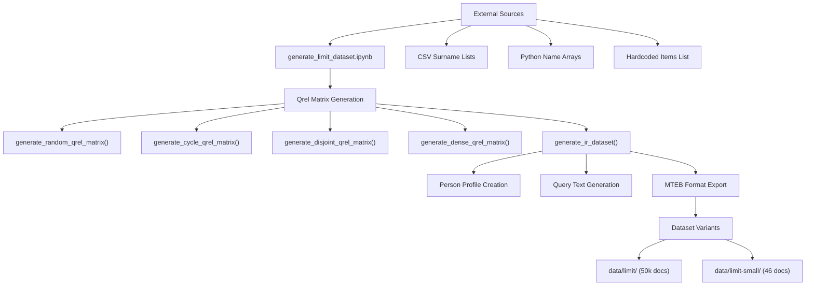
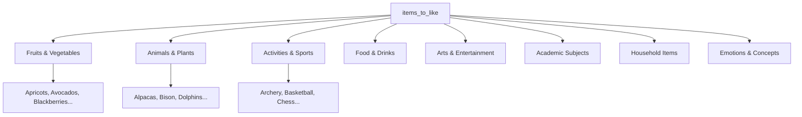
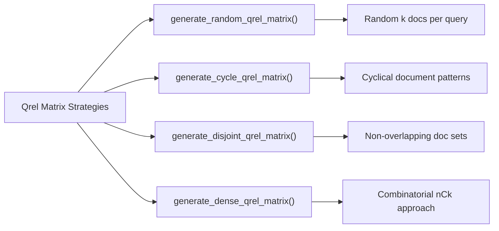
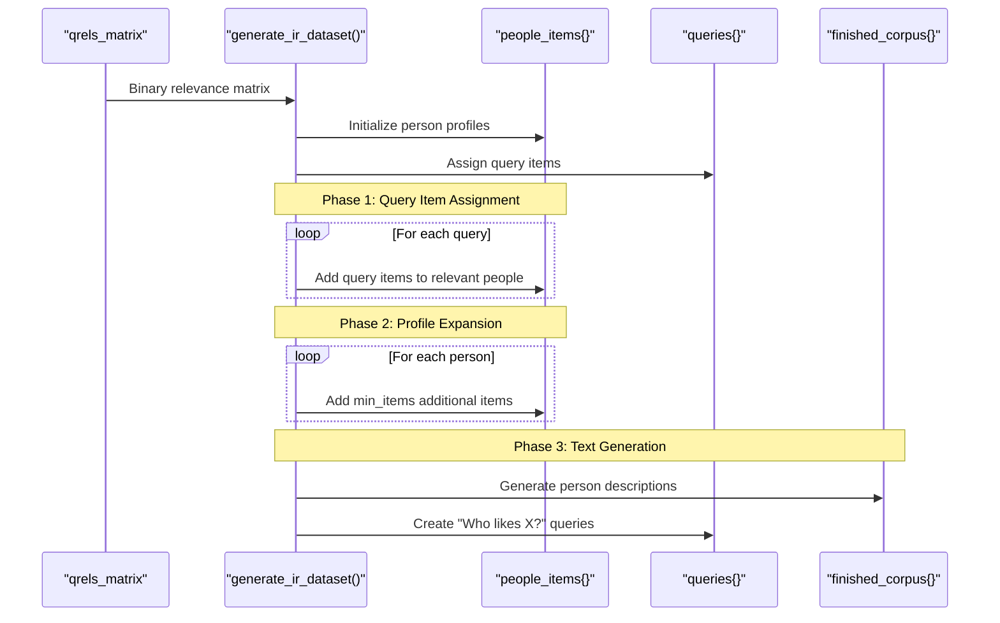

<!-- source: DeepWiki mcp.deepwiki.com · repo google-deepmind/limit · page 2.2 Dataset Generation · fetched 2026-10-26 -->

# Dataset Generation

<details>
<summary>Relevant source files</summary>

The following files were used as context for generating this wiki page:

- [README.md](README.md)
- [code/generate_limit_dataset.ipynb](code/generate_limit_dataset.ipynb)

</details>


## Purpose and Scope

This document explains the dataset generation process for the LIMIT dataset, which creates theoretically grounded information retrieval datasets designed to expose fundamental limitations of embedding-based retrieval systems. The generation process produces datasets in MTEB-compatible format with configurable relevance patterns that stress-test embedding models based on theoretical principles.

For information about the dataset structure and file formats, see [Dataset Structure and Format](#2.1). For details about using the generated datasets in experiments, see [Experiment Framework](#3.1).

## Generation Overview

The LIMIT dataset generation process follows a systematic approach to create synthetic information retrieval datasets where documents represent people with preferences and queries ask "Who likes X?" The theoretical foundation ensures that certain document combinations cannot be retrieved simultaneously by any embedding-based system, regardless of optimization.



**Dataset Generation Process Flow**

The generation pipeline transforms external name sources and predefined preference items into structured IR datasets through configurable relevance matrix strategies.

Sources: [code/generate_limit_dataset.ipynb:1-2464](), [README.md:40-47]()

## Name and Item Sources

The generation process requires two primary data sources: names for creating person identities and items that people can express preferences about.

### Name Acquisition

Names are sourced dynamically from external repositories to ensure diversity:

| Source Type | URL Pattern | Processing Function |
|-------------|-------------|-------------------|
| Surnames | gist.githubusercontent.com CSV | `pd.read_csv()` |
| First Names | gist.githubusercontent.com Python array | `exec(python_content)` |

The system downloads approximately 1,000 unique surnames and 2,738 unique first names, then generates unique combinations for person profiles.

### Items to Like

The system includes a comprehensive hardcoded list of 1,972 preference items across categories:



**Item Category Distribution in items_to_like**

Sources: [code/generate_limit_dataset.ipynb:62-94](), [code/generate_limit_dataset.ipynb:124-1973]()

## Qrel Matrix Generation Strategies

The system provides four distinct strategies for generating query-document relevance matrices, each designed to test different theoretical aspects of embedding limitations.

### Strategy Implementations



**Qrel Matrix Generation Function Architecture**

### Dense Matrix Strategy

The `generate_dense_qrel_matrix()` function implements the theoretically motivated approach:

1. **Minimum Document Calculation**: Finds smallest `n` where `nCk >= num_queries`
2. **Combinatorial Generation**: Creates all combinations of `k` documents from first `n` documents  
3. **Matrix Population**: Maps combinations to binary relevance matrix

This strategy ensures maximum theoretical stress on embedding systems by requiring retrieval of all possible k-combinations from a minimal document set.

### Matrix Validation

Each strategy includes validation logic:

| Strategy | Validation Check | Error Condition |
|----------|-----------------|-----------------|
| Random | `num_docs >= k_per_query` | Insufficient documents |
| Cycle | `num_queries <= num_docs` | Warning only |
| Disjoint | `num_queries * k_per_query <= num_docs` | Hard requirement |
| Dense | `nCk calculation feasible` | Mathematical impossibility |

Sources: [code/generate_limit_dataset.ipynb:2007-2143]()

## IR Dataset Construction

The `generate_ir_dataset()` function transforms qrel matrices into complete IR datasets with person profiles, natural language queries, and relevance judgments.



**IR Dataset Construction Sequence**

### Profile Generation Process

The system creates person profiles through conflict-aware item assignment:

1. **Query Item Assignment** [code/generate_limit_dataset.ipynb:2197-2204](): Assigns query-specific items to all relevant people based on qrel matrix
2. **Profile Expansion** [code/generate_limit_dataset.ipynb:2210-2238](): Adds `min_items` additional items while avoiding conflicts
3. **Name Mapping** [code/generate_limit_dataset.ipynb:2269-2278](): Maps `person_id` to generated names and creates natural language profiles

### Text Template Generation

The system uses consistent templates for dataset components:

| Component | Template Pattern | Example |
|-----------|-----------------|---------|
| Queries | `"Who likes {item}?"` | `"Who likes Joshua Trees?"` |
| Corpus | `"{name} likes {items} and {last_item}."` | `"John Smith likes apples, oranges and bananas."` |
| Qrels | `{query_id: {person_name: 1}}` | `{"query_0": {"John Smith": 1}}` |

Sources: [code/generate_limit_dataset.ipynb:2170-2289]()

## Dataset Variants

The generation system produces two primary dataset variants optimized for different use cases:

### LIMIT Small Configuration

```python
qrels_small = generate_dense_qrel_matrix(num_docs=46, num_queries=1000, k_per_query=2)
ir_dataset_small = generate_ir_dataset(items_to_like, qrels_small, min_items=45)
```

- **Documents**: 46 (minimum for 1000 combinations of 2)
- **Queries**: 1000  
- **Relevance Judgments**: 2000 (2 per query)
- **Profile Size**: 45+ items per person

### LIMIT Full Configuration

The full dataset scales to 50,000 documents while maintaining the same query structure, providing comprehensive evaluation coverage for production embedding systems.

### Theoretical Properties

Both variants guarantee specific mathematical properties:

- **Completeness**: All possible k-combinations represented in query set
- **Stress Testing**: Optimal adversarial conditions for embedding systems
- **Consistency**: Deterministic generation with fixed random seed (42)

Sources: [code/generate_limit_dataset.ipynb:2313-2319](), [README.md:32-36]()

---

