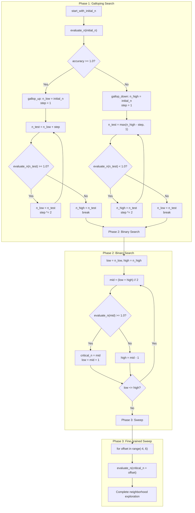
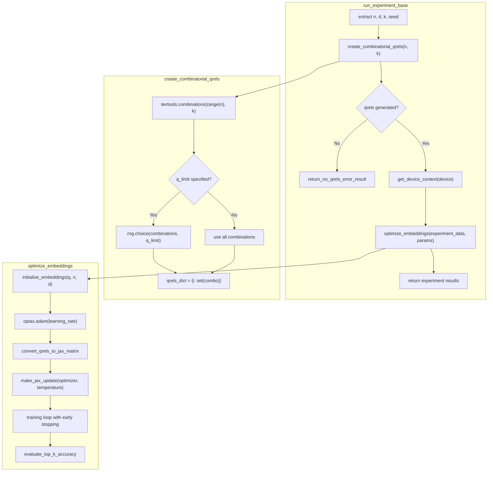
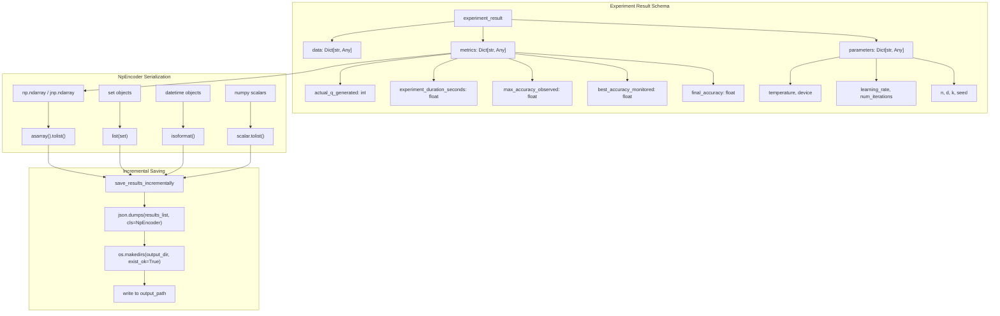

<!-- source: DeepWiki mcp.deepwiki.com · repo google-deepmind/limit · page 3 Free Embedding Experiments · fetched 2026-10-26 -->

# Free Embedding Experiments

<details>
<summary>Relevant source files</summary>

The following files were used as context for generating this wiki page:

- [README.md](README.md)
- [code/free_embedding_experiment.py](code/free_embedding_experiment.py)

</details>


This document covers the free embedding experiment system designed to find the theoretical limits of embedding-based retrieval. The system conducts optimization experiments to determine the critical N value - the maximum number of documents that can be successfully retrieved for a given embedding dimension and relevance structure. 

For information about the LIMIT dataset used in these experiments, see [LIMIT Dataset](#2). For details about the computational infrastructure and JAX optimization stack, see [Computational Infrastructure](#3.2).

## Purpose and Core Concept

The free embedding experiment system implements a search algorithm to find the "critical N" - the maximum number of documents N for which embeddings of dimension d can achieve perfect retrieval accuracy when each query has exactly k relevant documents. This validates theoretical limitations of embedding-based retrieval by finding the empirical breaking point through unconstrained optimization.

The system uses InfoNCE loss with full-batch training to learn optimal query and document embeddings, testing whether perfect retrieval is achievable for specific parameter combinations.

Sources: [code/free_embedding_experiment.py:16-37](), [README.md:46-47]()

## Critical N Search Algorithm

The search process uses a three-phase algorithm implemented in `_run_critical_n_search_for_config` to efficiently locate the critical N value:

### Multi-Phase Search Strategy



Sources: [code/free_embedding_experiment.py:576-676]()

### Evaluation Function

The `_evaluate_n` function handles experiment execution and result caching:

| Component | Function | Implementation |
|-----------|----------|----------------|
| **Signature-based Caching** | `get_params_signature` | Avoids redundant computation by checking processed signatures |
| **Experiment Execution** | `_process_experiment_and_save` | Runs single experiment and saves results incrementally |
| **Accuracy Selection** | `_pick_best_accuracy` | Chooses best accuracy signal from multiple metrics |

Sources: [code/free_embedding_experiment.py:602-625](), [code/free_embedding_experiment.py:591-600]()

## Experiment Execution Framework

### Single Experiment Workflow



Sources: [code/free_embedding_experiment.py:496-535](), [code/free_embedding_experiment.py:123-151](), [code/free_embedding_experiment.py:363-493]()

### JAX Optimization Pipeline

The core optimization uses JAX for GPU-accelerated training with InfoNCE loss:


Sources: [code/free_embedding_experiment.py:348-360](), [code/free_embedding_experiment.py:279-311](), [code/free_embedding_experiment.py:250-276]()

## Configuration and Command-Line Interface

### Core Parameters

The experiment system uses `absl.flags` for configuration management:

| Flag | Type | Purpose | Default |
|------|------|---------|---------|
| `--d` | integer | Embedding dimension | Required |
| `--k` | integer | Relevant documents per query | Required |
| `--enable_critical_n_search` | integer | Starting N for search | Required |
| `--results_output_path` | string | JSON output path | None |
| `--device` | string | Compute device (gpu/tpu/cpu) | "gpu" |
| `--learning_rate` | float | Optimizer learning rate | 0.01 |
| `--num_iterations` | integer | Maximum training iterations | 100000 |
| `--temperature` | float | InfoNCE temperature parameter | 0.1 |

Sources: [code/free_embedding_experiment.py:682-723](), [code/free_embedding_experiment.py:58-71]()

### Usage Example

```bash
python free_embedding_experiment.py \
  --d=4 --k=2 \
  --enable_critical_n_search=11 \
  --results_output_path='d=4_k=2.json' \
  --device=gpu
```

Sources: [code/free_embedding_experiment.py:33-36]()

## Results Management and Output

### Result Structure and Serialization



Sources: [code/free_embedding_experiment.py:97-115](), [code/free_embedding_experiment.py:216-229](), [code/free_embedding_experiment.py:526-534]()

### Early Stopping and Monitoring

The optimization includes sophisticated early stopping with multiple monitoring options:

| Parameter | Purpose | Default |
|-----------|---------|---------|
| `early_stopping_patience` | Iterations to wait before stopping | 1000 |
| `early_stopping_min_delta` | Minimum improvement threshold | 0.00001 |
| `early_stopping_monitor_metric` | Metric to monitor ("loss" or "accuracy") | "loss" |
| `early_stopping_restore_best_weights` | Restore best weights after stopping | False |

The system tracks multiple accuracy signals: `final_accuracy`, `best_accuracy_monitored`, `max_accuracy_observed`, and `last_logged_accuracy` to provide robust signals for the critical N search logic.

Sources: [code/free_embedding_experiment.py:67-70](), [code/free_embedding_experiment.py:412-475](), [code/free_embedding_experiment.py:591-600]()

---

