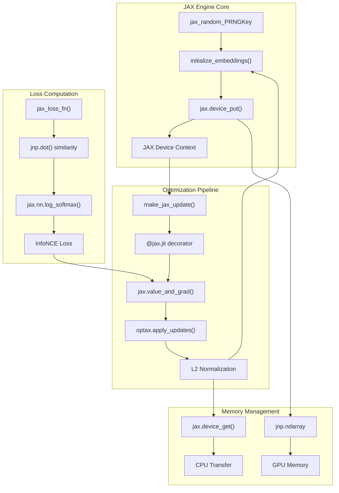
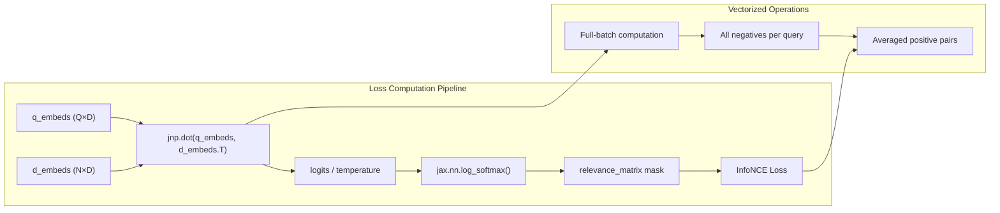
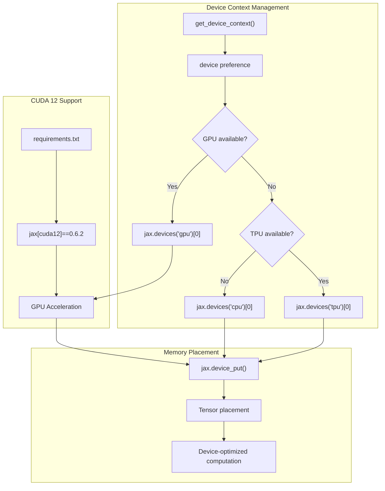
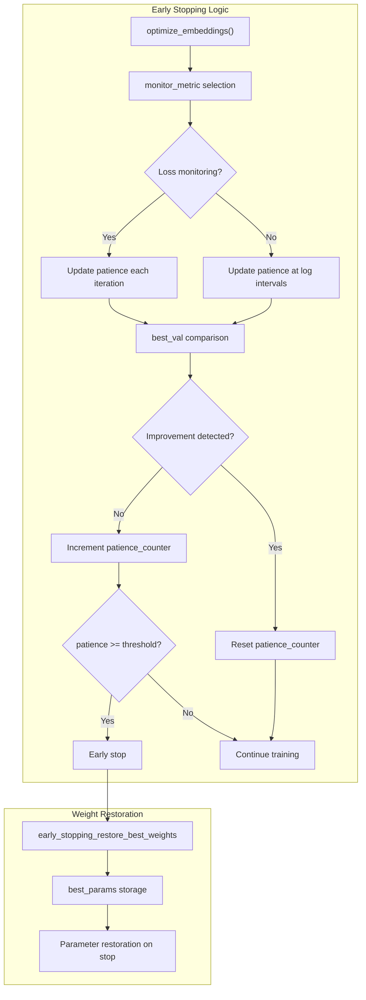
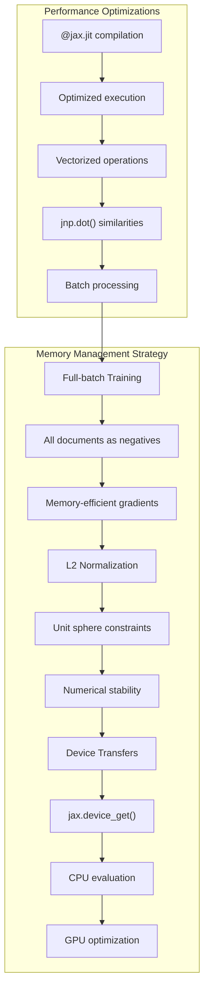
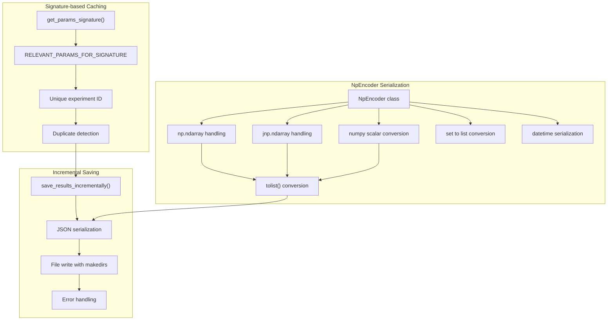
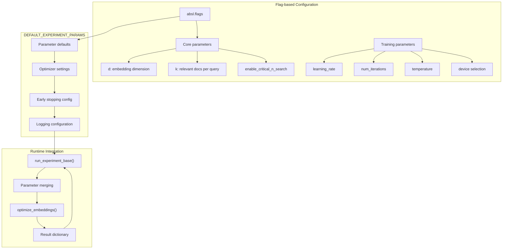

<!-- source: DeepWiki mcp.deepwiki.com · repo google-deepmind/limit · page 3.2 Computational Infrastructure · fetched 2026-10-26 -->

# Computational Infrastructure

Relevant source files

The following files were used as context for generating this wiki page:

- [code/free_embedding_experiment.py](code/free_embedding_experiment.py)
- [code/requirements.txt](code/requirements.txt)

This document covers the high-performance computational infrastructure that powers the free embedding optimization experiments in the LIMIT repository. The infrastructure is built on JAX with GPU acceleration and provides optimized embedding training, device management, and result persistence capabilities.

For information about the experiment framework and search algorithms that use this infrastructure, see [Experiment Framework](#3.1). For dataset-related infrastructure, see [Dataset Generation](#2.2).

## JAX Computational Engine

The core computational engine is built on JAX, providing just-in-time (JIT) compilation and automatic differentiation for high-performance embedding optimization.

### JAX Computational Stack

The JAX engine handles embedding initialization with random normal distributions and L2 normalization. The `initialize_embeddings()` function [code/free_embedding_experiment.py:348-361]() creates query and document embeddings on the specified device context.

The JIT-compiled update function `make_jax_update()` [code/free_embedding_experiment.py:279-312]() combines gradient computation, optimizer updates, and normalization into a single compiled operation for maximum performance.

Sources: [code/free_embedding_experiment.py:279-361](), [code/free_embedding_experiment.py:250-277]()

### InfoNCE Loss Implementation

The `jax_loss_fn()` [code/free_embedding_experiment.py:250-277]() implements vectorized InfoNCE loss computation using full-batch training where all documents serve as negatives for each query. This approach maximizes GPU utilization and training efficiency.

Sources: [code/free_embedding_experiment.py:250-277]()

## Device Management and Hardware Acceleration

The system provides automatic device detection and context management for optimal hardware utilization across GPU, TPU, and CPU environments.

### Device Selection Architecture

The `get_device_context()` function [code/free_embedding_experiment.py:336-346]() implements graceful device fallback, prioritizing GPU acceleration when available. The system supports CUDA 12 through the JAX installation specified in requirements.txt [code/requirements.txt:6]().

Device contexts are automatically applied to all tensors and computations, ensuring optimal memory placement and execution performance across different hardware configurations.

Sources: [code/free_embedding_experiment.py:336-346](), [code/requirements.txt:6]()

## Optimization Infrastructure

The optimization system combines Optax optimizers with JAX for high-performance gradient-based training with sophisticated early stopping mechanisms.

### Optimizer Configuration

| Component | Implementation | Configuration |
|-----------|----------------|---------------|
| Optimizer | `optax.adam()` | Learning rate configurable via flags |
| Learning Rate | Default: 0.01 | `--learning_rate` flag |
| Max Iterations | Default: 100,000 | `--num_iterations` flag |
| Temperature | Default: 0.1 | `--temperature` flag |
| Early Stopping | Patience-based | 1000 iterations default patience |

The optimization pipeline [code/free_embedding_experiment.py:363-494]() integrates Adam optimizer with custom early stopping logic that monitors either loss or accuracy metrics with configurable patience and minimum improvement thresholds.

### Early Stopping Mechanisms

The early stopping system [code/free_embedding_experiment.py:392-476]() supports both loss-based and accuracy-based monitoring with configurable patience, minimum delta, and optional best weight restoration.

Sources: [code/free_embedding_experiment.py:363-494](), [code/free_embedding_experiment.py:58-71]()

## Memory Management and Performance

The system implements efficient memory management strategies for large-scale embedding optimization while maintaining numerical stability.

### Memory-Efficient Training

The training loop maintains embeddings on GPU memory while transferring to CPU only for evaluation steps. L2 normalization [code/free_embedding_experiment.py:307-308]() ensures embeddings remain on the unit sphere, preventing gradient explosion and maintaining numerical stability.

JIT compilation of the update function eliminates Python overhead in the optimization loop, while vectorized similarity computation [code/free_embedding_experiment.py:118-121]() maximizes hardware utilization.

Sources: [code/free_embedding_experiment.py:118-121](), [code/free_embedding_experiment.py:307-308](), [code/free_embedding_experiment.py:294-311]()

## Result Persistence and Serialization

The infrastructure provides robust result persistence with custom serialization support for JAX/NumPy arrays and incremental saving capabilities.

### Custom JSON Serialization

The `NpEncoder` class [code/free_embedding_experiment.py:97-116]() provides comprehensive serialization support for JAX and NumPy data types, handling arrays, scalars, sets, and datetime objects with compact JSON output.

Incremental saving [code/free_embedding_experiment.py:216-230]() ensures results are persisted after each experiment completion, providing fault tolerance for long-running searches.

### Experiment Signature System

The signature system [code/free_embedding_experiment.py:208-214]() creates unique identifiers for experiment configurations using the parameters defined in `RELEVANT_PARAMS_FOR_SIGNATURE` [code/free_embedding_experiment.py:74-77](), enabling efficient caching and duplicate detection across experiment runs.

Sources: [code/free_embedding_experiment.py:97-116](), [code/free_embedding_experiment.py:216-230](), [code/free_embedding_experiment.py:208-214](), [code/free_embedding_experiment.py:74-77]()

## Integration with Experiment Framework

The computational infrastructure integrates seamlessly with the experiment framework through standardized interfaces and configuration management.

### Configuration Interface

The configuration system [code/free_embedding_experiment.py:678-743]() provides comprehensive flag-based parameter control, merging command-line arguments with sensible defaults defined in `DEFAULT_EXPERIMENT_PARAMS` [code/free_embedding_experiment.py:58-71]().

The `run_experiment_base()` function [code/free_embedding_experiment.py:496-536]() serves as the primary integration point, coordinating device setup, qrel generation, optimization execution, and result formatting for the experiment framework.

Sources: [code/free_embedding_experiment.py:678-743](), [code/free_embedding_experiment.py:58-71](), [code/free_embedding_experiment.py:496-536]()

---

