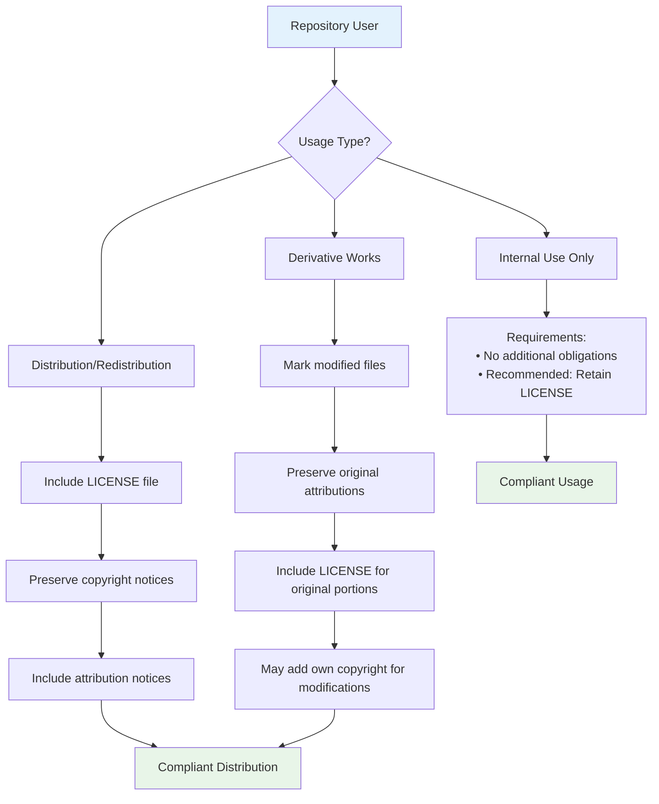
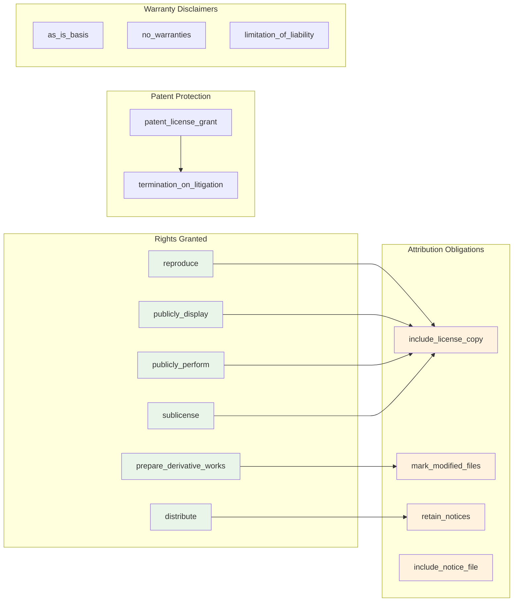

<!-- source: DeepWiki mcp.deepwiki.com · repo google-deepmind/limit · page 6 Legal and Licensing · fetched 2026-10-26 -->

# Legal and Licensing

Relevant source files

The following files were used as context for generating this wiki page:

- [LICENSE](LICENSE)

This document covers the legal terms, licensing requirements, and copyright information for the LIMIT repository. It provides guidance on permitted usage, distribution requirements, and compliance obligations for users, contributors, and organizations incorporating this software.

For information about contributing code changes, see [Development and Contributing](#5).

## Apache License 2.0

The LIMIT repository is licensed under the Apache License Version 2.0, as specified in [LICENSE:1-203](). This is a permissive open-source license that allows broad usage while requiring proper attribution and license preservation.

### License Overview

The Apache License 2.0 provides the following key permissions and requirements:

| Permission | Description | Requirements |
|------------|-------------|--------------|
| **Use** | Commercial and private use allowed | Include license and copyright notice |
| **Modify** | Create derivative works | Mark changed files, preserve attributions |
| **Distribute** | Share original or modified versions | Include license, provide attribution |
| **Patent Grant** | Protection from patent litigation | Automatic patent license from contributors |
| **Sublicense** | Include in larger works with different licenses | Maintain Apache 2.0 terms for this code |

Sources: [LICENSE:1-203]()

## License Compliance Workflow

Sources: [LICENSE:90-129]()

## Copyright and Attribution

### Primary Copyright
The software is provided under copyright protection as specified in the Apache License terms. Users must preserve all copyright, patent, trademark, and attribution notices from the original source code when redistributing.

### Attribution Requirements
When distributing the Work or Derivative Works, you must:

1. **Preserve License File**: Include a copy of the Apache License 2.0 with any distribution
2. **Maintain Copyright Notices**: Retain all existing copyright notices in source files  
3. **Mark Modifications**: Add prominent notices to modified files indicating changes made
4. **Include Attribution**: Preserve attribution notices from the original Work

Sources: [LICENSE:95-105]()

## Rights and Obligations Framework

Sources: [LICENSE:67-72](), [LICENSE:74-88](), [LICENSE:90-129]()

## Distribution Requirements

### Source Code Distribution
When distributing source code versions:
- Include the complete [LICENSE:1-203]() file
- Preserve all copyright notices in source files
- Maintain any existing `NOTICE` file with attribution information
- Mark any modified files with change notifications

### Binary/Object Form Distribution  
When distributing compiled or processed versions:
- Include license and attribution in documentation or display
- Provide readable copy of attribution notices
- May include notices in generated displays where third-party notices typically appear

Sources: [LICENSE:107-122]()

## Patent License Provisions

The Apache License 2.0 includes important patent protection mechanisms:

### Grant of Patent License
Each contributor grants users a perpetual, worldwide, royalty-free patent license covering any patent claims necessarily infringed by their contributions. This applies to patents that would be infringed by the contribution alone or in combination with the Work.

### Patent Litigation Termination
If you initiate patent litigation alleging that the Work or any contribution constitutes patent infringement, your patent licenses under this License terminate immediately as of the litigation filing date.

Sources: [LICENSE:74-88]()

## Warranty and Liability

### Disclaimer of Warranty
The software is provided on an "AS IS" BASIS without warranties of any kind, including:
- No warranty of MERCHANTABILITY
- No warranty of FITNESS FOR A PARTICULAR PURPOSE  
- No warranty of TITLE or NON-INFRINGEMENT
- No express or implied warranties or conditions

### Limitation of Liability
Contributors have no liability for damages arising from use of the Work, including:
- Direct, indirect, special, incidental, or consequential damages
- Loss of goodwill, work stoppage, computer failure, or commercial losses
- Any damages even if advised of the possibility of such damages

Sources: [LICENSE:144-164]()

## Compliance Guidelines

### For Individual Users
- No additional requirements for internal use and modification
- Follow attribution requirements only when distributing to others
- Recommended to preserve `LICENSE` file in local copies

### For Organizations
- Establish processes to include license files in distributed software
- Train developers on marking modified files appropriately
- Maintain attribution notices in documentation and displays
- Consider adding organization's own copyright notices to modifications

### For Contributors
- All contributions submitted are assumed to be under Apache License 2.0 terms
- May not impose additional license terms on contributions
- Separate license agreements may be executed for specific contributions

Sources: [LICENSE:131-137]()