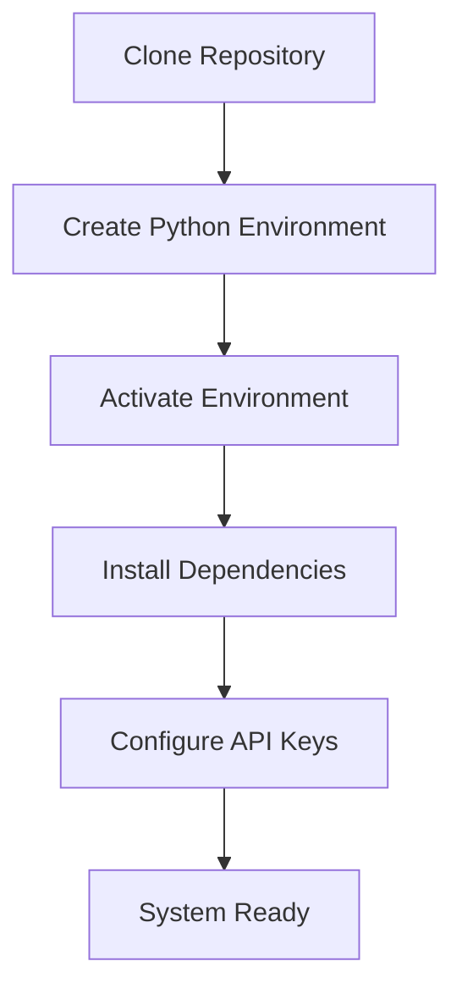
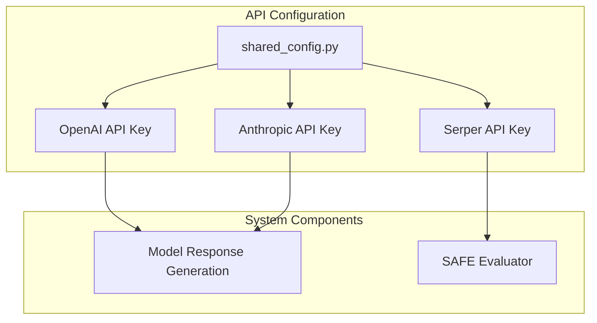
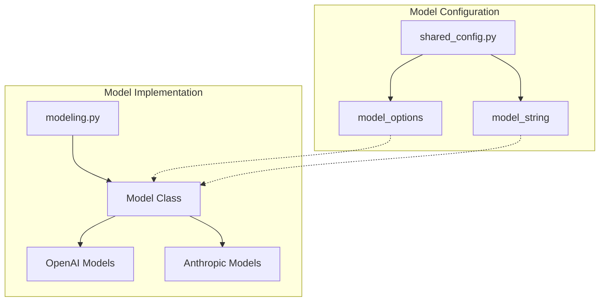

<!-- source: DeepWiki mcp.deepwiki.com · repo google-deepmind/long-form-factuality · page 1.1 Installation and Setup · fetched 2026-10-26 -->

# Installation and Setup

<details>
<summary>Relevant source files</summary>

The following files were used as context for generating this wiki page:

- [README.md](README.md)
- [common/README.md](common/README.md)

</details>


This page provides detailed instructions for installing the long-form-factuality evaluation system and configuring the necessary API keys. It covers the initial setup process, required dependencies, and configuration steps to prepare the system for benchmarking language models.

For information about system architecture and components, see [System Architecture](#2).

## Prerequisites

Before installing the long-form-factuality system, ensure you have:

1. Git installed on your system
2. Python 3.10 or higher
3. Conda package manager (recommended)
4. API keys for external services:
   - OpenAI API key (for GPT models)
   - Anthropic API key (for Claude models)
   - Serper API key (for search functionality in SAFE evaluator)

Sources: [README.md:11-41]()(common/README.md:15-20)()

## Installation Process



### Step 1: Clone the Repository

Clone the GitHub repository to your local machine:

```bash
git clone https://github.com/google-deepmind/long-form-factuality.git
cd long-form-factuality
```

Sources: [README.md:13-22]()

### Step 2: Create and Activate Python Environment

Create a new conda environment with Python 3.10:

```bash
conda create --name longfact python=3.10
conda activate longfact
```

Sources: [README.md:24-34]()

### Step 3: Install Dependencies

Install all required packages using pip:

```bash
pip install -r requirements.txt
```

Sources: [README.md:36-41]()

## API Key Configuration

The system requires API keys for external services to function properly. These must be configured in the shared configuration file.



### Setting API Keys

Add your API keys to the `common/shared_config.py` file:

1. OpenAI API key - Required for accessing GPT models
2. Anthropic API key - Required for accessing Claude models
3. Serper API key - Required for the search functionality in the SAFE evaluator

These keys should be set as values for the respective variables in the configuration file:
- `openai_api_key`
- `anthropic_api_key`
- `serper_api_key`

**Important**: Do not publish these API keys or commit them to public repositories.

Sources: [README.md:67]()(common/README.md:15-20]()

## Configuration Options

The system provides several configuration options that can be customized according to your requirements.

### Random Seed

For reproducibility, the system uses a random seed for operations that require randomness. By default, this is set to `1` but can be modified in `common/shared_config.py`.

### Results Directory

By default, all result files are saved in the `results/` directory. This can be changed by modifying the `path_to_result` variable in `common/shared_config.py`.

### Prompt Postamble

When using the experimentation pipeline, you can add a universal postamble to all prompts by modifying the `prompt_postamble` variable in `common/shared_config.py`. Note that this feature must be enabled in `main/config.py`.

Sources: [common/README.md:22-41]()

## Supported Models

The system supports various models from OpenAI and Anthropic:

| Provider | Models |
|----------|--------|
| OpenAI   | GPT-4-Turbo (`gpt-4-0125-preview`)<br>GPT-4 (`gpt-4-0613`)<br>GPT-4-32K (`gpt-4-32k-0613`)<br>GPT-3.5-Turbo (`gpt-3.5-turbo-0125`)<br>GPT-3.5-Turbo-16K (`gpt-3.5-turbo-16k-0613`) |
| Anthropic | Claude-3-Opus (`claude-3-opus-20240229`)<br>Claude-3-Sonnet (`claude-3-sonnet-20240229`)<br>Claude-3-Haiku (`claude-3-haiku-20240307`)<br>Claude-2.1 (`claude-2.1`)<br>Claude-2.0 (`claude-2.0`)<br>Claude-Instant (`claude-instant-1.2`) |

Additional models can be configured by adding entries to the `model_options` and `model_string` variables in `common/shared_config.py`.



Sources: [common/README.md:43-67]()

## Verifying Installation

After completing the installation and configuration, you can verify that everything is working correctly by running the unit tests:

```bash
python -m unittest discover -s ./ -p "*_test.py"
```

This command will run all unit tests in the repository. If all tests pass, your installation is successful.

To run tests for specific components:

```bash
# Run tests for the common module
python -m unittest discover -s common/ -p "*_test.py"
```

Sources: [README.md:82-90]()(common/README.md:86-92]()

## Next Steps

After completing the installation and setup process, you can proceed to:

1. Generate data using the data creation pipeline:
   ```bash
   python -m data_creation.pipeline
   ```

2. Evaluate models using the SAFE evaluator:
   ```bash
   python -m eval.correlation_vs_factscore
   ```

3. Benchmark models:
   ```bash
   python -m main.pipeline
   ```
   
   And then evaluate the generated responses:
   ```bash
   python -m eval.run_eval --result_path=PATH_TO_RESULTS_FILE
   ```

For more information on using these components, see [Usage Guides](#4).

Sources: [README.md:43-80]()

---

