<!-- source: DeepWiki mcp.deepwiki.com · repo google-deepmind/long-form-factuality · page 1.2 Key Concepts and Terminology · fetched 2026-10-26 -->

# Key Concepts and Terminology

Relevant source files

The following files were used as context for generating this wiki page:

- [LICENSE](LICENSE)
- [README.md](README.md)

This document explains the key concepts and terminology used throughout the long-form factuality system. It provides definitions and explanations of the core components, metrics, and processes that are essential for understanding how the system evaluates factuality in long-form content generated by large language models.

For installation instructions, see [Installation and Setup](#1.1).
For details on system architecture, see [System Architecture](#2).

## Core Concepts

### Long-form Factuality

Long-form factuality refers to the evaluation of factual correctness in extended responses generated by large language models (LLMs). Unlike short-form factuality assessment, long-form responses present unique challenges due to:

- Greater number of claims per response
- Increased complexity of information
- More opportunities for factual errors
- Need for nuanced evaluation methods

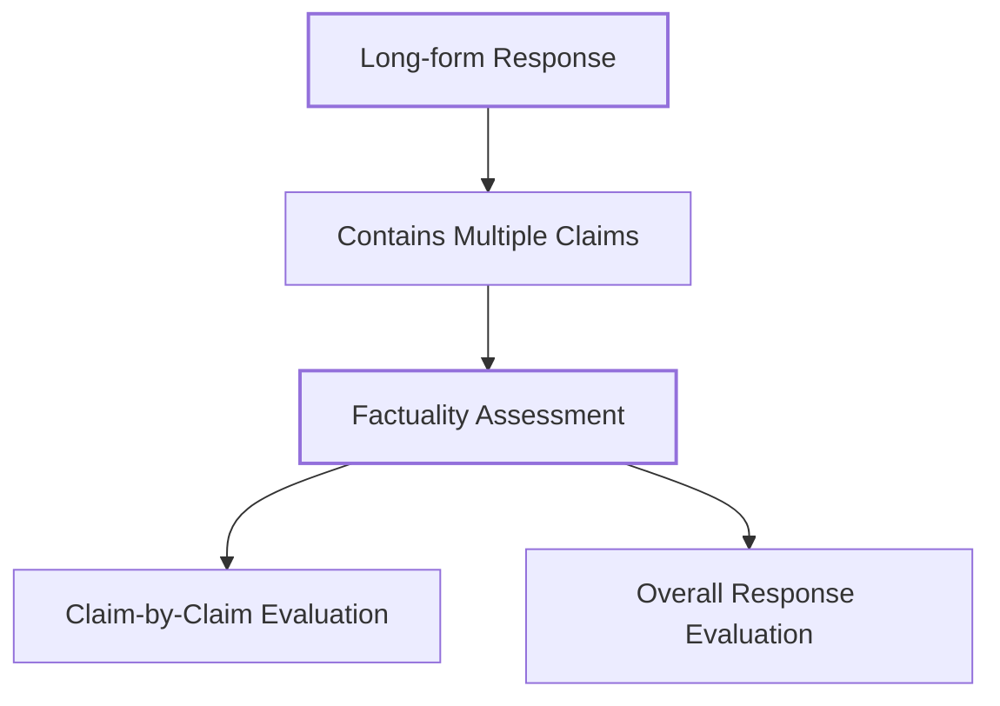

Sources: README.md

### LongFact Prompt Set

The LongFact prompt set is a collection of 2,280 fact-seeking prompts specifically designed to elicit long-form responses from language models. These prompts cover a wide range of topics and are structured to encourage detailed, factual responses.

| Component | Description |
|-----------|-------------|
| Size | 2,280 prompts |
| Purpose | Elicit long-form factual responses |
| Location | `longfact/` directory |
| Creation | Generated via `data_creation.pipeline` |

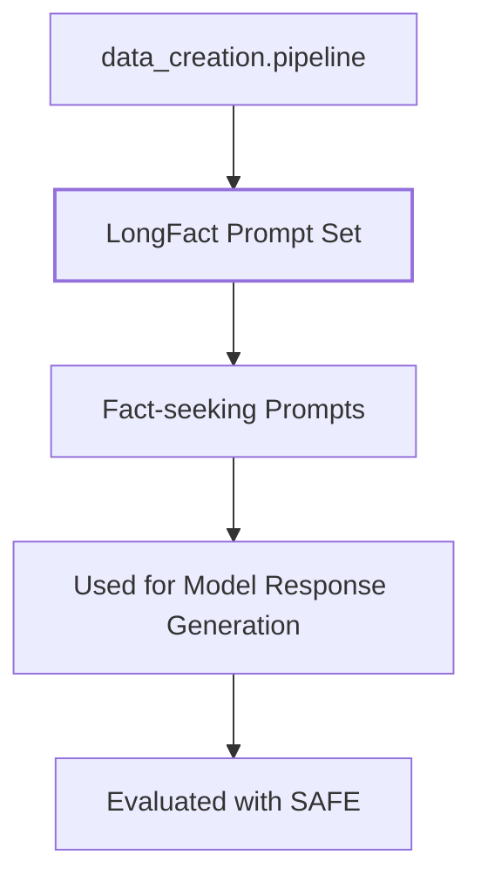

Sources: README.md

### Model Responses

Model responses refer to the outputs generated by large language models (e.g., OpenAI and Anthropic models) when presented with prompts from the LongFact prompt set. These responses are typically long-form, containing multiple factual claims.

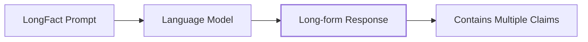

Sources: README.md

## Evaluation Concepts

### Search-Augmented Factuality Evaluator (SAFE)

SAFE is an automatic evaluation system designed to assess the factuality of long-form responses. It uses search augmentation to verify claims made in model responses against trusted sources.

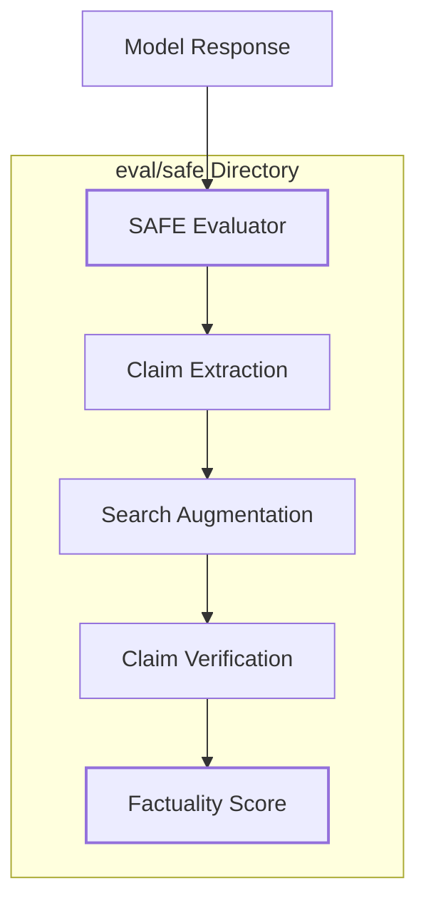

Sources: README.md

### F1@K Metric

F1@K is an adaptation of the traditional F1 score for long-form factuality evaluation. It extends the F1 score by using recall from human-preferred length to better evaluate long-form responses.

| Component | Description |
|-----------|-------------|
| F1 | Harmonic mean of precision and recall |
| K | Human-preferred length parameter |
| Purpose | Calibrate evaluation to human preferences |
| Implementation | Located in SAFE evaluator code |

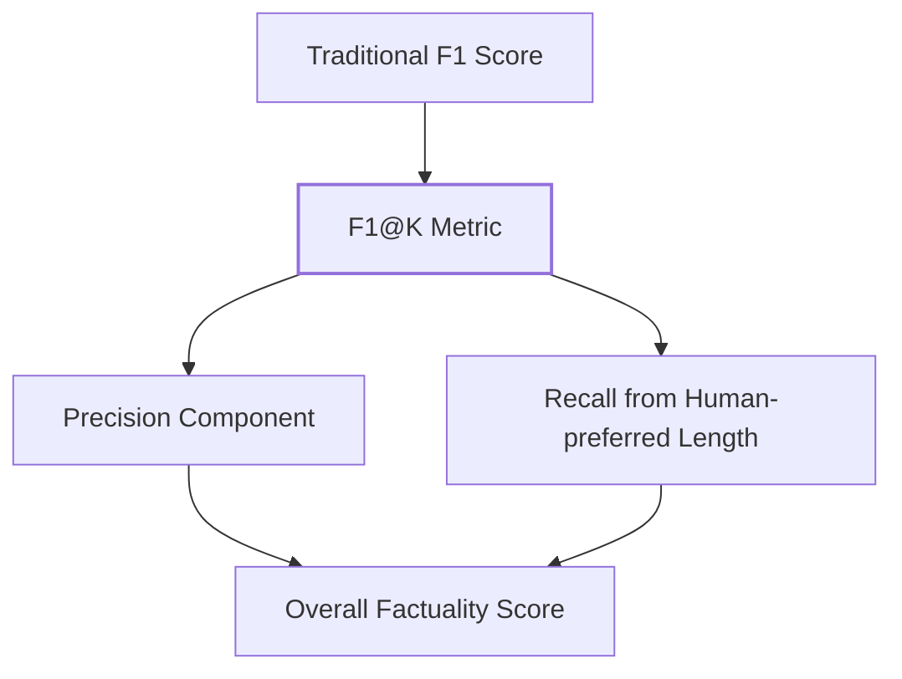

Sources: README.md

### FActScore

FActScore refers to human annotations used for correlation analysis with SAFE. This metric is used to validate the performance of the SAFE evaluator by comparing its automated assessments against human judgments.

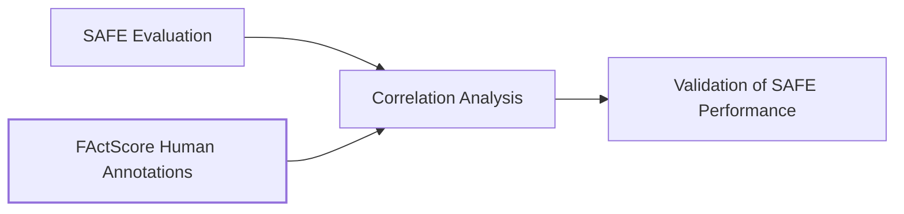

Sources: README.md

## System Components

### Data Creation Pipeline

The data creation pipeline generates the LongFact prompt set. It's implemented in the `data_creation/pipeline.py` file and produces the 2,280 fact-seeking prompts used in the system.

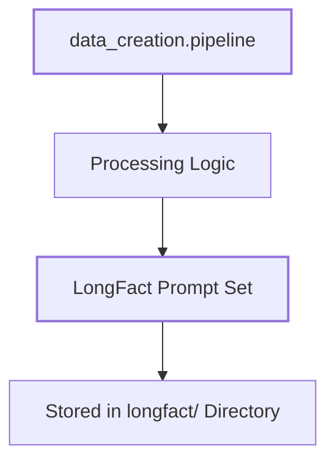

Sources: README.md

### Model Response Generation Pipeline

This pipeline handles the generation of responses from language models using the LongFact prompts. It's implemented in `main/pipeline.py` and interfaces with LLM APIs to obtain responses.

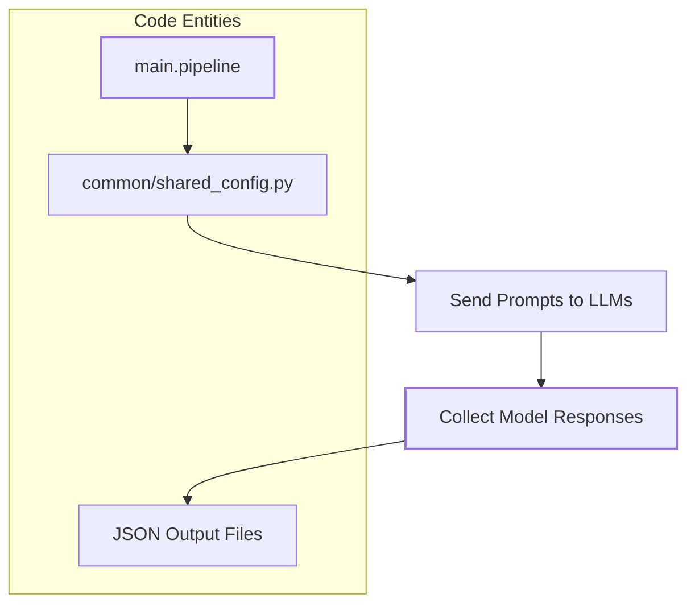

Sources: README.md

### Evaluation Pipeline

The evaluation pipeline assesses the factuality of model responses using SAFE. It's implemented in `eval/run_eval.py` and processes prompt-response pairs to produce factuality scores.

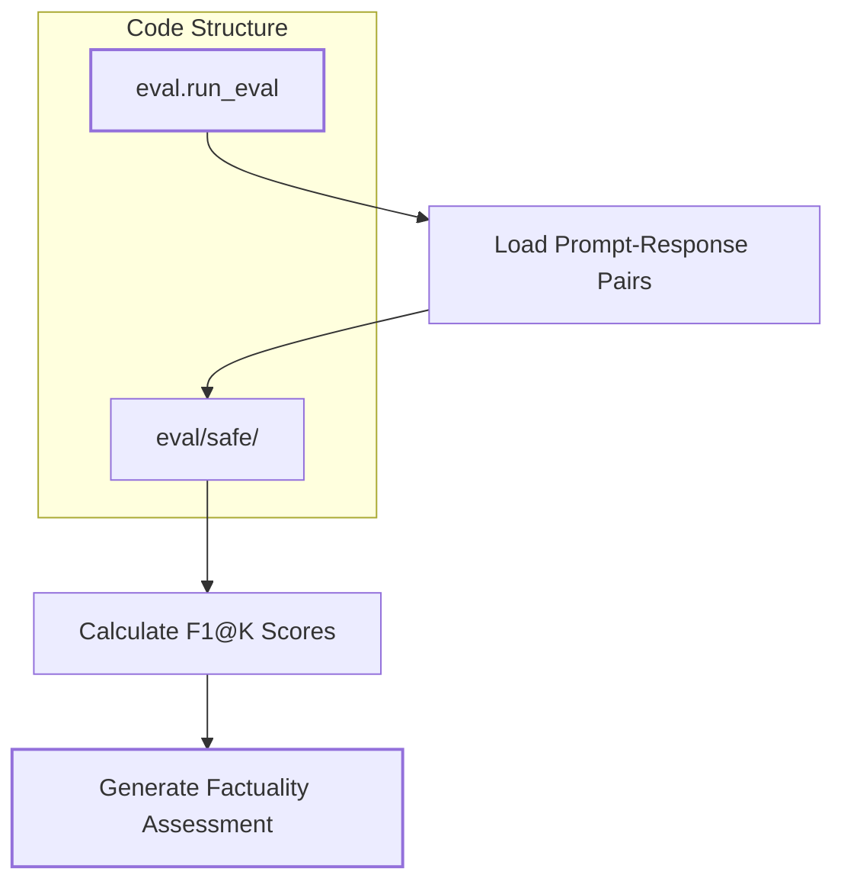

Sources: README.md

## Terminology Reference

| Term | Definition | Code Location |
|------|------------|--------------|
| LongFact | Prompt set of 2,280 fact-seeking prompts | `longfact/` |
| SAFE | Search-Augmented Factuality Evaluator | `eval/safe/` |
| F1@K | Extended F1 score for long-form evaluation | `eval/safe/` |
| Prompt-Response Pairs | JSON files containing prompts and model responses | Output of `main.pipeline` |
| API Keys | Authentication for OpenAI and Anthropic services | `common/shared_config.py` |
| Correlation Analysis | Comparison between SAFE and human annotations | `eval/correlation_vs_factscore.py` |
| Benchmarking | Process of evaluating multiple LLMs | `main/pipeline.py` and `eval/run_eval.py` |

Sources: README.md

## Code to Concept Mapping

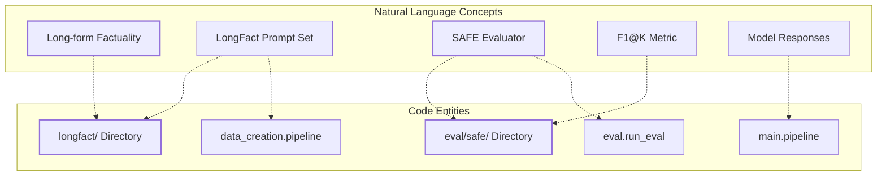

Sources: README.md

## Data Flow and Process Relationships

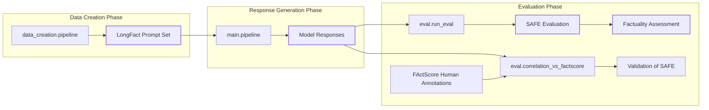

Sources: README.md

---

