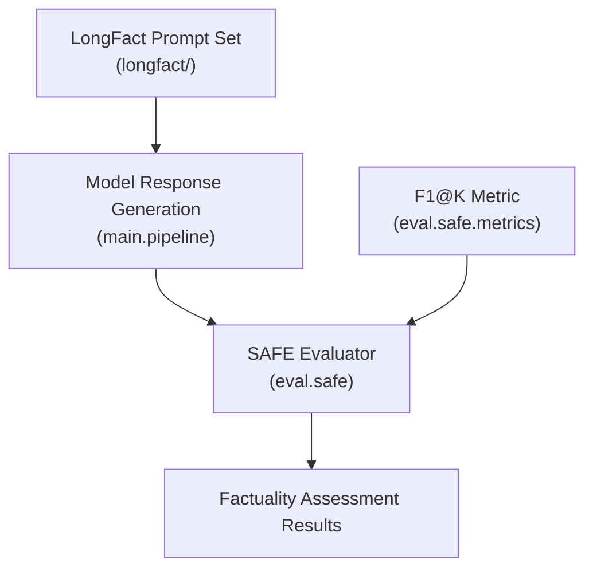
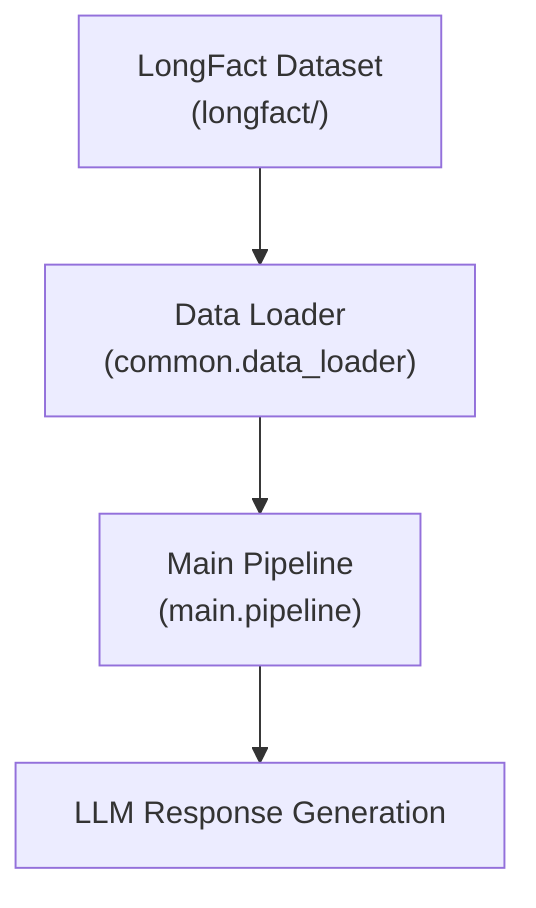
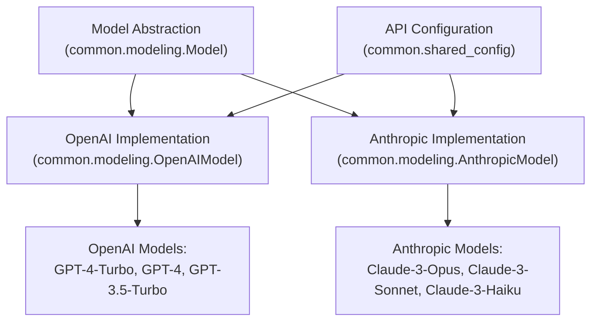
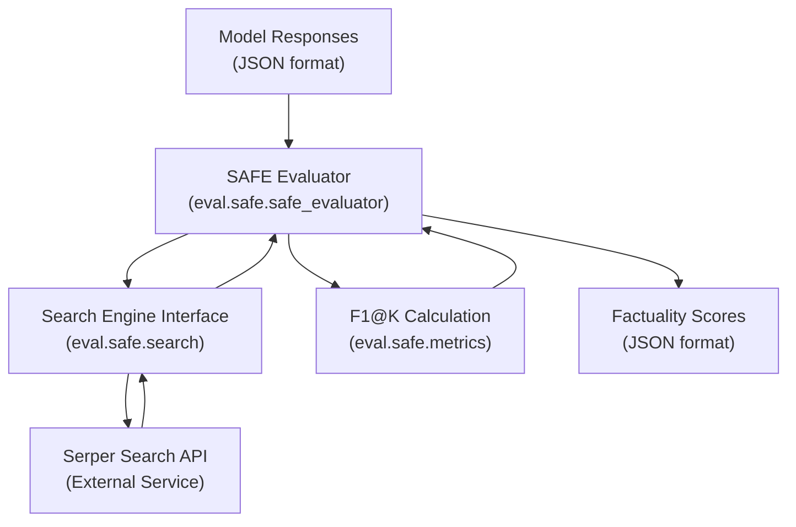
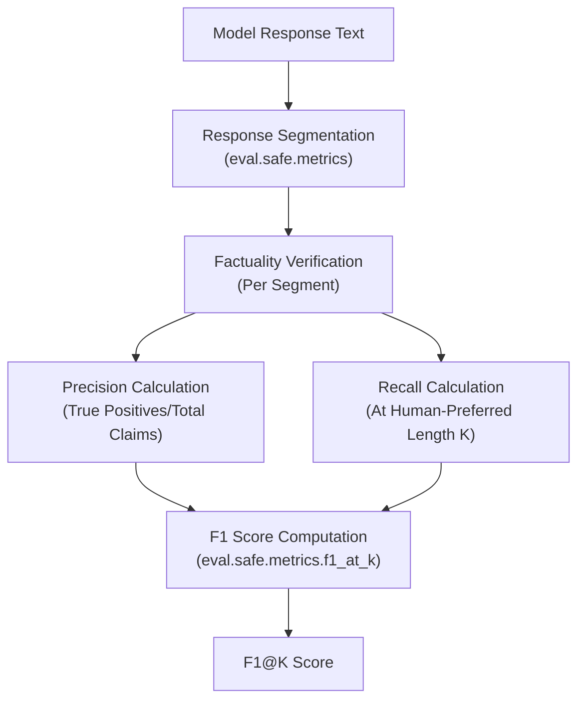
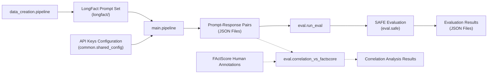
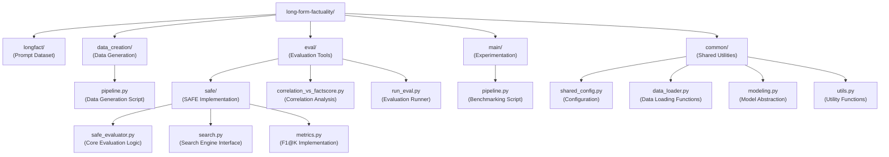
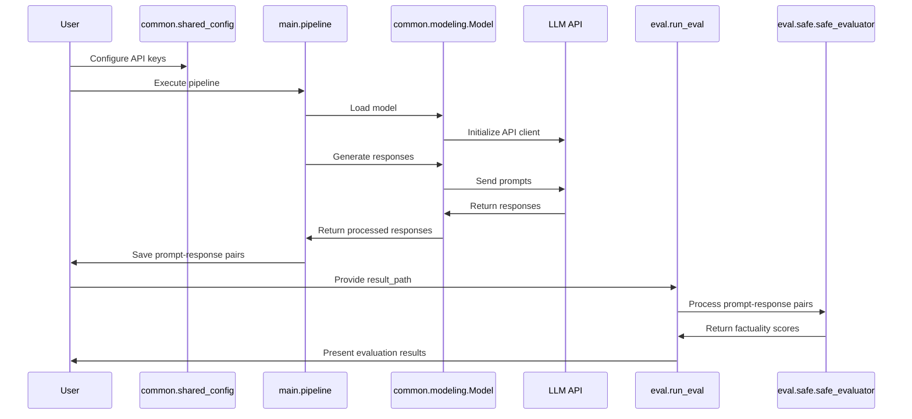

<!-- source: DeepWiki mcp.deepwiki.com · repo google-deepmind/long-form-factuality · page 2 System Architecture · fetched 2026-10-26 -->

# System Architecture

Relevant source files

The following files were used as context for generating this wiki page:

- [LICENSE](LICENSE)
- [README.md](README.md)
- [common/README.md](common/README.md)

This document provides an overview of the Long-Form Factuality system architecture, describing its key components and their interactions. It covers how the different modules are structured and interconnected to evaluate factuality in long-form responses generated by large language models.

For information about specific components, please see the dedicated pages for the [LongFact Prompt Set](#2.1), [SAFE Evaluator](#2.2), and [F1@K Metric](#2.3).

## High-Level System Overview

### System Components and Flow

The Long-Form Factuality system consists of four primary components that work together to evaluate the factuality of responses from LLMs:

The system flow begins with the LongFact prompt set (2,280 fact-seeking prompts), which is processed by the main pipeline to generate model responses. These responses are then evaluated by the SAFE evaluator using the F1@K metric to produce a factuality assessment.

Sources: [README.md:3-9]()

## Core Components

### LongFact Prompt Set

The LongFact prompt set is stored in the `longfact/` directory and loaded using functions in `common/data_loader.py`. These prompts are designed to elicit long-form factual responses from language models.

Sources: [README.md:6](), [common/README.md:6]()

### Model Integration Layer

The system unifies access to various language models through an abstraction layer in `common/modeling.py`. The `Model` class provides a common interface for working with both OpenAI and Anthropic models, with configuration managed through `common/shared_config.py`.

Sources: [common/README.md:44-67]()

### SAFE Evaluator

The Search-Augmented Factuality Evaluator (SAFE) verifies the factuality of statements in model responses using web search. It's implemented in `eval/safe/` and integrates with the Serper search API to retrieve verification information.

Sources: [README.md:7](), [common/README.md:20]()

### F1@K Metric

The F1@K metric extends the traditional F1 score for long-form settings by considering recall at a human-preferred length. The implementation segments responses, checks factuality per segment, and calculates precision and recall to derive the F1 score.

Sources: [README.md:8]()

## Data Flow Architecture

The following diagram illustrates the end-to-end data flow through the system:

The system begins with the data creation pipeline generating the LongFact prompt set. These prompts are processed by the main pipeline, which uses language models (via API keys in `common/shared_config.py`) to generate responses. The prompt-response pairs are then evaluated using SAFE. Additionally, the system can perform correlation analysis against human FActScore annotations to validate the automatic evaluation.

Sources: [README.md:48-64](), [common/README.md:15-21]()

## Directory Structure and Code Organization

The repository is organized into several main directories:
- `longfact/`: Contains the prompt dataset
- `data_creation/`: Implements the data generation pipeline
- `eval/`: Houses the SAFE evaluator and evaluation tools
- `main/`: Provides the experimentation pipeline for benchmarking
- `common/`: Contains shared utilities used across the codebase

Sources: [README.md:44-80](), [common/README.md:4-9]()

## Benchmarking Workflow

The following sequence diagram illustrates the workflow for benchmarking language models:

The benchmarking process starts with configuring API keys in `common/shared_config.py`, then executing the main pipeline to generate and save model responses. These responses are then evaluated using the SAFE evaluator to assess their factuality.

Sources: [README.md:66-80](), [common/README.md:15-21]()

## Integration with External Services

The system integrates with the following external services:

| Service | Purpose | Integration Point | Configuration |
|---------|---------|-------------------|--------------|
| OpenAI API | Access to GPT models | `common.modeling.OpenAIModel` | `common.shared_config.openai_api_key` |
| Anthropic API | Access to Claude models | `common.modeling.AnthropicModel` | `common.shared_config.anthropic_api_key` |
| Serper API | Web search for fact verification | `eval.safe.search.SerperSearchEngine` | `common.shared_config.serper_api_key` |

These integrations allow the system to generate responses from various language models and verify factual claims using web search.

Sources: [common/README.md:15-21](), [common/README.md:44-62]()

---

