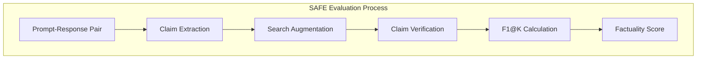
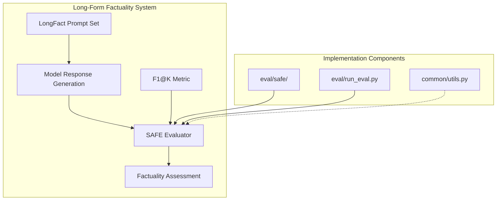
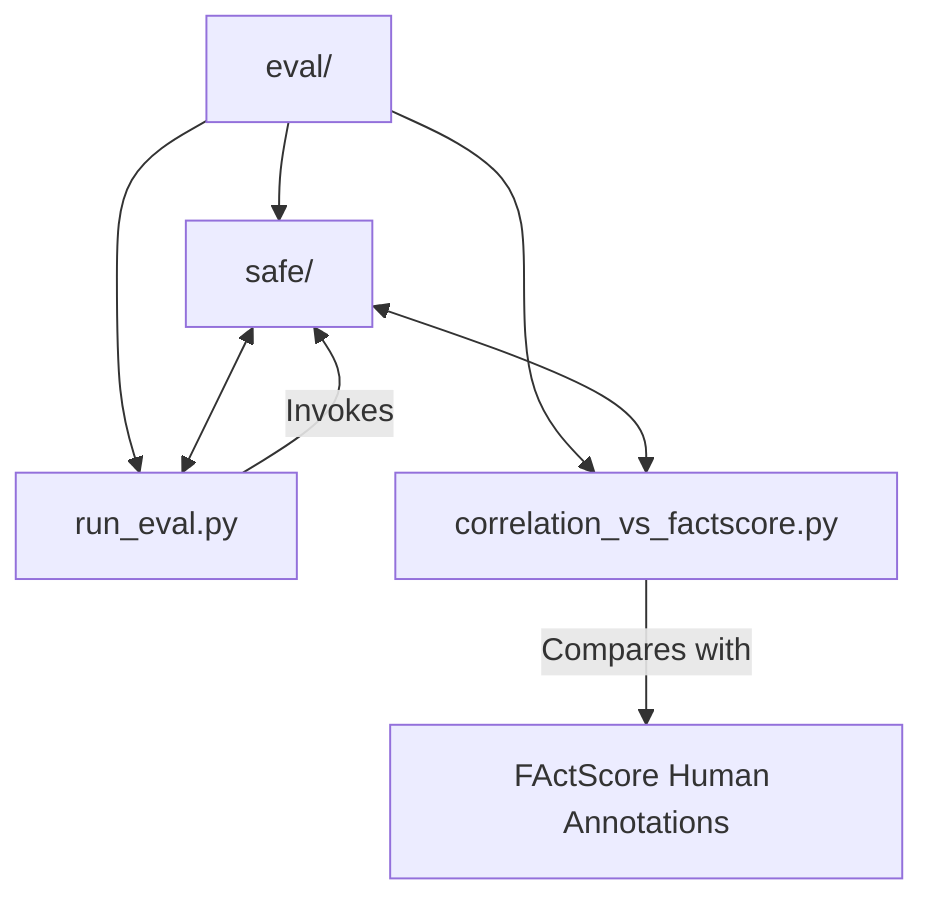
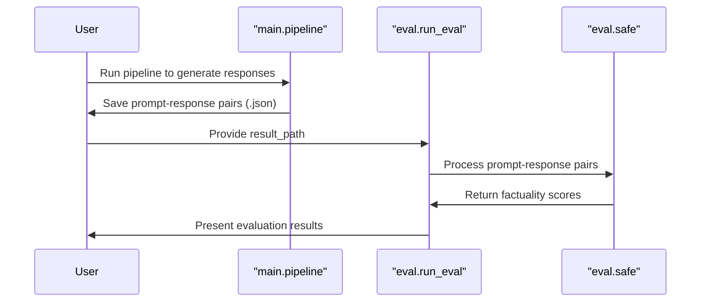
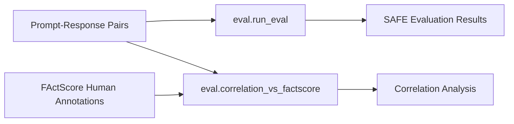

<!-- source: DeepWiki mcp.deepwiki.com · repo google-deepmind/long-form-factuality · page 2.2 SAFE Evaluator · fetched 2026-10-26 -->

# SAFE Evaluator

<details>
<summary>Relevant source files</summary>

The following files were used as context for generating this wiki page:

- [README.md](README.md)

</details>


## Purpose and Scope

The Search-Augmented Factuality Evaluator (SAFE) is a core component of the long-form factuality system designed to automatically assess the factual accuracy of responses generated by large language models (LLMs). This document provides a technical overview of the SAFE evaluator, its architecture, implementation, and how it integrates with other components of the system.

For information on the F1@K metric that SAFE uses to evaluate factuality, see [F1@K Metric](#2.3).

Sources: [README.md:7-8]()

## Overview

SAFE evaluates the factual accuracy of LLM-generated responses by analyzing prompt-response pairs and producing factuality scores. As its name suggests, SAFE uses search augmentation to verify factual claims in model responses against reliable sources of information.

The evaluation process works by breaking down responses into individual factual claims and then verifying these claims against information retrieved from search to determine their accuracy. This enables a comprehensive assessment of factuality in long-form content, where multiple claims may be present in a single response.



Sources: [README.md:7-8](), [README.md:56-58]()

## System Architecture

SAFE is positioned as a critical evaluation component within the larger long-form factuality system. It receives model-generated responses, processes them to assess factual accuracy, and outputs factuality scores that can be used to benchmark different LLMs.



The SAFE evaluator is tightly integrated with other components:
- It receives prompt-response pairs generated by the main pipeline
- It uses the F1@K metric to quantify factuality
- It can be compared against human annotations (FActScore) for correlation analysis

Sources: [README.md:56-58](), [README.md:75-80]()

## Implementation Details

The SAFE evaluator is implemented in the `eval/safe/` directory. It is designed to provide automated, scalable assessment of factuality in long-form text.

### Directory Structure



The primary components involved in SAFE evaluation include:
- `eval/safe/`: Contains the core implementation of the SAFE evaluator
- `eval/run_eval.py`: Provides an interface to run SAFE evaluation on prompt-response pairs
- `eval/correlation_vs_factscore.py`: Used to evaluate SAFE against human annotations

Sources: [README.md:56-58](), [README.md:59-64]()

## Usage

To use SAFE for evaluating model responses, you can run the `eval.run_eval` module with a path to the JSON file containing prompt-response pairs:

```bash
python -m eval.run_eval --result_path=<path_to_json_file>
```

The JSON file should contain prompt-response pairs generated by the main experimentation pipeline.

### Workflow



This workflow shows how SAFE integrates into the overall benchmarking process for LLMs:

1. The user generates responses using the main pipeline
2. The responses are saved as prompt-response pairs in a JSON file
3. The user provides the path to this file to the evaluation module
4. SAFE processes the prompt-response pairs and returns factuality scores
5. The results are presented to the user

Sources: [README.md:75-80]()

## Benchmarking and Validation

SAFE has been validated against human annotations (FActScore) to ensure its reliability as an automated factuality evaluator. This correlation analysis can be run using:

```bash
python -m eval.correlation_vs_factscore
```

This analysis helps establish SAFE's effectiveness at approximating human judgment of factuality in long-form content.



This validation process is essential for ensuring that SAFE provides reliable automated evaluation that correlates well with human assessment of factuality.

Sources: [README.md:59-64]()

## Technical Considerations

When using SAFE, consider the following technical aspects:

1. **Input Format**: SAFE expects prompt-response pairs in a specific JSON format
2. **Scalability**: SAFE is designed to evaluate large numbers of responses efficiently
3. **Search Integration**: As a search-augmented evaluator, SAFE relies on access to information sources for verification
4. **Metrics**: SAFE uses the F1@K metric, which is specifically adapted for long-form settings

SAFE represents an important advancement in automated factuality evaluation, particularly for long-form content where traditional metrics may not be suitable.

Sources: [README.md:7-8](), [README.md:56-58](), [README.md:75-80]()

---

