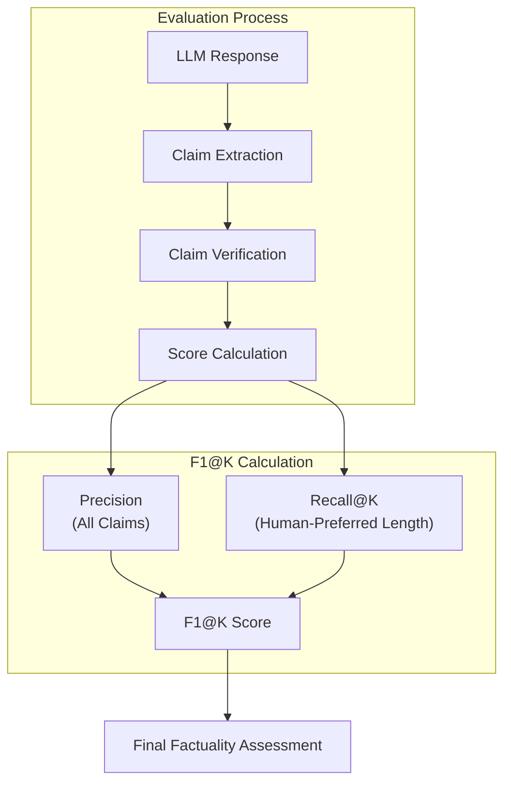
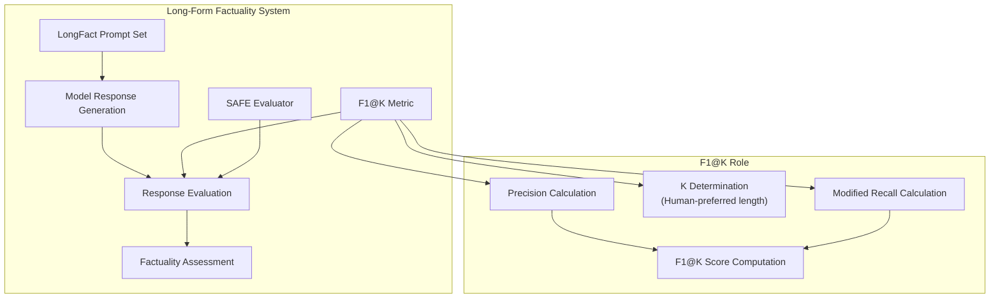

<!-- source: DeepWiki mcp.deepwiki.com · repo google-deepmind/long-form-factuality · page 2.3 F1@K Metric · fetched 2026-10-26 -->

# F1@K Metric

<details>
<summary>Relevant source files</summary>

The following files were used as context for generating this wiki page:

- [README.md](README.md)

</details>


## Purpose and Scope

This document describes the F1@K metric, which is an adaptation of the traditional F1 score designed specifically for evaluating factuality in long-form content generated by large language models. F1@K extends the standard F1 score by incorporating human-preferred length considerations into the recall component. For information about the SAFE evaluator that uses this metric, see [SAFE Evaluator](#2.2).

## Concept and Definition

F1@K metric addresses a key challenge in evaluating long-form content: balancing precision (accuracy of stated claims) with recall (completeness of information) while accounting for appropriate response length.

```
F1@K = 2 × (Precision × Recall@K) / (Precision + Recall@K)
```

Where:
- Precision: Proportion of generated claims that are factually correct
- Recall@K: Proportion of expected claims that are correctly generated, considering only the top K claims (where K represents human-preferred length)

Sources: [README.md:7-8]()

## How F1@K Differs from Standard F1

The standard F1 score can be problematic for long-form content because:

1. It doesn't account for response length variability
2. It may unfairly penalize shorter responses or reward excessively verbose ones
3. It doesn't align with human preferences for appropriate detail level

F1@K addresses these limitations by:

1. Using a modified recall component (Recall@K) that considers human preferences for content length
2. Maintaining the standard precision calculation across all claims
3. Creating a more balanced assessment that rewards both accuracy and appropriate detail

| Metric | Calculation | Strengths | Limitations |
|--------|-------------|-----------|-------------|
| Standard F1 | Harmonic mean of precision and recall across all claims | Simple, established | Doesn't account for preferred length |
| F1@K | Harmonic mean of precision and recall@K (human-preferred length) | Aligns with human preferences, suitable for long-form | Requires determining appropriate K |

Sources: [README.md:8]()

## Integration with SAFE Evaluator

F1@K serves as a critical metric within the Search-Augmented Factuality Evaluator (SAFE), helping to provide more nuanced factuality assessments that align with human expectations.



Sources: [README.md:7-8]()

## System Context

The F1@K metric is a foundational component of the long-form factuality evaluation system, working in conjunction with the SAFE evaluator to assess model-generated responses.



Sources: [README.md:3-9]()

## Applications and Use Cases

The F1@K metric is particularly valuable for:

1. Benchmarking different LLMs on long-form factuality
2. Evaluating the impact of different prompting strategies
3. Providing a more balanced assessment that considers both accuracy and appropriate detail
4. Aligning automated evaluation with human judgment about response quality

## Key Advantages

- Provides a more nuanced evaluation compared to traditional metrics
- Accounts for human preferences regarding content length and detail
- Better suited for comparing models in long-form response settings
- Balances the precision-recall tradeoff in a way that's appropriate for long-form content
- Integrates seamlessly with search-augmented evaluation approaches

Sources: [README.md:8]()

## Summary

F1@K represents an important adaptation of traditional evaluation metrics for the long-form setting. By incorporating human preferences for content length into the recall calculation, it provides a more balanced and realistic assessment of factuality in long-form responses. This metric works in conjunction with the SAFE evaluator to benchmark language models on their ability to generate factual long-form content.

Sources: [README.md:3-9]()

---

