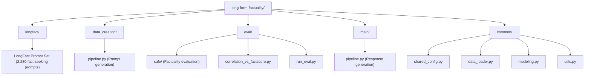
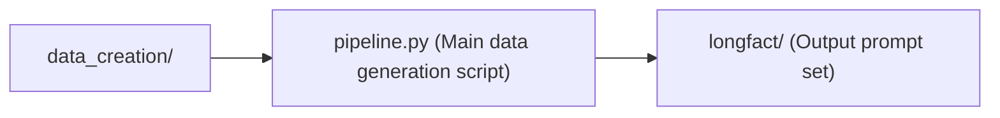
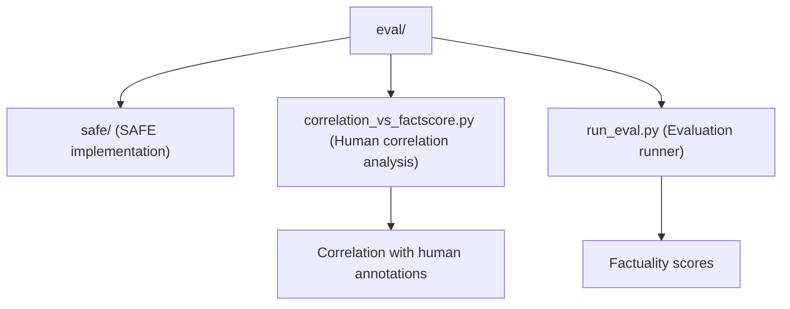
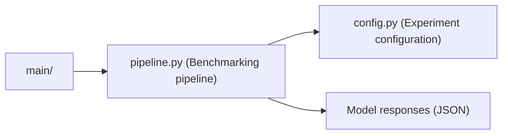
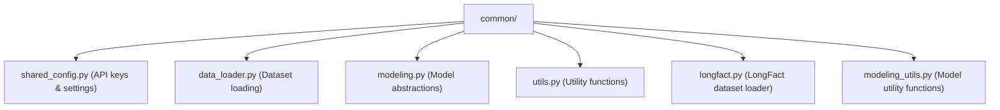
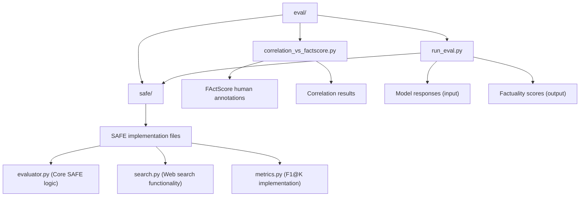
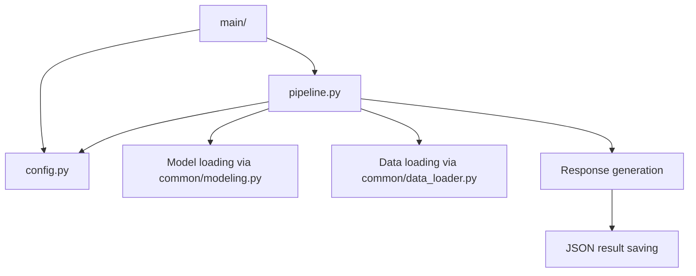
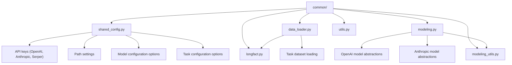
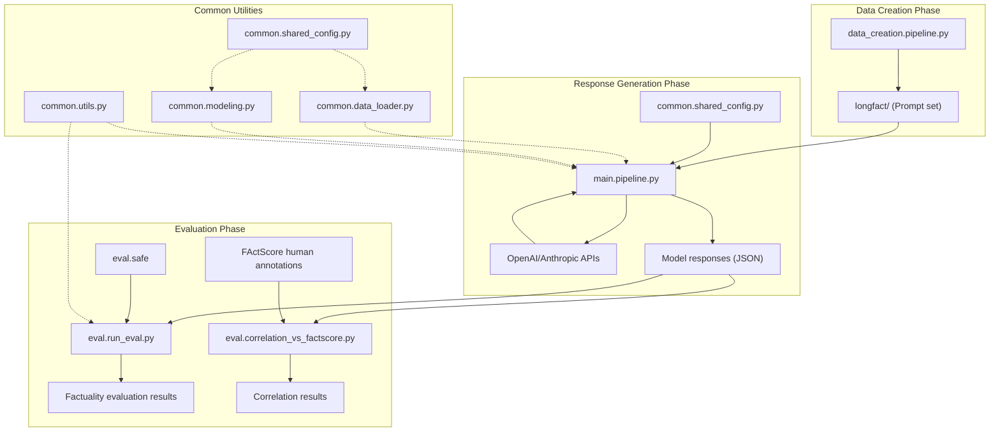
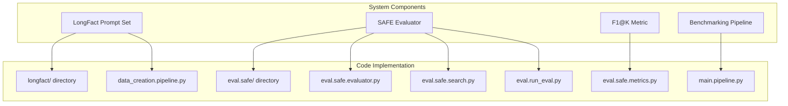

<!-- source: DeepWiki mcp.deepwiki.com · repo google-deepmind/long-form-factuality · page 3 Directory Structure · fetched 2026-10-26 -->

# Directory Structure

<details>
<summary>Relevant source files</summary>

The following files were used as context for generating this wiki page:

- [README.md](README.md)
- [common/README.md](common/README.md)

</details>


## Purpose and Scope

This document provides a detailed overview of the Long-Form Factuality repository directory structure, explaining how the codebase is organized and how different components relate to each other. It describes the purpose of each directory, key files, and their roles in the overall system architecture. For information about how to set up and install the system, see [Installation and Setup](#1.1).

## Repository Root Structure

The repository is organized into five main directories, each serving a specific purpose in the evaluation of long-form factuality in large language models.



Sources: [README.md:3-9]()

## Main Directories Overview

### 1. `longfact/` Directory

Contains the LongFact prompt set with 2,280 fact-seeking prompts designed to elicit long-form responses from language models.

Sources: [README.md:6](), [README.md:44-46]()

### 2. `data_creation/` Directory

Houses the data generation pipeline used to create the LongFact prompt set.



Sources: [README.md:48-53]()

### 3. `eval/` Directory

Contains the evaluation components, most notably the Search-Augmented Factuality Evaluator (SAFE), as well as code for evaluating model responses.



Sources: [README.md:55-64](), [README.md:75-80]()

### 4. `main/` Directory

Contains the experimentation pipeline for benchmarking language models from OpenAI and Anthropic using the LongFact prompt set.



Sources: [README.md:66-73]()

### 5. `common/` Directory

Houses shared code components used across the codebase, including data loading utilities, model abstractions, and configuration settings.



Sources: [common/README.md:5-9]()

## Detailed Directory Structure

### LongFact Directory Structure

The `longfact/` directory contains the LongFact prompt set organized as JSON files. This is the primary dataset used for evaluating long-form factuality in language models.

Sources: [README.md:44-46]()

### Data Creation Directory Structure

The `data_creation/` directory contains the pipeline for generating the LongFact prompt set. The main script is `pipeline.py`, which implements the data generation process.

Sources: [README.md:48-53]()

### Evaluation Directory Structure

The `eval/` directory contains the components related to evaluating model responses for factuality:



The SAFE evaluator is implemented in the `safe/` subdirectory, which contains modules for web search functionality, evaluation logic, and metric calculation. The `correlation_vs_factscore.py` script analyzes the correlation between SAFE and human annotations. The `run_eval.py` script provides a command-line interface for evaluating model responses.

Sources: [README.md:55-64](), [README.md:75-80]()

### Main Directory Structure

The `main/` directory contains the experimentation pipeline for benchmarking language models:



The main pipeline in `pipeline.py` handles the process of loading models and data, generating responses to prompts, and saving the results for later evaluation.

Sources: [README.md:66-73]()

### Common Directory Structure

The `common/` directory contains shared code used across the repository:



The `common/` directory provides essential utilities that support the entire system:

- `shared_config.py`: Contains configuration settings, API keys, and model/task options
- `data_loader.py`: Provides functions for loading datasets
- `modeling.py`: Implements abstractions for working with different language models
- `utils.py`: Contains general utility functions
- `longfact.py`: Specialized loader for the LongFact dataset
- `modeling_utils.py`: Utility functions related to model interaction

Sources: [common/README.md:5-9](), [common/README.md:15-21](), [common/README.md:44-63]()

## Cross-Component Relationships

The following diagram illustrates how the different components of the system interact with each other in a typical workflow:



This diagram shows the workflow from data creation to response generation to evaluation, highlighting how data flows through the system and how the common utilities support each phase.

Sources: [README.md:44-80](), [common/README.md:5-9]()

## Code to Component Mapping

The following diagram maps high-level system components to their specific code implementations:



This diagram shows how the conceptual system components are implemented in specific code files and directories.

Sources: [README.md:3-9](), [README.md:55-64](), [README.md:66-73]()

## Unit Tests Structure

Each file in the repository has a corresponding unit test file with the `_test` suffix. For example, `file.py` would have `file_test.py` for unit tests. These tests ensure the functionality of each component is working as expected.


To run all unit tests in the repository:

```bash
python -m unittest discover -s ./ -p "*_test.py"
```

To run unit tests for a specific directory (e.g., `common/`):

```bash
python -m unittest discover -s common/ -p "*_test.py"
```

Sources: [README.md:82-90](), [common/README.md:86-92]()

## File Relationships Table

The following table summarizes the key files in each directory and their primary responsibilities:

| Directory | Key Files | Primary Responsibilities |
|-----------|-----------|--------------------------|
| `longfact/` | JSON prompt files | Store the 2,280 fact-seeking prompts |
| `data_creation/` | `pipeline.py` | Generate the LongFact prompt set |
| `eval/` | `safe/evaluator.py`<br>`safe/search.py`<br>`safe/metrics.py`<br>`run_eval.py`<br>`correlation_vs_factscore.py` | Implement SAFE evaluator<br>Handle web search functionality<br>Implement F1@K metric<br>Provide CLI for evaluation<br>Compare with human annotations |
| `main/` | `pipeline.py`<br>`config.py` | Implement benchmarking pipeline<br>Configure experiment parameters |
| `common/` | `shared_config.py`<br>`data_loader.py`<br>`modeling.py`<br>`utils.py` | Store configuration settings<br>Load datasets<br>Abstract model interactions<br>Provide utility functions |

Sources: [README.md:3-9](), [common/README.md:5-9](), [README.md:44-80]()

---

