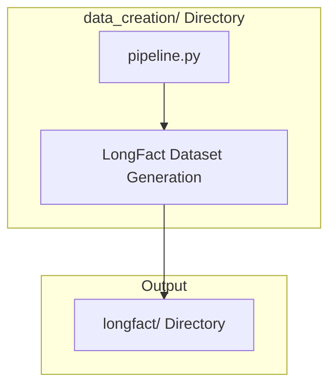
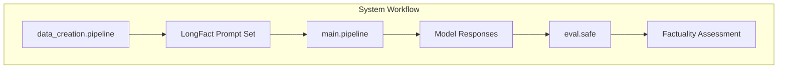
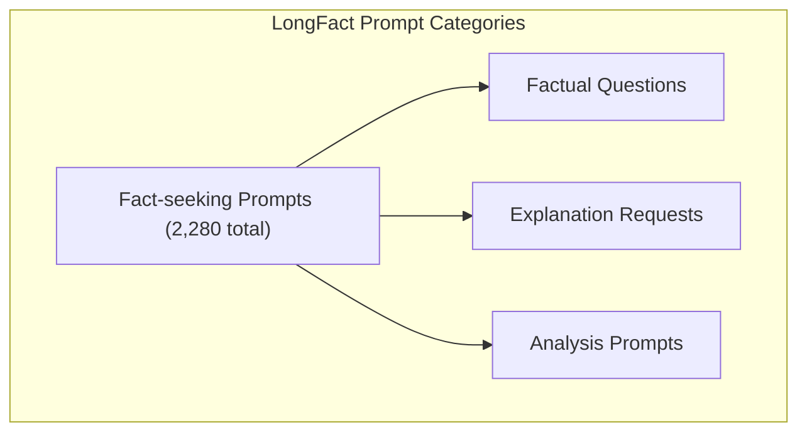
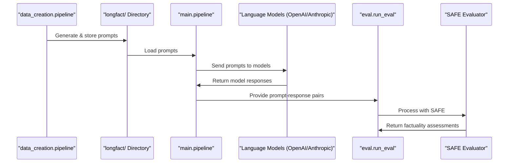
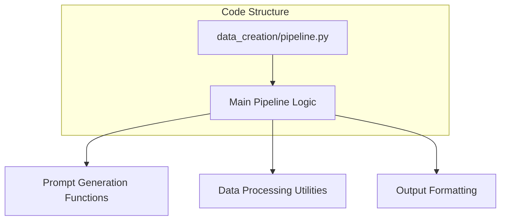
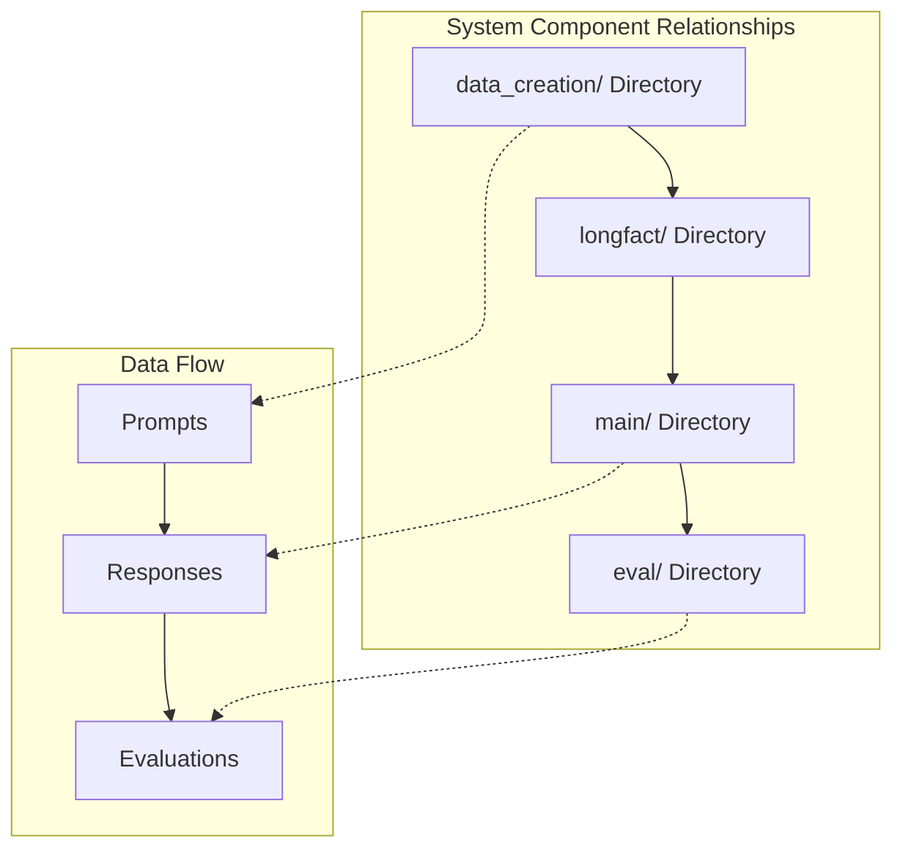

<!-- source: DeepWiki mcp.deepwiki.com · repo google-deepmind/long-form-factuality · page 3.1 data_creation/ Directory · fetched 2026-10-26 -->

# data_creation/ Directory

<details>
<summary>Relevant source files</summary>

The following files were used as context for generating this wiki page:

- [README.md](README.md)

</details>


## Purpose and Scope

The `data_creation/` directory contains the implementation of the data generation pipeline responsible for creating the LongFact prompt set—a collection of 2,280 fact-seeking prompts designed to elicit long-form responses from language models. This document explains the structure, implementation, and usage of the data creation pipeline. For information about the LongFact prompt set itself, see [LongFact Prompt Set](#2.1).

Sources: [README.md:3-9](), [README.md:48-53]()

## Directory Overview

The `data_creation/` directory contains the pipeline and supporting code for generating the LongFact dataset, which is a core component of the long-form factuality evaluation system.



Sources: [README.md:44-46](), [README.md:48-53]()

## Pipeline Architecture

The data creation pipeline is responsible for generating the structured prompts that make up the LongFact dataset. This pipeline transforms raw information sources into carefully crafted prompts designed to test the factuality of LLM responses in long-form contexts.


Sources: [README.md:6](), [README.md:48-53]()

## Integration with System Architecture

The data creation pipeline is the first component in the overall system workflow, producing the prompts that are later used for benchmarking language models with the SAFE evaluator.



Sources: [README.md:3-9](), [README.md:48-53](), [README.md:66-73](), [README.md:75-80]()

## Running the Pipeline

The data creation pipeline can be executed using the following command:

```bash
python -m data_creation.pipeline
```

This command runs the pipeline script that generates the LongFact prompt set.

Sources: [README.md:48-53]()

## Output Structure

The output of the data creation pipeline is the LongFact dataset, which consists of 2,280 fact-seeking prompts. These prompts are stored in the `longfact/` directory of the repository.

| Dataset Property | Value |
|------------------|-------|
| Number of Prompts | 2,280 |
| Type | Fact-seeking prompts |
| Purpose | Elicit long-form responses |
| Storage Location | `longfact/` directory |

Sources: [README.md:6](), [README.md:44-46]()

## Prompt Types and Categories

The LongFact prompt set includes various types of prompts designed to test different aspects of factuality in long-form settings.



Sources: [README.md:6]()

## Data Flow From Creation to Evaluation

The following diagram illustrates how data flows from the creation pipeline through the entire system, showing how the LongFact prompts are generated and subsequently used for model evaluation.



Sources: [README.md:3-9](), [README.md:48-53](), [README.md:66-73](), [README.md:75-80]()

## Code Structure and Key Components

The primary component in the data creation directory is the pipeline implementation:



Sources: [README.md:48-53]()

## Relationship to Other System Components

The data creation pipeline interacts with other components of the system, particularly the main experimentation pipeline and evaluation modules.



Sources: [README.md:3-9](), [README.md:44-53](), [README.md:66-80]()

## Usage Examples

To generate the LongFact prompt set, execute the data creation pipeline:

```bash
python -m data_creation.pipeline
```

After generating the prompts, they can be used with the main pipeline to benchmark language models:

```bash
python -m main.pipeline
```

Finally, model responses can be evaluated using SAFE:

```bash
python -m eval.run_eval --result_path=<path_to_responses.json>
```

Sources: [README.md:48-53](), [README.md:66-73](), [README.md:75-80]()

## Summary

The `data_creation/` directory contains the pipeline responsible for generating the LongFact prompt set, which is a collection of 2,280 fact-seeking prompts designed to elicit long-form responses from language models. This pipeline is the first step in the overall workflow of evaluating the factuality of large language models in long-form settings.

Sources: [README.md:3-9](), [README.md:48-53]()

---

