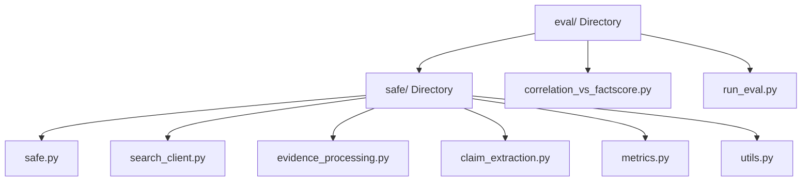
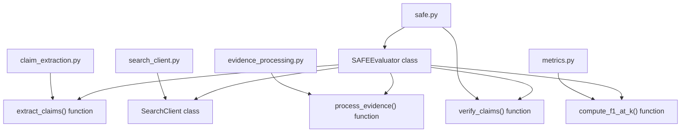
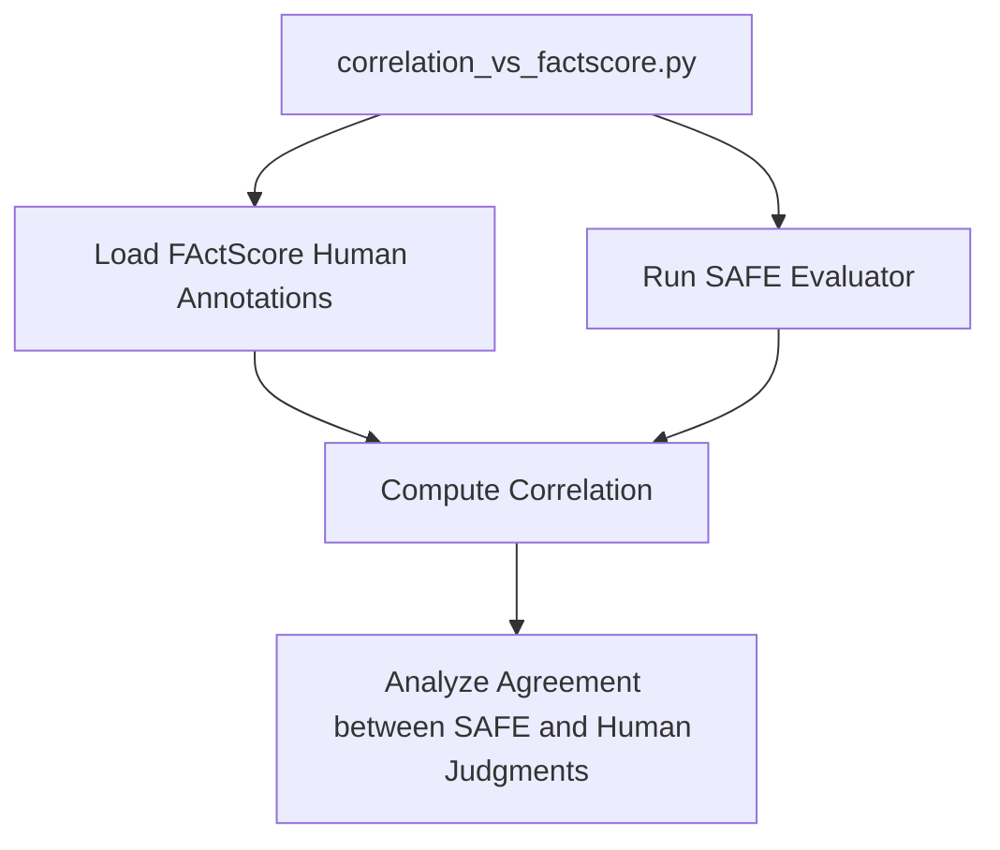
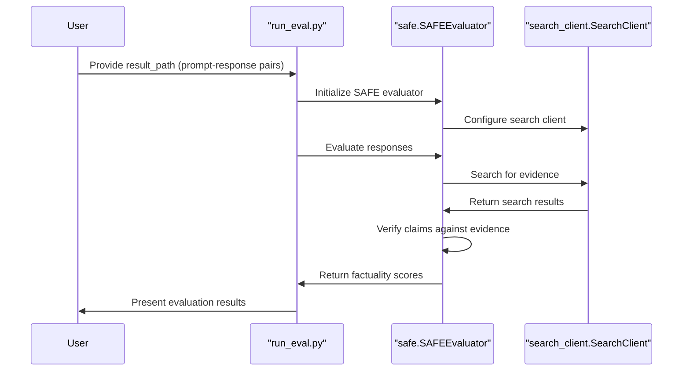
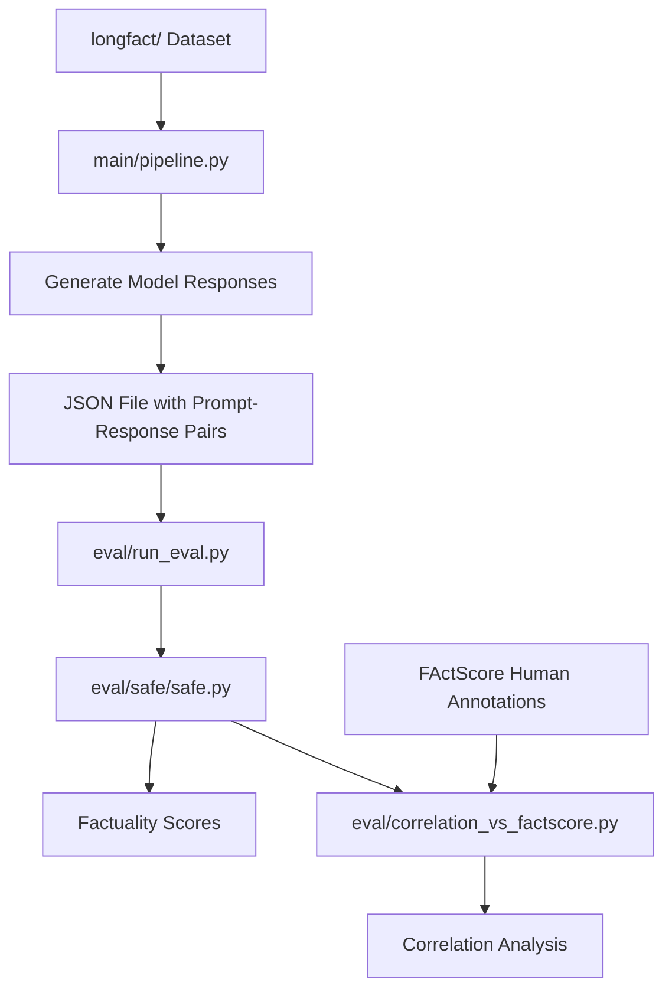
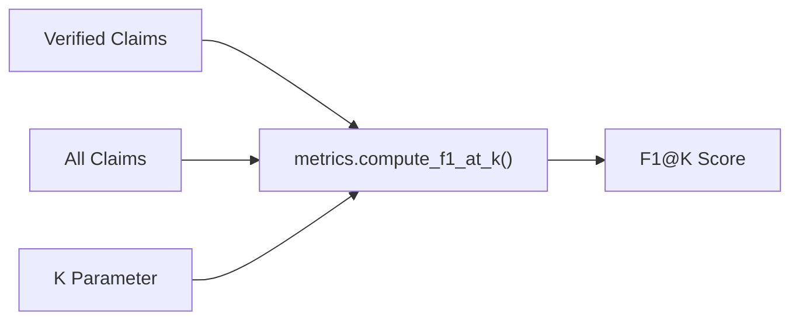

<!-- source: DeepWiki mcp.deepwiki.com · repo google-deepmind/long-form-factuality · page 3.2 eval/ Directory · fetched 2026-10-26 -->

# eval/ Directory

<details>
<summary>Relevant source files</summary>

The following files were used as context for generating this wiki page:

- [README.md](README.md)

</details>


## Purpose and Scope

This document provides a comprehensive overview of the `eval/` directory in the long-form-factuality repository. The `eval/` directory contains the factuality evaluation components, including the Search-Augmented Factuality Evaluator (SAFE), correlation analysis tools, and evaluation runners. These components are responsible for assessing the factual accuracy of long-form text generated by language models.

For information about benchmarking models using these evaluation tools, see [Benchmarking Models](#4.3). For details about the LongFact prompt set that is evaluated, see [LongFact Prompt Set](#2.1).

## Directory Structure

The `eval/` directory consists of the following key components:



Sources: [README.md:56-58]()

### Key Files and Their Purposes

| File/Directory | Purpose |
|----------------|---------|
| `safe/` | Contains the implementation of the Search-Augmented Factuality Evaluator |
| `correlation_vs_factscore.py` | Pipeline for evaluating SAFE against FActScore human annotations |
| `run_eval.py` | Command-line tool for running SAFE evaluations on prompt-response pairs |

Sources: [README.md:56-64](), [README.md:75-80]()

## SAFE Evaluator

The Search-Augmented Factuality Evaluator (SAFE) is a central component of the long-form factuality evaluation system. It assesses the factual accuracy of model-generated responses by extracting claims, searching for evidence, and verifying claims against retrieved evidence.

### SAFE Architecture and Workflow


The SAFE evaluator works through the following process:
1. Extracts atomic claims from a model-generated response
2. Searches for evidence related to each claim using web search
3. Processes the retrieved evidence to make it suitable for verification
4. Verifies each claim against the processed evidence
5. Computes the F1@K metric based on the verification results

Sources: [README.md:8](), [README.md:56-57]()

### Key Components of SAFE



Sources: [README.md:56-57]()

## Correlation Analysis with FActScore

The `correlation_vs_factscore.py` module provides a pipeline for evaluating SAFE against human annotations from the FActScore dataset. This helps validate the effectiveness of the automatic evaluation method by comparing it with human judgments.

### Correlation Analysis Pipeline



Sources: [README.md:59-64]()

## Running Evaluations

The `run_eval.py` script provides a command-line interface for evaluating prompt-response pairs using the SAFE evaluator. This script is the main entry point for running factuality evaluations on model outputs.

### Evaluation Process



### Usage

To evaluate prompt-response pairs, use the following command:

```bash
python -m eval.run_eval --result_path=<path_to_json_file>
```

The `result_path` argument should point to a JSON file containing prompt-response pairs generated by the main experimentation pipeline.

Sources: [README.md:75-80]()

## Integration with System Components

The evaluation components in the `eval/` directory integrate with other parts of the system to form a complete pipeline for assessing long-form factuality.



The evaluation system fits into the broader workflow as follows:
1. The `main/pipeline.py` generates model responses for prompts from the LongFact dataset
2. The responses are saved to a JSON file
3. The `eval/run_eval.py` script processes this JSON file
4. The SAFE evaluator assesses the factuality of the responses
5. The evaluation results are presented to the user

For correlation analysis, the SAFE evaluator's results are compared against human annotations from the FActScore dataset using `eval/correlation_vs_factscore.py`.

Sources: [README.md:66-80]()

## F1@K Metric Implementation

The `eval/` directory implements the F1@K metric, which extends the traditional F1 score to long-form settings. This metric computes recall based on human-preferred length to provide a more suitable measure for assessing factuality in long-form content.



The F1@K metric is implemented in the `metrics.py` file within the `safe/` directory and is used by the SAFE evaluator to compute the final factuality score.

Sources: [README.md:8]()

## Unit Testing

Each file in the `eval/` directory has a corresponding unit test file with the `_test` suffix. For example, `safe.py` has a corresponding test file named `safe_test.py`. These unit tests help ensure the correctness and robustness of the evaluation components.

To run all unit tests for the evaluation components, use:

```bash
python -m unittest discover -s ./eval -p "*_test.py"
```

Sources: [README.md:82-90]()

---

