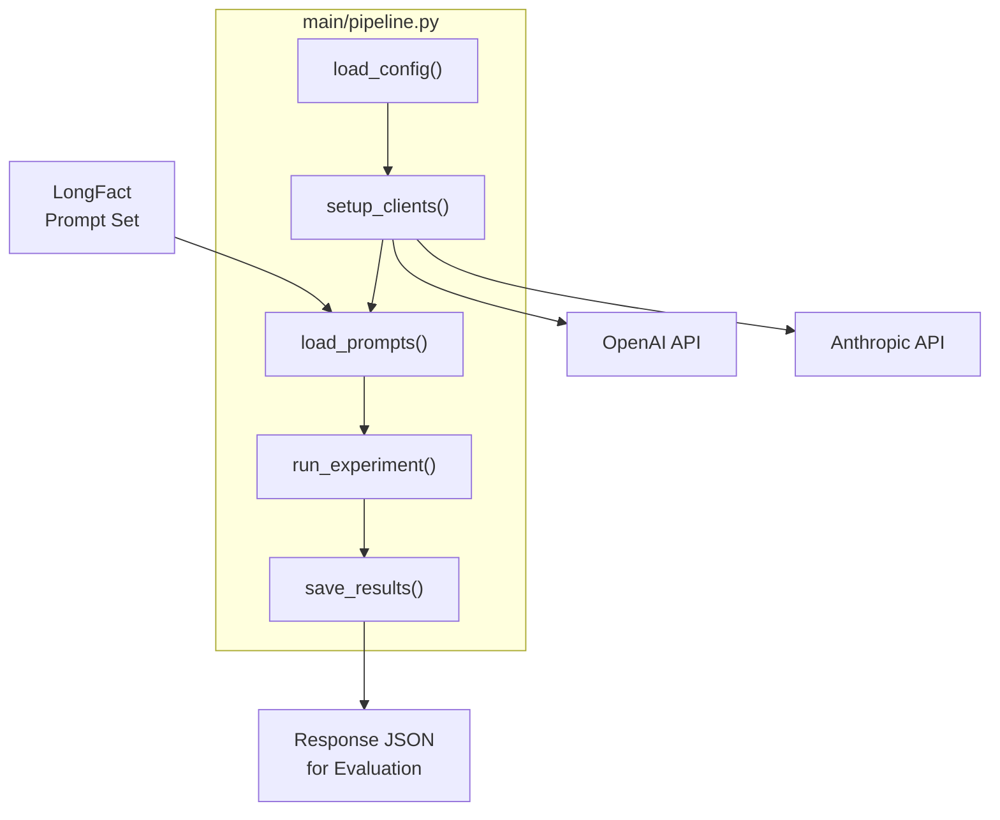
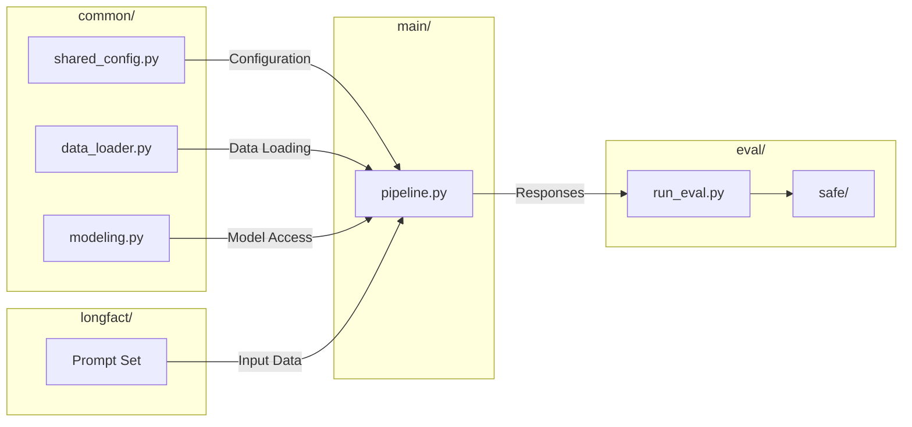
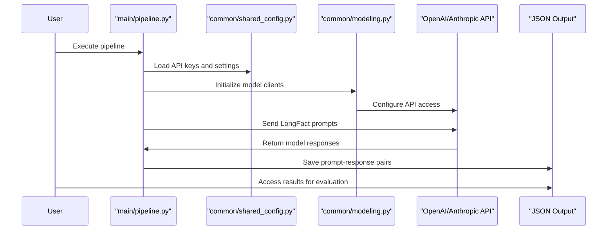
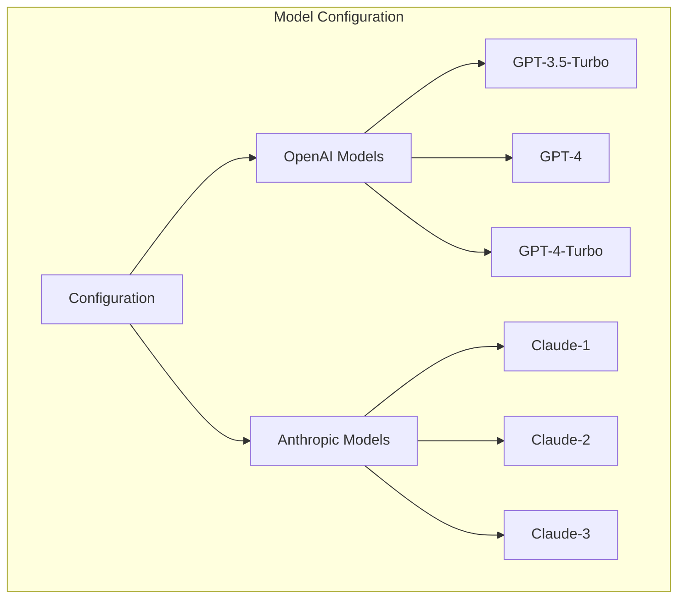
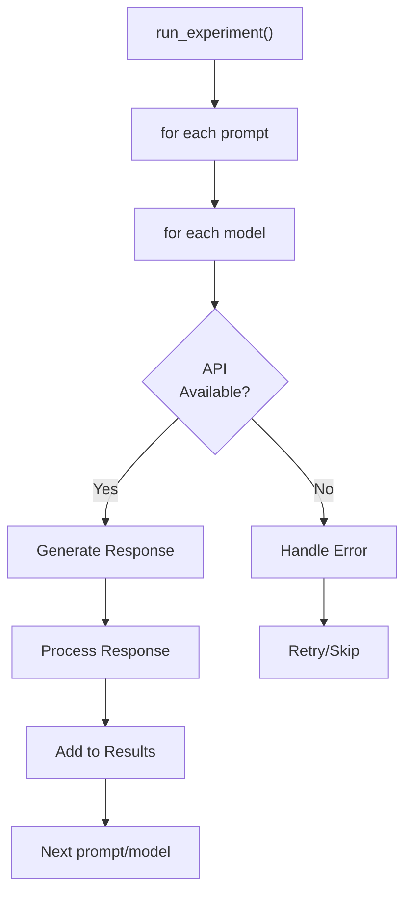
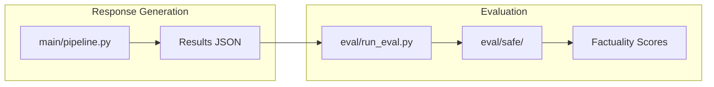

<!-- source: DeepWiki mcp.deepwiki.com · repo google-deepmind/long-form-factuality · page 3.3 main/ Directory · fetched 2026-10-26 -->

# main/ Directory

<details>
<summary>Relevant source files</summary>

The following files were used as context for generating this wiki page:

- [README.md](README.md)

</details>


## Purpose and Scope

The `main/` directory houses the experimentation pipeline for benchmarking Large Language Models (LLMs) using the LongFact prompt set. This pipeline is responsible for generating responses from models like OpenAI's GPT models and Anthropic's Claude models, which are then evaluated using the SAFE evaluator. For information about evaluating the generated responses, see [Evaluating Responses](#4.2).

Sources: README.md:66-73

## Pipeline Overview

The main experimentation pipeline is centered around the `pipeline.py` file, which orchestrates the process of sending prompts to language models and collecting their responses. This pipeline serves as the bridge between the LongFact prompt set and the evaluation components of the system.



Sources: README.md:66-73

## Pipeline Components

The main pipeline consists of several key components that work together to benchmark language models:

| Component | Description |
|-----------|-------------|
| Configuration | Loads settings from the shared configuration |
| Model Clients | Sets up API clients for OpenAI and Anthropic |
| Prompt Loading | Loads prompts from the LongFact dataset |
| Response Generation | Sends prompts to models and collects responses |
| Result Storage | Saves prompt-response pairs for later evaluation |

Sources: README.md:66-73

## Integration with System Components

The `main/` directory's pipeline interfaces with several other components in the system, forming a crucial part of the benchmarking workflow.



Sources: README.md:66-80

## Benchmarking Workflow

The benchmarking process follows a specific sequence to generate and prepare responses for evaluation:



Sources: README.md:66-80

## Technical Implementation Details

The main pipeline implements a uniform interface for different language models through an abstraction layer that standardizes input/output formats across model providers.

### Model Configuration

The pipeline supports multiple model configurations for benchmarking, allowing for comparison between different models and parameter settings:



Sources: README.md:66-73

### Response Generation Process

The pipeline implements a robust mechanism for generating responses, handling rate limits, and managing failures:



Sources: README.md:66-73

## Usage

To use the main experimentation pipeline, follow these steps:

1. Configure API keys in `common/shared_config.py`
2. Run the pipeline:
   ```bash
   python -m main.pipeline
   ```
3. The pipeline will generate a JSON file containing prompt-response pairs
4. Use the evaluation module to assess these responses:
   ```bash
   python -m eval.run_eval --result_path=path/to/results.json
   ```

### Output Format

The pipeline outputs a JSON file containing prompt-response pairs in the following format:

```
{
    "prompt_id": "unique_id",
    "prompt": "The full text of the prompt",
    "response": "The model's response",
    "model": "The model that generated the response",
    "metadata": {
        "timestamp": "Generation time",
        "model_parameters": {...}
    }
}
```

Sources: README.md:66-80

## Integration with Evaluation

After generating responses with the main pipeline, these responses can be evaluated using the SAFE evaluator. This evaluation process is a separate step handled by the `eval/` module.



Sources: README.md:74-80

## Key Considerations

When using the main pipeline, consider the following:

1. **API Credentials**: Ensure your API keys are properly configured
2. **Cost Management**: Be aware that generating responses incurs API costs
3. **Rate Limits**: The pipeline includes mechanisms to handle rate limiting
4. **Storage Requirements**: Response data can be substantial, especially for long-form responses
5. **Parallel Processing**: For large-scale benchmarking, the pipeline supports parallel processing

Sources: README.md:66-73

---

