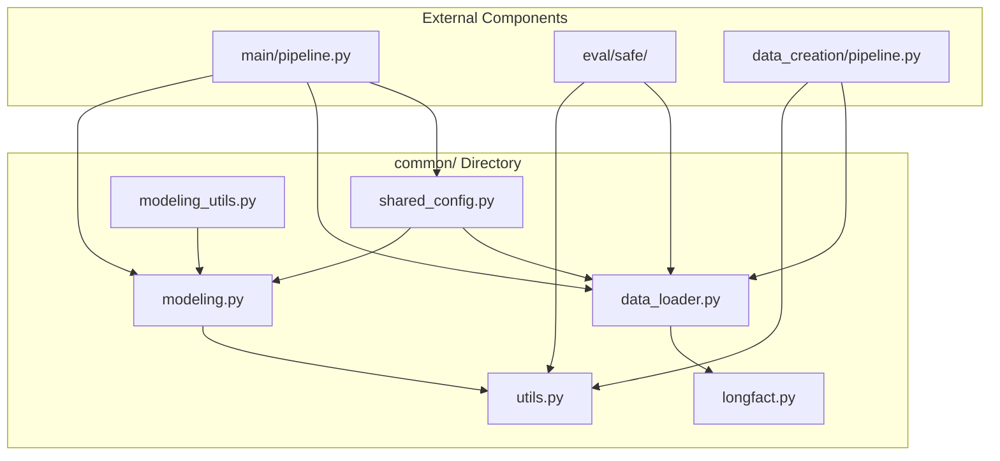
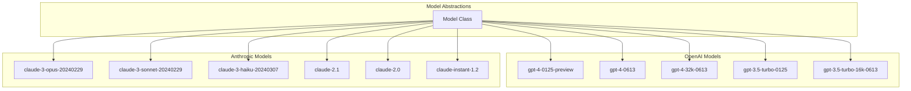
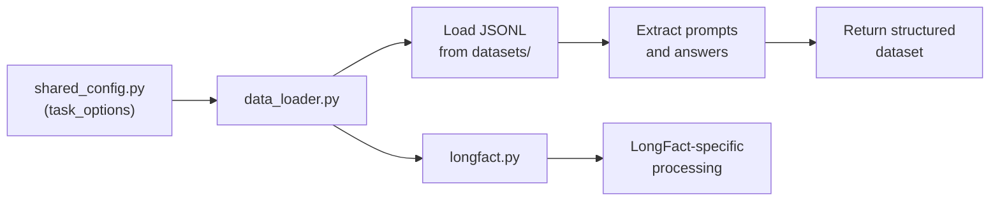
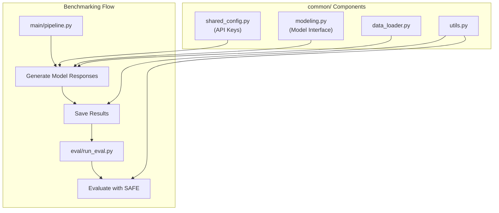

<!-- source: DeepWiki mcp.deepwiki.com · repo google-deepmind/long-form-factuality · page 3.4 common/ Directory · fetched 2026-10-26 -->

# common/ Directory

<details>
<summary>Relevant source files</summary>

The following files were used as context for generating this wiki page:

- [README.md](README.md)
- [common/README.md](common/README.md)

</details>


## Purpose and Scope

This document provides a technical overview of the `common/` directory within the long-form factuality repository. The directory contains shared code components that are utilized across the codebase, including configuration settings, data loading utilities, model abstractions, and general utility functions. These components provide essential infrastructure that enables the evaluation of long-form factuality in large language models.

Sources: [common/README.md:1-9]()

## Directory Structure and Components

The `common/` directory contains several Python modules, each with a specific purpose:

| File | Purpose |
|------|---------|
| `shared_config.py` | Central configuration settings including API keys, paths, and model definitions |
| `data_loader.py` | Functions for loading and processing datasets |
| `longfact.py` | Functions specific to working with the LongFact dataset |
| `modeling.py` | Unified model interface for OpenAI and Anthropic models |
| `modeling_utils.py` | Utility functions for model interaction |
| `utils.py` | General utility functions used throughout the codebase |

Each file has a corresponding unit test file with the suffix `_test.py`.

Sources: [common/README.md:1-9](), [common/README.md:86-92]()

## Component Relationships

The following diagram illustrates how the components in the `common/` directory relate to each other and to the broader system:



Sources: [common/README.md:1-9]()

## Shared Configuration (shared_config.py)

The `shared_config.py` file serves as a central configuration hub for the entire system. It contains:

1. **API Keys**: Variables for storing API keys for external services:
   - `openai_api_key` for OpenAI
   - `anthropic_api_key` for Anthropic
   - `serper_api_key` for the Serper search service used by SAFE

2. **Path Settings**:
   - `path_to_result`: Directory for storing experiment results (default: `results/`)
   - `path_to_data`: Directory for storing datasets (default: `datasets/`)

3. **Model Configurations**:
   - `model_options`: Dictionary mapping model shorthands to their full names
   - `model_string`: Dictionary mapping model shorthands to saveable names

4. **Task Configurations**:
   - `task_options`: Dictionary mapping task shorthands to dataset details

5. **Other Settings**:
   - `random_seed`: For reproducibility (default: `1`)
   - `prompt_postamble`: Universal text appended to all prompts

Sources: [common/README.md:15-77]()

### Supported Models

The configuration natively supports the following models:



Sources: [common/README.md:43-56]()

## Model Abstractions (modeling.py)

The `modeling.py` file provides a unified interface for interacting with different language model providers (OpenAI and Anthropic). It defines a central `Model` class that handles:

1. Model loading based on configuration in `shared_config.py`
2. Text generation with consistent parameters across providers
3. Proper handling of API keys and error cases

The abstraction layer allows the rest of the codebase to work with different models without needing provider-specific code paths.

### Model Interface Structure

```mermaid
classDiagram
    class "Model" {
        +load(model_name)
        +generate(prompt)
    }
    
    class "langfun.LanguageModel" {
        +generate()
    }
    
    class "AnthropicModel" {
        +generate()
    }
    
    class "OpenAIModel" {
        +generate()
    }
    
    "Model" --> "langfun.LanguageModel"
    "langfun.LanguageModel" <|-- "AnthropicModel"
    "langfun.LanguageModel" <|-- "OpenAIModel"
```

Sources: [common/README.md:60-67]()

## Data Loading Utilities (data_loader.py, longfact.py)

These modules handle the loading and processing of datasets, particularly the LongFact dataset.

### data_loader.py

The `data_loader.py` module provides functions for:
1. Loading datasets from JSONL files based on configuration in `shared_config.py`
2. Preprocessing prompts and answers
3. Validating dataset structure

### longfact.py

The `longfact.py` module contains functions specific to working with the LongFact dataset, which consists of 2,280 fact-seeking prompts requiring long-form responses.

### Data Loading Process



Sources: [common/README.md:6](), [common/README.md:68-84]()

## Utility Functions (utils.py)

The `utils.py` file contains general-purpose utility functions used throughout the codebase. While the exact functions are not detailed in the documentation, they likely include helpers for:

1. File I/O operations
2. Text processing
3. Data formatting
4. Error handling

These utilities help maintain consistency across the codebase and reduce duplication of commonly used functions.

Sources: [common/README.md:9]()

## Extending the System

### Adding New Models

To add support for additional models:

1. **For OpenAI or Anthropic models**: Add entries to the `model_options` and `model_string` dictionaries in `shared_config.py` with appropriate prefixes:
   - OpenAI models: Use `'OPENAI:'` prefix
   - Anthropic models: Use `'ANTHROPIC:'` prefix

2. **For other providers**:
   - Create a new class inheriting from `langfun.LanguageModel` (following the example of `AnthropicModel`)
   - Add the new class to the `load()` method in the `Model` class
   - Add entries to `model_options` and `model_string` in `shared_config.py`

Sources: [common/README.md:58-67]()

### Supporting Additional Tasks

To run the system on datasets beyond LongFact:

1. Format the dataset as a JSONL file with each line containing a dictionary with prompt and answer information
2. Save the file in the directory specified by `path_to_data` in `shared_config.py`
3. Add an entry to `task_options` in `shared_config.py` with:
   - Key: Shorthand name for the dataset
   - Value: Tuple containing:
     - Filename (without `.jsonl`)
     - Dictionary key for prompts
     - Dictionary key for correct answers (or `'NONE'`)
     - Dictionary key for incorrect answers (or `'NONE'`)

Example JSONL format:
```
{"prompt": "Question 1", "Correct Answers": "Answer 1"}
{"prompt": "Question 2", "Correct Answers": "Answer 2"}
```

Sources: [common/README.md:68-84]()

## Custom Configuration

The `common/` directory provides several configuration options that can be modified:

1. **Random Seed**: Change the `random_seed` variable in `shared_config.py` (default: `1`)
2. **Results Folder**: Modify the `path_to_result` variable in `shared_config.py` (default: `results/`)
3. **Universal Postamble**: Edit the `prompt_postamble` variable in `shared_config.py` to add text that will be appended to all prompts (used when enabled in `main/config.py`)

Sources: [common/README.md:23-42]()

## Integration with Main System Components

The following diagram illustrates how the `common/` directory integrates with the main system components for benchmarking language models:



Sources: [README.md:66-80](), [common/README.md:15-19]()

---

