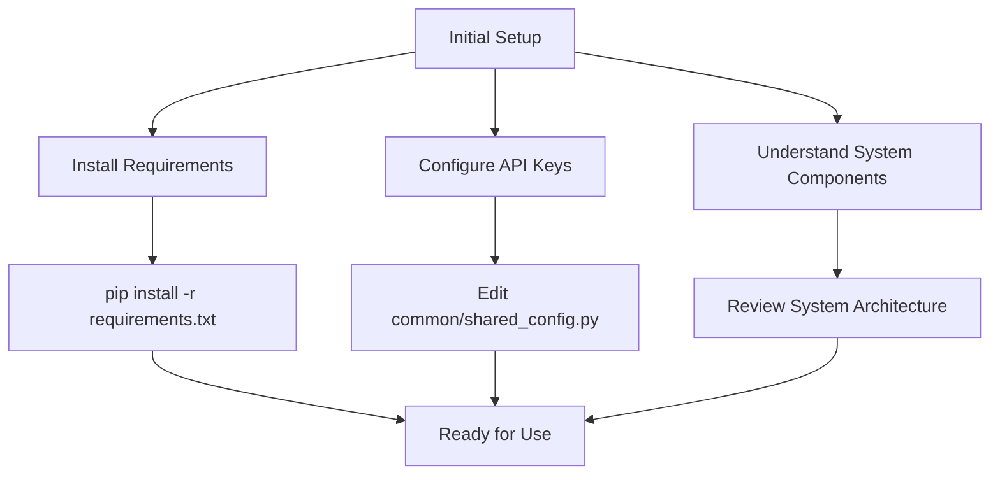
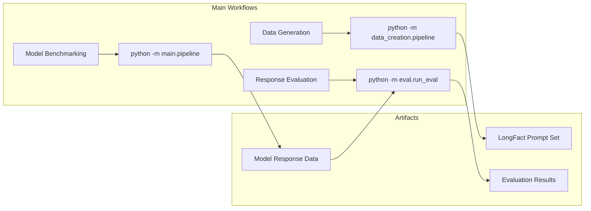
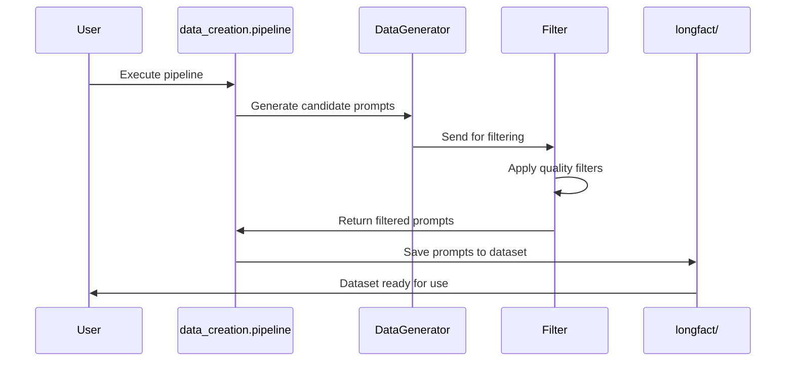
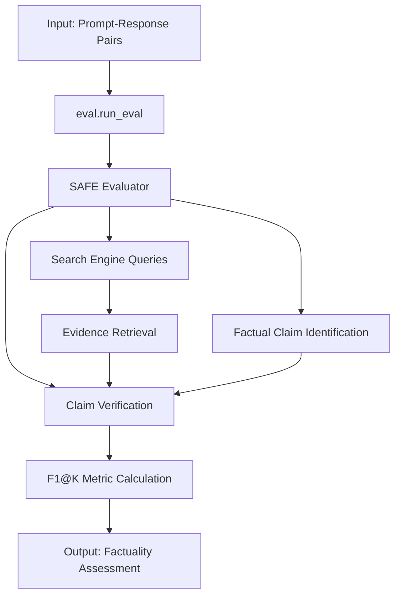
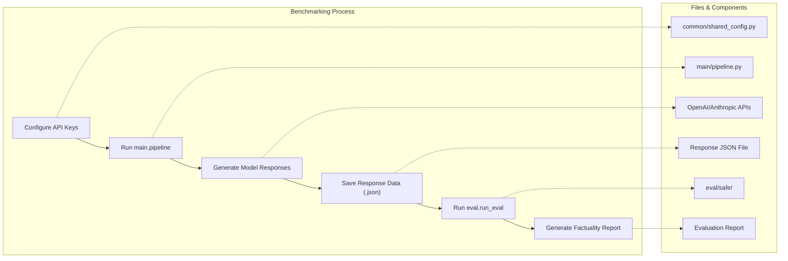
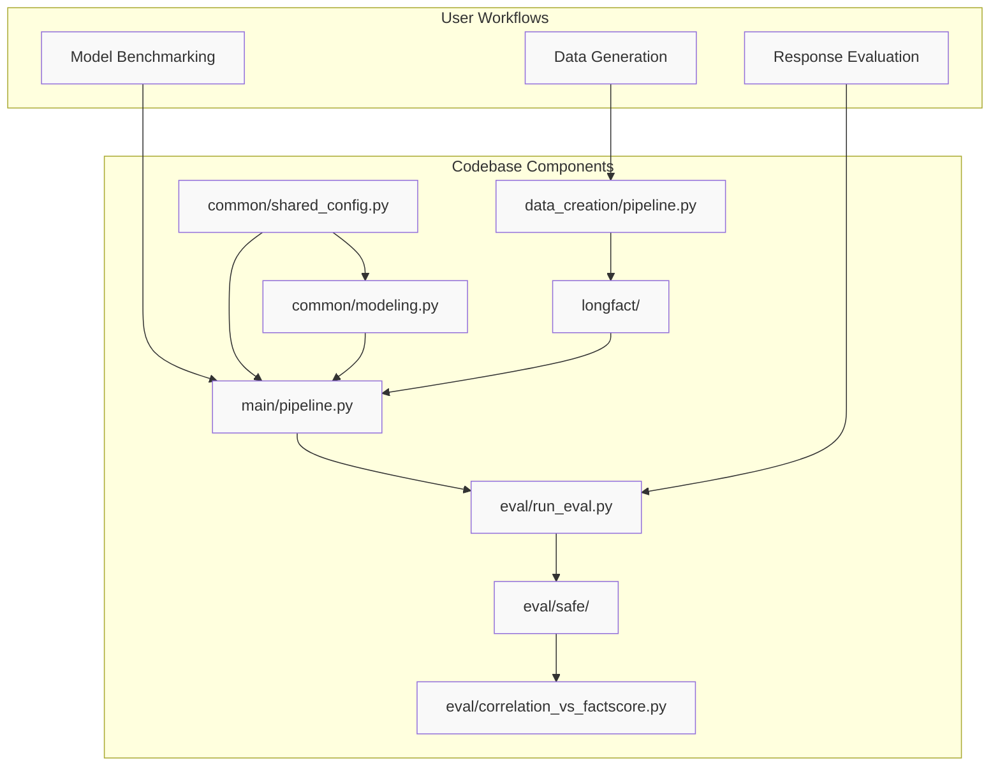

<!-- source: DeepWiki mcp.deepwiki.com · repo google-deepmind/long-form-factuality · page 4 Usage Guides · fetched 2026-10-26 -->

# Usage Guides

<details>
<summary>Relevant source files</summary>

The following files were used as context for generating this wiki page:

- [README.md](README.md)

</details>


This page provides practical guidance for using the long-form factuality evaluation system. It covers the core workflows for generating data, evaluating responses, and benchmarking language models. For detailed installation instructions, see [Installation and Setup](#1.1), and for technical API references, see [API Reference](#5).

## System Setup Prerequisites

Before using any of the system components, ensure you have:

1. Installed all required packages (see README.md)
2. Configured necessary API keys in the shared config file
3. Understood the overall workflow of the system



Sources: [README.md:11-41]()

### API Key Configuration

For benchmarking OpenAI and Anthropic models, you must add your API keys to the shared configuration file:

```bash
# Edit this file to add your API keys
common/shared_config.py
```

**Important**: Never publish or commit these API keys to a public repository.

Sources: [README.md:67-68]()

## Core Workflows

The system supports three main workflows:



Sources: [README.md:44-80]()

## Generating Data with LongFact

The LongFact dataset contains 2,280 fact-seeking prompts requiring long-form responses. You can either use the existing dataset or generate new data.

### Using the Existing Dataset

The complete LongFact prompt set is available in the `longfact/` directory. These prompts are ready to use for model evaluation.

### Running the Data Creation Pipeline

To generate new data using the same approach as LongFact:

```bash
python -m data_creation.pipeline
```

This process involves multiple stages of data generation and filtering:



For additional configuration options and customization, refer to the README in the `data_creation/` directory.

Sources: [README.md:44-53]()

## Evaluating Responses with SAFE

The Search-Augmented Factuality Evaluator (SAFE) automatically evaluates model responses for factuality in long-form settings.

### Running the Evaluator

To evaluate prompt-response pairs:

```bash
python -m eval.run_eval --result_path=PATH_TO_JSON_FILE
```

Where `PATH_TO_JSON_FILE` is the path to a JSON file containing prompt-response pairs generated by the main pipeline.

### Evaluation Process



The SAFE evaluator identifies claims in the response, retrieves evidence from a search engine, and verifies each claim against the evidence. The process results in a factuality score based on the F1@K metric.

Sources: [README.md:55-64](), [README.md:75-80]()

## Benchmarking Language Models

The system provides a complete pipeline for benchmarking OpenAI and Anthropic models using LongFact and SAFE.

### Generating Model Responses

To obtain responses from language models for a given prompt set:

```bash
python -m main.pipeline
```

This command runs the main experimentation pipeline, which:
1. Loads prompts from the LongFact dataset
2. Sends prompts to configured language models
3. Saves prompt-response pairs to a JSON file

### End-to-End Benchmarking Workflow



The benchmarking process involves configuring API keys, running the main pipeline to generate model responses, and then using SAFE to evaluate those responses for factuality.

Sources: [README.md:66-80]()

## Common Usage Patterns

### Evaluating Models Against Human Annotations

To run the pipeline for evaluating SAFE against FActScore human annotations:

```bash
python -m eval.correlation_vs_factscore
```

This allows comparison between automated SAFE evaluations and human factuality assessments.

Sources: [README.md:59-64]()

### Running Experiments with Custom Parameters

The main pipeline supports several configuration options that can be adjusted in the `common/shared_config.py` file, including:

- Model selection (which OpenAI/Anthropic models to use)
- Sampling parameters (temperature, top_p, etc.)
- Output file paths

### Testing System Components

Each component has corresponding unit tests:

```bash
# Run all unit tests
python -m unittest discover -s ./ -p "*_test.py"

# Run a specific test
# See individual test files for commands
```

Sources: [README.md:82-90]()

## System Component Relationship Map

The following diagram shows how the different code components relate to the usage workflows:



Sources: [README.md:3-9]()

## Output Formats and Data Structures

### LongFact Prompt Format

The LongFact dataset contains prompts in a structured format. Each prompt is designed to elicit a long-form, fact-based response.

### Model Response JSON Format

The output from the main pipeline is a JSON file containing prompt-response pairs. This format serves as input to the evaluation pipeline.

### SAFE Evaluation Results

The SAFE evaluator produces detailed factuality assessments, including:
- Overall factuality scores
- Claim-by-claim verification results
- F1@K metrics

For detailed guidance on specific components, see:
- [Generating Data](#4.1) for detailed usage of the data creation pipeline
- [Evaluating Responses](#4.2) for detailed instructions on using SAFE
- [Benchmarking Models](#4.3) for comprehensive benchmarking guidance

Sources: [README.md:44-80]()

---

