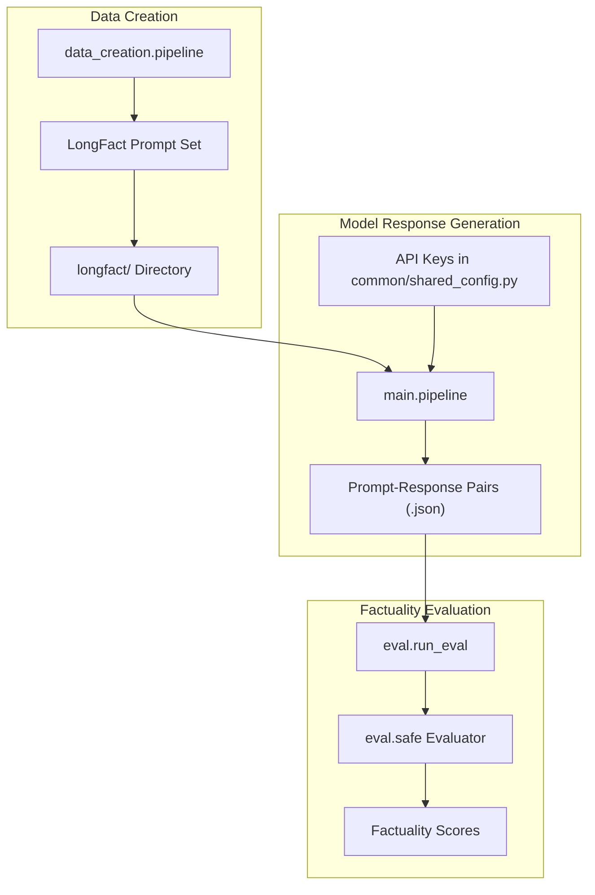
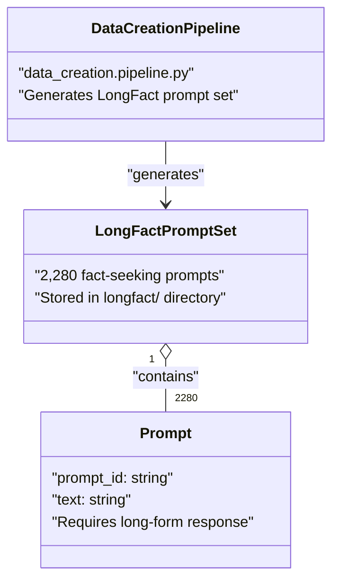
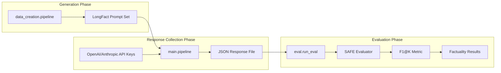

<!-- source: DeepWiki mcp.deepwiki.com · repo google-deepmind/long-form-factuality · page 4.1 Generating Data · fetched 2026-10-26 -->

# Generating Data

<details>
<summary>Relevant source files</summary>

The following files were used as context for generating this wiki page:

- [README.md](README.md)

</details>


This document provides a guide for using the data creation pipeline to generate the LongFact prompt set and explains how to work with the generated data within the long-form factuality evaluation framework. For information about evaluating model responses with these prompts, see [Evaluating Responses](#4.2).

## Overview

The LongFact prompt set is a collection of 2,280 fact-seeking prompts specifically designed to elicit long-form responses from language models. This prompt set serves as the foundation for benchmarking and evaluating the factuality of information provided by large language models in extended responses.

## Running the Data Generation Pipeline

To generate the LongFact prompt set, follow these steps:

1. Ensure you have installed all required dependencies as described in [Installation and Setup](#1.1).
2. Run the data creation pipeline using the following command:
   ```bash
   python -m data_creation.pipeline
   ```
3. The pipeline will generate the LongFact prompt set and save it in the `longfact/` directory.

Sources: README.md

## Data Creation Process and System Integration

The following diagram illustrates how the data creation process integrates with the overall system:



The data creation pipeline (`data_creation.pipeline`) generates the LongFact prompt set, which is stored in the `longfact/` directory. This prompt set is then used by the main pipeline to obtain responses from language models. These prompt-response pairs are subsequently evaluated using the SAFE evaluator to assess factuality.

Sources: README.md

## Components of the Data Creation System

The following diagram shows the key components involved in data generation and their relationships:



Sources: README.md

## LongFact Dataset Structure

The LongFact dataset is available in the `longfact/` directory after generation. The dataset comprises 2,280 prompts that are specifically designed to:

1. Require comprehensive, long-form responses (paragraphs rather than short answers)
2. Test factual knowledge across diverse domains
3. Enable systematic evaluation of factuality in language model outputs

| Component | Description |
|-----------|-------------|
| Prompt Set | 2,280 fact-seeking prompts |
| Storage Location | `longfact/` directory |
| Format | JSON files containing prompt data |
| Purpose | Testing factuality in long-form LLM responses |

Sources: README.md

## Working with the Generated Data

Once you've generated the LongFact prompt set, you can use it to evaluate language models by following these steps:

1. Configure your API keys in `common/shared_config.py` for accessing language models you want to evaluate.
2. Run the main pipeline to generate responses using the LongFact prompts:
   ```bash
   python -m main.pipeline
   ```
   This will generate a JSON file containing prompt-response pairs.
3. Evaluate the factuality of the responses using the SAFE evaluator:
   ```bash
   python -m eval.run_eval --result_path=[path_to_json_file]
   ```
   Replace `[path_to_json_file]` with the path to the JSON file containing the prompt-response pairs.

For more information about evaluating responses and benchmarking models, refer to the [Evaluating Responses](#4.2) and [Benchmarking Models](#4.3) pages.

Sources: README.md

## Data Flow from Generation to Evaluation

The following diagram shows the complete data flow from prompt generation through model evaluation:



This diagram illustrates the complete workflow from data generation to final evaluation results. The process begins with generating the LongFact prompt set, proceeds through collecting model responses, and concludes with evaluating those responses using the SAFE evaluator and F1@K metric.

Sources: README.md

---

