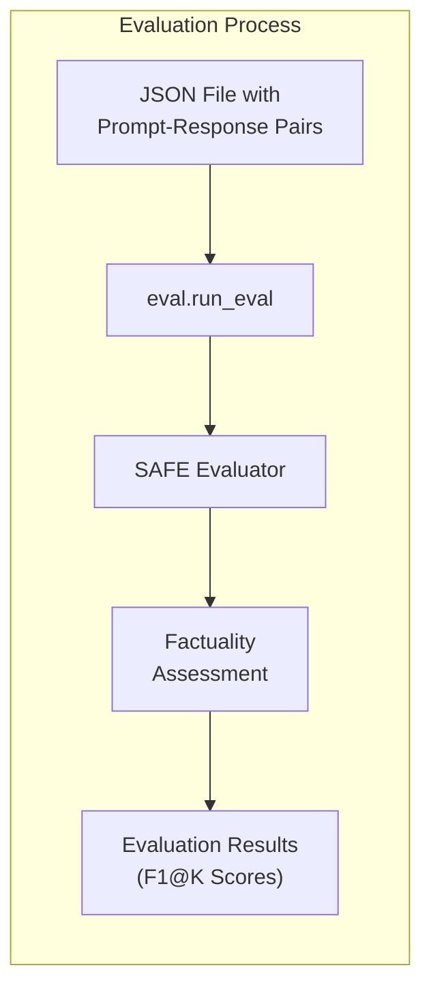
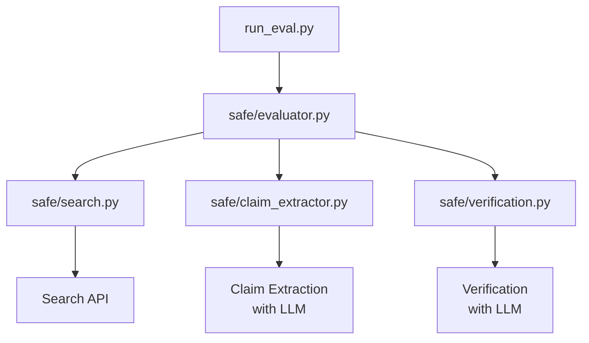
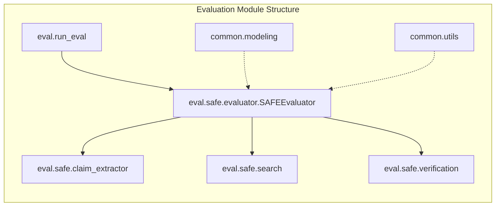

<!-- source: DeepWiki mcp.deepwiki.com · repo google-deepmind/long-form-factuality · page 4.2 Evaluating Responses · fetched 2026-10-26 -->

# Evaluating Responses

<details>
<summary>Relevant source files</summary>

The following files were used as context for generating this wiki page:

- [README.md](README.md)

</details>


This document provides detailed instructions for evaluating the factuality of LLM-generated responses using the Search-Augmented Factuality Evaluator (SAFE). For information about generating responses to evaluate, see [Generating Data](#4.1) and for benchmarking models using the complete pipeline, see [Benchmarking Models](#4.3).

## Overview of the Evaluation Process

The SAFE evaluator is designed to assess the factuality of long-form responses generated by language models. The evaluation process takes prompt-response pairs as input and produces factuality scores using the F1@K metric.



Sources: [README.md:74-80]()

## Running the Evaluation

To evaluate prompt-response pairs using SAFE, use the `eval.run_eval` module with the `--result_path` argument pointing to the JSON file containing the prompt-response pairs:

```
python -m eval.run_eval --result_path=path/to/prompt_response_pairs.json
```

The JSON file should contain the prompt-response pairs generated from the main experimentation pipeline, typically created using `main.pipeline`.

Sources: [README.md:74-80]()

## Input Data Format

The evaluator expects a specific input format for the prompt-response pairs JSON file:

```mermaid
classDiagram
    class "Input JSON Structure" {
        Array~objects~ responses
    }
    class "Response Object" {
        String prompt
        String response
        String model_name
        String prompt_id
        Additional metadata
    }
    "Input JSON Structure" --> "Response Object" : contains
```

Each response object in the array must contain at least the prompt text and the model's response. The additional fields like `model_name` and `prompt_id` help organize and track the evaluation results.

Sources: [README.md:74-80]()

## SAFE Evaluation Components

The SAFE evaluation system comprises several interconnected components that work together to assess factuality:



The evaluation process involves:
1. Extracting claims from the response
2. Searching for evidence related to those claims
3. Verifying the claims against the retrieved evidence
4. Computing factuality scores using the F1@K metric

Sources: [README.md:55-64]()

## Evaluation Output

After running the evaluation, SAFE produces a comprehensive report containing:

| Output Element | Description |
|----------------|-------------|
| Overall F1@K Score | The primary factuality metric for the entire set of responses |
| Per-Response Scores | Individual factuality scores for each response |
| Extracted Claims | The claims identified in each response |
| Verification Results | Assessment of each claim's factuality |
| Evidence Used | The search results used to verify claims |

The F1@K metric is an extension of the traditional F1 score adapted for long-form responses, calculating recall based on human-preferred response length.

Sources: [README.md:8-9](), [README.md:55-64]()

## Correlation Analysis with Human Annotations

To validate SAFE's effectiveness, you can compare its results with human annotations from FActScore using the correlation analysis tool:

```
python -m eval.correlation_vs_factscore
```

This analysis helps establish SAFE's reliability by measuring its correlation with human judgments of factuality.

Sources: [README.md:59-64]()

## Technical Implementation Details

The evaluation system integrates several key components:



The `SAFEEvaluator` class is the central component that orchestrates:
1. Claim extraction from responses
2. Evidence search for each claim
3. Verification of claims against evidence
4. Computation of F1@K scores

Sources: [README.md:55-64]()

## Best Practices for Evaluation

When evaluating responses with SAFE, consider the following best practices:

1. **Diverse Prompts**: Ensure your evaluation covers a diverse set of topics and response lengths
2. **Multiple Models**: Compare responses from multiple models to establish relative performance
3. **Batch Processing**: For large datasets, consider breaking evaluation into smaller batches
4. **Correlation Analysis**: Validate automated scores with human annotations when possible
5. **Consistent Environment**: Use the same evaluation environment for comparing different models

## Troubleshooting

Common issues and their solutions:

| Issue | Solution |
|-------|----------|
| Missing API keys | Ensure API keys are properly set in `common/shared_config.py` |
| Input format errors | Verify JSON structure matches expected format |
| Long evaluation times | Consider batching evaluations for large datasets |
| Memory issues | Reduce batch size or increase available system memory |
| Search API rate limits | Implement delays between search requests or use alternative search providers |

Sources: [README.md:67-73]()

## Limitations

When interpreting SAFE evaluation results, be aware of these limitations:

1. SAFE relies on search engines for verification, so its accuracy depends on the quality and availability of search results
2. The system may have varying performance across different knowledge domains
3. Complex claims requiring specialized knowledge may be challenging to verify
4. The F1@K metric provides a quantitative measure but should be interpreted alongside qualitative analysis

Sources: [README.md:55-64]()

---

