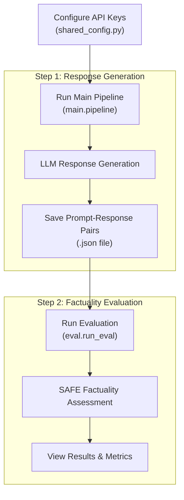
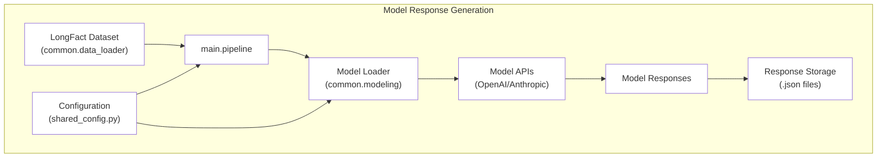
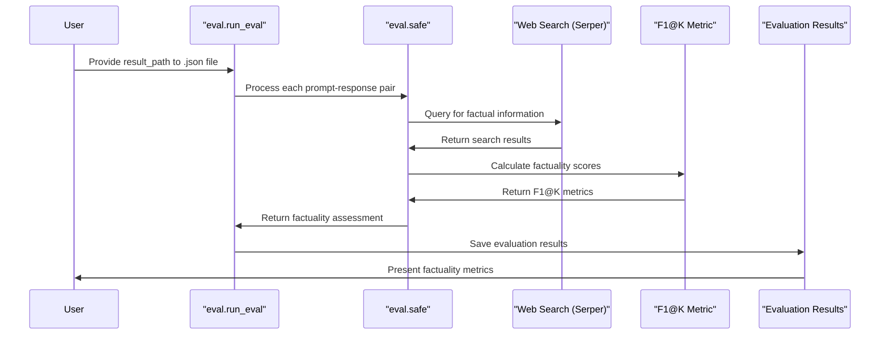
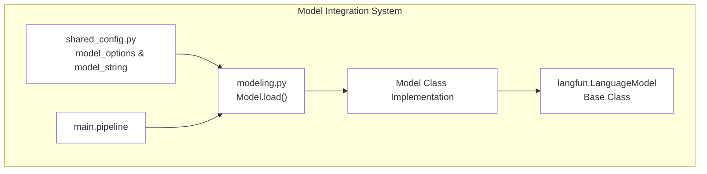

<!-- source: DeepWiki mcp.deepwiki.com · repo google-deepmind/long-form-factuality · page 4.3 Benchmarking Models · fetched 2026-10-26 -->

# Benchmarking Models

<details>
<summary>Relevant source files</summary>

The following files were used as context for generating this wiki page:

- [README.md](README.md)
- [common/README.md](common/README.md)

</details>


## Purpose and Scope

This document provides a comprehensive guide for benchmarking language models (LLMs) using the Long-Form Factuality evaluation system. It covers how to configure the benchmarking environment, execute the benchmarking pipeline, and evaluate model responses for factuality. This guide focuses specifically on the operational aspects of running benchmarks against LLMs using the LongFact prompt set and SAFE evaluator.

For information about the LongFact prompt set itself, see [LongFact Prompt Set](#2.1). For details about the SAFE evaluator, see [SAFE Evaluator](#2.2).

Sources: [README.md:66-80]()

## Benchmarking Process Overview

The process for benchmarking models involves two main steps:
1. Generating responses from models using the LongFact prompt set
2. Evaluating these responses using the SAFE evaluator

### Benchmarking Workflow



Sources: [README.md:66-80](), [main/pipeline.py]()

## Prerequisites

Before benchmarking models, you must set up the required API keys and understand the configuration options.

### API Key Configuration

All API keys must be added to the shared configuration file:

| API | Purpose | Configuration Variable |
|-----|---------|------------------------|
| OpenAI | Access to GPT models | `openai_api_key` |
| Anthropic | Access to Claude models | `anthropic_api_key` |
| Serper | Web search capabilities for SAFE | `serper_api_key` |

Sources: [common/README.md:15-20]()

### Supported Models

The system natively supports benchmarking the following models:

| Provider | Models |
|----------|--------|
| OpenAI | GPT-4-Turbo, GPT-4, GPT-4-32K, GPT-3.5-Turbo, GPT-3.5-Turbo-16K |
| Anthropic | Claude-3-Opus, Claude-3-Sonnet, Claude-3-Haiku, Claude-2.1, Claude-2.0, Claude-Instant |

Sources: [common/README.md:44-57]()

## Step 1: Generating Model Responses

The first phase of benchmarking is to generate responses from the target models using the LongFact prompt set.

### Components and Interaction



Sources: [main/pipeline.py](), [common/modeling.py](), [common/data_loader.py](), [common/shared_config.py]()

### Running the Pipeline

To generate model responses, run the main pipeline:

```bash
python -m main.pipeline
```

This command will:
1. Load the LongFact prompt set
2. Initialize the specified language model(s)
3. Generate responses for each prompt
4. Save the prompt-response pairs to a JSON file in the results directory

The output file location will be displayed in the terminal when execution completes.

Sources: [README.md:72-73]()

### Configuration Options

You can customize the benchmarking behavior by modifying settings in the configuration files:

| Setting | File | Description |
|---------|------|-------------|
| Model selection | `main/config.py` | Choose which model(s) to benchmark |
| Result path | `common/shared_config.py` | Directory where results are saved |
| Prompt postamble | `common/shared_config.py` | Optional text appended to all prompts |
| Random seed | `common/shared_config.py` | For reproducibility |

Sources: [common/README.md:22-41]()

## Step 2: Evaluating Model Responses

After generating responses, the second phase is to evaluate their factuality using the SAFE evaluator.

### Evaluation Workflow



Sources: [README.md:74-80](), [eval/run_eval.py](), [eval/safe/]()

### Running the Evaluation

To evaluate the generated prompt-response pairs using SAFE, run:

```bash
python -m eval.run_eval --result_path=PATH_TO_JSON_FILE
```

Replace `PATH_TO_JSON_FILE` with the path to the JSON file containing the prompt-response pairs generated in Step 1.

Sources: [README.md:77-80]()

## Customizing Benchmarks

### Adding New Models

To benchmark additional models:

1. For OpenAI or Anthropic models, add entries to `model_options` and `model_string` in `common/shared_config.py`
2. For other providers, create a new model class (see [common/README.md:60-67]() for details)



Sources: [common/README.md:44-67]()

### Running on Different Tasks

While the system is designed for LongFact, you can benchmark models on other datasets:

1. Format the dataset as a `.jsonl` file with each line containing a prompt dictionary
2. Save the formatted dataset in the data folder specified by `path_to_data`
3. Add an entry to the `task_options` variable in `common/shared_config.py`
4. Update `task_short` in `main/config.py` to reference your new dataset

Sources: [common/README.md:68-84]()

## Interpreting Results

The evaluation results will include:
- Overall factuality scores for each model
- Detailed metrics using the F1@K measure
- Per-prompt factuality assessments

These metrics allow you to compare different models' performance on long-form factual generation tasks.

For more information about the F1@K metric and how it's adapted for long-form settings, see [F1@K Metric](#2.3).

Sources: [eval/run_eval.py]()

## Tips and Best Practices

1. **API Keys Safety**: Never commit API keys to version control. Keep them secure in your local environment.

2. **Resource Management**: Be mindful of API usage costs when benchmarking multiple models or large datasets.

3. **Reproducibility**: Set a fixed random seed in `common/shared_config.py` to ensure reproducible results.

4. **Prompt Engineering**: Consider testing different prompt postambles to see how they affect factuality.

5. **Large Datasets**: For very large datasets, consider benchmarking in smaller batches to manage resources efficiently.

Sources: [common/README.md:15-20](), [common/README.md:22-41]()

---

