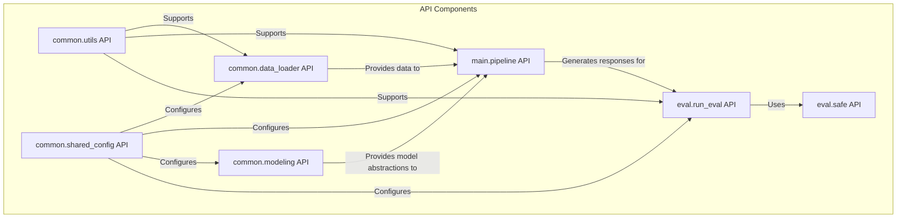
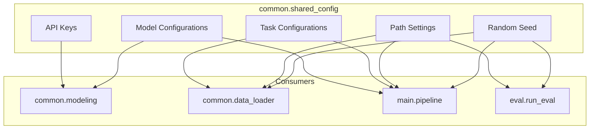
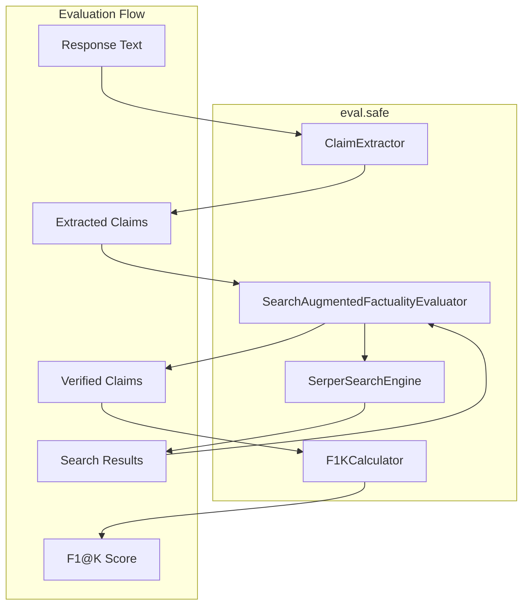
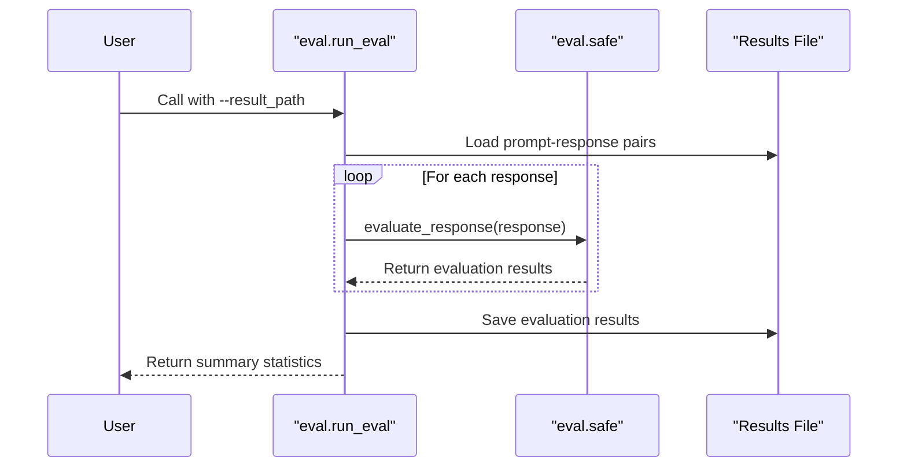
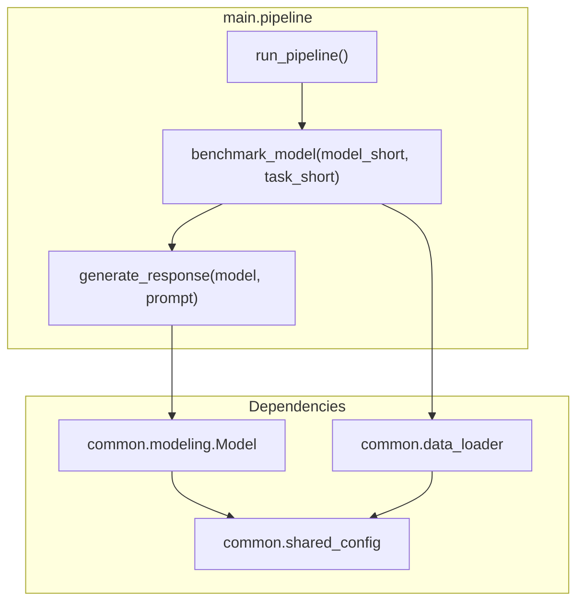

<!-- source: DeepWiki mcp.deepwiki.com · repo google-deepmind/long-form-factuality · page 5 API Reference · fetched 2026-10-26 -->

# API Reference

<details>
<summary>Relevant source files</summary>

The following files were used as context for generating this wiki page:

- [README.md](README.md)
- [common/README.md](common/README.md)

</details>


## Purpose and Scope

This document provides a technical reference for the programmatic interfaces available in the Long-Form Factuality codebase. It describes the key APIs that developers can use to interact with the system's components, including data loading, model abstractions, and evaluation utilities. This reference is intended for technical users who need to programmatically integrate with or extend the system's functionality.

For information about system architecture, see [System Architecture](#2). For usage guides, see [Usage Guides](#4).

## API Overview

The Long-Form Factuality system exposes several APIs organized into logical modules. The following diagram illustrates the high-level API structure:



Sources: [README.md](), [common/README.md]()

## Common Module APIs

The common module provides core utilities and abstractions used throughout the system. It includes APIs for data loading, model interaction, configuration, and general utility functions.

### Data Loading API

The data loader API provides interfaces for loading and processing the LongFact dataset and other supported datasets.

```mermaid
classDiagram
    class "common.data_loader" {
        +load_dataset(task_short) Dataset
        +load_longfact() Dataset
        +get_task_prompt(task_data, idx) str
        +get_task_answers(task_data, idx) list
    }
    class "Dataset" {
        +prompts list
        +correct_answers list~optional~
        +incorrect_answers list~optional~
    }
    "common.data_loader" --> "Dataset" : returns
```

Sources: [common/README.md]()

#### Key Functions

| Function | Description | Parameters | Return Value |
|----------|-------------|------------|--------------|
| `load_dataset(task_short)` | Loads dataset based on task shorthand | `task_short`: String identifier of task | Dataset object containing prompts and answers |
| `load_longfact()` | Loads the LongFact dataset | None | Dataset object containing LongFact prompts |
| `get_task_prompt(task_data, idx)` | Gets prompt at specified index | `task_data`: Dataset, `idx`: Index | String prompt |
| `get_task_answers(task_data, idx)` | Gets correct answers at index | `task_data`: Dataset, `idx`: Index | List of correct answers or None |

Sources: [common/README.md]()

### Model Abstraction API

The modeling API provides a unified interface for interacting with different language models from providers like OpenAI and Anthropic.

```mermaid
classDiagram
    class "common.modeling.Model" {
        +load(model_short) LanguageModel
        +generate(prompt, temperature, max_tokens) str
    }
    class "langfun.LanguageModel" {
        +generate_text(prompt) str
    }
    class "common.modeling.OpenAIModel" {
        +generate_text(prompt) str
    }
    class "common.modeling.AnthropicModel" {
        +generate_text(prompt) str
    }
    "common.modeling.Model" --> "langfun.LanguageModel" : uses
    "common.modeling.OpenAIModel" --|> "langfun.LanguageModel" : inherits
    "common.modeling.AnthropicModel" --|> "langfun.LanguageModel" : inherits
```

Sources: [common/README.md]()

#### Supported Models

The API currently supports the following models:

| Provider | Models |
|----------|--------|
| OpenAI | GPT-4-Turbo (`gpt-4-0125-preview`), GPT-4 (`gpt-4-0613`), GPT-4-32K (`gpt-4-32k-0613`), GPT-3.5-Turbo (`gpt-3.5-turbo-0125`), GPT-3.5-Turbo-16K (`gpt-3.5-turbo-16k-0613`) |
| Anthropic | Claude-3-Opus (`claude-3-opus-20240229`), Claude-3-Sonnet (`claude-3-sonnet-20240229`), Claude-3-Haiku (`claude-3-haiku-20240307`), Claude-2.1 (`claude-2.1`), Claude-2.0 (`claude-2.0`), Claude-Instant (`claude-instant-1.2`) |

Sources: [common/README.md]()

#### Key Functions

| Function | Description | Parameters | Return Value |
|----------|-------------|------------|--------------|
| `Model.load(model_short)` | Creates model instance based on shorthand | `model_short`: String identifier of model | LanguageModel instance |
| `Model.generate(prompt, temperature, max_tokens)` | Generates text from specified model | `prompt`: Input text, `temperature`: Sampling temperature, `max_tokens`: Maximum response length | Generated text as string |

Sources: [common/README.md]()

### Configuration API

The configuration API provides access to system-wide settings through the `shared_config` module.



Sources: [common/README.md]()

#### Key Configuration Variables

| Variable | Description | Default Value |
|----------|-------------|---------------|
| `openai_api_key` | API key for OpenAI models | None, must be set by user |
| `anthropic_api_key` | API key for Anthropic models | None, must be set by user |
| `serper_api_key` | API key for Serper (used by SAFE) | None, must be set by user |
| `path_to_data` | Directory path containing datasets | `"datasets/"` |
| `path_to_result` | Directory path for saving results | `"results/"` |
| `random_seed` | Random seed for reproducibility | `1` |
| `prompt_postamble` | Universal postamble appended to prompts | Prompts model to provide specific details |
| `model_options` | Dictionary mapping model shorthand to full model identifiers | Maps shorthand names to provider-specific identifiers |
| `task_options` | Dictionary mapping task shorthand to dataset information | Maps shorthand names to dataset file and key information |

Sources: [common/README.md]()

### Utility API

The utility API provides helper functions used throughout the system.

```mermaid
classDiagram
    class "common.utils" {
        +create_directory_if_not_exists(path) void
        +load_jsonl(path) list
        +save_jsonl(data, path) void
        +format_prompt(prompt, postamble) str
    }
```

Sources: [common/README.md]()

## Evaluation APIs

### SAFE Evaluator API

The SAFE (Search-Augmented Factuality Evaluator) API provides functions for evaluating the factuality of model responses.



Sources: [README.md]()

#### Key Functions

| Function | Description | Parameters | Return Value |
|----------|-------------|------------|--------------|
| `evaluate_response(response_text)` | Evaluates factuality of a response | `response_text`: Text to evaluate | Evaluation result object with scores and details |
| `extract_claims(text)` | Extracts verifiable claims from text | `text`: Text to analyze | List of claim objects |
| `verify_claim(claim)` | Verifies a single claim using search | `claim`: Claim object to verify | Verification result with support evidence |
| `calculate_f1k(verified_claims, k)` | Calculates F1@K metric | `verified_claims`: List of verification results, `k`: K value | F1@K score as float |

Sources: [README.md]()

### Run Evaluation API

The run evaluation API provides functions for running evaluations on model responses.



Sources: [README.md]()

#### Key Functions

| Function | Description | Parameters | Return Value |
|----------|-------------|------------|--------------|
| `run_eval(result_path)` | Runs evaluation on prompt-response pairs | `result_path`: Path to JSON file with prompt-response pairs | Evaluation results saved to file |
| `summarize_results(results)` | Generates summary statistics | `results`: List of evaluation results | Summary statistics object |

Sources: [README.md]()

## Main Pipeline API

The main pipeline API provides functions for running experiments to benchmark language models.



Sources: [README.md]()

#### Key Functions

| Function | Description | Parameters | Return Value |
|----------|-------------|------------|--------------|
| `run_pipeline()` | Runs the main experimentation pipeline | None | None, results saved to file |
| `benchmark_model(model_short, task_short)` | Benchmarks a specific model on a task | `model_short`: Model identifier, `task_short`: Task identifier | Results saved to file |
| `generate_response(model, prompt)` | Generates a response for a prompt | `model`: Model instance, `prompt`: Prompt text | Generated response as string |

Sources: [README.md]()

## Extending the API

### Adding New Models

To add support for new models to the system, you can extend the model abstraction API:

1. Create a new class that inherits from `langfun.LanguageModel`
2. Implement the required methods such as `generate_text()`
3. Add the new class to the `Model.load()` method
4. Update `model_options` and `model_string` in `shared_config.py`

Sources: [common/README.md]()

### Adding New Tasks

To add support for new tasks or datasets:

1. Format the dataset as a `.jsonl` file with the appropriate structure
2. Save the file in the data directory (default: `datasets/`)
3. Add an entry to the `task_options` dictionary in `shared_config.py`

Sources: [common/README.md]()

### Customizing Evaluation

The SAFE evaluator and F1@K metric can be customized by modifying their respective components:

1. To customize claim extraction, modify the `ClaimExtractor` class
2. To customize verification, modify the `SearchAugmentedFactualityEvaluator` class
3. To customize scoring, modify the `F1KCalculator` class

Sources: [README.md]()

## Environment Configuration

The API requires several environment configurations to function properly:

1. Python 3.10+ environment
2. Required dependencies installed from `requirements.txt`
3. API keys set in `shared_config.py`:
   - `openai_api_key` for OpenAI models
   - `anthropic_api_key` for Anthropic models
   - `serper_api_key` for SAFE evaluator

Sources: [README.md](), [common/README.md]()

---

