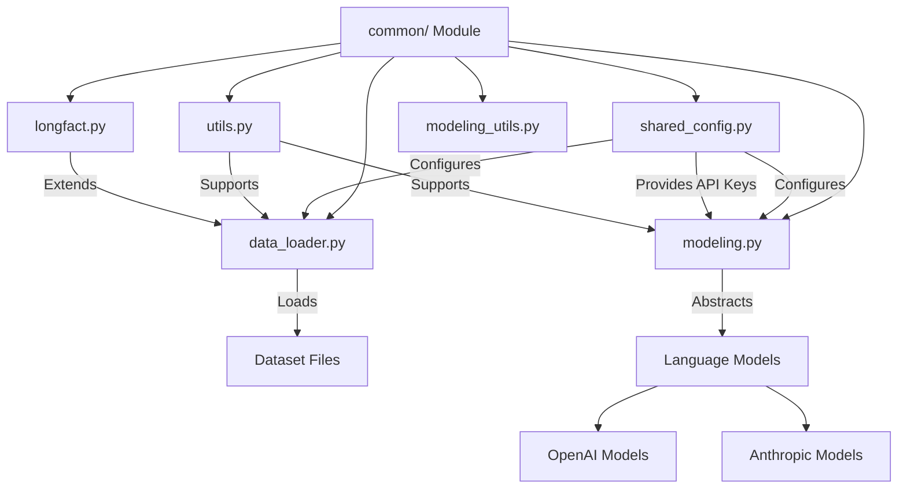
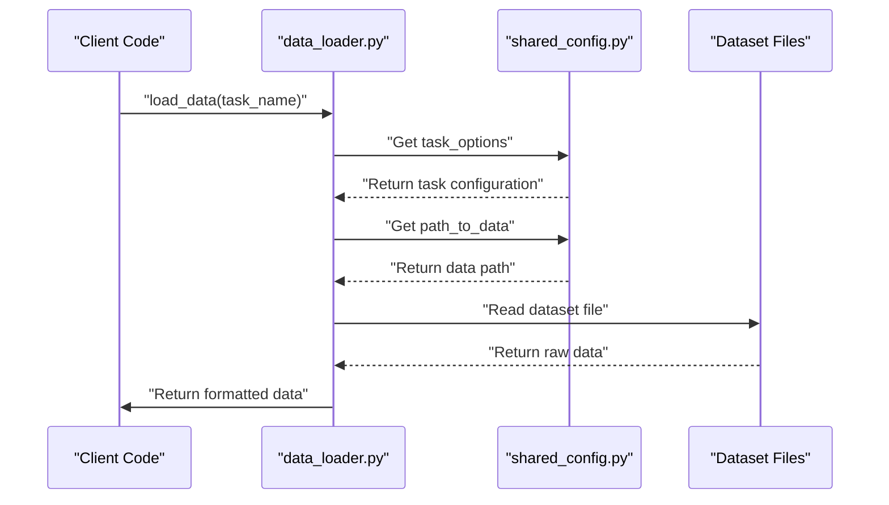
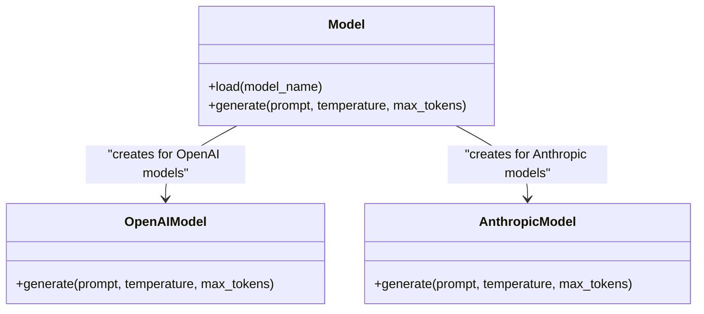
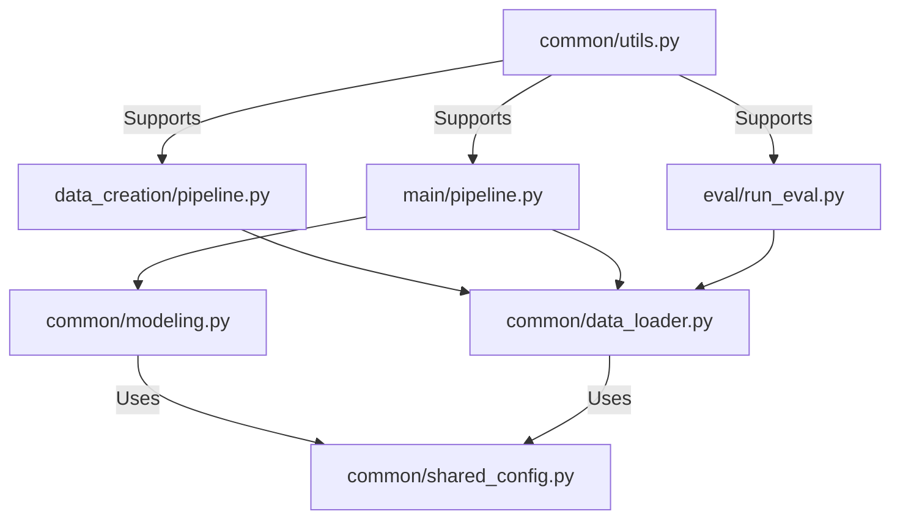

<!-- source: DeepWiki mcp.deepwiki.com · repo google-deepmind/long-form-factuality · page 5.1 Common Module API · fetched 2026-10-26 -->

# Common Module API

<details>
<summary>Relevant source files</summary>

The following files were used as context for generating this wiki page:

- [common/README.md](common/README.md)

</details>


## Purpose and Scope

The Common Module provides shared utilities, abstractions, and configuration settings used throughout the long-form-factuality evaluation system. It serves as the foundation for data loading, model interaction, and configuration management across all components of the system. This module is essential for ensuring consistent behavior and reducing code duplication across the codebase.

For information about the overall system architecture, see [System Architecture](#2), and for details about the common directory structure, see [common/ Directory](#3.4).

## Core Components

The Common Module consists of several key files, each providing specific functionality:

| File | Purpose |
|------|---------|
| `data_loader.py` | Functions for loading and processing datasets |
| `modeling.py` | Unified interface for interacting with language models |
| `shared_config.py` | Centralized configuration settings |
| `utils.py` | General utility functions |
| `longfact.py` | Specific functionality for handling the LongFact dataset |
| `modeling_utils.py` | Helper functions for model interactions |

### Component Relationship Diagram



Sources: common/README.md

## Data Loading API

The Data Loading API provides functions for loading and processing datasets used throughout the system.

### Key Functions and Classes

| Function | Description |
|----------|-------------|
| `load_data(task_name)` | Loads a dataset based on the task name in the configuration |
| `format_data(raw_data, prompt_key, correct_answers_key, incorrect_answers_key)` | Formats raw data into a standardized structure |

### Data Loading Process



Sources: common/README.md

## Model Abstraction API

The Model Abstraction API provides a unified interface for interacting with different language models, abstracting away provider-specific implementation details.

### Supported Models

The API natively supports the following models:

#### OpenAI Models
* GPT-4-Turbo (`gpt-4-0125-preview`)
* GPT-4 (`gpt-4-0613`)
* GPT-4-32K (`gpt-4-32k-0613`)
* GPT-3.5-Turbo (`gpt-3.5-turbo-0125`)
* GPT-3.5-Turbo-16K (`gpt-3.5-turbo-16k-0613`)

#### Anthropic Models
* Claude-3-Opus (`claude-3-opus-20240229`)
* Claude-3-Sonnet (`claude-3-sonnet-20240229`)
* Claude-3-Haiku (`claude-3-haiku-20240307`)
* Claude-2.1 (`claude-2.1`)
* Claude-2.0 (`claude-2.0`)
* Claude-Instant (`claude-instant-1.2`)

### Model Architecture



### Key Methods

| Method | Description |
|----------|-------------|
| `Model.load(model_name)` | Factory method that creates and returns the appropriate model instance based on the model name |
| `Model.generate(prompt, temperature=0, max_tokens=None)` | Generates a response from the model for the given prompt |

Sources: common/README.md

## Configuration API

The Configuration API centralizes settings and configurations used throughout the codebase in the `shared_config.py` file.

### Important Settings

| Setting | Description | Default |
|---------|-------------|---------|
| `openai_api_key` | API key for OpenAI services | None |
| `anthropic_api_key` | API key for Anthropic services | None |
| `serper_api_key` | API key for Serper services (used by SAFE evaluator) | None |
| `random_seed` | Random seed for reproducibility | 1 |
| `path_to_result` | Path to save result files | 'results/' |
| `path_to_data` | Path to dataset files | 'datasets/' |
| `prompt_postamble` | Text to append to all prompts | Custom text prompting for detailed responses |
| `model_options` | Maps model shorthand names to full identifiers | See shared_config.py |
| `task_options` | Maps task names to dataset configurations | See shared_config.py |

### System Integration



Sources: common/README.md

## Common Usage Patterns

### Data Loading

```python
from common import data_loader

# Load data for a specific task
data = data_loader.load_data('longfact')
```

### Model Interaction

```python
from common.modeling import Model

# Load a specific model
model = Model.load('gpt-4')

# Generate a response
response = model.generate(
    prompt="What is the capital of France?",
    temperature=0,
    max_tokens=1000
)
```

### Configuration Access

```python
from common import shared_config

# Access configuration settings
api_key = shared_config.openai_api_key
result_path = shared_config.path_to_result
```

Sources: common/README.md

## Extending the API

### Adding New Models

To add support for new language models:

1. **Create a new model class** that inherits from `langfun.LanguageModel`:
   - Follow the pattern of `AnthropicModel` class in `modeling.py`
   - Implement the required interface methods, especially `generate()`

2. **Add the new class to the `Model.load()` method**:
   - Update the conditional logic to detect and instantiate your new model class

3. **Update configuration in `shared_config.py`**:
   - Add entries to `model_options` with the format `'shorthand': 'PROVIDER:model-name'`
   - Add entries to `model_string` for output file naming

### Supporting Additional Tasks

To add support for new datasets:

1. **Format the dataset** as a `.jsonl` file with consistent key structure
2. **Save the dataset** in the directory specified by `path_to_data` in `shared_config.py` 
3. **Add an entry to `task_options`** in `shared_config.py`:

```python
'new-task': ('filename', 'prompt_key', 'correct_answers_key', 'incorrect_answers_key')
```

Where:
- `'new-task'` is the shorthand name for the dataset
- `'filename'` is the filename without the `.jsonl` extension
- `'prompt_key'` is the dictionary key that stores each prompt
- `'correct_answers_key'` is the key for correct answers (or `'NONE'` if none)
- `'incorrect_answers_key'` is the key for incorrect answers (or `'NONE'` if none)

Sources: common/README.md

---

