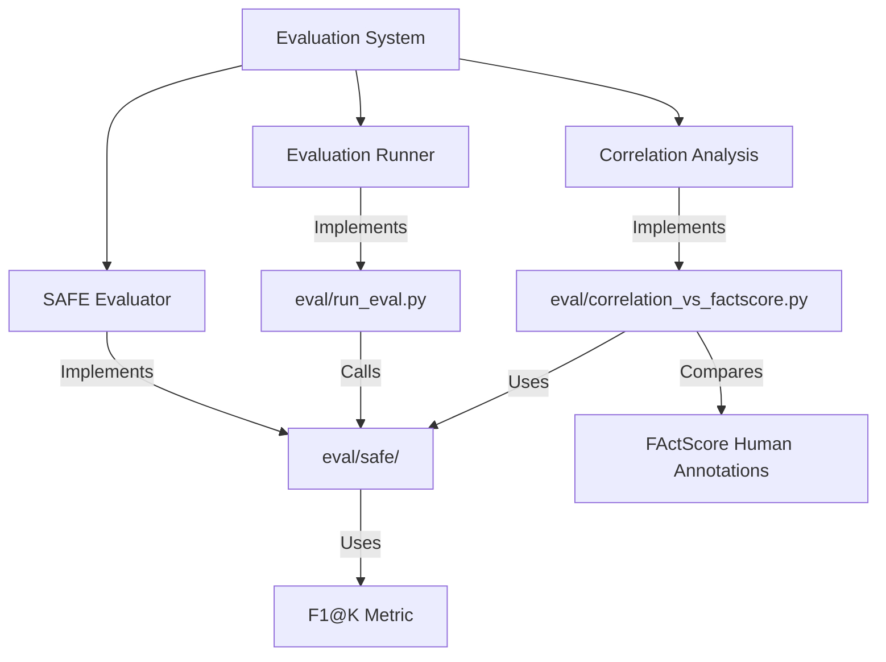
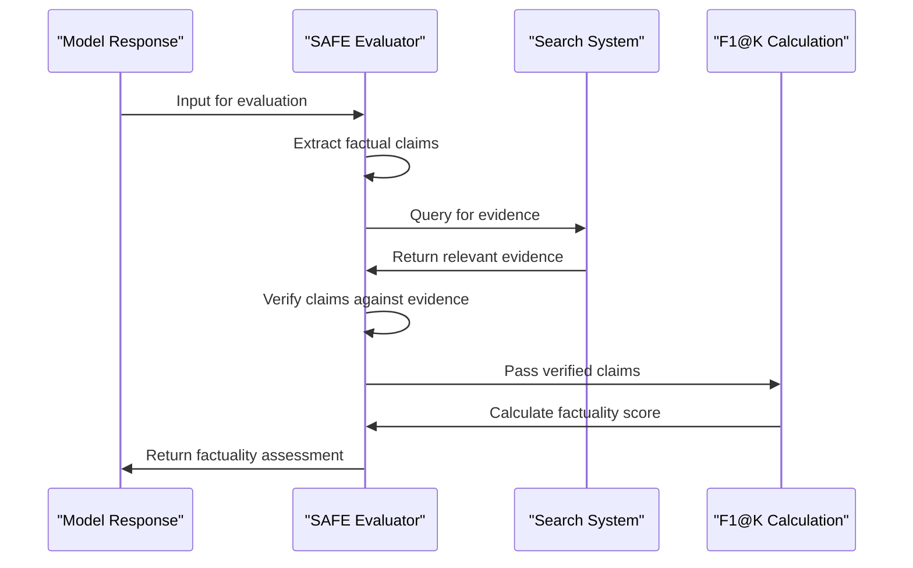
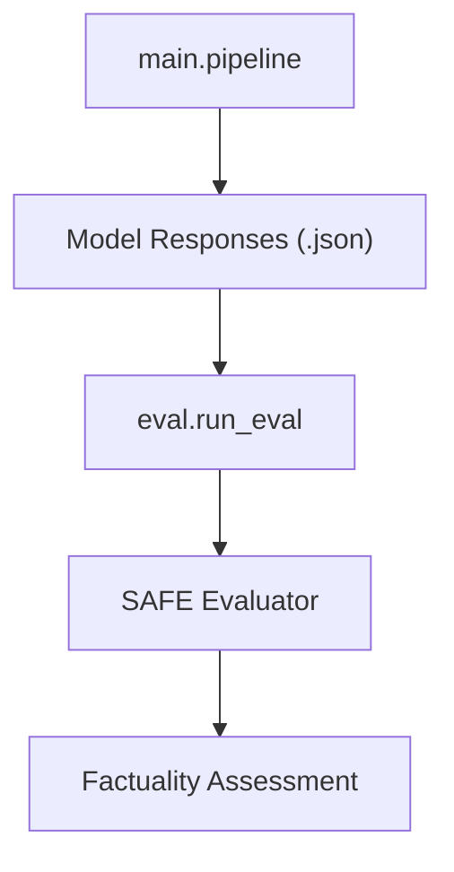
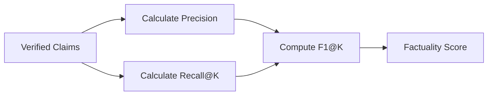
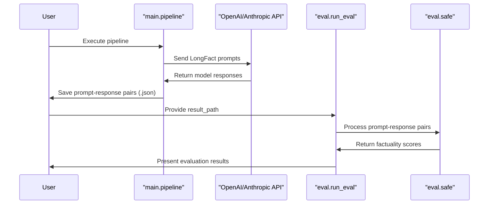

<!-- source: DeepWiki mcp.deepwiki.com · repo google-deepmind/long-form-factuality · page 5.2 Evaluation APIs · fetched 2026-10-26 -->

# Evaluation APIs

<details>
<summary>Relevant source files</summary>

The following files were used as context for generating this wiki page:

- [README.md](README.md)

</details>


## Purpose and Scope

This document provides technical reference for the evaluation APIs in the long-form-factuality system. These APIs enable automated assessment of factuality in long-form LLM responses through the Search-Augmented Factuality Evaluator (SAFE) and F1@K metrics. For guidance on using these APIs to benchmark models, see [Benchmarking Models](#4.3).

## Evaluation System Architecture

The evaluation APIs are organized into several components that work together to assess factuality:



Sources: [README.md:56-64]()

## SAFE Evaluator API

The Search-Augmented Factuality Evaluator (SAFE) is the core component for evaluating the factuality of model-generated responses. Its implementation is located in the `eval/safe/` directory.

### Evaluation Workflow



Sources: [README.md:56-58]()

## Running Evaluations

The primary entry point for evaluating model responses is the `eval/run_eval.py` script, which provides a command-line interface to the SAFE evaluator.

### Command-line Interface

```
python -m eval.run_eval --result_path=<path_to_json_file>
```

Where:
- `--result_path`: Path to a JSON file containing prompt-response pairs to be evaluated

### Integration with Benchmarking Pipeline



Sources: [README.md:75-80]()

## Correlation Analysis API

The system includes an API for analyzing the correlation between SAFE's automated evaluations and human annotations through the `eval/correlation_vs_factscore.py` script.

### Usage

```
python -m eval.correlation_vs_factscore
```

This script evaluates SAFE against FActScore human annotations to validate the automated evaluation approach.

Sources: [README.md:59-64]()

## F1@K Metric

The F1@K metric extends the traditional F1 score for long-form settings by using recall from human-preferred length. This metric is a key component of the factuality assessment provided by SAFE.



Sources: [README.md:8]()

## Evaluation Data Flow

To provide a more comprehensive view of how the evaluation APIs fit into the overall system, here is the complete data flow from model response generation to evaluation:



Sources: [README.md:67-80]()

## Unit Testing

Each evaluation API component has corresponding unit tests with the `_test` suffix. For example, to run tests for specific evaluation components:

```
python -m unittest discover -s ./eval/ -p "*_test.py"
```

Sources: [README.md:82-90]()

This documentation provides a reference for the evaluation APIs in the long-form-factuality system. The APIs enable automated assessment of factuality in LLM responses through the SAFE evaluator, factuality metrics, and correlation analysis tools.