# Page: Overview

# Overview

<details>
<summary>Relevant source files</summary>

The following files were used as context for generating this wiki page:

- [LICENSE](LICENSE)
- [README.md](README.md)

</details>


This document provides an introduction to the Long-Form Factuality repository, a comprehensive framework for evaluating factuality in long-form responses generated by Large Language Models (LLMs). The repository implements the methodologies described in the paper ["Long-form factuality in large language models"](https://arxiv.org/abs/2403.18802).

For installation instructions, see [Installation and Setup](#1.1).

## Core Components

The repository consists of four key components:

1. **LongFact**: A dataset of 2,280 fact-seeking prompts designed to elicit long-form responses from LLMs.

2. **Search-Augmented Factuality Evaluator (SAFE)**: An automatic evaluation framework that assesses the factual accuracy of model-generated responses.

3. **F1@K**: A metric that extends traditional F1 scoring to long-form content by using recall from human-preferred length.

4. **Experimentation Pipeline**: A system for benchmarking various LLMs (specifically OpenAI and Anthropic models) using the LongFact dataset and SAFE evaluator.

Sources: [README.md:3-9]()

## System Architecture

The following diagram illustrates the high-level architecture of the Long-Form Factuality evaluation system:

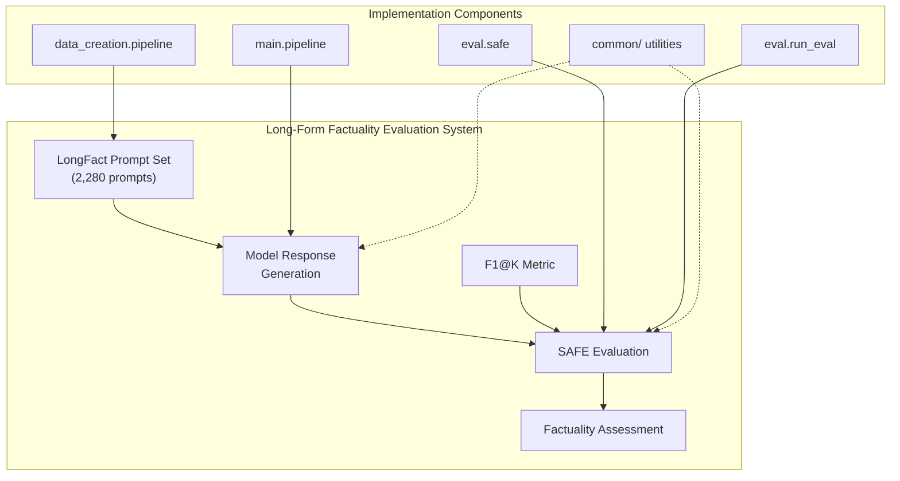

Sources: [README.md:3-9](), [README.md:66-80]()

## Data and Process Flow

The following diagram shows the workflow for evaluating LLM factuality:

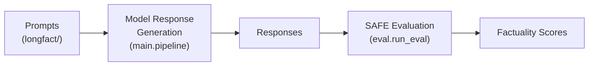

The process begins with the LongFact prompt set, which is used to generate responses from various language models. These responses are then evaluated using the SAFE framework to produce factuality scores that assess the accuracy of the information provided in the responses.

Sources: [README.md:44-80]()

## Key Features

The Long-Form Factuality framework provides several important capabilities:

| Feature | Description | Implementation |
|---------|-------------|----------------|
| Long-form prompt dataset | 2,280 fact-seeking prompts requiring detailed responses | `longfact/` directory |
| Automated factuality evaluation | Search-augmented system to verify claims in LLM responses | `eval/safe/` |
| Benchmarking framework | System to evaluate and compare different LLMs | `main/pipeline.py` |
| Extended metrics for long-form content | F1@K adaptation for long-form factuality assessment | `eval/safe/` |
| Human correlation analysis | Tools to compare automated metrics with human annotations | `eval/correlation_vs_factscore.py` |

Sources: [README.md:3-9](), [README.md:44-64]()

## Repository Structure

The codebase is organized into several key directories:

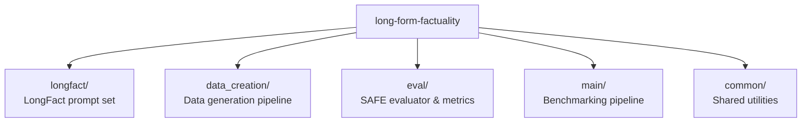

Each directory serves a specific purpose:

- **longfact/**: Contains the LongFact prompt set.
- **data_creation/**: Implements the pipeline used to generate the LongFact dataset.
- **eval/**: Houses the SAFE evaluation framework and correlation analysis tools.
- **main/**: Contains the experimentation pipeline for benchmarking models.
- **common/**: Provides shared utilities, configuration settings, and model abstractions.

For a more detailed breakdown of each directory, see [Directory Structure](#3).

Sources: [README.md:44-80]()

## Getting Started

To use the Long-Form Factuality framework:

1. Install the required dependencies as outlined in [Installation and Setup](#1.1).
2. Configure API keys for OpenAI and Anthropic in the common configuration file.
3. Generate model responses using the main pipeline.
4. Evaluate the responses using SAFE.

Basic usage examples:

```bash
# Generate model responses
python -m main.pipeline

# Evaluate responses using SAFE
python -m eval.run_eval --result_path=path/to/responses.json
```

For detailed usage guides, see [Usage Guides](#4).

Sources: [README.md:11-80]()

## Related Resources

- For key terminology used throughout the system, see [Key Concepts and Terminology](#1.2).
- For detailed information about the LongFact prompt set, see [LongFact Prompt Set](#2.1).
- For a deeper understanding of the SAFE evaluator, see [SAFE Evaluator](#2.2).
- For information about the F1@K metric, see [F1@K Metric](#2.3).

This repository supports researchers and developers in assessing and improving factuality in long-form content generated by large language models.

Sources: [README.md:3-9](), [README.md:94-103]()

---

# Page: Installation and Setup

# Installation and Setup

<details>
<summary>Relevant source files</summary>

The following files were used as context for generating this wiki page:

- [README.md](README.md)
- [common/README.md](common/README.md)

</details>


This page provides detailed instructions for installing the long-form-factuality evaluation system and configuring the necessary API keys. It covers the initial setup process, required dependencies, and configuration steps to prepare the system for benchmarking language models.

For information about system architecture and components, see [System Architecture](#2).

## Prerequisites

Before installing the long-form-factuality system, ensure you have:

1. Git installed on your system
2. Python 3.10 or higher
3. Conda package manager (recommended)
4. API keys for external services:
   - OpenAI API key (for GPT models)
   - Anthropic API key (for Claude models)
   - Serper API key (for search functionality in SAFE evaluator)

Sources: [README.md:11-41]()(common/README.md:15-20)()

## Installation Process

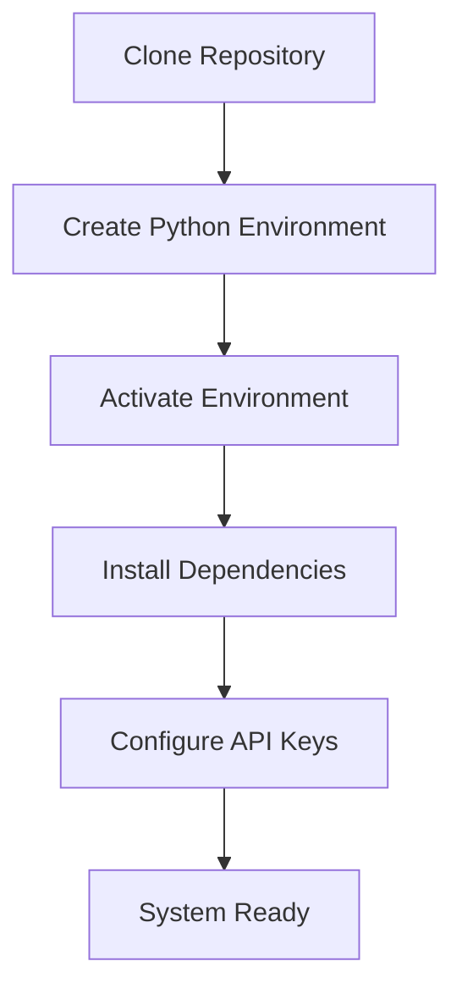

### Step 1: Clone the Repository

Clone the GitHub repository to your local machine:

```bash
git clone https://github.com/google-deepmind/long-form-factuality.git
cd long-form-factuality
```

Sources: [README.md:13-22]()

### Step 2: Create and Activate Python Environment

Create a new conda environment with Python 3.10:

```bash
conda create --name longfact python=3.10
conda activate longfact
```

Sources: [README.md:24-34]()

### Step 3: Install Dependencies

Install all required packages using pip:

```bash
pip install -r requirements.txt
```

Sources: [README.md:36-41]()

## API Key Configuration

The system requires API keys for external services to function properly. These must be configured in the shared configuration file.

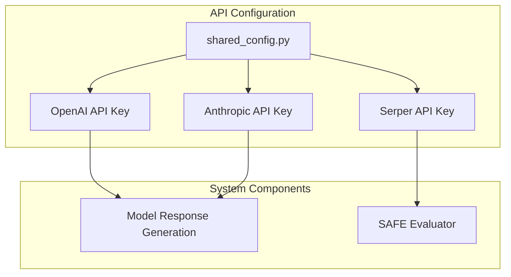

### Setting API Keys

Add your API keys to the `common/shared_config.py` file:

1. OpenAI API key - Required for accessing GPT models
2. Anthropic API key - Required for accessing Claude models
3. Serper API key - Required for the search functionality in the SAFE evaluator

These keys should be set as values for the respective variables in the configuration file:
- `openai_api_key`
- `anthropic_api_key`
- `serper_api_key`

**Important**: Do not publish these API keys or commit them to public repositories.

Sources: [README.md:67]()(common/README.md:15-20]()

## Configuration Options

The system provides several configuration options that can be customized according to your requirements.

### Random Seed

For reproducibility, the system uses a random seed for operations that require randomness. By default, this is set to `1` but can be modified in `common/shared_config.py`.

### Results Directory

By default, all result files are saved in the `results/` directory. This can be changed by modifying the `path_to_result` variable in `common/shared_config.py`.

### Prompt Postamble

When using the experimentation pipeline, you can add a universal postamble to all prompts by modifying the `prompt_postamble` variable in `common/shared_config.py`. Note that this feature must be enabled in `main/config.py`.

Sources: [common/README.md:22-41]()

## Supported Models

The system supports various models from OpenAI and Anthropic:

| Provider | Models |
|----------|--------|
| OpenAI   | GPT-4-Turbo (`gpt-4-0125-preview`)<br>GPT-4 (`gpt-4-0613`)<br>GPT-4-32K (`gpt-4-32k-0613`)<br>GPT-3.5-Turbo (`gpt-3.5-turbo-0125`)<br>GPT-3.5-Turbo-16K (`gpt-3.5-turbo-16k-0613`) |
| Anthropic | Claude-3-Opus (`claude-3-opus-20240229`)<br>Claude-3-Sonnet (`claude-3-sonnet-20240229`)<br>Claude-3-Haiku (`claude-3-haiku-20240307`)<br>Claude-2.1 (`claude-2.1`)<br>Claude-2.0 (`claude-2.0`)<br>Claude-Instant (`claude-instant-1.2`) |

Additional models can be configured by adding entries to the `model_options` and `model_string` variables in `common/shared_config.py`.

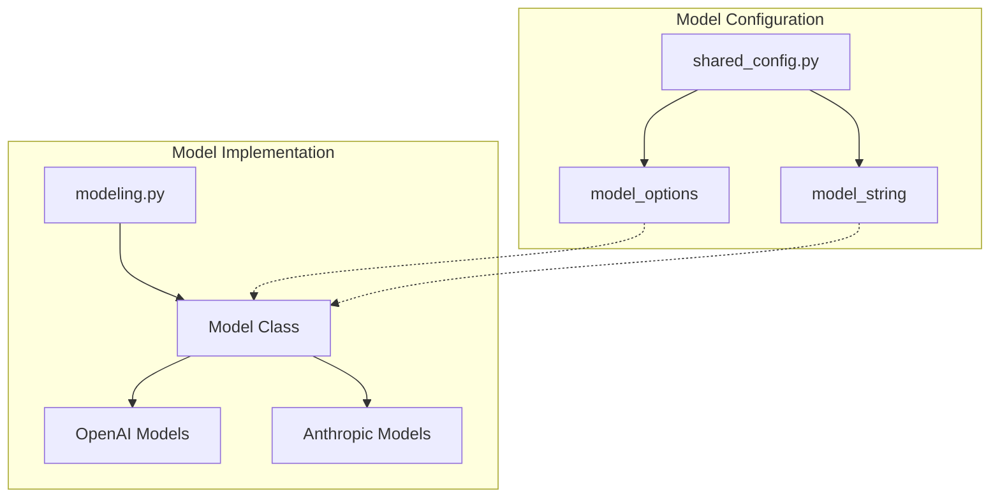

Sources: [common/README.md:43-67]()

## Verifying Installation

After completing the installation and configuration, you can verify that everything is working correctly by running the unit tests:

```bash
python -m unittest discover -s ./ -p "*_test.py"
```

This command will run all unit tests in the repository. If all tests pass, your installation is successful.

To run tests for specific components:

```bash
# Run tests for the common module
python -m unittest discover -s common/ -p "*_test.py"
```

Sources: [README.md:82-90]()(common/README.md:86-92]()

## Next Steps

After completing the installation and setup process, you can proceed to:

1. Generate data using the data creation pipeline:
   ```bash
   python -m data_creation.pipeline
   ```

2. Evaluate models using the SAFE evaluator:
   ```bash
   python -m eval.correlation_vs_factscore
   ```

3. Benchmark models:
   ```bash
   python -m main.pipeline
   ```
   
   And then evaluate the generated responses:
   ```bash
   python -m eval.run_eval --result_path=PATH_TO_RESULTS_FILE
   ```

For more information on using these components, see [Usage Guides](#4).

Sources: [README.md:43-80]()

---

# Page: Key Concepts and Terminology

# Key Concepts and Terminology

<details>
<summary>Relevant source files</summary>

The following files were used as context for generating this wiki page:

- [LICENSE](LICENSE)
- [README.md](README.md)

</details>


This document explains the key concepts and terminology used throughout the long-form factuality system. It provides definitions and explanations of the core components, metrics, and processes that are essential for understanding how the system evaluates factuality in long-form content generated by large language models.

For installation instructions, see [Installation and Setup](#1.1).
For details on system architecture, see [System Architecture](#2).

## Core Concepts

### Long-form Factuality

Long-form factuality refers to the evaluation of factual correctness in extended responses generated by large language models (LLMs). Unlike short-form factuality assessment, long-form responses present unique challenges due to:

- Greater number of claims per response
- Increased complexity of information
- More opportunities for factual errors
- Need for nuanced evaluation methods

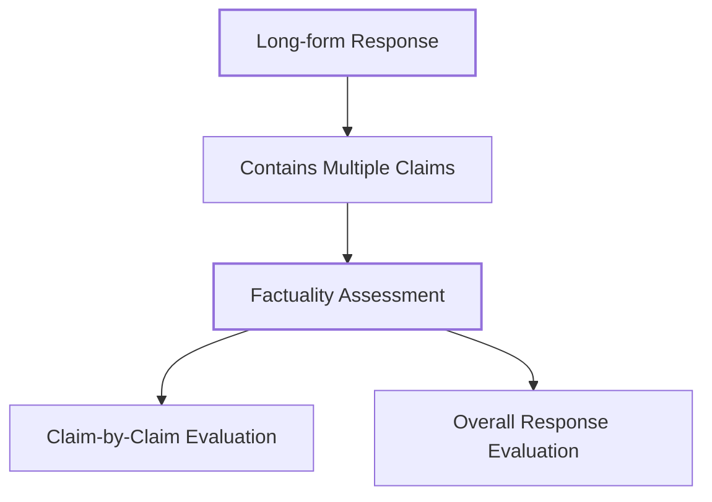

Sources: README.md

### LongFact Prompt Set

The LongFact prompt set is a collection of 2,280 fact-seeking prompts specifically designed to elicit long-form responses from language models. These prompts cover a wide range of topics and are structured to encourage detailed, factual responses.

| Component | Description |
|-----------|-------------|
| Size | 2,280 prompts |
| Purpose | Elicit long-form factual responses |
| Location | `longfact/` directory |
| Creation | Generated via `data_creation.pipeline` |

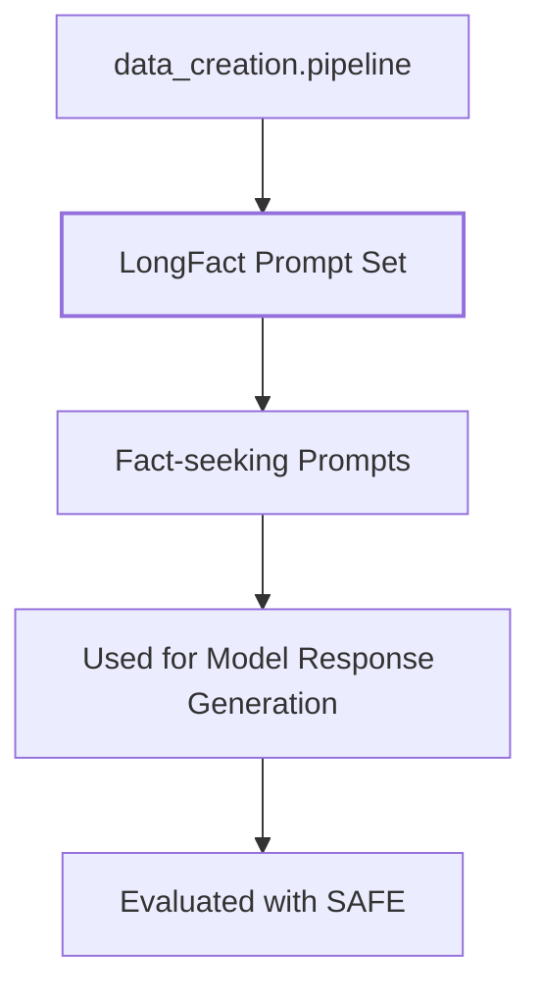

Sources: README.md

### Model Responses

Model responses refer to the outputs generated by large language models (e.g., OpenAI and Anthropic models) when presented with prompts from the LongFact prompt set. These responses are typically long-form, containing multiple factual claims.


Sources: README.md

## Evaluation Concepts

### Search-Augmented Factuality Evaluator (SAFE)

SAFE is an automatic evaluation system designed to assess the factuality of long-form responses. It uses search augmentation to verify claims made in model responses against trusted sources.

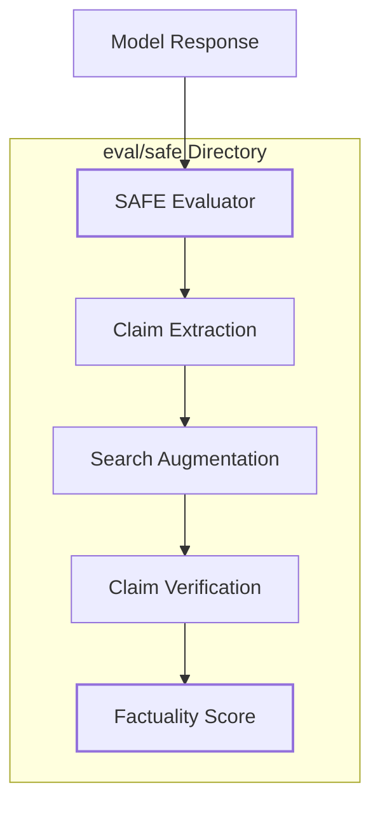

Sources: README.md

### F1@K Metric

F1@K is an adaptation of the traditional F1 score for long-form factuality evaluation. It extends the F1 score by using recall from human-preferred length to better evaluate long-form responses.

| Component | Description |
|-----------|-------------|
| F1 | Harmonic mean of precision and recall |
| K | Human-preferred length parameter |
| Purpose | Calibrate evaluation to human preferences |
| Implementation | Located in SAFE evaluator code |

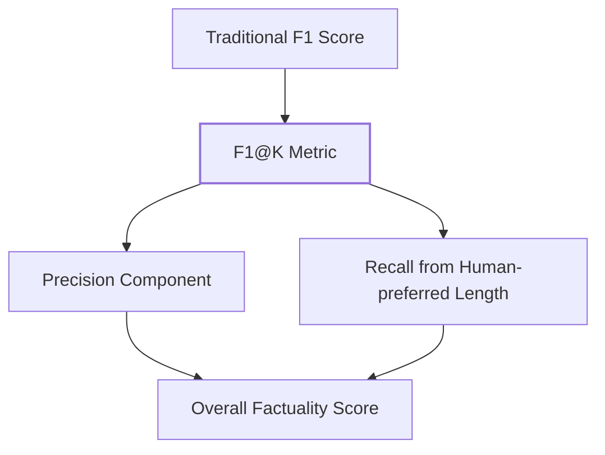

Sources: README.md

### FActScore

FActScore refers to human annotations used for correlation analysis with SAFE. This metric is used to validate the performance of the SAFE evaluator by comparing its automated assessments against human judgments.

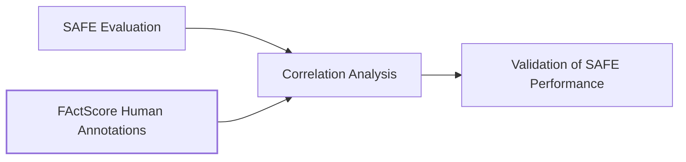

Sources: README.md

## System Components

### Data Creation Pipeline

The data creation pipeline generates the LongFact prompt set. It's implemented in the `data_creation/pipeline.py` file and produces the 2,280 fact-seeking prompts used in the system.

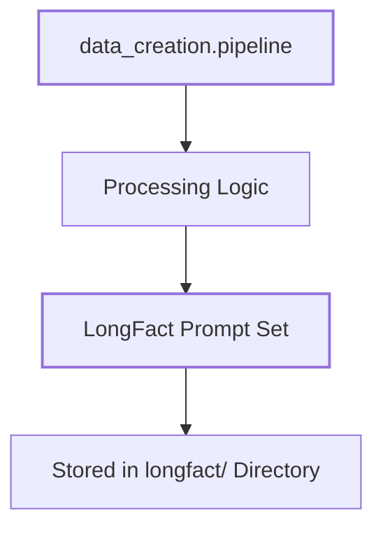

Sources: README.md

### Model Response Generation Pipeline

This pipeline handles the generation of responses from language models using the LongFact prompts. It's implemented in `main/pipeline.py` and interfaces with LLM APIs to obtain responses.

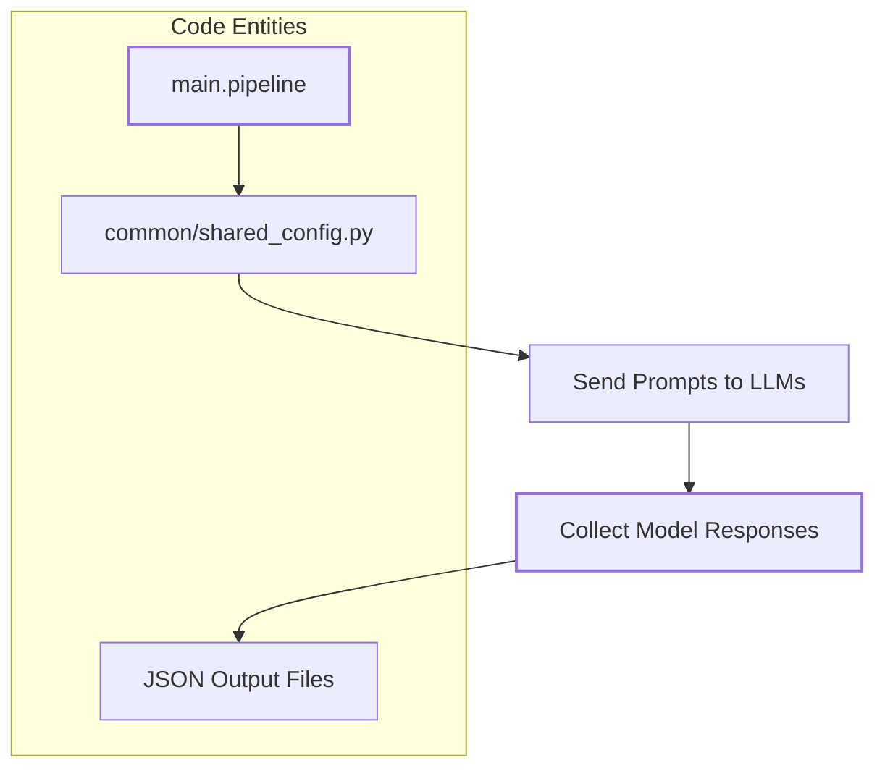

Sources: README.md

### Evaluation Pipeline

The evaluation pipeline assesses the factuality of model responses using SAFE. It's implemented in `eval/run_eval.py` and processes prompt-response pairs to produce factuality scores.

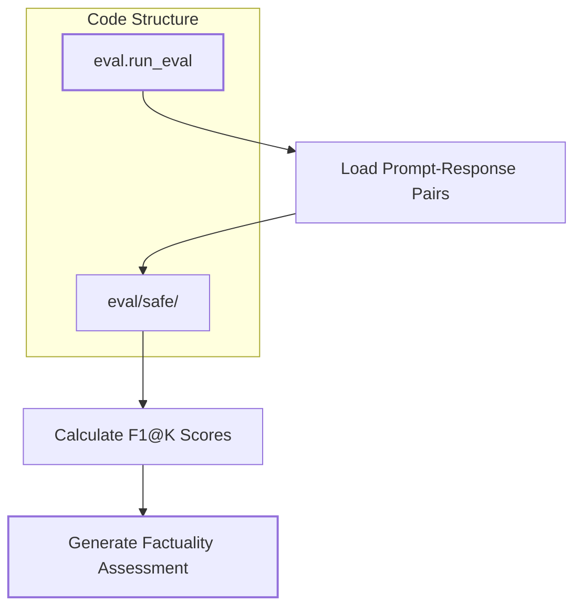

Sources: README.md

## Terminology Reference

| Term | Definition | Code Location |
|------|------------|--------------|
| LongFact | Prompt set of 2,280 fact-seeking prompts | `longfact/` |
| SAFE | Search-Augmented Factuality Evaluator | `eval/safe/` |
| F1@K | Extended F1 score for long-form evaluation | `eval/safe/` |
| Prompt-Response Pairs | JSON files containing prompts and model responses | Output of `main.pipeline` |
| API Keys | Authentication for OpenAI and Anthropic services | `common/shared_config.py` |
| Correlation Analysis | Comparison between SAFE and human annotations | `eval/correlation_vs_factscore.py` |
| Benchmarking | Process of evaluating multiple LLMs | `main/pipeline.py` and `eval/run_eval.py` |

Sources: README.md

## Code to Concept Mapping

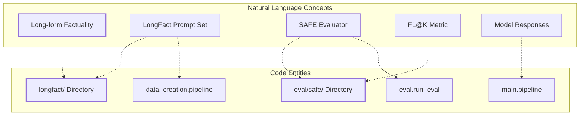

Sources: README.md

## Data Flow and Process Relationships

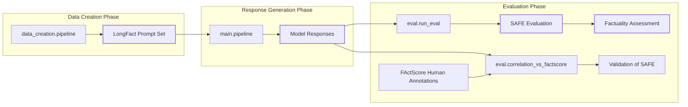

Sources: README.md

---

# Page: System Architecture

# System Architecture

<details>
<summary>Relevant source files</summary>

The following files were used as context for generating this wiki page:

- [LICENSE](LICENSE)
- [README.md](README.md)
- [common/README.md](common/README.md)

</details>


This document provides an overview of the Long-Form Factuality system architecture, describing its key components and their interactions. It covers how the different modules are structured and interconnected to evaluate factuality in long-form responses generated by large language models.

For information about specific components, please see the dedicated pages for the [LongFact Prompt Set](#2.1), [SAFE Evaluator](#2.2), and [F1@K Metric](#2.3).

## High-Level System Overview

### System Components and Flow

The Long-Form Factuality system consists of four primary components that work together to evaluate the factuality of responses from LLMs:

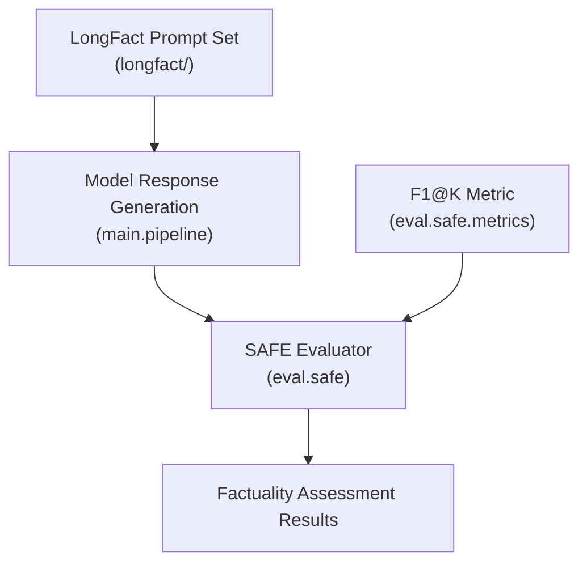

The system flow begins with the LongFact prompt set (2,280 fact-seeking prompts), which is processed by the main pipeline to generate model responses. These responses are then evaluated by the SAFE evaluator using the F1@K metric to produce a factuality assessment.

Sources: [README.md:3-9]()

## Core Components

### LongFact Prompt Set

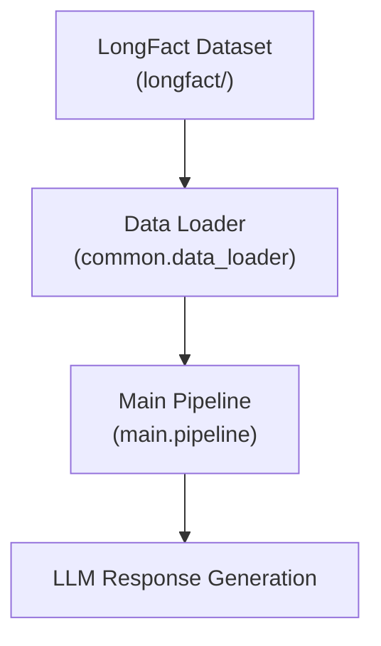

The LongFact prompt set is stored in the `longfact/` directory and loaded using functions in `common/data_loader.py`. These prompts are designed to elicit long-form factual responses from language models.

Sources: [README.md:6](), [common/README.md:6]()

### Model Integration Layer

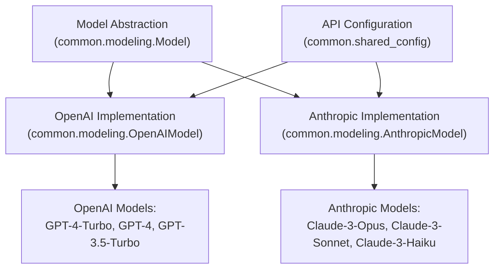

The system unifies access to various language models through an abstraction layer in `common/modeling.py`. The `Model` class provides a common interface for working with both OpenAI and Anthropic models, with configuration managed through `common/shared_config.py`.

Sources: [common/README.md:44-67]()

### SAFE Evaluator

```mermaid
graph TD
    ModelResponses["Model Responses<br>(JSON format)"] --> SAFEEvaluator["SAFE Evaluator<br>(eval.safe.safe_evaluator)"]
    SAFEEvaluator --> SearchEngine["Search Engine Interface<br>(eval.safe.search)"]
    SearchEngine --> SerperAPI["Serper Search API<br>(External Service)"]
    SerperAPI --> SearchEngine
    SearchEngine --> SAFEEvaluator
    SAFEEvaluator --> F1KCalculation["F1@K Calculation<br>(eval.safe.metrics)"]
    F1KCalculation --> SAFEEvaluator
    SAFEEvaluator --> FactualityScores["Factuality Scores<br>(JSON format)"]
```

The Search-Augmented Factuality Evaluator (SAFE) verifies the factuality of statements in model responses using web search. It's implemented in `eval/safe/` and integrates with the Serper search API to retrieve verification information.

Sources: [README.md:7](), [common/README.md:20]()

### F1@K Metric

```mermaid
graph TD
    Response["Model Response Text"] --> Segmentation["Response Segmentation<br>(eval.safe.metrics)"]
    Segmentation --> FactCheck["Factuality Verification<br>(Per Segment)"]
    FactCheck --> Precision["Precision Calculation<br>(True Positives/Total Claims)"]
    FactCheck --> Recall["Recall Calculation<br>(At Human-Preferred Length K)"]
    Precision --> F1Computation["F1 Score Computation<br>(eval.safe.metrics.f1_at_k)"]
    Recall --> F1Computation
    F1Computation --> F1KScore["F1@K Score"]
```

The F1@K metric extends the traditional F1 score for long-form settings by considering recall at a human-preferred length. The implementation segments responses, checks factuality per segment, and calculates precision and recall to derive the F1 score.

Sources: [README.md:8]()

## Data Flow Architecture

The following diagram illustrates the end-to-end data flow through the system:

```mermaid
flowchart LR
    DataCreation["data_creation.pipeline"] --> PromptSet["LongFact Prompt Set<br>(longfact/)"]
    PromptSet --> MainPipeline["main.pipeline"]
    APIKeys["API Keys Configuration<br>(common.shared_config)"] --> MainPipeline
    MainPipeline --> ResponsePairs["Prompt-Response Pairs<br>(JSON Files)"]
    ResponsePairs --> EvalRunner["eval.run_eval"]
    EvalRunner --> SAFEProcessor["SAFE Evaluation<br>(eval.safe)"]
    SAFEProcessor --> EvalResults["Evaluation Results<br>(JSON Files)"]
    
    ResponsePairs -.-> CorrelationAnalysis["eval.correlation_vs_factscore"]
    HumanAnnotations["FActScore Human Annotations"] -.-> CorrelationAnalysis
    CorrelationAnalysis -.-> ValidationResults["Correlation Analysis Results"]
```

The system begins with the data creation pipeline generating the LongFact prompt set. These prompts are processed by the main pipeline, which uses language models (via API keys in `common/shared_config.py`) to generate responses. The prompt-response pairs are then evaluated using SAFE. Additionally, the system can perform correlation analysis against human FActScore annotations to validate the automatic evaluation.

Sources: [README.md:48-64](), [common/README.md:15-21]()

## Directory Structure and Code Organization

```mermaid
graph TD
    RootDir["long-form-factuality/"] --> LongfactDir["longfact/<br>(Prompt Dataset)"]
    RootDir --> DataCreationDir["data_creation/<br>(Data Generation)"]
    RootDir --> EvalDir["eval/<br>(Evaluation Tools)"]
    RootDir --> MainDir["main/<br>(Experimentation)"]
    RootDir --> CommonDir["common/<br>(Shared Utilities)"]
    
    DataCreationDir --> PipelinePy["pipeline.py<br>(Data Generation Script)"]
    
    EvalDir --> SafeDir["safe/<br>(SAFE Implementation)"]
    EvalDir --> CorrelationPy["correlation_vs_factscore.py<br>(Correlation Analysis)"]
    EvalDir --> RunEvalPy["run_eval.py<br>(Evaluation Runner)"]
    
    SafeDir --> EvaluatorPy["safe_evaluator.py<br>(Core Evaluation Logic)"]
    SafeDir --> SearchPy["search.py<br>(Search Engine Interface)"]
    SafeDir --> MetricsPy["metrics.py<br>(F1@K Implementation)"]
    
    MainDir --> MainPipelinePy["pipeline.py<br>(Benchmarking Script)"]
    
    CommonDir --> ConfigPy["shared_config.py<br>(Configuration)"]
    CommonDir --> DataLoaderPy["data_loader.py<br>(Data Loading Functions)"]
    CommonDir --> ModelingPy["modeling.py<br>(Model Abstraction)"]
    CommonDir --> UtilsPy["utils.py<br>(Utility Functions)"]
```

The repository is organized into several main directories:
- `longfact/`: Contains the prompt dataset
- `data_creation/`: Implements the data generation pipeline
- `eval/`: Houses the SAFE evaluator and evaluation tools
- `main/`: Provides the experimentation pipeline for benchmarking
- `common/`: Contains shared utilities used across the codebase

Sources: [README.md:44-80](), [common/README.md:4-9]()

## Benchmarking Workflow

The following sequence diagram illustrates the workflow for benchmarking language models:

```mermaid
sequenceDiagram
    participant User
    participant Config as common.shared_config
    participant MainPipeline as main.pipeline
    participant ModelClass as common.modeling.Model
    participant LLM as LLM API
    participant Evaluator as eval.run_eval
    participant SAFE as eval.safe.safe_evaluator
    
    User->>Config: Configure API keys
    User->>MainPipeline: Execute pipeline
    MainPipeline->>ModelClass: Load model
    ModelClass->>LLM: Initialize API client
    MainPipeline->>ModelClass: Generate responses
    ModelClass->>LLM: Send prompts
    LLM->>ModelClass: Return responses
    ModelClass->>MainPipeline: Return processed responses
    MainPipeline->>User: Save prompt-response pairs
    User->>Evaluator: Provide result_path
    Evaluator->>SAFE: Process prompt-response pairs
    SAFE->>Evaluator: Return factuality scores
    Evaluator->>User: Present evaluation results
```

The benchmarking process starts with configuring API keys in `common/shared_config.py`, then executing the main pipeline to generate and save model responses. These responses are then evaluated using the SAFE evaluator to assess their factuality.

Sources: [README.md:66-80](), [common/README.md:15-21]()

## Integration with External Services

The system integrates with the following external services:

| Service | Purpose | Integration Point | Configuration |
|---------|---------|-------------------|--------------|
| OpenAI API | Access to GPT models | `common.modeling.OpenAIModel` | `common.shared_config.openai_api_key` |
| Anthropic API | Access to Claude models | `common.modeling.AnthropicModel` | `common.shared_config.anthropic_api_key` |
| Serper API | Web search for fact verification | `eval.safe.search.SerperSearchEngine` | `common.shared_config.serper_api_key` |

These integrations allow the system to generate responses from various language models and verify factual claims using web search.

Sources: [common/README.md:15-21](), [common/README.md:44-62]()

---

# Page: LongFact Prompt Set

# LongFact Prompt Set

<details>
<summary>Relevant source files</summary>

The following files were used as context for generating this wiki page:

- [README.md](README.md)

</details>


## Purpose and Scope
The LongFact Prompt Set is a collection of 2,280 fact-seeking prompts specifically designed to elicit long-form responses from language models. It serves as the foundational input dataset for evaluating factuality in extended content generated by large language models. For information about how responses to these prompts are evaluated, see [SAFE Evaluator](#2.2) and [F1@K Metric](#2.3).

## Dataset Specifications
- **Size**: 2,280 prompts
- **Type**: Fact-seeking prompts requiring long-form responses
- **Location**: `longfact/` directory
- **Creation**: Generated via `data_creation.pipeline` module

## System Integration

### LongFact in System Architecture

```mermaid
graph TD
    A["LongFact Prompt Set (longfact/)"] --> B["common/data_loader.py"]
    B --> C["main/pipeline.py"]
    D["common/shared_config.py (API Keys)"] --> C
    C --> E["Language Model APIs"]
    E --> F["Model Response JSON"]
    F --> G["eval/run_eval.py (--result_path)"]
    G --> H["eval/safe/"]
    H --> I["Factuality Metrics (F1@K)"]
```

Sources: README.md:6-8, README.md:44-46, README.md:67-80

### Data Processing Workflow

```mermaid
sequenceDiagram
    participant Creator as "data_creation.pipeline"
    participant Dataset as "LongFact (longfact/)"
    participant Loader as "common.data_loader"
    participant Pipeline as "main.pipeline"
    participant Models as "OpenAI/Anthropic APIs"
    participant Evaluator as "eval.run_eval"
    participant SAFE as "eval.safe"
    
    Creator->>Dataset: Generate 2,280 prompts
    Dataset->>Loader: Load prompts
    Loader->>Pipeline: Process prompts
    Pipeline->>Models: Request responses
    Models->>Pipeline: Return responses
    Pipeline->>Evaluator: Provide prompt-response pairs (.json)
    Evaluator->>SAFE: Process for evaluation
    SAFE->>Evaluator: Return factuality metrics
```

Sources: README.md:44-52, README.md:67-80

## Prompt Set Characteristics

The LongFact Prompt Set is designed to address a gap in existing factuality benchmarks, which typically focus on short-form question answering. By requiring long-form responses, LongFact allows for evaluation of a model's ability to maintain factual accuracy throughout extended text generation.

Key characteristics of the prompts include:
- Fact-seeking nature that requires reference to verifiable information
- Structure that encourages detailed, multi-paragraph responses
- Coverage of diverse domains and topics to test breadth of factual knowledge

Sources: README.md:3-9

## Usage in Codebase
The LongFact Prompt Set interacts with several components in the codebase:

### Data Creation and Loading
- Created by: `data_creation.pipeline` module
- Stored in: `longfact/` directory
- Loaded via: `common.data_loader` module

### Response Generation
- Processed by: `main.pipeline` module
- Uses API configuration from: `common.shared_config.py`
- Generates: Prompt-response pairs in JSON format

### Factuality Evaluation
- Evaluated by: `eval.run_eval` module
- Using: `eval.safe` (Search-Augmented Factuality Evaluator)
- Produces: Factuality metrics including F1@K

## Usage Instructions
To use the LongFact Prompt Set for benchmarking language models:

```bash
# Step 1: Ensure API keys are configured in common/shared_config.py
# Step 2: Generate model responses
python -m main.pipeline
# Step 3: Evaluate the responses
python -m eval.run_eval --result_path=[path_to_response_file]
```

Sources: README.md:67-80

## Code Component Diagram

```mermaid
graph TD
    subgraph "Data Creation"
        A["data_creation.pipeline"] --> B["longfact/ (2,280 prompts)"]
    end
    
    subgraph "Data Processing"
        B --> C["common.data_loader"]
        C --> D["main.pipeline"]
        E["common.shared_config (API Keys)"] --> D
        D --> F["common.modeling (Model Interface)"]
        F --> G["Response JSON"]
    end
    
    subgraph "Evaluation"
        G --> H["eval.run_eval (--result_path)"]
        H --> I["eval.safe (SAFE Evaluator)"]
        I --> J["F1@K Metrics"]
    end
```

Sources: README.md:44-52, README.md:55-80

## Creating or Regenerating the Prompt Set

To regenerate or modify the LongFact Prompt Set, you can use the data creation pipeline:

```bash
python -m data_creation.pipeline
```

This pipeline implements the methodology for generating fact-seeking prompts designed to elicit long-form responses suitable for factuality evaluation.

Sources: README.md:48-53

This technical documentation provides an overview of the LongFact Prompt Set, focusing on its role in the system architecture, its interactions with other code components, and how it's used in the factuality evaluation process.

---

# Page: SAFE Evaluator

# SAFE Evaluator

<details>
<summary>Relevant source files</summary>

The following files were used as context for generating this wiki page:

- [README.md](README.md)

</details>


## Purpose and Scope

The Search-Augmented Factuality Evaluator (SAFE) is a core component of the long-form factuality system designed to automatically assess the factual accuracy of responses generated by large language models (LLMs). This document provides a technical overview of the SAFE evaluator, its architecture, implementation, and how it integrates with other components of the system.

For information on the F1@K metric that SAFE uses to evaluate factuality, see [F1@K Metric](#2.3).

Sources: [README.md:7-8]()

## Overview

SAFE evaluates the factual accuracy of LLM-generated responses by analyzing prompt-response pairs and producing factuality scores. As its name suggests, SAFE uses search augmentation to verify factual claims in model responses against reliable sources of information.

The evaluation process works by breaking down responses into individual factual claims and then verifying these claims against information retrieved from search to determine their accuracy. This enables a comprehensive assessment of factuality in long-form content, where multiple claims may be present in a single response.

```mermaid
flowchart TD
    subgraph "SAFE Evaluation Process"
        A["Prompt-Response Pair"] --> B["Claim Extraction"]
        B --> C["Search Augmentation"]
        C --> D["Claim Verification"]
        D --> E["F1@K Calculation"]
        E --> F["Factuality Score"]
    end
```

Sources: [README.md:7-8](), [README.md:56-58]()

## System Architecture

SAFE is positioned as a critical evaluation component within the larger long-form factuality system. It receives model-generated responses, processes them to assess factual accuracy, and outputs factuality scores that can be used to benchmark different LLMs.

```mermaid
graph TD
    subgraph "Long-Form Factuality System"
        A["LongFact Prompt Set"] --> B["Model Response Generation"]
        B --> C["SAFE Evaluator"]
        D["F1@K Metric"] --> C
        C --> E["Factuality Assessment"]
    end
    
    subgraph "Implementation Components"
        F["eval/safe/"] --> C
        G["eval/run_eval.py"] --> C
        H["common/utils.py"] -.-> C
    end
```

The SAFE evaluator is tightly integrated with other components:
- It receives prompt-response pairs generated by the main pipeline
- It uses the F1@K metric to quantify factuality
- It can be compared against human annotations (FActScore) for correlation analysis

Sources: [README.md:56-58](), [README.md:75-80]()

## Implementation Details

The SAFE evaluator is implemented in the `eval/safe/` directory. It is designed to provide automated, scalable assessment of factuality in long-form text.

### Directory Structure

```mermaid
graph TD
    A["eval/"] --> B["safe/"]
    A --> C["run_eval.py"]
    A --> D["correlation_vs_factscore.py"]
    
    B <--> C
    B <--> D
    
    C -- "Invokes" --> B
    D -- "Compares with" --> E["FActScore Human Annotations"]
```

The primary components involved in SAFE evaluation include:
- `eval/safe/`: Contains the core implementation of the SAFE evaluator
- `eval/run_eval.py`: Provides an interface to run SAFE evaluation on prompt-response pairs
- `eval/correlation_vs_factscore.py`: Used to evaluate SAFE against human annotations

Sources: [README.md:56-58](), [README.md:59-64]()

## Usage

To use SAFE for evaluating model responses, you can run the `eval.run_eval` module with a path to the JSON file containing prompt-response pairs:

```bash
python -m eval.run_eval --result_path=<path_to_json_file>
```

The JSON file should contain prompt-response pairs generated by the main experimentation pipeline.

### Workflow

```mermaid
sequenceDiagram
    participant User
    participant MainPipeline as "main.pipeline"
    participant Evaluator as "eval.run_eval"
    participant SAFE as "eval.safe"
    
    User->>MainPipeline: Run pipeline to generate responses
    MainPipeline->>User: Save prompt-response pairs (.json)
    User->>Evaluator: Provide result_path
    Evaluator->>SAFE: Process prompt-response pairs
    SAFE->>Evaluator: Return factuality scores
    Evaluator->>User: Present evaluation results
```

This workflow shows how SAFE integrates into the overall benchmarking process for LLMs:

1. The user generates responses using the main pipeline
2. The responses are saved as prompt-response pairs in a JSON file
3. The user provides the path to this file to the evaluation module
4. SAFE processes the prompt-response pairs and returns factuality scores
5. The results are presented to the user

Sources: [README.md:75-80]()

## Benchmarking and Validation

SAFE has been validated against human annotations (FActScore) to ensure its reliability as an automated factuality evaluator. This correlation analysis can be run using:

```bash
python -m eval.correlation_vs_factscore
```

This analysis helps establish SAFE's effectiveness at approximating human judgment of factuality in long-form content.

```mermaid
flowchart LR
    A["Prompt-Response Pairs"] --> B["eval.run_eval"]
    A --> C["eval.correlation_vs_factscore"]
    D["FActScore Human Annotations"] --> C
    B --> E["SAFE Evaluation Results"]
    C --> F["Correlation Analysis"]
```

This validation process is essential for ensuring that SAFE provides reliable automated evaluation that correlates well with human assessment of factuality.

Sources: [README.md:59-64]()

## Technical Considerations

When using SAFE, consider the following technical aspects:

1. **Input Format**: SAFE expects prompt-response pairs in a specific JSON format
2. **Scalability**: SAFE is designed to evaluate large numbers of responses efficiently
3. **Search Integration**: As a search-augmented evaluator, SAFE relies on access to information sources for verification
4. **Metrics**: SAFE uses the F1@K metric, which is specifically adapted for long-form settings

SAFE represents an important advancement in automated factuality evaluation, particularly for long-form content where traditional metrics may not be suitable.

Sources: [README.md:7-8](), [README.md:56-58](), [README.md:75-80]()

---

# Page: F1@K Metric

# F1@K Metric

<details>
<summary>Relevant source files</summary>

The following files were used as context for generating this wiki page:

- [README.md](README.md)

</details>


## Purpose and Scope

This document describes the F1@K metric, which is an adaptation of the traditional F1 score designed specifically for evaluating factuality in long-form content generated by large language models. F1@K extends the standard F1 score by incorporating human-preferred length considerations into the recall component. For information about the SAFE evaluator that uses this metric, see [SAFE Evaluator](#2.2).

## Concept and Definition

F1@K metric addresses a key challenge in evaluating long-form content: balancing precision (accuracy of stated claims) with recall (completeness of information) while accounting for appropriate response length.

```
F1@K = 2 × (Precision × Recall@K) / (Precision + Recall@K)
```

Where:
- Precision: Proportion of generated claims that are factually correct
- Recall@K: Proportion of expected claims that are correctly generated, considering only the top K claims (where K represents human-preferred length)

Sources: [README.md:7-8]()

## How F1@K Differs from Standard F1

The standard F1 score can be problematic for long-form content because:

1. It doesn't account for response length variability
2. It may unfairly penalize shorter responses or reward excessively verbose ones
3. It doesn't align with human preferences for appropriate detail level

F1@K addresses these limitations by:

1. Using a modified recall component (Recall@K) that considers human preferences for content length
2. Maintaining the standard precision calculation across all claims
3. Creating a more balanced assessment that rewards both accuracy and appropriate detail

| Metric | Calculation | Strengths | Limitations |
|--------|-------------|-----------|-------------|
| Standard F1 | Harmonic mean of precision and recall across all claims | Simple, established | Doesn't account for preferred length |
| F1@K | Harmonic mean of precision and recall@K (human-preferred length) | Aligns with human preferences, suitable for long-form | Requires determining appropriate K |

Sources: [README.md:8]()

## Integration with SAFE Evaluator

F1@K serves as a critical metric within the Search-Augmented Factuality Evaluator (SAFE), helping to provide more nuanced factuality assessments that align with human expectations.

```mermaid
flowchart TD
    subgraph "Evaluation Process"
        A["LLM Response"] --> B["Claim Extraction"]
        B --> C["Claim Verification"]
        C --> D["Score Calculation"]
    end
    
    subgraph "F1@K Calculation"
        E["Precision\n(All Claims)"] --> G["F1@K Score"]
        F["Recall@K\n(Human-Preferred Length)"] --> G
    end
    
    D --> E
    D --> F
    G --> H["Final Factuality Assessment"]
```

Sources: [README.md:7-8]()

## System Context

The F1@K metric is a foundational component of the long-form factuality evaluation system, working in conjunction with the SAFE evaluator to assess model-generated responses.

```mermaid
graph TD
    subgraph "Long-Form Factuality System"
        A["LongFact Prompt Set"] --> B["Model Response Generation"]
        B --> C["Response Evaluation"]
        D["F1@K Metric"] --> C
        E["SAFE Evaluator"] --> C
        C --> F["Factuality Assessment"]
    end
    
    subgraph "F1@K Role"
        D --> D1["Precision Calculation"]
        D --> D2["K Determination\n(Human-preferred length)"]
        D --> D3["Modified Recall Calculation"]
        D1 & D3 --> D4["F1@K Score Computation"]
    end
```

Sources: [README.md:3-9]()

## Applications and Use Cases

The F1@K metric is particularly valuable for:

1. Benchmarking different LLMs on long-form factuality
2. Evaluating the impact of different prompting strategies
3. Providing a more balanced assessment that considers both accuracy and appropriate detail
4. Aligning automated evaluation with human judgment about response quality

## Key Advantages

- Provides a more nuanced evaluation compared to traditional metrics
- Accounts for human preferences regarding content length and detail
- Better suited for comparing models in long-form response settings
- Balances the precision-recall tradeoff in a way that's appropriate for long-form content
- Integrates seamlessly with search-augmented evaluation approaches

Sources: [README.md:8]()

## Summary

F1@K represents an important adaptation of traditional evaluation metrics for the long-form setting. By incorporating human preferences for content length into the recall calculation, it provides a more balanced and realistic assessment of factuality in long-form responses. This metric works in conjunction with the SAFE evaluator to benchmark language models on their ability to generate factual long-form content.

Sources: [README.md:3-9]()

---

# Page: Directory Structure

# Directory Structure

<details>
<summary>Relevant source files</summary>

The following files were used as context for generating this wiki page:

- [README.md](README.md)
- [common/README.md](common/README.md)

</details>


## Purpose and Scope

This document provides a detailed overview of the Long-Form Factuality repository directory structure, explaining how the codebase is organized and how different components relate to each other. It describes the purpose of each directory, key files, and their roles in the overall system architecture. For information about how to set up and install the system, see [Installation and Setup](#1.1).

## Repository Root Structure

The repository is organized into five main directories, each serving a specific purpose in the evaluation of long-form factuality in large language models.

```mermaid
graph TD
    root["long-form-factuality/"] --> longfact["longfact/"]
    root --> data_creation["data_creation/"]
    root --> eval["eval/"]
    root --> main["main/"]
    root --> common["common/"]
    
    longfact --> lf_data["LongFact Prompt Set (2,280 fact-seeking prompts)"]
    data_creation --> dc_pipe["pipeline.py (Prompt generation)"]
    eval --> safe["safe/ (Factuality evaluation)"]
    eval --> correlation["correlation_vs_factscore.py"]
    eval --> run_eval["run_eval.py"]
    main --> main_pipe["pipeline.py (Response generation)"]
    common --> config["shared_config.py"]
    common --> data_loader["data_loader.py"]
    common --> modeling["modeling.py"]
    common --> utils["utils.py"]
```

Sources: [README.md:3-9]()

## Main Directories Overview

### 1. `longfact/` Directory

Contains the LongFact prompt set with 2,280 fact-seeking prompts designed to elicit long-form responses from language models.

Sources: [README.md:6](), [README.md:44-46]()

### 2. `data_creation/` Directory

Houses the data generation pipeline used to create the LongFact prompt set.

```mermaid
graph LR
    data_creation["data_creation/"] --> pipeline["pipeline.py (Main data generation script)"]
    pipeline --> longfact["longfact/ (Output prompt set)"]
```

Sources: [README.md:48-53]()

### 3. `eval/` Directory

Contains the evaluation components, most notably the Search-Augmented Factuality Evaluator (SAFE), as well as code for evaluating model responses.

```mermaid
graph TD
    eval["eval/"] --> safe["safe/ (SAFE implementation)"]
    eval --> correlation["correlation_vs_factscore.py (Human correlation analysis)"]
    eval --> run_eval["run_eval.py (Evaluation runner)"]
    
    run_eval --> results["Factuality scores"]
    correlation --> comparison["Correlation with human annotations"]
```

Sources: [README.md:55-64](), [README.md:75-80]()

### 4. `main/` Directory

Contains the experimentation pipeline for benchmarking language models from OpenAI and Anthropic using the LongFact prompt set.

```mermaid
graph LR
    main["main/"] --> pipeline["pipeline.py (Benchmarking pipeline)"]
    pipeline --> config["config.py (Experiment configuration)"]
    pipeline --> results["Model responses (JSON)"]
```

Sources: [README.md:66-73]()

### 5. `common/` Directory

Houses shared code components used across the codebase, including data loading utilities, model abstractions, and configuration settings.

```mermaid
graph TD
    common["common/"] --> shared_config["shared_config.py (API keys & settings)"]
    common --> data_loader["data_loader.py (Dataset loading)"]
    common --> modeling["modeling.py (Model abstractions)"]
    common --> utils["utils.py (Utility functions)"]
    common --> longfact_loader["longfact.py (LongFact dataset loader)"]
    common --> modeling_utils["modeling_utils.py (Model utility functions)"]
```

Sources: [common/README.md:5-9]()

## Detailed Directory Structure

### LongFact Directory Structure

The `longfact/` directory contains the LongFact prompt set organized as JSON files. This is the primary dataset used for evaluating long-form factuality in language models.

Sources: [README.md:44-46]()

### Data Creation Directory Structure

The `data_creation/` directory contains the pipeline for generating the LongFact prompt set. The main script is `pipeline.py`, which implements the data generation process.

Sources: [README.md:48-53]()

### Evaluation Directory Structure

The `eval/` directory contains the components related to evaluating model responses for factuality:

```mermaid
graph TD
    eval["eval/"] --> safe_dir["safe/"]
    eval --> correlation["correlation_vs_factscore.py"]
    eval --> run_eval["run_eval.py"]
    
    safe_dir --> safe_impl["SAFE implementation files"]
    safe_impl --> evaluator["evaluator.py (Core SAFE logic)"]
    safe_impl --> search["search.py (Web search functionality)"]
    safe_impl --> metrics["metrics.py (F1@K implementation)"]
    
    correlation --> human_data["FActScore human annotations"]
    correlation --> correlation_results["Correlation results"]
    
    run_eval --> model_responses["Model responses (input)"]
    run_eval --> safe_dir
    run_eval --> evaluation_results["Factuality scores (output)"]
```

The SAFE evaluator is implemented in the `safe/` subdirectory, which contains modules for web search functionality, evaluation logic, and metric calculation. The `correlation_vs_factscore.py` script analyzes the correlation between SAFE and human annotations. The `run_eval.py` script provides a command-line interface for evaluating model responses.

Sources: [README.md:55-64](), [README.md:75-80]()

### Main Directory Structure

The `main/` directory contains the experimentation pipeline for benchmarking language models:

```mermaid
graph TD
    main["main/"] --> pipeline["pipeline.py"]
    main --> config["config.py"]
    
    pipeline --> config
    pipeline --> model_loading["Model loading via common/modeling.py"]
    pipeline --> data_loading["Data loading via common/data_loader.py"]
    pipeline --> response_gen["Response generation"]
    response_gen --> result_saving["JSON result saving"]
```

The main pipeline in `pipeline.py` handles the process of loading models and data, generating responses to prompts, and saving the results for later evaluation.

Sources: [README.md:66-73]()

### Common Directory Structure

The `common/` directory contains shared code used across the repository:

```mermaid
graph TD
    common["common/"] --> shared_config["shared_config.py"]
    common --> data_loader["data_loader.py"]
    common --> modeling["modeling.py"]
    common --> utils["utils.py"]
    common --> longfact_loader["longfact.py"]
    common --> modeling_utils["modeling_utils.py"]
    
    shared_config --> api_keys["API keys (OpenAI, Anthropic, Serper)"]
    shared_config --> path_settings["Path settings"]
    shared_config --> model_options["Model configuration options"]
    shared_config --> task_options["Task configuration options"]
    
    data_loader --> longfact_loader
    data_loader --> task_loading["Task dataset loading"]
    
    modeling --> openai_models["OpenAI model abstractions"]
    modeling --> anthropic_models["Anthropic model abstractions"]
    modeling --> modeling_utils
```

The `common/` directory provides essential utilities that support the entire system:

- `shared_config.py`: Contains configuration settings, API keys, and model/task options
- `data_loader.py`: Provides functions for loading datasets
- `modeling.py`: Implements abstractions for working with different language models
- `utils.py`: Contains general utility functions
- `longfact.py`: Specialized loader for the LongFact dataset
- `modeling_utils.py`: Utility functions related to model interaction

Sources: [common/README.md:5-9](), [common/README.md:15-21](), [common/README.md:44-63]()

## Cross-Component Relationships

The following diagram illustrates how the different components of the system interact with each other in a typical workflow:

```mermaid
flowchart TD
    subgraph "Data Creation Phase"
        dc_pipeline["data_creation.pipeline.py"]
        longfact["longfact/ (Prompt set)"]
        dc_pipeline --> longfact
    end
    
    subgraph "Response Generation Phase"
        main_pipeline["main.pipeline.py"]
        config["common.shared_config.py"]
        model_api["OpenAI/Anthropic APIs"]
        responses["Model responses (JSON)"]
        
        longfact --> main_pipeline
        config --> main_pipeline
        main_pipeline --> model_api
        model_api --> main_pipeline
        main_pipeline --> responses
    end
    
    subgraph "Evaluation Phase"
        run_eval["eval.run_eval.py"]
        safe["eval.safe"]
        eval_results["Factuality evaluation results"]
        correlation["eval.correlation_vs_factscore.py"]
        human_annotations["FActScore human annotations"]
        corr_results["Correlation results"]
        
        responses --> run_eval
        safe --> run_eval
        run_eval --> eval_results
        
        responses --> correlation
        human_annotations --> correlation
        correlation --> corr_results
    end
    
    subgraph "Common Utilities"
        shared_config["common.shared_config.py"]
        data_loader["common.data_loader.py"]
        modeling["common.modeling.py"]
        utils["common.utils.py"]
        
        shared_config -.-> data_loader
        shared_config -.-> modeling
        data_loader -.-> main_pipeline
        modeling -.-> main_pipeline
        utils -.-> main_pipeline
        utils -.-> run_eval
    end
```

This diagram shows the workflow from data creation to response generation to evaluation, highlighting how data flows through the system and how the common utilities support each phase.

Sources: [README.md:44-80](), [common/README.md:5-9]()

## Code to Component Mapping

The following diagram maps high-level system components to their specific code implementations:

```mermaid
graph TD
    subgraph "System Components"
        longfact_component["LongFact Prompt Set"]
        safe_component["SAFE Evaluator"]
        f1k_component["F1@K Metric"]
        pipeline_component["Benchmarking Pipeline"]
    end
    
    subgraph "Code Implementation"
        longfact_dir["longfact/ directory"]
        data_creation["data_creation.pipeline.py"]
        safe_dir["eval.safe/ directory"]
        safe_evaluator["eval.safe.evaluator.py"]
        safe_search["eval.safe.search.py"]
        metrics["eval.safe.metrics.py"]
        main_pipeline["main.pipeline.py"]
        run_eval["eval.run_eval.py"]
    end
    
    longfact_component --> longfact_dir
    longfact_component --> data_creation
    
    safe_component --> safe_dir
    safe_component --> safe_evaluator
    safe_component --> safe_search
    safe_component --> run_eval
    
    f1k_component --> metrics
    
    pipeline_component --> main_pipeline
```

This diagram shows how the conceptual system components are implemented in specific code files and directories.

Sources: [README.md:3-9](), [README.md:55-64](), [README.md:66-73]()

## Unit Tests Structure

Each file in the repository has a corresponding unit test file with the `_test` suffix. For example, `file.py` would have `file_test.py` for unit tests. These tests ensure the functionality of each component is working as expected.

```mermaid
graph LR
    source["Source file (file.py)"] --- test["Test file (file_test.py)"]
```

To run all unit tests in the repository:

```bash
python -m unittest discover -s ./ -p "*_test.py"
```

To run unit tests for a specific directory (e.g., `common/`):

```bash
python -m unittest discover -s common/ -p "*_test.py"
```

Sources: [README.md:82-90](), [common/README.md:86-92]()

## File Relationships Table

The following table summarizes the key files in each directory and their primary responsibilities:

| Directory | Key Files | Primary Responsibilities |
|-----------|-----------|--------------------------|
| `longfact/` | JSON prompt files | Store the 2,280 fact-seeking prompts |
| `data_creation/` | `pipeline.py` | Generate the LongFact prompt set |
| `eval/` | `safe/evaluator.py`<br>`safe/search.py`<br>`safe/metrics.py`<br>`run_eval.py`<br>`correlation_vs_factscore.py` | Implement SAFE evaluator<br>Handle web search functionality<br>Implement F1@K metric<br>Provide CLI for evaluation<br>Compare with human annotations |
| `main/` | `pipeline.py`<br>`config.py` | Implement benchmarking pipeline<br>Configure experiment parameters |
| `common/` | `shared_config.py`<br>`data_loader.py`<br>`modeling.py`<br>`utils.py` | Store configuration settings<br>Load datasets<br>Abstract model interactions<br>Provide utility functions |

Sources: [README.md:3-9](), [common/README.md:5-9](), [README.md:44-80]()

---

# Page: data_creation/ Directory

# data_creation/ Directory

<details>
<summary>Relevant source files</summary>

The following files were used as context for generating this wiki page:

- [README.md](README.md)

</details>


## Purpose and Scope

The `data_creation/` directory contains the implementation of the data generation pipeline responsible for creating the LongFact prompt set—a collection of 2,280 fact-seeking prompts designed to elicit long-form responses from language models. This document explains the structure, implementation, and usage of the data creation pipeline. For information about the LongFact prompt set itself, see [LongFact Prompt Set](#2.1).

Sources: [README.md:3-9](), [README.md:48-53]()

## Directory Overview

The `data_creation/` directory contains the pipeline and supporting code for generating the LongFact dataset, which is a core component of the long-form factuality evaluation system.

```mermaid
graph TD
    subgraph "data_creation/ Directory"
        A["pipeline.py"] --> B["LongFact Dataset Generation"]
    end
    
    subgraph "Output"
        B --> C["longfact/ Directory"]
    end
```

Sources: [README.md:44-46](), [README.md:48-53]()

## Pipeline Architecture

The data creation pipeline is responsible for generating the structured prompts that make up the LongFact dataset. This pipeline transforms raw information sources into carefully crafted prompts designed to test the factuality of LLM responses in long-form contexts.

```mermaid
flowchart LR
    subgraph "Data Creation Pipeline"
        A["Information Sources"] --> B["Prompt Generation"]
        B --> C["Prompt Filtering/Verification"]
        C --> D["Dataset Formatting"]
    end
    
    D --> E["LongFact\n2,280 fact-seeking prompts"]
```

Sources: [README.md:6](), [README.md:48-53]()

## Integration with System Architecture

The data creation pipeline is the first component in the overall system workflow, producing the prompts that are later used for benchmarking language models with the SAFE evaluator.

```mermaid
graph TD
    subgraph "System Workflow"
        A["data_creation.pipeline"] --> B["LongFact Prompt Set"]
        B --> C["main.pipeline"]
        C --> D["Model Responses"]
        D --> E["eval.safe"]
        E --> F["Factuality Assessment"]
    end
```

Sources: [README.md:3-9](), [README.md:48-53](), [README.md:66-73](), [README.md:75-80]()

## Running the Pipeline

The data creation pipeline can be executed using the following command:

```bash
python -m data_creation.pipeline
```

This command runs the pipeline script that generates the LongFact prompt set.

Sources: [README.md:48-53]()

## Output Structure

The output of the data creation pipeline is the LongFact dataset, which consists of 2,280 fact-seeking prompts. These prompts are stored in the `longfact/` directory of the repository.

| Dataset Property | Value |
|------------------|-------|
| Number of Prompts | 2,280 |
| Type | Fact-seeking prompts |
| Purpose | Elicit long-form responses |
| Storage Location | `longfact/` directory |

Sources: [README.md:6](), [README.md:44-46]()

## Prompt Types and Categories

The LongFact prompt set includes various types of prompts designed to test different aspects of factuality in long-form settings.

```mermaid
graph TD
    subgraph "LongFact Prompt Categories"
        A["Fact-seeking Prompts (2,280 total)"] --> B["Factual Questions"]
        A --> C["Explanation Requests"]
        A --> D["Analysis Prompts"]
    end
```

Sources: [README.md:6]()

## Data Flow From Creation to Evaluation

The following diagram illustrates how data flows from the creation pipeline through the entire system, showing how the LongFact prompts are generated and subsequently used for model evaluation.

```mermaid
sequenceDiagram
    participant DC as "data_creation.pipeline"
    participant LF as "longfact/ Directory"
    participant MP as "main.pipeline"
    participant LLM as "Language Models (OpenAI/Anthropic)"
    participant EV as "eval.run_eval"
    participant SF as "SAFE Evaluator"
    
    DC->>LF: Generate & store prompts
    LF->>MP: Load prompts
    MP->>LLM: Send prompts to models
    LLM->>MP: Return model responses
    MP->>EV: Provide prompt-response pairs
    EV->>SF: Process with SAFE
    SF->>EV: Return factuality assessments
```

Sources: [README.md:3-9](), [README.md:48-53](), [README.md:66-73](), [README.md:75-80]()

## Code Structure and Key Components

The primary component in the data creation directory is the pipeline implementation:

```mermaid
graph TD
    subgraph "Code Structure"
        A["data_creation/pipeline.py"] --> B["Main Pipeline Logic"]
    end
    
    B --> C["Prompt Generation Functions"]
    B --> D["Data Processing Utilities"]
    B --> E["Output Formatting"]
```

Sources: [README.md:48-53]()

## Relationship to Other System Components

The data creation pipeline interacts with other components of the system, particularly the main experimentation pipeline and evaluation modules.

```mermaid
graph TD
    subgraph "System Component Relationships"
        A["data_creation/ Directory"] --> B["longfact/ Directory"]
        B --> C["main/ Directory"]
        C --> D["eval/ Directory"]
    end
    
    subgraph "Data Flow"
        E["Prompts"] --> F["Responses"]
        F --> G["Evaluations"]
    end
    
    A -.-> E
    C -.-> F
    D -.-> G
```

Sources: [README.md:3-9](), [README.md:44-53](), [README.md:66-80]()

## Usage Examples

To generate the LongFact prompt set, execute the data creation pipeline:

```bash
python -m data_creation.pipeline
```

After generating the prompts, they can be used with the main pipeline to benchmark language models:

```bash
python -m main.pipeline
```

Finally, model responses can be evaluated using SAFE:

```bash
python -m eval.run_eval --result_path=<path_to_responses.json>
```

Sources: [README.md:48-53](), [README.md:66-73](), [README.md:75-80]()

## Summary

The `data_creation/` directory contains the pipeline responsible for generating the LongFact prompt set, which is a collection of 2,280 fact-seeking prompts designed to elicit long-form responses from language models. This pipeline is the first step in the overall workflow of evaluating the factuality of large language models in long-form settings.

Sources: [README.md:3-9](), [README.md:48-53]()

---

# Page: eval/ Directory

# eval/ Directory

<details>
<summary>Relevant source files</summary>

The following files were used as context for generating this wiki page:

- [README.md](README.md)

</details>


## Purpose and Scope

This document provides a comprehensive overview of the `eval/` directory in the long-form-factuality repository. The `eval/` directory contains the factuality evaluation components, including the Search-Augmented Factuality Evaluator (SAFE), correlation analysis tools, and evaluation runners. These components are responsible for assessing the factual accuracy of long-form text generated by language models.

For information about benchmarking models using these evaluation tools, see [Benchmarking Models](#4.3). For details about the LongFact prompt set that is evaluated, see [LongFact Prompt Set](#2.1).

## Directory Structure

The `eval/` directory consists of the following key components:

```mermaid
graph TD
    A["eval/ Directory"] --> B["safe/ Directory"]
    A --> C["correlation_vs_factscore.py"]
    A --> D["run_eval.py"]
    
    B --> E["safe.py"]
    B --> F["search_client.py"]
    B --> G["evidence_processing.py"]
    B --> H["claim_extraction.py"]
    B --> I["metrics.py"]
    B --> J["utils.py"]
```

Sources: [README.md:56-58]()

### Key Files and Their Purposes

| File/Directory | Purpose |
|----------------|---------|
| `safe/` | Contains the implementation of the Search-Augmented Factuality Evaluator |
| `correlation_vs_factscore.py` | Pipeline for evaluating SAFE against FActScore human annotations |
| `run_eval.py` | Command-line tool for running SAFE evaluations on prompt-response pairs |

Sources: [README.md:56-64](), [README.md:75-80]()

## SAFE Evaluator

The Search-Augmented Factuality Evaluator (SAFE) is a central component of the long-form factuality evaluation system. It assesses the factual accuracy of model-generated responses by extracting claims, searching for evidence, and verifying claims against retrieved evidence.

### SAFE Architecture and Workflow

```mermaid
flowchart LR
    A["Model Response"] --> B["SAFE.evaluate()"]
    B --> C["claim_extraction.extract_claims()"]
    C --> D["search_client.search()"]
    D --> E["evidence_processing.process_evidence()"]
    E --> F["safe.verify_claims()"]
    F --> G["metrics.compute_f1_at_k()"]
    G --> H["Factuality Assessment"]
```

The SAFE evaluator works through the following process:
1. Extracts atomic claims from a model-generated response
2. Searches for evidence related to each claim using web search
3. Processes the retrieved evidence to make it suitable for verification
4. Verifies each claim against the processed evidence
5. Computes the F1@K metric based on the verification results

Sources: [README.md:8](), [README.md:56-57]()

### Key Components of SAFE

```mermaid
graph TD
    A["safe.py"] --> B["SAFEEvaluator class"]
    A --> C["verify_claims() function"]
    
    D["search_client.py"] --> E["SearchClient class"]
    
    F["claim_extraction.py"] --> G["extract_claims() function"]
    
    H["evidence_processing.py"] --> I["process_evidence() function"]
    
    J["metrics.py"] --> K["compute_f1_at_k() function"]
    
    B --> G
    B --> E
    B --> I
    B --> C
    B --> K
```

Sources: [README.md:56-57]()

## Correlation Analysis with FActScore

The `correlation_vs_factscore.py` module provides a pipeline for evaluating SAFE against human annotations from the FActScore dataset. This helps validate the effectiveness of the automatic evaluation method by comparing it with human judgments.

### Correlation Analysis Pipeline

```mermaid
flowchart TD
    A["correlation_vs_factscore.py"] --> B["Load FActScore Human Annotations"]
    A --> C["Run SAFE Evaluator"]
    B --> D["Compute Correlation"]
    C --> D
    D --> E["Analyze Agreement between SAFE and Human Judgments"]
```

Sources: [README.md:59-64]()

## Running Evaluations

The `run_eval.py` script provides a command-line interface for evaluating prompt-response pairs using the SAFE evaluator. This script is the main entry point for running factuality evaluations on model outputs.

### Evaluation Process

```mermaid
sequenceDiagram
    participant User
    participant RunEval as "run_eval.py"
    participant SAFE as "safe.SAFEEvaluator"
    participant SearchClient as "search_client.SearchClient"
    
    User->>RunEval: Provide result_path (prompt-response pairs)
    RunEval->>SAFE: Initialize SAFE evaluator
    SAFE->>SearchClient: Configure search client
    RunEval->>SAFE: Evaluate responses
    SAFE->>SearchClient: Search for evidence
    SearchClient->>SAFE: Return search results
    SAFE->>SAFE: Verify claims against evidence
    SAFE->>RunEval: Return factuality scores
    RunEval->>User: Present evaluation results
```

### Usage

To evaluate prompt-response pairs, use the following command:

```bash
python -m eval.run_eval --result_path=<path_to_json_file>
```

The `result_path` argument should point to a JSON file containing prompt-response pairs generated by the main experimentation pipeline.

Sources: [README.md:75-80]()

## Integration with System Components

The evaluation components in the `eval/` directory integrate with other parts of the system to form a complete pipeline for assessing long-form factuality.

```mermaid
graph TD
    A["main/pipeline.py"] --> B["Generate Model Responses"]
    B --> C["JSON File with Prompt-Response Pairs"]
    C --> D["eval/run_eval.py"]
    D --> E["eval/safe/safe.py"]
    E --> F["Factuality Scores"]
    
    G["longfact/ Dataset"] --> A
    
    H["eval/correlation_vs_factscore.py"] --> I["Correlation Analysis"]
    E --> H
    J["FActScore Human Annotations"] --> H
```

The evaluation system fits into the broader workflow as follows:
1. The `main/pipeline.py` generates model responses for prompts from the LongFact dataset
2. The responses are saved to a JSON file
3. The `eval/run_eval.py` script processes this JSON file
4. The SAFE evaluator assesses the factuality of the responses
5. The evaluation results are presented to the user

For correlation analysis, the SAFE evaluator's results are compared against human annotations from the FActScore dataset using `eval/correlation_vs_factscore.py`.

Sources: [README.md:66-80]()

## F1@K Metric Implementation

The `eval/` directory implements the F1@K metric, which extends the traditional F1 score to long-form settings. This metric computes recall based on human-preferred length to provide a more suitable measure for assessing factuality in long-form content.

```mermaid
flowchart LR
    A["Verified Claims"] --> B["metrics.compute_f1_at_k()"]
    C["All Claims"] --> B
    D["K Parameter"] --> B
    B --> E["F1@K Score"]
```

The F1@K metric is implemented in the `metrics.py` file within the `safe/` directory and is used by the SAFE evaluator to compute the final factuality score.

Sources: [README.md:8]()

## Unit Testing

Each file in the `eval/` directory has a corresponding unit test file with the `_test` suffix. For example, `safe.py` has a corresponding test file named `safe_test.py`. These unit tests help ensure the correctness and robustness of the evaluation components.

To run all unit tests for the evaluation components, use:

```bash
python -m unittest discover -s ./eval -p "*_test.py"
```

Sources: [README.md:82-90]()

---

# Page: main/ Directory

# main/ Directory

<details>
<summary>Relevant source files</summary>

The following files were used as context for generating this wiki page:

- [README.md](README.md)

</details>


## Purpose and Scope

The `main/` directory houses the experimentation pipeline for benchmarking Large Language Models (LLMs) using the LongFact prompt set. This pipeline is responsible for generating responses from models like OpenAI's GPT models and Anthropic's Claude models, which are then evaluated using the SAFE evaluator. For information about evaluating the generated responses, see [Evaluating Responses](#4.2).

Sources: README.md:66-73

## Pipeline Overview

The main experimentation pipeline is centered around the `pipeline.py` file, which orchestrates the process of sending prompts to language models and collecting their responses. This pipeline serves as the bridge between the LongFact prompt set and the evaluation components of the system.

```mermaid
flowchart TD
    subgraph "main/pipeline.py"
        A["load_config()"] --> B["setup_clients()"]
        B --> C["load_prompts()"]
        C --> D["run_experiment()"]
        D --> E["save_results()"]
    end
    
    F["LongFact\nPrompt Set"] --> C
    B --> G["OpenAI API"]
    B --> H["Anthropic API"]
    E --> I["Response JSON\nfor Evaluation"]
```

Sources: README.md:66-73

## Pipeline Components

The main pipeline consists of several key components that work together to benchmark language models:

| Component | Description |
|-----------|-------------|
| Configuration | Loads settings from the shared configuration |
| Model Clients | Sets up API clients for OpenAI and Anthropic |
| Prompt Loading | Loads prompts from the LongFact dataset |
| Response Generation | Sends prompts to models and collects responses |
| Result Storage | Saves prompt-response pairs for later evaluation |

Sources: README.md:66-73

## Integration with System Components

The `main/` directory's pipeline interfaces with several other components in the system, forming a crucial part of the benchmarking workflow.

```mermaid
flowchart LR
    subgraph "main/"
        A["pipeline.py"]
    end
    
    subgraph "common/"
        B["shared_config.py"]
        C["data_loader.py"]
        D["modeling.py"]
    end
    
    subgraph "longfact/"
        E["Prompt Set"]
    end
    
    subgraph "eval/"
        F["run_eval.py"]
        G["safe/"]
    end
    
    B --"Configuration"--> A
    C --"Data Loading"--> A
    D --"Model Access"--> A
    E --"Input Data"--> A
    A --"Responses"--> F
    F --> G
```

Sources: README.md:66-80

## Benchmarking Workflow

The benchmarking process follows a specific sequence to generate and prepare responses for evaluation:

```mermaid
sequenceDiagram
    participant User
    participant Pipeline as "main/pipeline.py"
    participant Config as "common/shared_config.py"
    participant Models as "common/modeling.py"
    participant LLM as "OpenAI/Anthropic API"
    participant Storage as "JSON Output"
    
    User->>Pipeline: Execute pipeline
    Pipeline->>Config: Load API keys and settings
    Pipeline->>Models: Initialize model clients
    Models->>LLM: Configure API access
    Pipeline->>LLM: Send LongFact prompts
    LLM->>Pipeline: Return model responses
    Pipeline->>Storage: Save prompt-response pairs
    User->>Storage: Access results for evaluation
```

Sources: README.md:66-80

## Technical Implementation Details

The main pipeline implements a uniform interface for different language models through an abstraction layer that standardizes input/output formats across model providers.

### Model Configuration

The pipeline supports multiple model configurations for benchmarking, allowing for comparison between different models and parameter settings:

```mermaid
graph TD
    subgraph "Model Configuration"
        A["Configuration"] --> B["OpenAI Models"]
        A --> C["Anthropic Models"]
        
        B --> B1["GPT-3.5-Turbo"]
        B --> B2["GPT-4"]
        B --> B3["GPT-4-Turbo"]
        
        C --> C1["Claude-1"]
        C --> C2["Claude-2"]
        C --> C3["Claude-3"]
    end
```

Sources: README.md:66-73

### Response Generation Process

The pipeline implements a robust mechanism for generating responses, handling rate limits, and managing failures:

```mermaid
flowchart TD
    A["run_experiment()"] --> B["for each prompt"]
    B --> C["for each model"]
    C --> D{"API\nAvailable?"}
    D -- Yes --> E["Generate Response"]
    D -- No --> F["Handle Error"]
    E --> G["Process Response"]
    F --> H["Retry/Skip"]
    G --> I["Add to Results"]
    I --> J["Next prompt/model"]
```

Sources: README.md:66-73

## Usage

To use the main experimentation pipeline, follow these steps:

1. Configure API keys in `common/shared_config.py`
2. Run the pipeline:
   ```bash
   python -m main.pipeline
   ```
3. The pipeline will generate a JSON file containing prompt-response pairs
4. Use the evaluation module to assess these responses:
   ```bash
   python -m eval.run_eval --result_path=path/to/results.json
   ```

### Output Format

The pipeline outputs a JSON file containing prompt-response pairs in the following format:

```
{
    "prompt_id": "unique_id",
    "prompt": "The full text of the prompt",
    "response": "The model's response",
    "model": "The model that generated the response",
    "metadata": {
        "timestamp": "Generation time",
        "model_parameters": {...}
    }
}
```

Sources: README.md:66-80

## Integration with Evaluation

After generating responses with the main pipeline, these responses can be evaluated using the SAFE evaluator. This evaluation process is a separate step handled by the `eval/` module.

```mermaid
flowchart LR
    subgraph "Response Generation"
        A["main/pipeline.py"] --> B["Results JSON"]
    end
    
    subgraph "Evaluation"
        B --> C["eval/run_eval.py"]
        C --> D["eval/safe/"]
        D --> E["Factuality Scores"]
    end
```

Sources: README.md:74-80

## Key Considerations

When using the main pipeline, consider the following:

1. **API Credentials**: Ensure your API keys are properly configured
2. **Cost Management**: Be aware that generating responses incurs API costs
3. **Rate Limits**: The pipeline includes mechanisms to handle rate limiting
4. **Storage Requirements**: Response data can be substantial, especially for long-form responses
5. **Parallel Processing**: For large-scale benchmarking, the pipeline supports parallel processing

Sources: README.md:66-73

---

# Page: common/ Directory

# common/ Directory

<details>
<summary>Relevant source files</summary>

The following files were used as context for generating this wiki page:

- [README.md](README.md)
- [common/README.md](common/README.md)

</details>


## Purpose and Scope

This document provides a technical overview of the `common/` directory within the long-form factuality repository. The directory contains shared code components that are utilized across the codebase, including configuration settings, data loading utilities, model abstractions, and general utility functions. These components provide essential infrastructure that enables the evaluation of long-form factuality in large language models.

Sources: [common/README.md:1-9]()

## Directory Structure and Components

The `common/` directory contains several Python modules, each with a specific purpose:

| File | Purpose |
|------|---------|
| `shared_config.py` | Central configuration settings including API keys, paths, and model definitions |
| `data_loader.py` | Functions for loading and processing datasets |
| `longfact.py` | Functions specific to working with the LongFact dataset |
| `modeling.py` | Unified model interface for OpenAI and Anthropic models |
| `modeling_utils.py` | Utility functions for model interaction |
| `utils.py` | General utility functions used throughout the codebase |

Each file has a corresponding unit test file with the suffix `_test.py`.

Sources: [common/README.md:1-9](), [common/README.md:86-92]()

## Component Relationships

The following diagram illustrates how the components in the `common/` directory relate to each other and to the broader system:

```mermaid
graph TD
    subgraph "common/ Directory"
        A["shared_config.py"] --> B["data_loader.py"]
        A --> C["modeling.py"]
        D["modeling_utils.py"] --> C
        C --> E["utils.py"]
        B --> F["longfact.py"]
    end
    
    subgraph "External Components"
        G["main/pipeline.py"] --> A
        G --> B
        G --> C
        H["eval/safe/"] --> B
        H --> E
        I["data_creation/pipeline.py"] --> B
        I --> E
    end
```

Sources: [common/README.md:1-9]()

## Shared Configuration (shared_config.py)

The `shared_config.py` file serves as a central configuration hub for the entire system. It contains:

1. **API Keys**: Variables for storing API keys for external services:
   - `openai_api_key` for OpenAI
   - `anthropic_api_key` for Anthropic
   - `serper_api_key` for the Serper search service used by SAFE

2. **Path Settings**:
   - `path_to_result`: Directory for storing experiment results (default: `results/`)
   - `path_to_data`: Directory for storing datasets (default: `datasets/`)

3. **Model Configurations**:
   - `model_options`: Dictionary mapping model shorthands to their full names
   - `model_string`: Dictionary mapping model shorthands to saveable names

4. **Task Configurations**:
   - `task_options`: Dictionary mapping task shorthands to dataset details

5. **Other Settings**:
   - `random_seed`: For reproducibility (default: `1`)
   - `prompt_postamble`: Universal text appended to all prompts

Sources: [common/README.md:15-77]()

### Supported Models

The configuration natively supports the following models:

```mermaid
graph TD
    subgraph "Model Abstractions"
        A["Model Class"]
    end
    
    subgraph "OpenAI Models"
        B["gpt-4-0125-preview"]
        C["gpt-4-0613"]
        D["gpt-4-32k-0613"]
        E["gpt-3.5-turbo-0125"]
        F["gpt-3.5-turbo-16k-0613"]
    end
    
    subgraph "Anthropic Models"
        G["claude-3-opus-20240229"]
        H["claude-3-sonnet-20240229"]
        I["claude-3-haiku-20240307"]
        J["claude-2.1"]
        K["claude-2.0"]
        L["claude-instant-1.2"]
    end
    
    A --> B
    A --> C
    A --> D
    A --> E
    A --> F
    A --> G
    A --> H
    A --> I
    A --> J
    A --> K
    A --> L
```

Sources: [common/README.md:43-56]()

## Model Abstractions (modeling.py)

The `modeling.py` file provides a unified interface for interacting with different language model providers (OpenAI and Anthropic). It defines a central `Model` class that handles:

1. Model loading based on configuration in `shared_config.py`
2. Text generation with consistent parameters across providers
3. Proper handling of API keys and error cases

The abstraction layer allows the rest of the codebase to work with different models without needing provider-specific code paths.

### Model Interface Structure

```mermaid
classDiagram
    class "Model" {
        +load(model_name)
        +generate(prompt)
    }
    
    class "langfun.LanguageModel" {
        +generate()
    }
    
    class "AnthropicModel" {
        +generate()
    }
    
    class "OpenAIModel" {
        +generate()
    }
    
    "Model" --> "langfun.LanguageModel"
    "langfun.LanguageModel" <|-- "AnthropicModel"
    "langfun.LanguageModel" <|-- "OpenAIModel"
```

Sources: [common/README.md:60-67]()

## Data Loading Utilities (data_loader.py, longfact.py)

These modules handle the loading and processing of datasets, particularly the LongFact dataset.

### data_loader.py

The `data_loader.py` module provides functions for:
1. Loading datasets from JSONL files based on configuration in `shared_config.py`
2. Preprocessing prompts and answers
3. Validating dataset structure

### longfact.py

The `longfact.py` module contains functions specific to working with the LongFact dataset, which consists of 2,280 fact-seeking prompts requiring long-form responses.

### Data Loading Process

```mermaid
flowchart LR
    A["shared_config.py\n(task_options)"] --> B["data_loader.py"]
    B --> C["Load JSONL\nfrom datasets/"]
    C --> D["Extract prompts\nand answers"]
    D --> E["Return structured\ndataset"]
    F["longfact.py"] --> G["LongFact-specific\nprocessing"]
    B --> F
```

Sources: [common/README.md:6](), [common/README.md:68-84]()

## Utility Functions (utils.py)

The `utils.py` file contains general-purpose utility functions used throughout the codebase. While the exact functions are not detailed in the documentation, they likely include helpers for:

1. File I/O operations
2. Text processing
3. Data formatting
4. Error handling

These utilities help maintain consistency across the codebase and reduce duplication of commonly used functions.

Sources: [common/README.md:9]()

## Extending the System

### Adding New Models

To add support for additional models:

1. **For OpenAI or Anthropic models**: Add entries to the `model_options` and `model_string` dictionaries in `shared_config.py` with appropriate prefixes:
   - OpenAI models: Use `'OPENAI:'` prefix
   - Anthropic models: Use `'ANTHROPIC:'` prefix

2. **For other providers**:
   - Create a new class inheriting from `langfun.LanguageModel` (following the example of `AnthropicModel`)
   - Add the new class to the `load()` method in the `Model` class
   - Add entries to `model_options` and `model_string` in `shared_config.py`

Sources: [common/README.md:58-67]()

### Supporting Additional Tasks

To run the system on datasets beyond LongFact:

1. Format the dataset as a JSONL file with each line containing a dictionary with prompt and answer information
2. Save the file in the directory specified by `path_to_data` in `shared_config.py`
3. Add an entry to `task_options` in `shared_config.py` with:
   - Key: Shorthand name for the dataset
   - Value: Tuple containing:
     - Filename (without `.jsonl`)
     - Dictionary key for prompts
     - Dictionary key for correct answers (or `'NONE'`)
     - Dictionary key for incorrect answers (or `'NONE'`)

Example JSONL format:
```
{"prompt": "Question 1", "Correct Answers": "Answer 1"}
{"prompt": "Question 2", "Correct Answers": "Answer 2"}
```

Sources: [common/README.md:68-84]()

## Custom Configuration

The `common/` directory provides several configuration options that can be modified:

1. **Random Seed**: Change the `random_seed` variable in `shared_config.py` (default: `1`)
2. **Results Folder**: Modify the `path_to_result` variable in `shared_config.py` (default: `results/`)
3. **Universal Postamble**: Edit the `prompt_postamble` variable in `shared_config.py` to add text that will be appended to all prompts (used when enabled in `main/config.py`)

Sources: [common/README.md:23-42]()

## Integration with Main System Components

The following diagram illustrates how the `common/` directory integrates with the main system components for benchmarking language models:

```mermaid
graph TD
    subgraph "Benchmarking Flow"
        A["main/pipeline.py"] --> B["Generate Model Responses"]
        B --> C["Save Results"]
        C --> D["eval/run_eval.py"]
        D --> E["Evaluate with SAFE"]
    end
    
    subgraph "common/ Components"
        F["shared_config.py\n(API Keys)"] --> B
        G["modeling.py\n(Model Interface)"] --> B
        H["data_loader.py"] --> B
        I["utils.py"] --> C
        I --> E
    end
```

Sources: [README.md:66-80](), [common/README.md:15-19]()

---

# Page: Usage Guides

# Usage Guides

<details>
<summary>Relevant source files</summary>

The following files were used as context for generating this wiki page:

- [README.md](README.md)

</details>


This page provides practical guidance for using the long-form factuality evaluation system. It covers the core workflows for generating data, evaluating responses, and benchmarking language models. For detailed installation instructions, see [Installation and Setup](#1.1), and for technical API references, see [API Reference](#5).

## System Setup Prerequisites

Before using any of the system components, ensure you have:

1. Installed all required packages (see README.md)
2. Configured necessary API keys in the shared config file
3. Understood the overall workflow of the system

```mermaid
flowchart TD
    A["Initial Setup"] --> B["Install Requirements"]
    A --> C["Configure API Keys"]
    A --> D["Understand System Components"]
    
    B --> E["pip install -r requirements.txt"]
    C --> F["Edit common/shared_config.py"]
    D --> G["Review System Architecture"]
    
    E --> H["Ready for Use"]
    F --> H
    G --> H
```

Sources: [README.md:11-41]()

### API Key Configuration

For benchmarking OpenAI and Anthropic models, you must add your API keys to the shared configuration file:

```bash
# Edit this file to add your API keys
common/shared_config.py
```

**Important**: Never publish or commit these API keys to a public repository.

Sources: [README.md:67-68]()

## Core Workflows

The system supports three main workflows:

```mermaid
flowchart LR
    subgraph "Main Workflows"
        direction TB
        A["Data Generation"] --> D["python -m data_creation.pipeline"]
        B["Response Evaluation"] --> E["python -m eval.run_eval"]
        C["Model Benchmarking"] --> F["python -m main.pipeline"]
    end
    
    subgraph "Artifacts"
        G["LongFact Prompt Set"]
        H["Evaluation Results"]
        I["Model Response Data"]
    end
    
    D --> G
    F --> I
    E --> H
    I --> E
```

Sources: [README.md:44-80]()

## Generating Data with LongFact

The LongFact dataset contains 2,280 fact-seeking prompts requiring long-form responses. You can either use the existing dataset or generate new data.

### Using the Existing Dataset

The complete LongFact prompt set is available in the `longfact/` directory. These prompts are ready to use for model evaluation.

### Running the Data Creation Pipeline

To generate new data using the same approach as LongFact:

```bash
python -m data_creation.pipeline
```

This process involves multiple stages of data generation and filtering:

```mermaid
sequenceDiagram
    participant User
    participant Pipeline as data_creation.pipeline
    participant DataGenerator
    participant Filter
    participant Storage as longfact/
    
    User->>Pipeline: Execute pipeline
    Pipeline->>DataGenerator: Generate candidate prompts
    DataGenerator->>Filter: Send for filtering
    Filter->>Filter: Apply quality filters
    Filter->>Pipeline: Return filtered prompts
    Pipeline->>Storage: Save prompts to dataset
    Storage->>User: Dataset ready for use
```

For additional configuration options and customization, refer to the README in the `data_creation/` directory.

Sources: [README.md:44-53]()

## Evaluating Responses with SAFE

The Search-Augmented Factuality Evaluator (SAFE) automatically evaluates model responses for factuality in long-form settings.

### Running the Evaluator

To evaluate prompt-response pairs:

```bash
python -m eval.run_eval --result_path=PATH_TO_JSON_FILE
```

Where `PATH_TO_JSON_FILE` is the path to a JSON file containing prompt-response pairs generated by the main pipeline.

### Evaluation Process

```mermaid
flowchart TD
    A["Input: Prompt-Response Pairs"] --> B["eval.run_eval"]
    B --> C["SAFE Evaluator"]
    C --> D["Search Engine Queries"]
    C --> E["Factual Claim Identification"]
    C --> F["Claim Verification"]
    D --> G["Evidence Retrieval"]
    G --> F
    E --> F
    F --> H["F1@K Metric Calculation"]
    H --> I["Output: Factuality Assessment"]
```

The SAFE evaluator identifies claims in the response, retrieves evidence from a search engine, and verifies each claim against the evidence. The process results in a factuality score based on the F1@K metric.

Sources: [README.md:55-64](), [README.md:75-80]()

## Benchmarking Language Models

The system provides a complete pipeline for benchmarking OpenAI and Anthropic models using LongFact and SAFE.

### Generating Model Responses

To obtain responses from language models for a given prompt set:

```bash
python -m main.pipeline
```

This command runs the main experimentation pipeline, which:
1. Loads prompts from the LongFact dataset
2. Sends prompts to configured language models
3. Saves prompt-response pairs to a JSON file

### End-to-End Benchmarking Workflow

```mermaid
flowchart LR
    subgraph "Benchmarking Process"
        A["Configure API Keys"] --> B["Run main.pipeline"]
        B --> C["Generate Model Responses"]
        C --> D["Save Response Data (.json)"]
        D --> E["Run eval.run_eval"]
        E --> F["Generate Factuality Report"]
    end
    
    subgraph "Files & Components"
        G["common/shared_config.py"]
        H["main/pipeline.py"]
        I["OpenAI/Anthropic APIs"]
        J["Response JSON File"]
        K["eval/safe/"]
        L["Evaluation Report"]
    end
    
    A -.-> G
    B -.-> H
    C -.-> I
    D -.-> J
    E -.-> K
    F -.-> L
```

The benchmarking process involves configuring API keys, running the main pipeline to generate model responses, and then using SAFE to evaluate those responses for factuality.

Sources: [README.md:66-80]()

## Common Usage Patterns

### Evaluating Models Against Human Annotations

To run the pipeline for evaluating SAFE against FActScore human annotations:

```bash
python -m eval.correlation_vs_factscore
```

This allows comparison between automated SAFE evaluations and human factuality assessments.

Sources: [README.md:59-64]()

### Running Experiments with Custom Parameters

The main pipeline supports several configuration options that can be adjusted in the `common/shared_config.py` file, including:

- Model selection (which OpenAI/Anthropic models to use)
- Sampling parameters (temperature, top_p, etc.)
- Output file paths

### Testing System Components

Each component has corresponding unit tests:

```bash
# Run all unit tests
python -m unittest discover -s ./ -p "*_test.py"

# Run a specific test
# See individual test files for commands
```

Sources: [README.md:82-90]()

## System Component Relationship Map

The following diagram shows how the different code components relate to the usage workflows:

```mermaid
graph TD
    subgraph "User Workflows"
        A["Data Generation"]
        B["Response Evaluation"]
        C["Model Benchmarking"]
    end
    
    subgraph "Codebase Components"
        D["data_creation/pipeline.py"] 
        E["longfact/"] 
        F["main/pipeline.py"]
        G["common/shared_config.py"]
        H["common/modeling.py"]
        I["eval/run_eval.py"]
        J["eval/safe/"]
        K["eval/correlation_vs_factscore.py"]
    end
    
    A --> D
    D --> E
    C --> F
    F --> I
    B --> I
    I --> J
    G --> F
    H --> F
    G --> H
    E --> F
    J --> K
    
    style A fill:#f9f9f9
    style B fill:#f9f9f9
    style C fill:#f9f9f9
    style D fill:#f9f9f9
    style E fill:#f9f9f9
    style F fill:#f9f9f9
    style G fill:#f9f9f9
    style H fill:#f9f9f9
    style I fill:#f9f9f9
    style J fill:#f9f9f9
    style K fill:#f9f9f9
```

Sources: [README.md:3-9]()

## Output Formats and Data Structures

### LongFact Prompt Format

The LongFact dataset contains prompts in a structured format. Each prompt is designed to elicit a long-form, fact-based response.

### Model Response JSON Format

The output from the main pipeline is a JSON file containing prompt-response pairs. This format serves as input to the evaluation pipeline.

### SAFE Evaluation Results

The SAFE evaluator produces detailed factuality assessments, including:
- Overall factuality scores
- Claim-by-claim verification results
- F1@K metrics

For detailed guidance on specific components, see:
- [Generating Data](#4.1) for detailed usage of the data creation pipeline
- [Evaluating Responses](#4.2) for detailed instructions on using SAFE
- [Benchmarking Models](#4.3) for comprehensive benchmarking guidance

Sources: [README.md:44-80]()

---

# Page: Generating Data

# Generating Data

<details>
<summary>Relevant source files</summary>

The following files were used as context for generating this wiki page:

- [README.md](README.md)

</details>


This document provides a guide for using the data creation pipeline to generate the LongFact prompt set and explains how to work with the generated data within the long-form factuality evaluation framework. For information about evaluating model responses with these prompts, see [Evaluating Responses](#4.2).

## Overview

The LongFact prompt set is a collection of 2,280 fact-seeking prompts specifically designed to elicit long-form responses from language models. This prompt set serves as the foundation for benchmarking and evaluating the factuality of information provided by large language models in extended responses.

## Running the Data Generation Pipeline

To generate the LongFact prompt set, follow these steps:

1. Ensure you have installed all required dependencies as described in [Installation and Setup](#1.1).
2. Run the data creation pipeline using the following command:
   ```bash
   python -m data_creation.pipeline
   ```
3. The pipeline will generate the LongFact prompt set and save it in the `longfact/` directory.

Sources: README.md

## Data Creation Process and System Integration

The following diagram illustrates how the data creation process integrates with the overall system:

```mermaid
flowchart TD
    subgraph "Data Creation"
        A["data_creation.pipeline"] --> B["LongFact Prompt Set"]
        B --> C["longfact/ Directory"]
    end
    
    subgraph "Model Response Generation"
        C --> D["main.pipeline"]
        E["API Keys in common/shared_config.py"] --> D
        D --> F["Prompt-Response Pairs (.json)"]
    end
    
    subgraph "Factuality Evaluation"
        F --> G["eval.run_eval"]
        G --> H["eval.safe Evaluator"]
        H --> I["Factuality Scores"]
    end
```

The data creation pipeline (`data_creation.pipeline`) generates the LongFact prompt set, which is stored in the `longfact/` directory. This prompt set is then used by the main pipeline to obtain responses from language models. These prompt-response pairs are subsequently evaluated using the SAFE evaluator to assess factuality.

Sources: README.md

## Components of the Data Creation System

The following diagram shows the key components involved in data generation and their relationships:

```mermaid
classDiagram
    class DataCreationPipeline {
        "data_creation.pipeline.py"
        "Generates LongFact prompt set"
    }
    
    class LongFactPromptSet {
        "2,280 fact-seeking prompts"
        "Stored in longfact/ directory"
    }
    
    class Prompt {
        "prompt_id: string"
        "text: string"
        "Requires long-form response"
    }
    
    DataCreationPipeline --> LongFactPromptSet: "generates"
    LongFactPromptSet "1" o-- "2280" Prompt: "contains"
```

Sources: README.md

## LongFact Dataset Structure

The LongFact dataset is available in the `longfact/` directory after generation. The dataset comprises 2,280 prompts that are specifically designed to:

1. Require comprehensive, long-form responses (paragraphs rather than short answers)
2. Test factual knowledge across diverse domains
3. Enable systematic evaluation of factuality in language model outputs

| Component | Description |
|-----------|-------------|
| Prompt Set | 2,280 fact-seeking prompts |
| Storage Location | `longfact/` directory |
| Format | JSON files containing prompt data |
| Purpose | Testing factuality in long-form LLM responses |

Sources: README.md

## Working with the Generated Data

Once you've generated the LongFact prompt set, you can use it to evaluate language models by following these steps:

1. Configure your API keys in `common/shared_config.py` for accessing language models you want to evaluate.
2. Run the main pipeline to generate responses using the LongFact prompts:
   ```bash
   python -m main.pipeline
   ```
   This will generate a JSON file containing prompt-response pairs.
3. Evaluate the factuality of the responses using the SAFE evaluator:
   ```bash
   python -m eval.run_eval --result_path=[path_to_json_file]
   ```
   Replace `[path_to_json_file]` with the path to the JSON file containing the prompt-response pairs.

For more information about evaluating responses and benchmarking models, refer to the [Evaluating Responses](#4.2) and [Benchmarking Models](#4.3) pages.

Sources: README.md

## Data Flow from Generation to Evaluation

The following diagram shows the complete data flow from prompt generation through model evaluation:

```mermaid
flowchart LR
    subgraph "Generation Phase"
        A["data_creation.pipeline"] --> B["LongFact Prompt Set"]
    end
    
    subgraph "Response Collection Phase"
        B --> C["main.pipeline"]
        D["OpenAI/Anthropic API Keys"] --> C
        C --> E["JSON Response File"]
    end
    
    subgraph "Evaluation Phase"
        E --> F["eval.run_eval"]
        F --> G["SAFE Evaluator"]
        G --> H["F1@K Metric"]
        H --> I["Factuality Results"]
    end
```

This diagram illustrates the complete workflow from data generation to final evaluation results. The process begins with generating the LongFact prompt set, proceeds through collecting model responses, and concludes with evaluating those responses using the SAFE evaluator and F1@K metric.

Sources: README.md

---

# Page: Evaluating Responses

# Evaluating Responses

<details>
<summary>Relevant source files</summary>

The following files were used as context for generating this wiki page:

- [README.md](README.md)

</details>


This document provides detailed instructions for evaluating the factuality of LLM-generated responses using the Search-Augmented Factuality Evaluator (SAFE). For information about generating responses to evaluate, see [Generating Data](#4.1) and for benchmarking models using the complete pipeline, see [Benchmarking Models](#4.3).

## Overview of the Evaluation Process

The SAFE evaluator is designed to assess the factuality of long-form responses generated by language models. The evaluation process takes prompt-response pairs as input and produces factuality scores using the F1@K metric.

```mermaid
flowchart LR
    subgraph "Evaluation Process"
        A["JSON File with<br>Prompt-Response Pairs"] --> B["eval.run_eval"]
        B --> C["SAFE Evaluator"]
        C --> D["Factuality<br>Assessment"]
        D --> E["Evaluation Results<br>(F1@K Scores)"]
    end
```

Sources: [README.md:74-80]()

## Running the Evaluation

To evaluate prompt-response pairs using SAFE, use the `eval.run_eval` module with the `--result_path` argument pointing to the JSON file containing the prompt-response pairs:

```
python -m eval.run_eval --result_path=path/to/prompt_response_pairs.json
```

The JSON file should contain the prompt-response pairs generated from the main experimentation pipeline, typically created using `main.pipeline`.

Sources: [README.md:74-80]()

## Input Data Format

The evaluator expects a specific input format for the prompt-response pairs JSON file:

```mermaid
classDiagram
    class "Input JSON Structure" {
        Array~objects~ responses
    }
    class "Response Object" {
        String prompt
        String response
        String model_name
        String prompt_id
        Additional metadata
    }
    "Input JSON Structure" --> "Response Object" : contains
```

Each response object in the array must contain at least the prompt text and the model's response. The additional fields like `model_name` and `prompt_id` help organize and track the evaluation results.

Sources: [README.md:74-80]()

## SAFE Evaluation Components

The SAFE evaluation system comprises several interconnected components that work together to assess factuality:

```mermaid
flowchart TD
    A["run_eval.py"] --> B["safe/evaluator.py"]
    B --> C["safe/search.py"]
    B --> D["safe/claim_extractor.py"]
    B --> E["safe/verification.py"]
    C --> F["Search API"]
    D --> G["Claim Extraction<br>with LLM"]
    E --> H["Verification<br>with LLM"]
```

The evaluation process involves:
1. Extracting claims from the response
2. Searching for evidence related to those claims
3. Verifying the claims against the retrieved evidence
4. Computing factuality scores using the F1@K metric

Sources: [README.md:55-64]()

## Evaluation Output

After running the evaluation, SAFE produces a comprehensive report containing:

| Output Element | Description |
|----------------|-------------|
| Overall F1@K Score | The primary factuality metric for the entire set of responses |
| Per-Response Scores | Individual factuality scores for each response |
| Extracted Claims | The claims identified in each response |
| Verification Results | Assessment of each claim's factuality |
| Evidence Used | The search results used to verify claims |

The F1@K metric is an extension of the traditional F1 score adapted for long-form responses, calculating recall based on human-preferred response length.

Sources: [README.md:8-9](), [README.md:55-64]()

## Correlation Analysis with Human Annotations

To validate SAFE's effectiveness, you can compare its results with human annotations from FActScore using the correlation analysis tool:

```
python -m eval.correlation_vs_factscore
```

This analysis helps establish SAFE's reliability by measuring its correlation with human judgments of factuality.

Sources: [README.md:59-64]()

## Technical Implementation Details

The evaluation system integrates several key components:

```mermaid
flowchart LR
    subgraph "Evaluation Module Structure"
        A["eval.run_eval"] --> B["eval.safe.evaluator.SAFEEvaluator"]
        B --> C["eval.safe.claim_extractor"]
        B --> D["eval.safe.search"]
        B --> E["eval.safe.verification"]
        F["common.modeling"] -.-> B
        G["common.utils"] -.-> B
    end
```

The `SAFEEvaluator` class is the central component that orchestrates:
1. Claim extraction from responses
2. Evidence search for each claim
3. Verification of claims against evidence
4. Computation of F1@K scores

Sources: [README.md:55-64]()

## Best Practices for Evaluation

When evaluating responses with SAFE, consider the following best practices:

1. **Diverse Prompts**: Ensure your evaluation covers a diverse set of topics and response lengths
2. **Multiple Models**: Compare responses from multiple models to establish relative performance
3. **Batch Processing**: For large datasets, consider breaking evaluation into smaller batches
4. **Correlation Analysis**: Validate automated scores with human annotations when possible
5. **Consistent Environment**: Use the same evaluation environment for comparing different models

## Troubleshooting

Common issues and their solutions:

| Issue | Solution |
|-------|----------|
| Missing API keys | Ensure API keys are properly set in `common/shared_config.py` |
| Input format errors | Verify JSON structure matches expected format |
| Long evaluation times | Consider batching evaluations for large datasets |
| Memory issues | Reduce batch size or increase available system memory |
| Search API rate limits | Implement delays between search requests or use alternative search providers |

Sources: [README.md:67-73]()

## Limitations

When interpreting SAFE evaluation results, be aware of these limitations:

1. SAFE relies on search engines for verification, so its accuracy depends on the quality and availability of search results
2. The system may have varying performance across different knowledge domains
3. Complex claims requiring specialized knowledge may be challenging to verify
4. The F1@K metric provides a quantitative measure but should be interpreted alongside qualitative analysis

Sources: [README.md:55-64]()

---

# Page: Benchmarking Models

# Benchmarking Models

<details>
<summary>Relevant source files</summary>

The following files were used as context for generating this wiki page:

- [README.md](README.md)
- [common/README.md](common/README.md)

</details>


## Purpose and Scope

This document provides a comprehensive guide for benchmarking language models (LLMs) using the Long-Form Factuality evaluation system. It covers how to configure the benchmarking environment, execute the benchmarking pipeline, and evaluate model responses for factuality. This guide focuses specifically on the operational aspects of running benchmarks against LLMs using the LongFact prompt set and SAFE evaluator.

For information about the LongFact prompt set itself, see [LongFact Prompt Set](#2.1). For details about the SAFE evaluator, see [SAFE Evaluator](#2.2).

Sources: [README.md:66-80]()

## Benchmarking Process Overview

The process for benchmarking models involves two main steps:
1. Generating responses from models using the LongFact prompt set
2. Evaluating these responses using the SAFE evaluator

### Benchmarking Workflow

```mermaid
flowchart TD
    A["Configure API Keys 
    (shared_config.py)"] --> B["Run Main Pipeline
    (main.pipeline)"]
    B --> C["LLM Response Generation"]
    C --> D["Save Prompt-Response Pairs
    (.json file)"]
    D --> E["Run Evaluation
    (eval.run_eval)"]
    E --> F["SAFE Factuality Assessment"]
    F --> G["View Results & Metrics"]
    
    subgraph "Step 1: Response Generation"
    B
    C
    D
    end
    
    subgraph "Step 2: Factuality Evaluation"
    E
    F
    G
    end
```

Sources: [README.md:66-80](), [main/pipeline.py]()

## Prerequisites

Before benchmarking models, you must set up the required API keys and understand the configuration options.

### API Key Configuration

All API keys must be added to the shared configuration file:

| API | Purpose | Configuration Variable |
|-----|---------|------------------------|
| OpenAI | Access to GPT models | `openai_api_key` |
| Anthropic | Access to Claude models | `anthropic_api_key` |
| Serper | Web search capabilities for SAFE | `serper_api_key` |

Sources: [common/README.md:15-20]()

### Supported Models

The system natively supports benchmarking the following models:

| Provider | Models |
|----------|--------|
| OpenAI | GPT-4-Turbo, GPT-4, GPT-4-32K, GPT-3.5-Turbo, GPT-3.5-Turbo-16K |
| Anthropic | Claude-3-Opus, Claude-3-Sonnet, Claude-3-Haiku, Claude-2.1, Claude-2.0, Claude-Instant |

Sources: [common/README.md:44-57]()

## Step 1: Generating Model Responses

The first phase of benchmarking is to generate responses from the target models using the LongFact prompt set.

### Components and Interaction

```mermaid
graph TD
    subgraph "Model Response Generation"
        A["main.pipeline"] --> B["Model Loader
        (common.modeling)"]
        C["LongFact Dataset
        (common.data_loader)"] --> A
        D["Configuration
        (shared_config.py)"] --> A
        D --> B
        B --> E["Model APIs
        (OpenAI/Anthropic)"]
        E --> F["Model Responses"]
        F --> G["Response Storage
        (.json files)"]
    end
    
    style A fill:white
    style B fill:white
    style C fill:white
    style D fill:white
    style E fill:white
    style F fill:white
    style G fill:white
```

Sources: [main/pipeline.py](), [common/modeling.py](), [common/data_loader.py](), [common/shared_config.py]()

### Running the Pipeline

To generate model responses, run the main pipeline:

```bash
python -m main.pipeline
```

This command will:
1. Load the LongFact prompt set
2. Initialize the specified language model(s)
3. Generate responses for each prompt
4. Save the prompt-response pairs to a JSON file in the results directory

The output file location will be displayed in the terminal when execution completes.

Sources: [README.md:72-73]()

### Configuration Options

You can customize the benchmarking behavior by modifying settings in the configuration files:

| Setting | File | Description |
|---------|------|-------------|
| Model selection | `main/config.py` | Choose which model(s) to benchmark |
| Result path | `common/shared_config.py` | Directory where results are saved |
| Prompt postamble | `common/shared_config.py` | Optional text appended to all prompts |
| Random seed | `common/shared_config.py` | For reproducibility |

Sources: [common/README.md:22-41]()

## Step 2: Evaluating Model Responses

After generating responses, the second phase is to evaluate their factuality using the SAFE evaluator.

### Evaluation Workflow

```mermaid
sequenceDiagram
    participant User
    participant RunEval as "eval.run_eval"
    participant SAFE as "eval.safe"
    participant SearchEngine as "Web Search (Serper)"
    participant F1Metric as "F1@K Metric"
    participant Results as "Evaluation Results"
    
    User->>RunEval: Provide result_path to .json file
    RunEval->>SAFE: Process each prompt-response pair
    SAFE->>SearchEngine: Query for factual information
    SearchEngine->>SAFE: Return search results
    SAFE->>F1Metric: Calculate factuality scores
    F1Metric->>SAFE: Return F1@K metrics
    SAFE->>RunEval: Return factuality assessment
    RunEval->>Results: Save evaluation results
    Results->>User: Present factuality metrics
```

Sources: [README.md:74-80](), [eval/run_eval.py](), [eval/safe/]()

### Running the Evaluation

To evaluate the generated prompt-response pairs using SAFE, run:

```bash
python -m eval.run_eval --result_path=PATH_TO_JSON_FILE
```

Replace `PATH_TO_JSON_FILE` with the path to the JSON file containing the prompt-response pairs generated in Step 1.

Sources: [README.md:77-80]()

## Customizing Benchmarks

### Adding New Models

To benchmark additional models:

1. For OpenAI or Anthropic models, add entries to `model_options` and `model_string` in `common/shared_config.py`
2. For other providers, create a new model class (see [common/README.md:60-67]() for details)

```mermaid
graph TD
    subgraph "Model Integration System"
        A["shared_config.py
        model_options & model_string"] --> B["modeling.py
        Model.load()"]
        B --> C["Model Class Implementation"]
        C --> D["langfun.LanguageModel
        Base Class"]
        E["main.pipeline"] --> B
    end
    
    style A fill:white
    style B fill:white
    style C fill:white
    style D fill:white
    style E fill:white
```

Sources: [common/README.md:44-67]()

### Running on Different Tasks

While the system is designed for LongFact, you can benchmark models on other datasets:

1. Format the dataset as a `.jsonl` file with each line containing a prompt dictionary
2. Save the formatted dataset in the data folder specified by `path_to_data`
3. Add an entry to the `task_options` variable in `common/shared_config.py`
4. Update `task_short` in `main/config.py` to reference your new dataset

Sources: [common/README.md:68-84]()

## Interpreting Results

The evaluation results will include:
- Overall factuality scores for each model
- Detailed metrics using the F1@K measure
- Per-prompt factuality assessments

These metrics allow you to compare different models' performance on long-form factual generation tasks.

For more information about the F1@K metric and how it's adapted for long-form settings, see [F1@K Metric](#2.3).

Sources: [eval/run_eval.py]()

## Tips and Best Practices

1. **API Keys Safety**: Never commit API keys to version control. Keep them secure in your local environment.

2. **Resource Management**: Be mindful of API usage costs when benchmarking multiple models or large datasets.

3. **Reproducibility**: Set a fixed random seed in `common/shared_config.py` to ensure reproducible results.

4. **Prompt Engineering**: Consider testing different prompt postambles to see how they affect factuality.

5. **Large Datasets**: For very large datasets, consider benchmarking in smaller batches to manage resources efficiently.

Sources: [common/README.md:15-20](), [common/README.md:22-41]()

---

# Page: API Reference

# API Reference

<details>
<summary>Relevant source files</summary>

The following files were used as context for generating this wiki page:

- [README.md](README.md)
- [common/README.md](common/README.md)

</details>


## Purpose and Scope

This document provides a technical reference for the programmatic interfaces available in the Long-Form Factuality codebase. It describes the key APIs that developers can use to interact with the system's components, including data loading, model abstractions, and evaluation utilities. This reference is intended for technical users who need to programmatically integrate with or extend the system's functionality.

For information about system architecture, see [System Architecture](#2). For usage guides, see [Usage Guides](#4).

## API Overview

The Long-Form Factuality system exposes several APIs organized into logical modules. The following diagram illustrates the high-level API structure:

```mermaid
graph TD
    subgraph "API Components"
        A["common.data_loader API"] --> |"Provides data to"| B["main.pipeline API"]
        C["common.modeling API"] --> |"Provides model abstractions to"| B
        B --> |"Generates responses for"| D["eval.run_eval API"]
        D --> |"Uses"| E["eval.safe API"]
        F["common.utils API"] --> |"Supports"| A
        F --> |"Supports"| B
        F --> |"Supports"| D
        G["common.shared_config API"] --> |"Configures"| A
        G --> |"Configures"| B
        G --> |"Configures"| C
        G --> |"Configures"| D
    end
```

Sources: [README.md](), [common/README.md]()

## Common Module APIs

The common module provides core utilities and abstractions used throughout the system. It includes APIs for data loading, model interaction, configuration, and general utility functions.

### Data Loading API

The data loader API provides interfaces for loading and processing the LongFact dataset and other supported datasets.

```mermaid
classDiagram
    class "common.data_loader" {
        +load_dataset(task_short) Dataset
        +load_longfact() Dataset
        +get_task_prompt(task_data, idx) str
        +get_task_answers(task_data, idx) list
    }
    class "Dataset" {
        +prompts list
        +correct_answers list~optional~
        +incorrect_answers list~optional~
    }
    "common.data_loader" --> "Dataset" : returns
```

Sources: [common/README.md]()

#### Key Functions

| Function | Description | Parameters | Return Value |
|----------|-------------|------------|--------------|
| `load_dataset(task_short)` | Loads dataset based on task shorthand | `task_short`: String identifier of task | Dataset object containing prompts and answers |
| `load_longfact()` | Loads the LongFact dataset | None | Dataset object containing LongFact prompts |
| `get_task_prompt(task_data, idx)` | Gets prompt at specified index | `task_data`: Dataset, `idx`: Index | String prompt |
| `get_task_answers(task_data, idx)` | Gets correct answers at index | `task_data`: Dataset, `idx`: Index | List of correct answers or None |

Sources: [common/README.md]()

### Model Abstraction API

The modeling API provides a unified interface for interacting with different language models from providers like OpenAI and Anthropic.

```mermaid
classDiagram
    class "common.modeling.Model" {
        +load(model_short) LanguageModel
        +generate(prompt, temperature, max_tokens) str
    }
    class "langfun.LanguageModel" {
        +generate_text(prompt) str
    }
    class "common.modeling.OpenAIModel" {
        +generate_text(prompt) str
    }
    class "common.modeling.AnthropicModel" {
        +generate_text(prompt) str
    }
    "common.modeling.Model" --> "langfun.LanguageModel" : uses
    "common.modeling.OpenAIModel" --|> "langfun.LanguageModel" : inherits
    "common.modeling.AnthropicModel" --|> "langfun.LanguageModel" : inherits
```

Sources: [common/README.md]()

#### Supported Models

The API currently supports the following models:

| Provider | Models |
|----------|--------|
| OpenAI | GPT-4-Turbo (`gpt-4-0125-preview`), GPT-4 (`gpt-4-0613`), GPT-4-32K (`gpt-4-32k-0613`), GPT-3.5-Turbo (`gpt-3.5-turbo-0125`), GPT-3.5-Turbo-16K (`gpt-3.5-turbo-16k-0613`) |
| Anthropic | Claude-3-Opus (`claude-3-opus-20240229`), Claude-3-Sonnet (`claude-3-sonnet-20240229`), Claude-3-Haiku (`claude-3-haiku-20240307`), Claude-2.1 (`claude-2.1`), Claude-2.0 (`claude-2.0`), Claude-Instant (`claude-instant-1.2`) |

Sources: [common/README.md]()

#### Key Functions

| Function | Description | Parameters | Return Value |
|----------|-------------|------------|--------------|
| `Model.load(model_short)` | Creates model instance based on shorthand | `model_short`: String identifier of model | LanguageModel instance |
| `Model.generate(prompt, temperature, max_tokens)` | Generates text from specified model | `prompt`: Input text, `temperature`: Sampling temperature, `max_tokens`: Maximum response length | Generated text as string |

Sources: [common/README.md]()

### Configuration API

The configuration API provides access to system-wide settings through the `shared_config` module.

```mermaid
graph TD
    subgraph "common.shared_config"
        A["API Keys"]
        B["Model Configurations"]
        C["Task Configurations"]
        D["Path Settings"]
        E["Random Seed"]
    end
    
    subgraph "Consumers"
        F["common.modeling"]
        G["common.data_loader"]
        H["main.pipeline"]
        I["eval.run_eval"]
    end
    
    A --> F
    B --> F
    B --> H
    C --> G
    C --> H
    D --> G
    D --> H
    D --> I
    E --> G
    E --> H
    E --> I
```

Sources: [common/README.md]()

#### Key Configuration Variables

| Variable | Description | Default Value |
|----------|-------------|---------------|
| `openai_api_key` | API key for OpenAI models | None, must be set by user |
| `anthropic_api_key` | API key for Anthropic models | None, must be set by user |
| `serper_api_key` | API key for Serper (used by SAFE) | None, must be set by user |
| `path_to_data` | Directory path containing datasets | `"datasets/"` |
| `path_to_result` | Directory path for saving results | `"results/"` |
| `random_seed` | Random seed for reproducibility | `1` |
| `prompt_postamble` | Universal postamble appended to prompts | Prompts model to provide specific details |
| `model_options` | Dictionary mapping model shorthand to full model identifiers | Maps shorthand names to provider-specific identifiers |
| `task_options` | Dictionary mapping task shorthand to dataset information | Maps shorthand names to dataset file and key information |

Sources: [common/README.md]()

### Utility API

The utility API provides helper functions used throughout the system.

```mermaid
classDiagram
    class "common.utils" {
        +create_directory_if_not_exists(path) void
        +load_jsonl(path) list
        +save_jsonl(data, path) void
        +format_prompt(prompt, postamble) str
    }
```

Sources: [common/README.md]()

## Evaluation APIs

### SAFE Evaluator API

The SAFE (Search-Augmented Factuality Evaluator) API provides functions for evaluating the factuality of model responses.

```mermaid
graph TD
    subgraph "eval.safe"
        A["SearchAugmentedFactualityEvaluator"]
        B["SerperSearchEngine"]
        C["ClaimExtractor"]
        D["F1KCalculator"]
    end
    
    subgraph "Evaluation Flow"
        E["Response Text"]
        F["Extracted Claims"]
        G["Search Results"]
        H["Verified Claims"]
        I["F1@K Score"]
    end
    
    E --> C
    C --> F
    F --> A
    A --> B
    B --> G
    G --> A
    A --> H
    H --> D
    D --> I
```

Sources: [README.md]()

#### Key Functions

| Function | Description | Parameters | Return Value |
|----------|-------------|------------|--------------|
| `evaluate_response(response_text)` | Evaluates factuality of a response | `response_text`: Text to evaluate | Evaluation result object with scores and details |
| `extract_claims(text)` | Extracts verifiable claims from text | `text`: Text to analyze | List of claim objects |
| `verify_claim(claim)` | Verifies a single claim using search | `claim`: Claim object to verify | Verification result with support evidence |
| `calculate_f1k(verified_claims, k)` | Calculates F1@K metric | `verified_claims`: List of verification results, `k`: K value | F1@K score as float |

Sources: [README.md]()

### Run Evaluation API

The run evaluation API provides functions for running evaluations on model responses.

```mermaid
sequenceDiagram
    participant User
    participant RunEval as "eval.run_eval"
    participant SAFE as "eval.safe"
    participant Results as "Results File"
    
    User->>RunEval: Call with --result_path
    RunEval->>Results: Load prompt-response pairs
    loop For each response
        RunEval->>SAFE: evaluate_response(response)
        SAFE-->>RunEval: Return evaluation results
    end
    RunEval->>Results: Save evaluation results
    RunEval-->>User: Return summary statistics
```

Sources: [README.md]()

#### Key Functions

| Function | Description | Parameters | Return Value |
|----------|-------------|------------|--------------|
| `run_eval(result_path)` | Runs evaluation on prompt-response pairs | `result_path`: Path to JSON file with prompt-response pairs | Evaluation results saved to file |
| `summarize_results(results)` | Generates summary statistics | `results`: List of evaluation results | Summary statistics object |

Sources: [README.md]()

## Main Pipeline API

The main pipeline API provides functions for running experiments to benchmark language models.

```mermaid
flowchart TD
    subgraph "main.pipeline"
        A["run_pipeline()"]
        B["benchmark_model(model_short, task_short)"]
        C["generate_response(model, prompt)"]
    end
    
    subgraph "Dependencies"
        D["common.modeling.Model"]
        E["common.data_loader"]
        F["common.shared_config"]
    end
    
    A --> B
    B --> C
    B --> E
    C --> D
    D --> F
    E --> F
```

Sources: [README.md]()

#### Key Functions

| Function | Description | Parameters | Return Value |
|----------|-------------|------------|--------------|
| `run_pipeline()` | Runs the main experimentation pipeline | None | None, results saved to file |
| `benchmark_model(model_short, task_short)` | Benchmarks a specific model on a task | `model_short`: Model identifier, `task_short`: Task identifier | Results saved to file |
| `generate_response(model, prompt)` | Generates a response for a prompt | `model`: Model instance, `prompt`: Prompt text | Generated response as string |

Sources: [README.md]()

## Extending the API

### Adding New Models

To add support for new models to the system, you can extend the model abstraction API:

1. Create a new class that inherits from `langfun.LanguageModel`
2. Implement the required methods such as `generate_text()`
3. Add the new class to the `Model.load()` method
4. Update `model_options` and `model_string` in `shared_config.py`

Sources: [common/README.md]()

### Adding New Tasks

To add support for new tasks or datasets:

1. Format the dataset as a `.jsonl` file with the appropriate structure
2. Save the file in the data directory (default: `datasets/`)
3. Add an entry to the `task_options` dictionary in `shared_config.py`

Sources: [common/README.md]()

### Customizing Evaluation

The SAFE evaluator and F1@K metric can be customized by modifying their respective components:

1. To customize claim extraction, modify the `ClaimExtractor` class
2. To customize verification, modify the `SearchAugmentedFactualityEvaluator` class
3. To customize scoring, modify the `F1KCalculator` class

Sources: [README.md]()

## Environment Configuration

The API requires several environment configurations to function properly:

1. Python 3.10+ environment
2. Required dependencies installed from `requirements.txt`
3. API keys set in `shared_config.py`:
   - `openai_api_key` for OpenAI models
   - `anthropic_api_key` for Anthropic models
   - `serper_api_key` for SAFE evaluator

Sources: [README.md](), [common/README.md]()

---

# Page: Common Module API

# Common Module API

<details>
<summary>Relevant source files</summary>

The following files were used as context for generating this wiki page:

- [common/README.md](common/README.md)

</details>


## Purpose and Scope

The Common Module provides shared utilities, abstractions, and configuration settings used throughout the long-form-factuality evaluation system. It serves as the foundation for data loading, model interaction, and configuration management across all components of the system. This module is essential for ensuring consistent behavior and reducing code duplication across the codebase.

For information about the overall system architecture, see [System Architecture](#2), and for details about the common directory structure, see [common/ Directory](#3.4).

## Core Components

The Common Module consists of several key files, each providing specific functionality:

| File | Purpose |
|------|---------|
| `data_loader.py` | Functions for loading and processing datasets |
| `modeling.py` | Unified interface for interacting with language models |
| `shared_config.py` | Centralized configuration settings |
| `utils.py` | General utility functions |
| `longfact.py` | Specific functionality for handling the LongFact dataset |
| `modeling_utils.py` | Helper functions for model interactions |

### Component Relationship Diagram

```mermaid
graph TD
    A["common/ Module"] --> B["data_loader.py"]
    A --> C["modeling.py"]
    A --> D["shared_config.py"]
    A --> E["utils.py"]
    A --> F["longfact.py"]
    A --> G["modeling_utils.py"]
    
    B -- "Loads" --> H["Dataset Files"]
    C -- "Abstracts" --> I["Language Models"]
    I --> J["OpenAI Models"]
    I --> K["Anthropic Models"]
    
    D -- "Configures" --> B
    D -- "Configures" --> C
    D -- "Provides API Keys" --> C
    E -- "Supports" --> B
    E -- "Supports" --> C
    F -- "Extends" --> B
```

Sources: common/README.md

## Data Loading API

The Data Loading API provides functions for loading and processing datasets used throughout the system.

### Key Functions and Classes

| Function | Description |
|----------|-------------|
| `load_data(task_name)` | Loads a dataset based on the task name in the configuration |
| `format_data(raw_data, prompt_key, correct_answers_key, incorrect_answers_key)` | Formats raw data into a standardized structure |

### Data Loading Process

```mermaid
sequenceDiagram
    participant A as "Client Code"
    participant B as "data_loader.py"
    participant C as "shared_config.py"
    participant D as "Dataset Files"
    
    A->>B: "load_data(task_name)"
    B->>C: "Get task_options"
    C-->>B: "Return task configuration"
    B->>C: "Get path_to_data"
    C-->>B: "Return data path"
    B->>D: "Read dataset file"
    D-->>B: "Return raw data"
    B->>A: "Return formatted data"
```

Sources: common/README.md

## Model Abstraction API

The Model Abstraction API provides a unified interface for interacting with different language models, abstracting away provider-specific implementation details.

### Supported Models

The API natively supports the following models:

#### OpenAI Models
* GPT-4-Turbo (`gpt-4-0125-preview`)
* GPT-4 (`gpt-4-0613`)
* GPT-4-32K (`gpt-4-32k-0613`)
* GPT-3.5-Turbo (`gpt-3.5-turbo-0125`)
* GPT-3.5-Turbo-16K (`gpt-3.5-turbo-16k-0613`)

#### Anthropic Models
* Claude-3-Opus (`claude-3-opus-20240229`)
* Claude-3-Sonnet (`claude-3-sonnet-20240229`)
* Claude-3-Haiku (`claude-3-haiku-20240307`)
* Claude-2.1 (`claude-2.1`)
* Claude-2.0 (`claude-2.0`)
* Claude-Instant (`claude-instant-1.2`)

### Model Architecture

```mermaid
classDiagram
    class Model {
        +load(model_name)
        +generate(prompt, temperature, max_tokens)
    }
    
    class OpenAIModel {
        +generate(prompt, temperature, max_tokens)
    }
    
    class AnthropicModel {
        +generate(prompt, temperature, max_tokens)
    }
    
    Model --> OpenAIModel: "creates for OpenAI models"
    Model --> AnthropicModel: "creates for Anthropic models"
```

### Key Methods

| Method | Description |
|----------|-------------|
| `Model.load(model_name)` | Factory method that creates and returns the appropriate model instance based on the model name |
| `Model.generate(prompt, temperature=0, max_tokens=None)` | Generates a response from the model for the given prompt |

Sources: common/README.md

## Configuration API

The Configuration API centralizes settings and configurations used throughout the codebase in the `shared_config.py` file.

### Important Settings

| Setting | Description | Default |
|---------|-------------|---------|
| `openai_api_key` | API key for OpenAI services | None |
| `anthropic_api_key` | API key for Anthropic services | None |
| `serper_api_key` | API key for Serper services (used by SAFE evaluator) | None |
| `random_seed` | Random seed for reproducibility | 1 |
| `path_to_result` | Path to save result files | 'results/' |
| `path_to_data` | Path to dataset files | 'datasets/' |
| `prompt_postamble` | Text to append to all prompts | Custom text prompting for detailed responses |
| `model_options` | Maps model shorthand names to full identifiers | See shared_config.py |
| `task_options` | Maps task names to dataset configurations | See shared_config.py |

### System Integration

```mermaid
graph TD
    A["data_creation/pipeline.py"] --> B["common/data_loader.py"]
    C["main/pipeline.py"] --> D["common/modeling.py"]
    C --> B
    E["eval/run_eval.py"] --> B
    
    D -- "Uses" --> F["common/shared_config.py"]
    B -- "Uses" --> F
    
    G["common/utils.py"] -- "Supports" --> A
    G -- "Supports" --> C
    G -- "Supports" --> E
```

Sources: common/README.md

## Common Usage Patterns

### Data Loading

```python
from common import data_loader

# Load data for a specific task
data = data_loader.load_data('longfact')
```

### Model Interaction

```python
from common.modeling import Model

# Load a specific model
model = Model.load('gpt-4')

# Generate a response
response = model.generate(
    prompt="What is the capital of France?",
    temperature=0,
    max_tokens=1000
)
```

### Configuration Access

```python
from common import shared_config

# Access configuration settings
api_key = shared_config.openai_api_key
result_path = shared_config.path_to_result
```

Sources: common/README.md

## Extending the API

### Adding New Models

To add support for new language models:

1. **Create a new model class** that inherits from `langfun.LanguageModel`:
   - Follow the pattern of `AnthropicModel` class in `modeling.py`
   - Implement the required interface methods, especially `generate()`

2. **Add the new class to the `Model.load()` method**:
   - Update the conditional logic to detect and instantiate your new model class

3. **Update configuration in `shared_config.py`**:
   - Add entries to `model_options` with the format `'shorthand': 'PROVIDER:model-name'`
   - Add entries to `model_string` for output file naming

### Supporting Additional Tasks

To add support for new datasets:

1. **Format the dataset** as a `.jsonl` file with consistent key structure
2. **Save the dataset** in the directory specified by `path_to_data` in `shared_config.py` 
3. **Add an entry to `task_options`** in `shared_config.py`:

```python
'new-task': ('filename', 'prompt_key', 'correct_answers_key', 'incorrect_answers_key')
```

Where:
- `'new-task'` is the shorthand name for the dataset
- `'filename'` is the filename without the `.jsonl` extension
- `'prompt_key'` is the dictionary key that stores each prompt
- `'correct_answers_key'` is the key for correct answers (or `'NONE'` if none)
- `'incorrect_answers_key'` is the key for incorrect answers (or `'NONE'` if none)

Sources: common/README.md

---

# Page: Evaluation APIs

# Evaluation APIs

<details>
<summary>Relevant source files</summary>

The following files were used as context for generating this wiki page:

- [README.md](README.md)

</details>


## Purpose and Scope

This document provides technical reference for the evaluation APIs in the long-form-factuality system. These APIs enable automated assessment of factuality in long-form LLM responses through the Search-Augmented Factuality Evaluator (SAFE) and F1@K metrics. For guidance on using these APIs to benchmark models, see [Benchmarking Models](#4.3).

## Evaluation System Architecture

The evaluation APIs are organized into several components that work together to assess factuality:

```mermaid
graph TD
    A["Evaluation System"] --> B["SAFE Evaluator"]
    A --> C["Evaluation Runner"]
    A --> D["Correlation Analysis"]
    
    B -- "Implements" --> E["eval/safe/"]
    C -- "Implements" --> F["eval/run_eval.py"]
    D -- "Implements" --> G["eval/correlation_vs_factscore.py"]
    
    E -- "Uses" --> H["F1@K Metric"]
    F -- "Calls" --> E
    G -- "Compares" --> I["FActScore Human Annotations"]
    G -- "Uses" --> E
```

Sources: [README.md:56-64]()

## SAFE Evaluator API

The Search-Augmented Factuality Evaluator (SAFE) is the core component for evaluating the factuality of model-generated responses. Its implementation is located in the `eval/safe/` directory.

### Evaluation Workflow

```mermaid
sequenceDiagram
    participant ModelResponse as "Model Response"
    participant SAFEEvaluator as "SAFE Evaluator"
    participant SearchSystem as "Search System"
    participant Scoring as "F1@K Calculation"
    
    ModelResponse->>SAFEEvaluator: Input for evaluation
    SAFEEvaluator->>SAFEEvaluator: Extract factual claims
    SAFEEvaluator->>SearchSystem: Query for evidence
    SearchSystem->>SAFEEvaluator: Return relevant evidence
    SAFEEvaluator->>SAFEEvaluator: Verify claims against evidence
    SAFEEvaluator->>Scoring: Pass verified claims
    Scoring->>SAFEEvaluator: Calculate factuality score
    SAFEEvaluator->>ModelResponse: Return factuality assessment
```

Sources: [README.md:56-58]()

## Running Evaluations

The primary entry point for evaluating model responses is the `eval/run_eval.py` script, which provides a command-line interface to the SAFE evaluator.

### Command-line Interface

```
python -m eval.run_eval --result_path=<path_to_json_file>
```

Where:
- `--result_path`: Path to a JSON file containing prompt-response pairs to be evaluated

### Integration with Benchmarking Pipeline

```mermaid
flowchart TD
    A["main.pipeline"] --> B["Model Responses (.json)"]
    B --> C["eval.run_eval"]
    C --> D["SAFE Evaluator"]
    D --> E["Factuality Assessment"]
```

Sources: [README.md:75-80]()

## Correlation Analysis API

The system includes an API for analyzing the correlation between SAFE's automated evaluations and human annotations through the `eval/correlation_vs_factscore.py` script.

### Usage

```
python -m eval.correlation_vs_factscore
```

This script evaluates SAFE against FActScore human annotations to validate the automated evaluation approach.

Sources: [README.md:59-64]()

## F1@K Metric

The F1@K metric extends the traditional F1 score for long-form settings by using recall from human-preferred length. This metric is a key component of the factuality assessment provided by SAFE.

```mermaid
flowchart LR
    A["Verified Claims"] --> B["Calculate Precision"]
    A --> C["Calculate Recall@K"]
    B --> D["Compute F1@K"]
    C --> D
    D --> E["Factuality Score"]
```

Sources: [README.md:8]()

## Evaluation Data Flow

To provide a more comprehensive view of how the evaluation APIs fit into the overall system, here is the complete data flow from model response generation to evaluation:

```mermaid
sequenceDiagram
    participant User
    participant MainPipeline as "main.pipeline"
    participant ModelAPI as "OpenAI/Anthropic API"
    participant RunEval as "eval.run_eval"
    participant SAFE as "eval.safe"
    
    User->>MainPipeline: Execute pipeline
    MainPipeline->>ModelAPI: Send LongFact prompts
    ModelAPI->>MainPipeline: Return model responses
    MainPipeline->>User: Save prompt-response pairs (.json)
    User->>RunEval: Provide result_path
    RunEval->>SAFE: Process prompt-response pairs
    SAFE->>RunEval: Return factuality scores
    RunEval->>User: Present evaluation results
```

Sources: [README.md:67-80]()

## Unit Testing

Each evaluation API component has corresponding unit tests with the `_test` suffix. For example, to run tests for specific evaluation components:

```
python -m unittest discover -s ./eval/ -p "*_test.py"
```

Sources: [README.md:82-90]()

This documentation provides a reference for the evaluation APIs in the long-form-factuality system. The APIs enable automated assessment of factuality in LLM responses through the SAFE evaluator, factuality metrics, and correlation analysis tools.