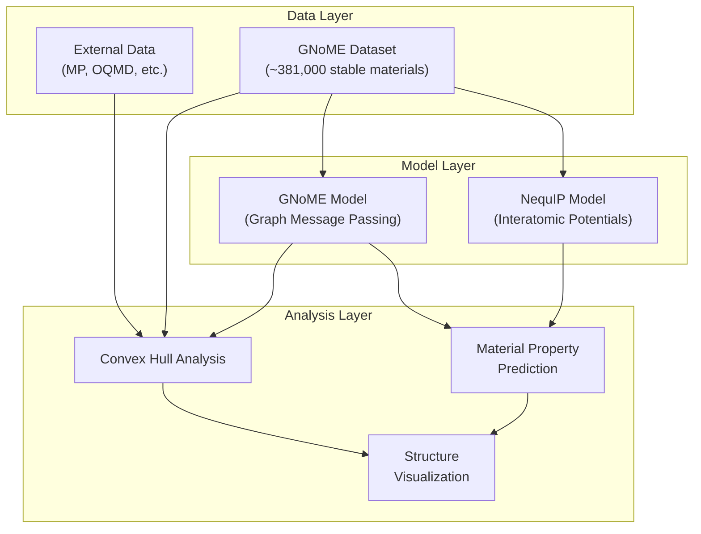
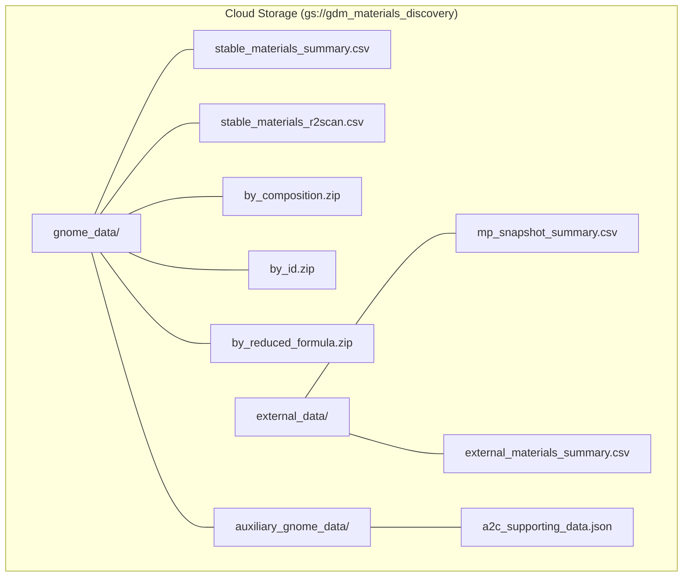
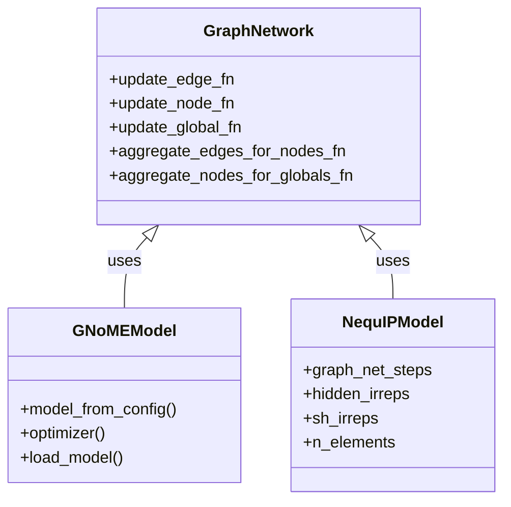
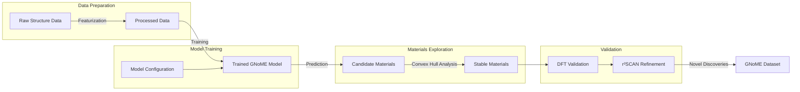
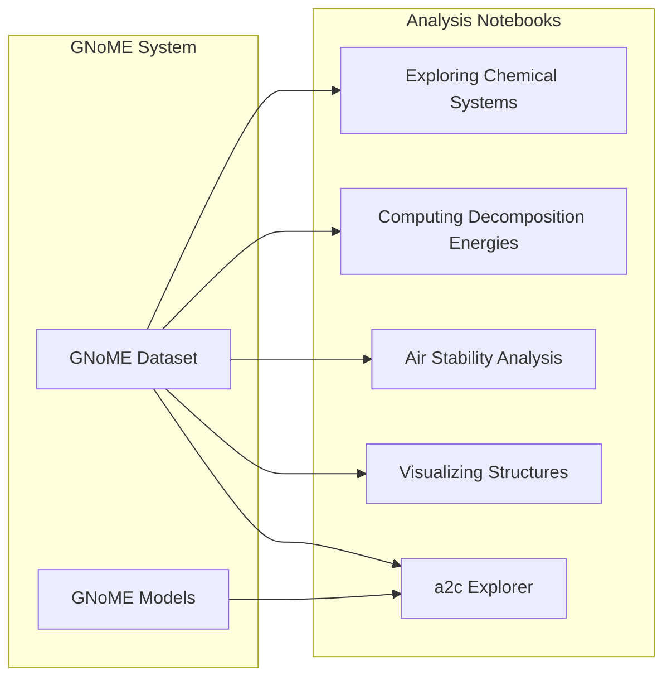

<!-- source: DeepWiki mcp.deepwiki.com · repo google-deepmind/materials_discovery · page 1 GNoME: Graph Networks for Materials Exploration · fetched 2026-10-26 -->

# GNoME: Graph Networks for Materials Exploration

Relevant source files

The following files were used as context for generating this wiki page:

- [DATASET.md](DATASET.md)
- [README.md](README.md)
- [model/gnome.py](model/gnome.py)

## Purpose and Scope

This document provides a high-level overview of the Graph Networks for Materials Exploration (GNoME) project, its core components, and how they interact to enable materials discovery at scale. GNoME is a system that utilizes graph neural networks to explore and predict stable inorganic crystal materials, resulting in the discovery of over 381,000 novel stable materials (expanded to more than 520,000 materials as of August 2024).

For detailed information about the GNoME dataset structure and access methods, see [GNoME Dataset](#2). For specifics on the machine learning models, see [Machine Learning Models](#3).

Sources: [README.md:11-28](), [DATASET.md:8-14]()

## System Architecture Overview

The GNoME system consists of three main components working together to enable materials discovery:

The system architecture consists of three main layers:
1. **Data Layer**: Contains the GNoME dataset with ~381,000 stable materials and external reference data
2. **Model Layer**: Houses the graph neural network models used for property prediction
3. **Analysis Layer**: Provides tools for analyzing stability, properties, and visualizing structures

Sources: [README.md:29-62](), [DATASET.md:8-28]()

## GNoME Dataset

The GNoME dataset is a comprehensive collection of novel crystal structures that update the convex hull of known stable materials. Key components include:

- **Stable Materials Summary**: Contains compositions, energies, and material properties
- **Structure Files**: Crystal structures in CIF format organized by composition, ID, and formula
- **r²SCAN Validation**: Additional high-precision DFT calculations for validation
- **External Data**: Reference data from Materials Project (MP) and Open Quantum Materials Database (OQMD)

The dataset is organized in a Google Cloud Storage bucket with a structure that facilitates access and analysis:

The dataset can be downloaded using provided utility scripts in the repository. For detailed information on the dataset structure and download instructions, see the [GNoME Dataset](#2) page.

Sources: [DATASET.md:8-40](), [DATASET.md:70-94]()

## Machine Learning Models

GNoME utilizes two main machine learning models for materials discovery and property prediction:

### GNoME Model

The primary model used for materials discovery is a graph neural network that processes crystal structures to predict energies and stability. The model represents crystal structures as graphs, where:
- Nodes represent atoms
- Edges represent interatomic connections
- Node features include element properties
- Edge features include spatial information

The model architecture is implemented in the `model/gnome.py` file and uses message passing to predict materials properties.

### NequIP Model

In addition to the GNoME model, the system also implements the NequIP architecture (Batzner et al., 2022) for interatomic potentials. This model:
- Utilizes equivariant neural networks
- Preserves rotational and translational symmetries
- Is used to model atomic dynamics

The models are configurable via a configuration dictionary (`ConfigDict`) that allows customization of model architecture, training parameters, and optimization strategies.

Sources: [model/gnome.py:15-165](), [README.md:65-76]()

## Materials Discovery Workflow

The GNoME system follows a comprehensive workflow for materials discovery, from data processing to novel material identification:

The workflow consists of four main stages:
1. **Data Preparation**: Raw crystal structures are processed and featurized for model input
2. **Model Training**: The GNoME model is trained on known materials
3. **Materials Exploration**: The model predicts properties of candidate materials, and stability is assessed
4. **Validation**: Promising candidates are validated with DFT and refined with r²SCAN calculations

Sources: [README.md:11-28](), [DATASET.md:141-159]()

## Model Implementation Details

### Model Configuration and Loading

The GNoME framework provides utilities for configuring, initializing, and loading models. These functions are defined in `model/gnome.py`:

```mermaid
flowchart TD
    subgraph "Model Configuration"
        Config["ConfigDict"]
        ModelFactory["model_from_config()"]
        Config --> ModelFactory
        ModelFactory --> |"Creates"| ModelInstance["Model Instance"]
    end
    
    subgraph "Model Optimization"
        OptConfig["Optimizer Configuration"]
        OptimizerFactory["optimizer()"]
        OptConfig --> OptimizerFactory
        OptimizerFactory --> |"Creates"| OptState["Optimizer State"]
    end
    
    subgraph "Model Loading"
        Directory["Model Directory"]
        LoadModel["load_model()"]
        Directory --> LoadModel
        LoadModel --> |"Returns"| ModelTriple["Config, Model, Params"]
    end
```

Key functions include:
- `model_from_config()`: Creates a model instance from a configuration dictionary
- `optimizer()`: Configures the optimizer based on learning rate schedule, regularization, etc.
- `load_model()`: Loads a saved model from a directory

The implementation supports various learning rate schedules and optimization strategies, including constant learning rate, linear decay, cosine decay, and learning rate reduction on plateau.

Sources: [model/gnome.py:48-165]()

## Key Metrics and Results

The GNoME project has achieved significant results in materials discovery:

| Metric | Value | Description |
|--------|-------|-------------|
| Discovered Materials | >381,000 | Novel stable materials discovered (as of initial release) |
| Expanded Dataset | >520,000 | Materials within 1 meV/atom from the convex hull (as of August 2024) |
| Model Accuracy | 21 meV/atom | State-of-the-art energy prediction accuracy |
| Validation | r²SCAN | Higher-precision DFT functional used for validation |

These results represent a significant advancement in computational materials discovery, expanding the known stable materials space by orders of magnitude.

Sources: [README.md:11-24](), [README.md:65-70]()

## Integration with Analysis Tools

The GNoME system integrates with various analysis tools for exploring and visualizing the discovered materials:

These analysis tools, provided as Jupyter notebooks, enable researchers to:
- Explore specific chemical systems
- Calculate decomposition energies to assess stability
- Analyze stability in air
- Visualize crystal structures
- Examine amorphous-to-crystalline transformations

For detailed information on these analysis tools, see the [Analysis Tools](#4) page.

Sources: [README.md:78-82]()

## Conclusion

The GNoME project represents a significant advancement in materials discovery, using graph neural networks to identify hundreds of thousands of novel stable materials. The system combines state-of-the-art machine learning models with comprehensive materials data and analysis tools to enable exploration of the materials space at an unprecedented scale.

The project is still evolving, with planned expansions including reference structures, search paths, model training examples, and additional material properties such as electronic band structures.

Sources: [README.md:94-98]()

---

