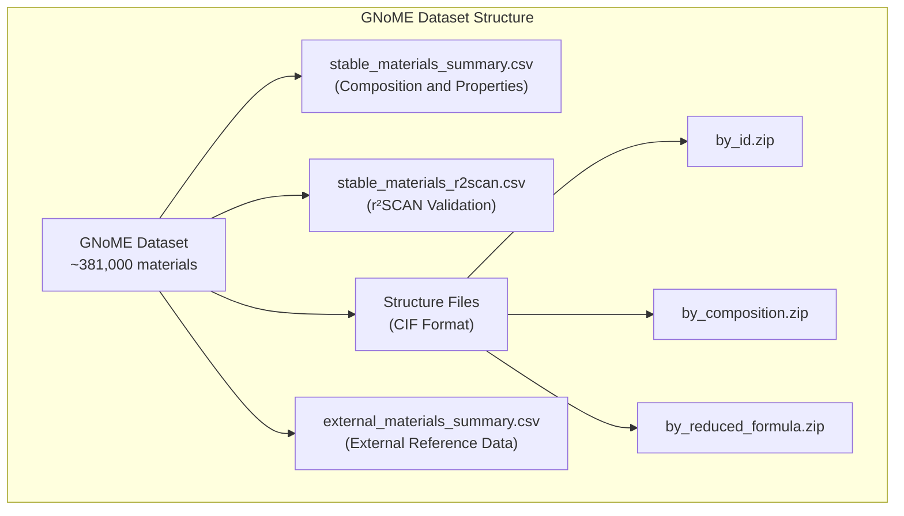
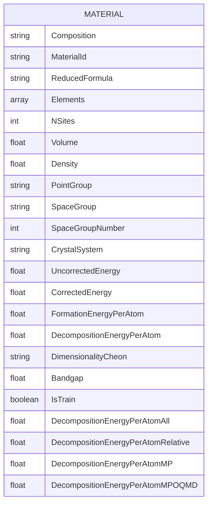
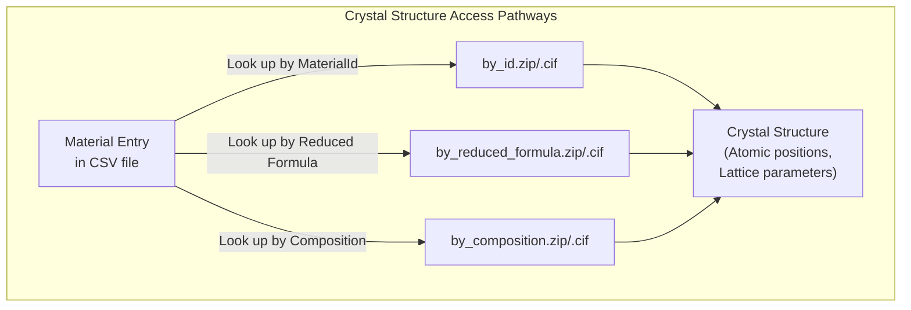
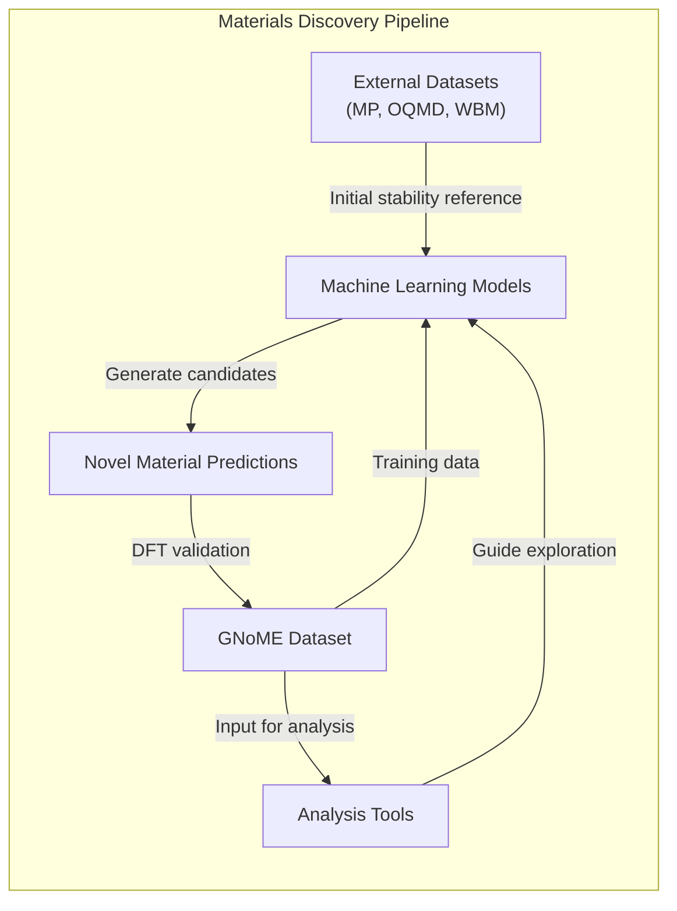

<!-- source: DeepWiki mcp.deepwiki.com · repo google-deepmind/materials_discovery · page 2 GNoME Dataset · fetched 2026-10-26 -->

# GNoME Dataset

<details>
<summary>Relevant source files</summary>

The following files were used as context for generating this wiki page:

- [DATASET.md](DATASET.md)

</details>


## Purpose and Scope

This page provides a comprehensive overview of the Graph Networks for Materials Exploration (GNoME) dataset, a collection of approximately 381,000 novel stable material structures. The document covers the dataset's organization, available properties, access methods, and significance for materials discovery research. For information about downloading the dataset, see [Downloading the Dataset](#2.1).

Sources: [DATASET.md:10-13]()

## Dataset Overview

The GNoME dataset represents a significant advancement in computational materials discovery, providing ~381,000 novel crystal structures that update the convex hull of known stable materials. These structures were discovered using the GNoME machine learning approach and have been validated through density functional theory (DFT) calculations.

The dataset serves as a foundational resource for:
- Evaluating material stability
- Exploring new chemical systems
- Benchmarking computational materials discovery methods
- Identifying candidates for various applications



Sources: [DATASET.md:10-28]()

## Dataset Organization

The dataset is stored in a Google Cloud Storage bucket (`gs://gdm_materials_discovery`) with the following file structure:

```
gdm_materials_discovery
└───gnome_data
│   │   stable_materials_summary.csv
│   │   stable_materials_r2scan.csv
│   │   by_composition.zip
│   │   by_id.zip
│   │   by_reduced_formula.zip
│   └───auxiliary_gnome_data
|       |   a2c_supporting_data.json
└───external_data
|   |   mp_snapshot_summary.csv
|   |   external_materials_summary.csv
```

### Core Dataset Files

| File | Description |
|------|-------------|
| `stable_materials_summary.csv` | Main data file containing compositions, energies, and other properties for all novel materials |
| `stable_materials_r2scan.csv` | Validation calculations performed using the r²SCAN functional |
| `by_id.zip` | Crystal structures in CIF format organized by unique material ID |
| `by_composition.zip` | Crystal structures organized by composition |
| `by_reduced_formula.zip` | Crystal structures organized by reduced chemical formula |
| `external_materials_summary.csv` | Compositions and convex hull entries from external datasets (MP, OQMD, WBM) with matching elemental compositions |

Sources: [DATASET.md:15-28](), [DATASET.md:72-89]()

## Material Properties

The `stable_materials_summary.csv` file provides comprehensive information about each material in the dataset. The following properties are included:



### Key Property Descriptions

| Property | Description |
|----------|-------------|
| Composition | Alphabetically-ordered chemical composition |
| MaterialId | Unique identifier for the material |
| Reduced Formula | Reduced chemical formula |
| Elements | Chemical system (constituent elements) |
| NSites | Number of atoms in the unit cell |
| Volume | Unit cell volume in ų |
| Density | Density in ų/atom |
| Point Group, Space Group, Space Group Number | Crystallographic symmetry information |
| Uncorrected Energy | Raw DFT energy |
| Corrected Energy | Energy adjusted by MP2020 corrections |
| Formation Energy Per Atom | Energy normalized and corrected by reference elements |
| Decomposition Energy Per Atom | Energy relative to the Materials Project convex hull |
| Dimensionality Cheon | Material dimensionality predicted by Cheon et al. 2017 method |
| Bandgap | Calculated electronic bandgap (when available) |
| Is Train | Boolean indicating if the material was in the training set for ML models |

Sources: [DATASET.md:102-138]()

## Convex Hull and Stability Analysis

The dataset provides comprehensive information for constructing and analyzing the convex hull of stable materials, which is essential for determining thermodynamic stability.

### Stability Metrics

The dataset includes multiple decomposition energy metrics that represent different reference stability hulls:

- **Decomposition Energy Per Atom All**: Distance to convex hull of all entries
- **Decomposition Energy Per Atom Relative**: Distance to convex hull of all entries except the current material
- **Decomposition Energy Per Atom MP**: Distance to convex hull of Materials Project entries
- **Decomposition Energy Per Atom MP OQMD**: Distance to convex hull of Materials Project + Open Quantum Materials Database entries

A stability threshold of 5e-5 eV was used to determine whether a material is on the convex hull.

### Energy Corrections

To ensure compatibility between different DFT calculations, energy corrections are applied to entries from the Materials Project that contain Ga, Ge, Li, Mg, or Na, for which the pseudopotentials differ. The corrections per atom are:

```
Ga: -0.0028805
Ge: 0.10417085
Li: -0.00301278
Mg: 0.0924014
Na: -0.00447437
```

Formation energies are calculated with respect to a fixed set of elemental references from the Materials Project, provided in `elemental_references.json`.

Sources: [DATASET.md:70-99](), [DATASET.md:162-168]()

## Crystal Structures

Each material in the dataset is associated with a crystal structure file in CIF format (Crystallographic Information File), which is the standard format in materials science. The structures are provided in three compressed archives:

1. `by_id.zip`: Structures organized by unique material identifier
2. `by_reduced_formula.zip`: Structures organized by reduced chemical formula
3. `by_composition.zip`: Structures organized by composition

These different organization schemes allow for easy lookup of structures based on different criteria.



Sources: [DATASET.md:145-151]()

## Validation with r²SCAN

Beyond the standard GGA-PBE calculations, a subset of the dataset has been validated using the more accurate r²SCAN functional. The `stable_materials_r2scan.csv` file provides these validation calculations.

It's important to note that stability metrics change with the choice of functional, so not all materials that are stable at the PBE level remain stable according to r²SCAN calculations.

Sources: [DATASET.md:153-159]()

## Dataset Integration with Materials Discovery Pipeline

The GNoME dataset serves as both input and output in the materials discovery pipeline, forming a critical component in the end-to-end workflow.



Sources: [DATASET.md:10-13]()

## Versioning and Updates

The GNoME dataset is periodically updated with improvements and corrections. Major version updates include:

| Date | Changes |
|------|---------|
| 11/29/2023 | Initial dataset release |
| 12/1/2023 | Re-introduced paper filters to remove un-physical energies; added 2 missing columns ('Dimensionality Cheon' and 'Is Train') |
| 8/21/2024 | Adjusted threshold to 1meV/atom off the hull (significantly increasing the number of released crystals); updated to use "require_bound" version of MP corrections; re-relaxed structures where VASP did not update lattice coordinates; provided convex hull entries from recomputations of MP/OQMD; fixed file naming in by_id.zip |
| 11/21/2024 | Ensured consistency in formation energies; provided elemental references and pseudopotential corrections used in the GNoME paper |

Sources: [DATASET.md:171-184]()

## Limitations and Caveats

When working with the GNoME dataset, the following caveats should be kept in mind:

1. A stability threshold of 5e-5 eV is used due to numerical precision and errors inherent in computational simulations.
2. The materials update the convex hull of a snapshotted version of Materials Project and similar databases, so stability may change as more crystals are discovered by the scientific community.
3. Additional data not part of the core GNoME effort (such as bandgaps) are provided as-is at PBE-level and may be updated over time.
4. Electronic property characterization is ongoing, and more accurate calculations may update or correct these values in the future.

Sources: [DATASET.md:162-193]()

---

