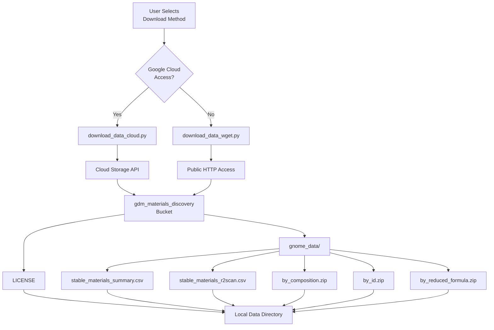
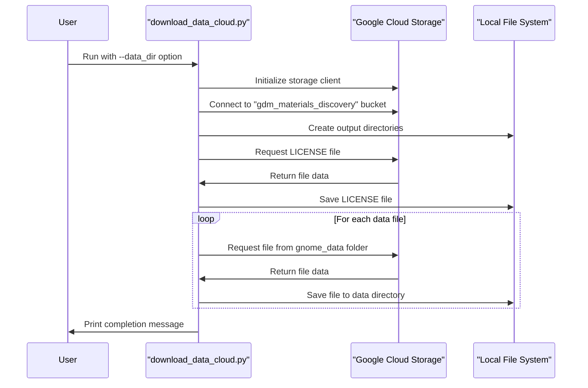
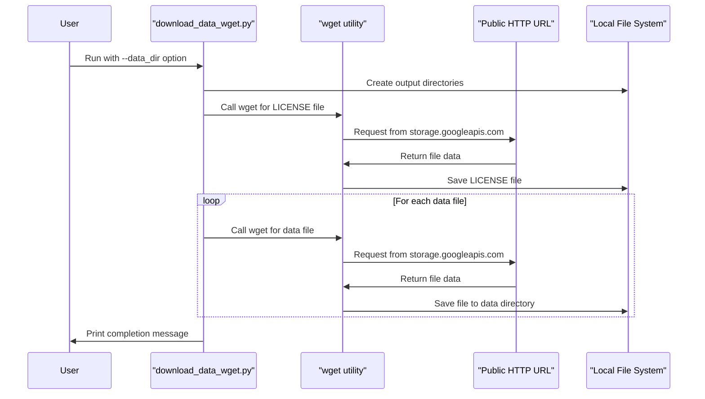
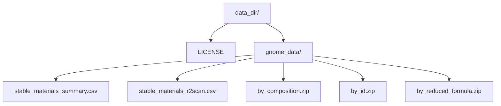

<!-- source: DeepWiki mcp.deepwiki.com · repo google-deepmind/materials_discovery · page 2.1 Downloading the Dataset · fetched 2026-10-26 -->

# Downloading the Dataset

<details>
<summary>Relevant source files</summary>

The following files were used as context for generating this wiki page:

- [scripts/download_data_cloud.py](scripts/download_data_cloud.py)
- [scripts/download_data_wget.py](scripts/download_data_wget.py)

</details>


This page provides detailed instructions for accessing and downloading the GNoME (Graph Networks for Materials Exploration) dataset using the utility scripts provided in the repository. The GNoME dataset contains 381,000 stable materials and their properties, which can be used for materials discovery and analysis. For information about the dataset's structure and contents, see [GNoME Dataset](#2).

## Dataset Overview

The GNoME dataset is hosted on Google Cloud Storage in the `gdm_materials_discovery` bucket. The repository provides two different methods for downloading the dataset:

1. Using Google Cloud Storage API (recommended for Google Cloud Platform users)
2. Using wget for public HTTP access (recommended for general users)

Both methods download the same set of files:

| File | Description |
|------|-------------|
| `LICENSE` | License information for the dataset |
| `stable_materials_summary.csv` | Summary of stable materials and their properties |
| `stable_materials_r2scan.csv` | r²SCAN validation data for stable materials |
| `by_composition.zip` | Crystal structures organized by composition (CIF format) |
| `by_id.zip` | Crystal structures organized by unique identifiers (CIF format) |
| `by_reduced_formula.zip` | Crystal structures organized by reduced formula (CIF format) |

Sources: [scripts/download_data_cloud.py:30-37](), [scripts/download_data_wget.py:28-37]()

## Data Download Process

The following diagram illustrates the overall process of downloading the GNoME dataset:



Sources: [scripts/download_data_cloud.py](), [scripts/download_data_wget.py]()

## Method 1: Download Using Google Cloud Storage API

This method requires the Google Cloud SDK and appropriate authentication to access the Google Cloud Storage bucket.

### Prerequisites
- Python 3.7 or newer
- Google Cloud SDK installed and configured
- `google-cloud-storage` Python package installed

### Usage

1. Clone the materials_discovery repository:
   ```bash
   git clone https://github.com/google-deepmind/materials_discovery.git
   cd materials_discovery
   ```

2. Run the download script with an optional data directory (defaults to "data"):
   ```bash
   python scripts/download_data_cloud.py --data_dir=/path/to/store/data
   ```

The script creates the specified directory (if it doesn't exist), establishes a connection to the Google Cloud Storage bucket, and downloads all the dataset files.



Sources: [scripts/download_data_cloud.py:49-68]()

## Method 2: Download Using wget

This method uses the `wget` command-line utility to download the dataset from public HTTP links. This is recommended for users who don't have Google Cloud Platform access.

### Prerequisites
- Python 3.7 or newer
- `wget` utility installed on your system

### Usage

1. Clone the materials_discovery repository:
   ```bash
   git clone https://github.com/google-deepmind/materials_discovery.git
   cd materials_discovery
   ```

2. Run the download script with an optional data directory (defaults to "data"):
   ```bash
   python scripts/download_data_wget.py --data_dir=/path/to/store/data
   ```

The script creates the specified directory (if it doesn't exist), constructs the public URLs for each file, and uses `wget` to download them.



Sources: [scripts/download_data_wget.py:45-65]()

## Downloaded File Structure

After running either download script, you'll have the following file structure in your specified data directory:



The total download size is approximately:
- CSV files: ~150 MB
- ZIP files with structures: ~3 GB

Sources: [scripts/download_data_cloud.py:57-66](), [scripts/download_data_wget.py:49-63]()

## Verifying the Download

You can verify that all files have been downloaded correctly by checking their existence and sizes:

```bash
ls -la data/LICENSE
ls -la data/gnome_data/
```

When the download is complete, you'll see a message:
```
Done downloading data to directory: [your_data_dir]
```

Sources: [scripts/download_data_cloud.py:68](), [scripts/download_data_wget.py:65]()

## Next Steps

After downloading the dataset, you can:

1. Extract the structure ZIP files if you need to access the individual crystal structures
2. Load the CSV files using pandas for data analysis
3. Use the provided analysis notebooks to explore the dataset (see [Analysis Tools](#4))

For specific guidance on analyzing the dataset, refer to the [Exploring Chemical Systems](#4.1) page.

---

