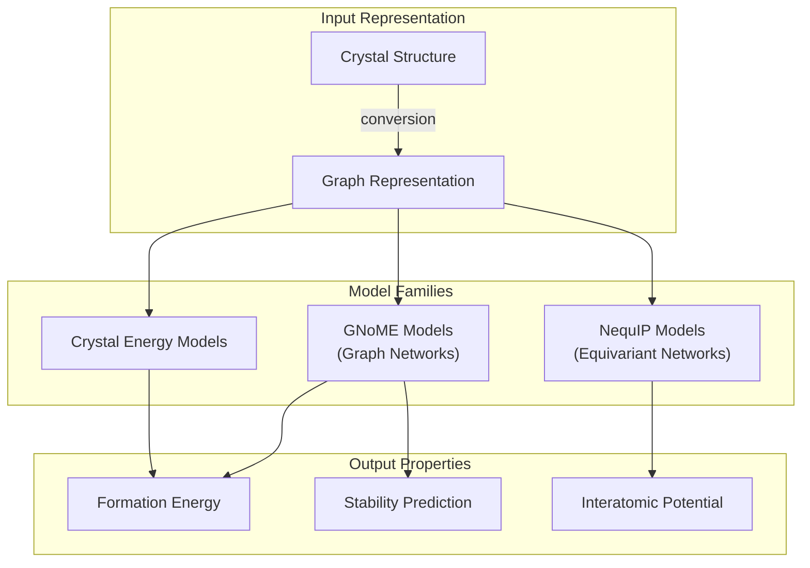
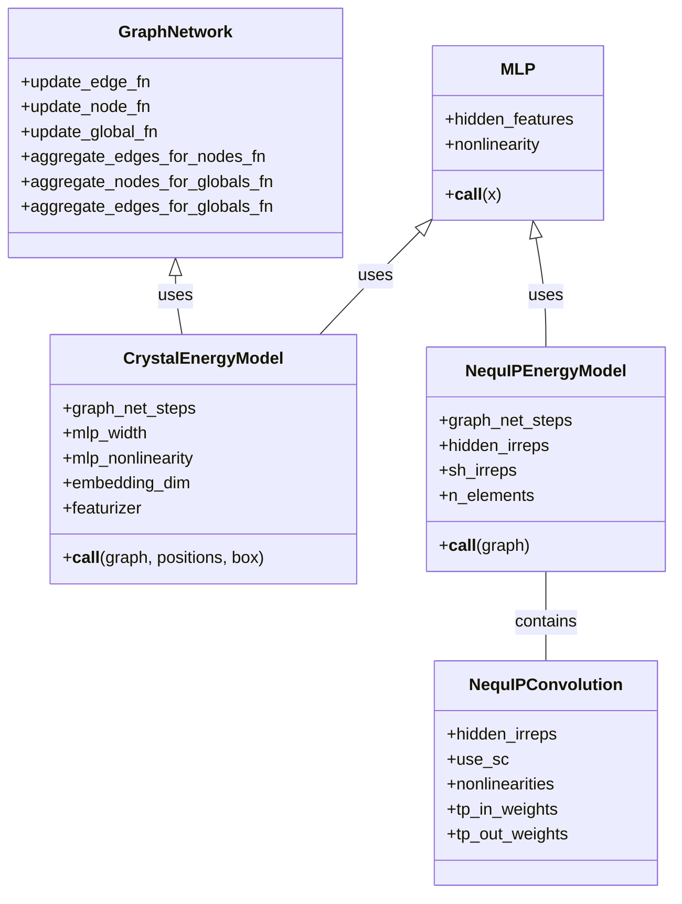
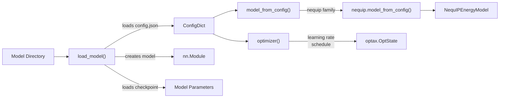
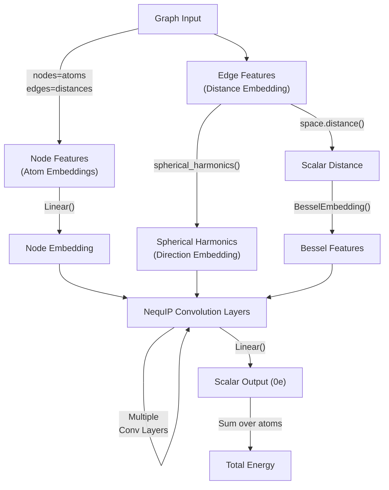
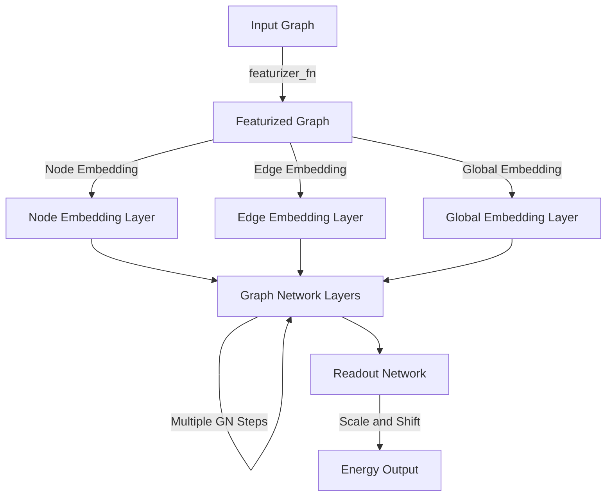
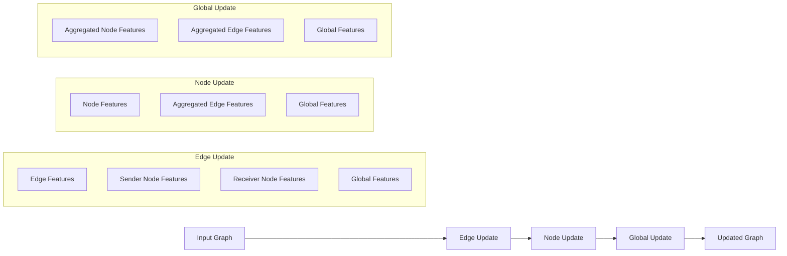
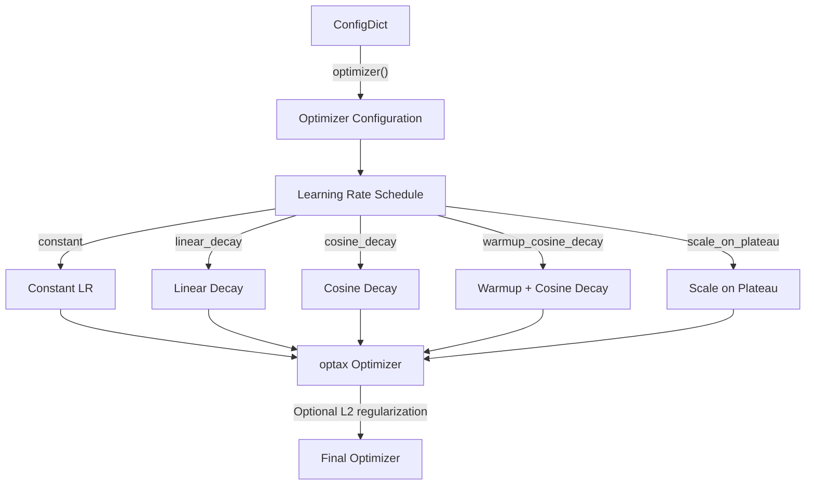

<!-- source: DeepWiki mcp.deepwiki.com · repo google-deepmind/materials_discovery · page 3 Machine Learning Models · fetched 2026-10-26 -->

# Machine Learning Models

<details>
<summary>Relevant source files</summary>

The following files were used as context for generating this wiki page:

- [README.md](README.md)
- [model/crystal.py](model/crystal.py)
- [model/gnn.py](model/gnn.py)
- [model/gnome.py](model/gnome.py)
- [model/nequip.py](model/nequip.py)

</details>


This page documents the machine learning architecture used in the Materials Discovery project for material property prediction and structure exploration. The repository contains implementations of specialized deep learning models, with a focus on graph-based representations of crystal structures to enable accurate prediction of material stability and properties.

For detailed instructions on using these models with the GNoME dataset, see [GNoME Dataset](#2). For more information about specific model implementations, refer to corresponding model-specific pages: [GNoME Model](#3.1), [NequIP Model](#3.2), and [Crystal Energy Model](#3.3).

## Model Architecture Overview

The codebase implements two primary model families:

1. **GNoME (Graph Networks for Materials Exploration)**: Message-passing neural networks optimized for materials discovery, achieving state-of-the-art accuracy of 21 meV/atom in formation energy prediction
   
2. **NequIP**: Equivariant interatomic potential models based on the architecture by Batzner et al. (2022), used for learning dynamics from large datasets

Both model families utilize graph representations of materials, where atoms serve as nodes and their connections as edges, enabling the models to understand and predict material properties based on structural relationships.



Sources: [README.md:64-77](), [model/gnome.py:48-53]()

## Model Components Hierarchy

The models in the codebase share common architectural principles but vary in their implementation details. Here's a hierarchical view of the model components:



Sources: [model/gnome.py:45-53](), [model/nequip.py:306-334](), [model/crystal.py:204-294](), [model/gnn.py:45-183]()

## Model Creation and Configuration

Models are created through a common interface that uses configuration dictionaries to specify model hyperparameters.



Sources: [model/gnome.py:48-53](), [model/gnome.py:95-123](), [model/gnome.py:126-165]()

### Creating Models from Configuration

The `model_from_config` function serves as the primary entry point for creating model instances:

```python
def model_from_config(cfg: ConfigDict) -> nn.Module:
  model_family = cfg.get('model_family', 'nequip')
  if model_family == 'nequip':
    return nequip.model_from_config(cfg)
  else:
    raise ValueError(f'Unrecognized model family: {model_family}')
```

Currently, the implementation only supports the `nequip` model family, though the repository documents both GNoME and NequIP models.

Sources: [model/gnome.py:48-53]()

### Configuring Optimizers

The `optimizer` function configures optimization algorithms based on the training configuration:

```python
def optimizer(cfg: ConfigDict) -> optax.OptState:
  # Configuration logic for learning rate schedules
  # Supports constant, linear_decay, cosine_decay, warmup_cosine_decay, scale_on_plateau
  # Returns appropriate optax optimizer
```

Sources: [model/gnome.py:95-123]()

### Loading Saved Models

The `load_model` function provides functionality to load saved models from a directory:

```python
def load_model(directory: str) -> Tuple[ConfigDict, nn.Module, PyTree]:
  # Loads config.json from directory
  # Creates model from config
  # Loads parameters from checkpoint
  # Returns config, model, and parameters
```

Sources: [model/gnome.py:126-165]()

## NequIP Model

The NequIP model implements the architecture described by Batzner et al. for equivariant interatomic potentials. It processes crystal structures represented as graphs and maintains invariance to rotations and translations in 3D space.



Key components of the NequIP model:

1. **NequIPEnergyModel**: Main model class that orchestrates the entire network
2. **NequIPConvolution**: Core convolution operation that performs equivariant message passing
3. **Linear and MLP layers**: Transform features while preserving equivariance

Sources: [model/nequip.py:306-334](), [model/nequip.py:77-303]()

## Crystal Energy Model

The Crystal Energy Model is specifically designed for crystal energy prediction, using a graph neural network with specialized features for crystalline materials.



Key components of the Crystal Energy Model:

1. **Featurizer**: Converts raw crystal structure to graph features
2. **Graph Network Steps**: Series of message passing layers that update node, edge, and global features
3. **Readout Network**: Converts graph features to energy prediction

Sources: [model/crystal.py:204-294](), [model/crystal.py:302-333]()

## Graph Neural Network

The fundamental building block for both model families is the graph neural network implementation in `gnn.py`. This implementation follows the architecture described in the DeepMind paper ["Relational inductive biases, deep learning, and graph networks"](https://arxiv.org/abs/1806.01261).



The `GraphNetwork` function generates a callable that applies this transformation to input graphs, with customizable update and aggregation functions.

Sources: [model/gnn.py:45-183]()

## Model Training Process

The codebase supports different learning rate schedules and optimization strategies for model training:



The `scale_lr_on_plateau` gradient transformation provides functionality to reduce the learning rate when the loss plateaus, which can help models escape local minima during training.

Sources: [model/gnome.py:64-92](), [model/gnome.py:95-123]()

## Summary

The machine learning models in this repository represent state-of-the-art approaches for materials discovery and property prediction. By leveraging graph neural networks with specialized architectures for 3D crystal structures, these models can accurately predict formation energies and stability of novel materials.

The model architecture is modular, with common interfaces for model creation, optimization, and loading. This enables easy experimentation with different model configurations and training strategies.

Sources: [model/gnome.py](), [model/nequip.py](), [model/crystal.py](), [model/gnn.py]()

---

