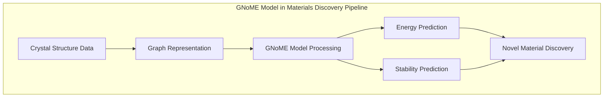
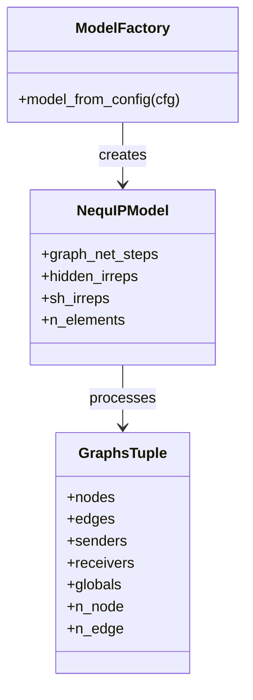
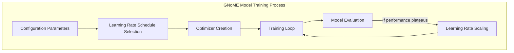
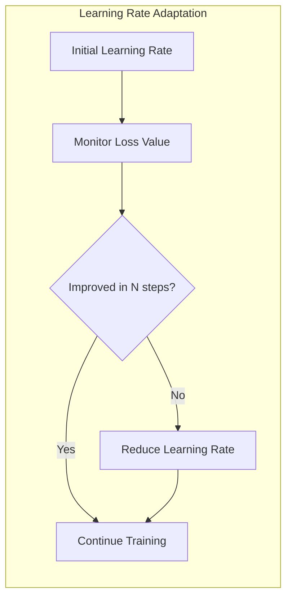
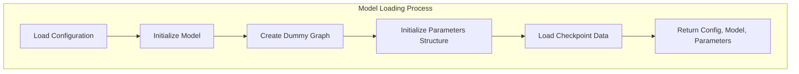
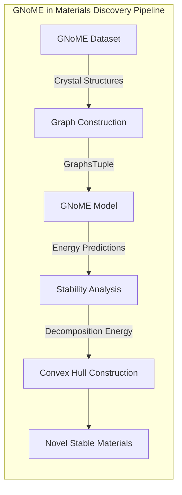

<!-- source: DeepWiki mcp.deepwiki.com · repo google-deepmind/materials_discovery · page 3.1 GNoME Model · fetched 2026-10-26 -->

# GNoME Model

<details>
<summary>Relevant source files</summary>

The following files were used as context for generating this wiki page:

- [README.md](README.md)
- [model/gnome.py](model/gnome.py)

</details>


This document provides a comprehensive overview of the GNoME (Graph Networks for Materials Exploration) model, its architecture, configuration, and usage within the materials discovery pipeline. The GNoME model is the primary machine learning component used to identify 381,000 novel stable materials as described in the research paper.

For information about NequIP, which is used for interatomic potentials, see [NequIP Model](#3.2). For information about the Crystal Energy Model, see [Crystal Energy Model](#3.3).

## 1. Model Overview

The GNoME model is a specialized graph neural network designed for predicting material stability and properties from crystal structures. It represents crystal structures as graphs where atoms are nodes and bonds or interactions are edges, then applies message passing operations to predict formation energies and stability metrics.



Sources: [model/gnome.py:48-53](), [README.md:67-71]()

## 2. Model Architecture

The GNoME model is built on the concept of graph neural networks, specifically optimized for materials science applications. The `model_from_config` function in the codebase is responsible for constructing the appropriate model architecture based on the provided configuration.



The current implementation defaults to the NequIP architecture when creating a model:

```python
def model_from_config(cfg: ConfigDict) -> nn.Module:
  model_family = cfg.get('model_family', 'nequip')
  if model_family == 'nequip':
    return nequip.model_from_config(cfg)
  else:
    raise ValueError(f'Unrecognized model family: {model_family}')
```

The model input is structured as a `GraphsTuple`, which contains:
- `nodes`: Features for each atom (shape: [nodes, features])
- `edges`: Spatial vectors between connected atoms (shape: [edges, 3])
- `senders`/`receivers`: Indices defining the graph connectivity
- `globals`: Global features for each graph
- `n_node`/`n_edge`: Number of nodes and edges per graph

Sources: [model/gnome.py:36-53](), [model/gnome.py:135-143]()

## 3. Model Training and Optimization

The model provides a flexible optimization strategy through the `optimizer` function, which creates an appropriate optimizer based on the configuration parameters.



The GNoME model supports various learning rate schedules:

| Schedule Type | Description |
|---------------|-------------|
| `constant` | Fixed learning rate throughout training |
| `linear_decay` | Linear decrease from initial to zero |
| `cosine_decay` | Cosine-shaped decay schedule |
| `warmup_cosine_decay` | Initial warmup period followed by cosine decay |
| `scale_on_plateau` | Reduces learning rate when performance plateaus |

The optimization is handled by either Adam or AdamW optimizers, with optional L2 regularization for weight decay:

```python
if not hasattr(cfg, 'l2_regularization') or cfg.l2_regularization == 0.0:
  return optax.adam(schedule)

return optax.adamw(schedule, weight_decay=cfg.l2_regularization)
```

Sources: [model/gnome.py:95-123](), [model/gnome.py:64-92]()

## 4. Learning Rate Adaptation

The GNoME model implements a `scale_lr_on_plateau` optimizer transformation that can automatically reduce the learning rate when training progress stalls. This is particularly useful for fine-tuning and achieving optimal convergence.



The implementation uses a `ScaleLROnPlateau` named tuple to track the optimization state:

```python
class ScaleLROnPlateau(NamedTuple):
  step_size: jnp.ndarray
  minimum_loss: jnp.ndarray
  steps_without_reduction: jnp.ndarray
  max_steps_without_reduction: jnp.ndarray
  reduction_factor: jnp.ndarray
```

When the model performance plateaus (doesn't improve for a specified number of steps), the learning rate is automatically scaled down by the reduction factor to enable more precise optimization.

Sources: [model/gnome.py:64-92]()

## 5. Model Loading and Initialization

The GNoME model provides utilities for loading pre-trained models from checkpoints. The `load_model` function handles the complete process of:
1. Loading the model configuration
2. Initializing the model architecture
3. Loading the trained parameters from checkpoints



The function initializes an abstract model structure using a dummy graph to determine the parameter shapes, then loads the actual parameter values from the checkpoint:

```python
def load_model(directory: str) -> Tuple[ConfigDict, nn.Module, PyTree]:
  # Load configuration
  with open(os.path.join(directory, 'config.json'), 'r') as f:
    c = json.loads(json.loads(f.read()))
    c = ConfigDict(c)

  # Initialize model and optimizer
  model = model_from_config(c)
  opt_init, _ = optimizer(c)

  # Create dummy graph for shape initialization
  graph = GraphsTuple(
      ShapedArray((1, NUM_ELEMENTS), f32),  # Nodes
      ShapedArray((1, 3), f32),  # dR 
      ShapedArray((1,), i32),  # senders
      ShapedArray((1,), i32),  # receivers
      ShapedArray((1, 1), f32),  # globals
      ShapedArray((1,), i32),  # n_node
      ShapedArray((1,), i32),  # n_edge
  )
  
  # Get abstract parameter structure
  abstract_params, abstract_state = eval_shape(init_opt_and_model, graph)
  
  # Load checkpoint data
  ckpt_data = (0, abstract_params, abstract_state)
  checkpoint = os.path.join(directory, checkpoints[0])
  with open(checkpoint, 'rb') as f:
    ckpt = serialization.from_bytes(ckpt_data, f.read())
    
  params = tree_map(lambda x: x.astype(f32), ckpt[1])
  return c, model, params
```

This function enables researchers to easily load trained models for inference on new crystal structures.

Sources: [model/gnome.py:126-165]()

## 6. Integration with Materials Discovery Pipeline

The GNoME model serves as a critical component in the materials discovery pipeline, bridging the gap between crystal structure representation and stability prediction.



The model takes crystal structures from the dataset, processes them as graph representations using the `GraphsTuple` structure, and makes energy predictions that feed into stability analysis and convex hull construction for materials discovery.

Sources: [model/gnome.py:36-53](), [README.md:67-71]()

## 7. Technical Implementation Details

The GNoME model is implemented using several key libraries:

| Library | Purpose |
|---------|---------|
| JAX | Accelerated numerical computing |
| Flax | Neural network library built on JAX |
| jraph | Graph neural network library for JAX |
| e3nn_jax | Equivariant neural networks for 3D data |
| optax | Gradient processing and optimization |

The model uses 32-bit floating point (`f32`) precision for parameters and computations, and provides specialized utilities for handling equivariant operations that respect the symmetries inherent in crystal structures.

A few important constants and type definitions used in the implementation:

```python
f32 = jnp.float32
i32 = jnp.int32
GraphsTuple = jraph.GraphsTuple
IrrepsArray = e3nn.IrrepsArray
NUM_ELEMENTS = 94  # Maximum atomic number considered
```

Sources: [model/gnome.py:15-47]()

This technical foundation enables the GNoME model to efficiently process crystal structures and make accurate predictions about their stability and properties, facilitating the discovery of novel materials at scale.

---

