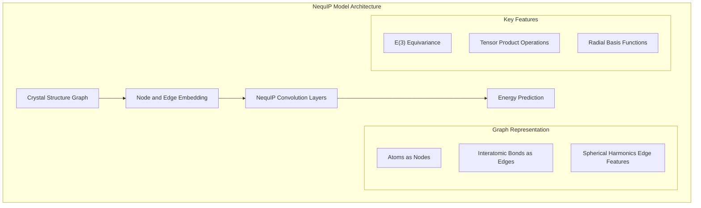
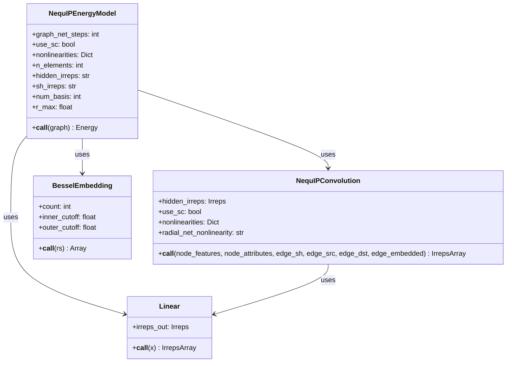
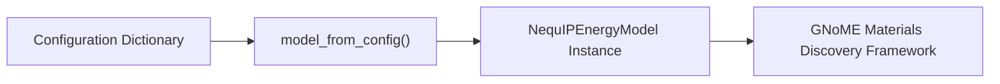

<!-- source: DeepWiki mcp.deepwiki.com · repo google-deepmind/materials_discovery · page 3.2 NequIP Model · fetched 2026-10-26 -->

# NequIP Model

<details>
<summary>Relevant source files</summary>

The following files were used as context for generating this wiki page:

- [README.md](README.md)
- [model/nequip.py](model/nequip.py)

</details>


## Purpose and Scope

This document describes the NequIP (Neural Equivariant Interatomic Potentials) model implementation in the Materials Discovery GNoME project. The NequIP model is designed to predict interatomic potentials and energies of crystal structures with high accuracy while respecting physical symmetries. This page covers the model architecture, components, and configuration options as implemented in JAX. For information about the broader GNoME model architecture, see [GNoME Model](#3.1).

Sources: [model/nequip.py:1-5](), [README.md:72-76]()

## Model Overview

NequIP is an equivariant graph neural network designed for atomic systems, originally described by Batzner et al. in their 2022 paper. The implementation in this repository uses JAX and e3nn_jax to create a model that respects the symmetries of 3D space (translations, rotations) while predicting energies of crystal structures.

The model processes atomic structures as graphs where:
- Atoms are represented as nodes
- Interatomic interactions are represented as edges
- Node and edge features transform according to specific symmetry rules (irreducible representations)



Sources: [model/nequip.py:306-334](), [model/nequip.py:427-433]()

## Model Components

The NequIP implementation consists of two main classes and several supporting functions:

### NequIPEnergyModel

This is the main model class that constructs the complete neural network architecture for energy prediction.



The `NequIPEnergyModel` takes a graph representation of a crystal structure and processes it through the following steps:
1. Creates node embeddings based on atom types
2. Computes spherical harmonic embeddings of edge vectors
3. Processes the graph through multiple convolutional layers
4. Outputs per-atom energies, which are then summed to get the total energy

Key parameters include:
- `graph_net_steps`: Number of convolutional layers
- `hidden_irreps`: Feature dimensions and transformation properties
- `sh_irreps`: Spherical harmonic irreps used for edge embedding
- `r_max`: Cutoff radius for interatomic interactions

Sources: [model/nequip.py:306-423]()

### NequIPConvolution

The `NequIPConvolution` class implements the message-passing operation for the NequIP model, combining node features with spherical harmonic embeddings of edge vectors.

Key operations include:
1. Linear transformation of node features
2. Tensor product between edge spherical harmonics and node features
3. Weighting by a radial network that processes interatomic distances
4. Aggregation of edge features to target nodes
5. Self-connection (residual connection) and gating operations

The convolution respects equivariance by using tensor products between features with well-defined transformation properties.

Sources: [model/nequip.py:77-303]()

## Technical Details

### Irreducible Representations (Irreps)

The model uses irreducible representations from group theory to encode how features transform under rotations. These are specified using strings like `"128x0e + 64x1e + 4x2e"`, where:
- `0e` represents scalar features (invariant to rotations)
- `1e` represents vector features (transform as vectors under rotation)
- `2e` represents L=2 features (transform like quadrupoles)
- The coefficients (128, 64, 4) indicate the multiplicity of each irrep

Default hidden irreps in the model are `"128x0e + 64x1e + 4x2e"`, providing a mix of scalar, vector, and higher-order features.

Sources: [model/nequip.py:39-43](), [model/nequip.py:464]()

### Tensor Products and Spherical Harmonics

The model uses tensor products to combine features in a way that preserves equivariance. Key components include:

1. **Spherical Harmonics**: Used to embed edge vectors in a rotationally equivariant representation
   ```python
   edge_sh = e3nn.spherical_harmonics(self.sh_irreps, dR, normalize=True)
   ```

2. **Functional Tensor Product**: Combines node features with spherical harmonics
   ```python
   tp = FunctionalTensorProduct(
       irreps_in1=edge_features.irreps,
       irreps_in2=edge_sh.irreps,
       irreps_out=irreps_after_tp,
       instructions=sorted_instructions,
   )
   ```

The tensor product operations follow specific "instructions" that determine how different irreps are combined.

Sources: [model/nequip.py:229-234](), [model/nequip.py:372]()

### Radial Functions

The model uses Bessel functions to create a basis for representing interatomic distances in a smooth, differentiable way.

```python
embedded_dr_edge = nn_util.BesselEmbedding(
    count=self.num_basis, inner_cutoff=r_max - 0.5, outer_cutoff=r_max
)(scalar_dr_edge)
```

These radial embeddings are used to weight the tensor product operations through a small MLP that maps distances to tensor product weights.

Sources: [model/nequip.py:374-376](), [model/nequip.py:248-253]()

## Configuration Options

The NequIP model provides several configuration options through the `default_config()` function:

| Parameter | Default Value | Description |
|-----------|---------------|-------------|
| `graph_net_steps` | 5 | Number of convolutional layers |
| `nonlinearities` | `{'e': 'raw_swish', 'o': 'tanh'}` | Activation functions for even/odd irreps |
| `use_sc` | `True` | Whether to use self-connections (residual connections) |
| `n_elements` | 94 | Number of chemical elements in the periodic table to support |
| `hidden_irreps` | `'128x0e + 64x1e + 4x2e'` | Feature dimensions and symmetry properties |
| `sh_irreps` | `'1x0e + 1x1e + 1x2e'` | Spherical harmonic irreps for edge embeddings |
| `num_basis` | 8 | Number of Bessel basis functions |
| `r_max` | 5.0 | Cutoff radius in Angstroms |
| `n_neighbors` | 10.0 | Average number of neighbors per atom (for normalization) |

These parameters can be adjusted to balance model expressivity, computational efficiency, and physical accuracy.

Sources: [model/nequip.py:457-480]()

## Integration with GNoME Framework

The NequIP model is integrated into the GNoME framework using the `model_from_config` function, which creates a model instance from a configuration dictionary:



The model provides energy predictions that can be used for various materials discovery tasks, including:
1. Structure optimization
2. Energy prediction for crystal structure candidates
3. Force calculations for molecular dynamics

Sources: [model/nequip.py:426-454](), [README.md:72-76]()

## Performance Considerations

The NequIP model balances accuracy and computational efficiency through several design choices:

1. **Configurable Depth**: The number of convolutional layers can be adjusted based on the complexity of the material system
2. **Feature Dimensions**: The hidden_irreps parameter controls model capacity
3. **Cutoff Radius**: The r_max parameter determines the extent of interatomic interactions considered
4. **Normalization**: Division by average neighbor count helps stabilize training

For larger systems, computational requirements grow with the number of atoms and their connectivity.

Sources: [model/nequip.py:274-276](), [model/nequip.py:473-474]()

---

