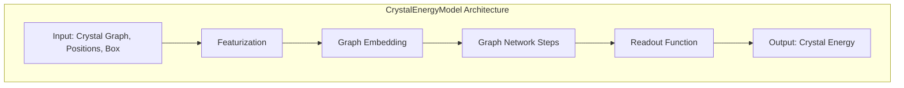
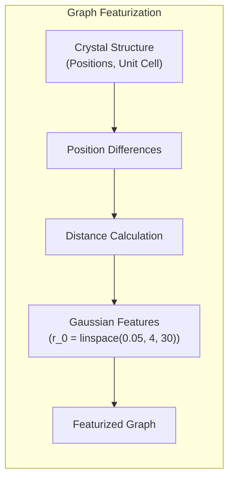
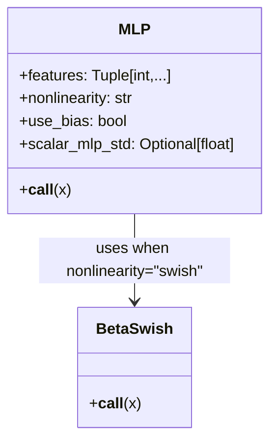
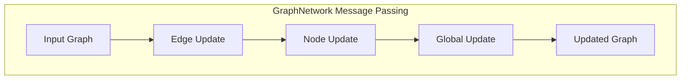
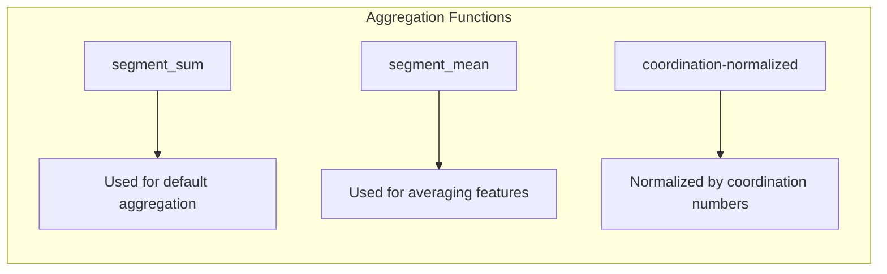
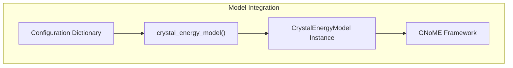

<!-- source: DeepWiki mcp.deepwiki.com · repo google-deepmind/materials_discovery · page 3.3 Crystal Energy Model · fetched 2026-10-26 -->

# Crystal Energy Model

<details>
<summary>Relevant source files</summary>

The following files were used as context for generating this wiki page:

- [model/crystal.py](model/crystal.py)
- [model/gnn.py](model/gnn.py)

</details>


## Purpose and Scope

The Crystal Energy Model is a graph neural network designed to predict the energy of crystal structures within the materials discovery pipeline. It serves as a key component in the GNoME (Graph Networks for Materials Exploration) framework by providing accurate energy predictions that are essential for identifying stable materials. For information about the broader GNoME model architecture, see [GNoME Model](#3.1).

This document explains the architecture, implementation, and integration of the Crystal Energy Model, focusing on how it transforms crystal structure information into accurate energy predictions.

Sources: [model/crystal.py:204-293]()

## Model Architecture Overview

The Crystal Energy Model processes crystal structures represented as graphs, where atoms are nodes and bonds/interactions are edges. The model uses message passing through a graph neural network to capture complex interactions within the crystal structure and predict its energy.



Sources: [model/crystal.py:204-293]()

### Graph Representation and Featurization

The model begins by converting crystal structure information into a graph-based representation:

- **Nodes**: Atoms in the crystal
- **Edges**: Interactions between atoms
- **Global attributes**: Properties of the entire crystal

The featurization process transforms atomic positions into feature vectors that capture distance relationships between atoms using Gaussian basis functions.



Sources: [model/crystal.py:139-183](), [model/crystal.py:186-202]()

## Implementation Details

The Crystal Energy Model is implemented as a Flax module in [model/crystal.py]() and uses the graph network definitions from [model/gnn.py]().

### Key Components

#### 1. MLP (Multi-Layer Perceptron)

The model uses MLPs to transform node, edge, and global features. The MLP implementation supports various activation functions including ReLU, Swish, and a customized BetaSwish.



Sources: [model/crystal.py:96-117](), [model/crystal.py:58-64]()

#### 2. Graph Network

The Crystal Energy Model uses the `GraphNetwork` defined in [model/gnn.py]() to perform message passing between nodes, edges, and global features of the graph.



Sources: [model/gnn.py:45-183]()

#### 3. Forward Pass Logic

The model processes a crystal graph through the following steps:

1. Apply featurization to the input graph, atom positions, and box dimensions
2. Embed the graph features into a latent space
3. Apply multiple graph network steps to update node, edge, and global features
4. Apply a readout function to produce the final energy prediction
5. Scale and shift the output to match the expected energy range

Sources: [model/crystal.py:226-293]()

### Configuration Parameters

The CrystalEnergyModel class accepts multiple configuration parameters:

| Parameter | Type | Description |
|-----------|------|-------------|
| graph_net_steps | int | Number of message passing steps in the graph network |
| mlp_width | Tuple[int] | Widths of MLP hidden layers |
| mlp_nonlinearity | str or Dict[str, str] | Activation function(s) for MLPs |
| embedding_dim | int | Dimension of the embedding space |
| featurizer | str | Type of featurization to use |
| shift | float | Constant shift applied to output (default: -1.6526496) |
| scale | float | Scaling factor for output (default: 1.0) |
| feature_band_limit | Optional[int] | Limit on feature bands |
| residual | Optional[str] | Type of residual connections |

Sources: [model/crystal.py:204-224](), [model/crystal.py:302-333]()

## Aggregation Functions

The model supports different types of aggregation functions for collecting information from nodes and edges:



The model uses these aggregation functions to gather information from edges to nodes, nodes to globals, and edges to globals. The aggregation functions are defined in a dictionary called `AGGREGATION`:

Sources: [model/crystal.py:41-55]()

## Integration with GNoME

The Crystal Energy Model is instantiated by the `crystal_energy_model` function which configures the model according to the provided configuration dictionary. This function creates a model instance with appropriate aggregation functions and normalization settings.



Sources: [model/crystal.py:302-333]()

## Gaussian Feature Generation

A key aspect of the model is how it generates features from interatomic distances using Gaussian basis functions. The `gaussian_edge_features` function implements this by transforming distance vectors into feature vectors:

```
feature_i = exp(-((dr - r_0_i)²) / 0.5²)
```

Where:
- `dr` is the interatomic distance
- `r_0_i` is a reference distance from a predefined set
- The standard deviation is fixed at 0.5 Å

The standard implementation uses 30 Gaussian basis functions with centers linearly spaced from 0.05 to 4 Å.

Sources: [model/crystal.py:186-202]()

## Practical Usage

The Crystal Energy Model can be used in two modes:
1. **Compositional mode**: When `positions` is `None`, the model operates only on composition information
2. **Structural mode**: When provided with atomic positions and unit cell information, the model performs full structural energy prediction

This makes the model versatile for different stages of materials discovery, from initial composition screening to detailed structural analysis.

Sources: [model/crystal.py:226-227](), [model/crystal.py:244-246]()

---

