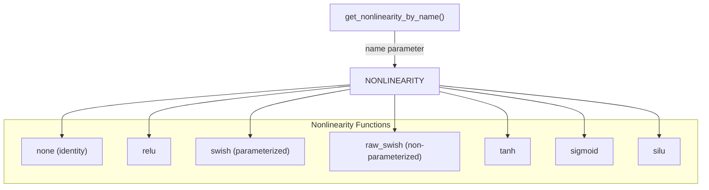
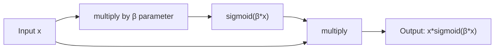
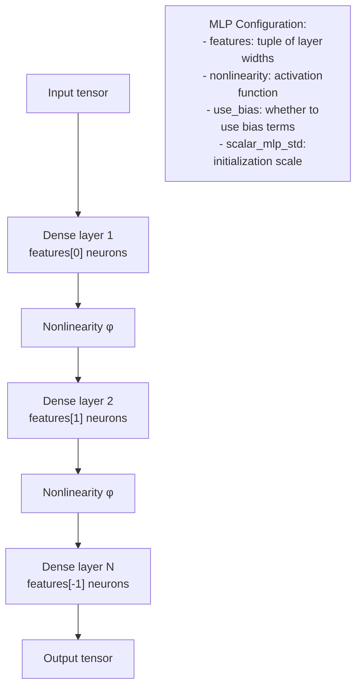
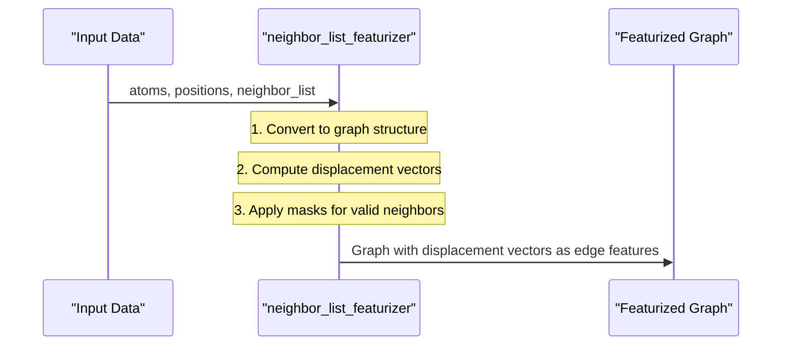
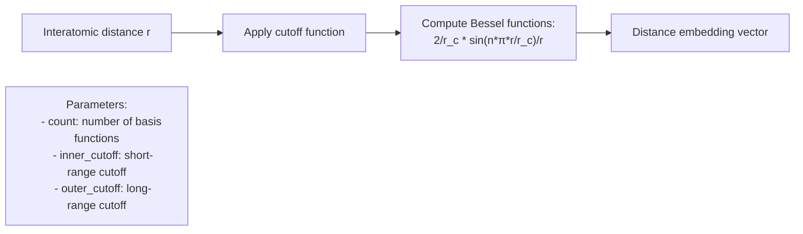
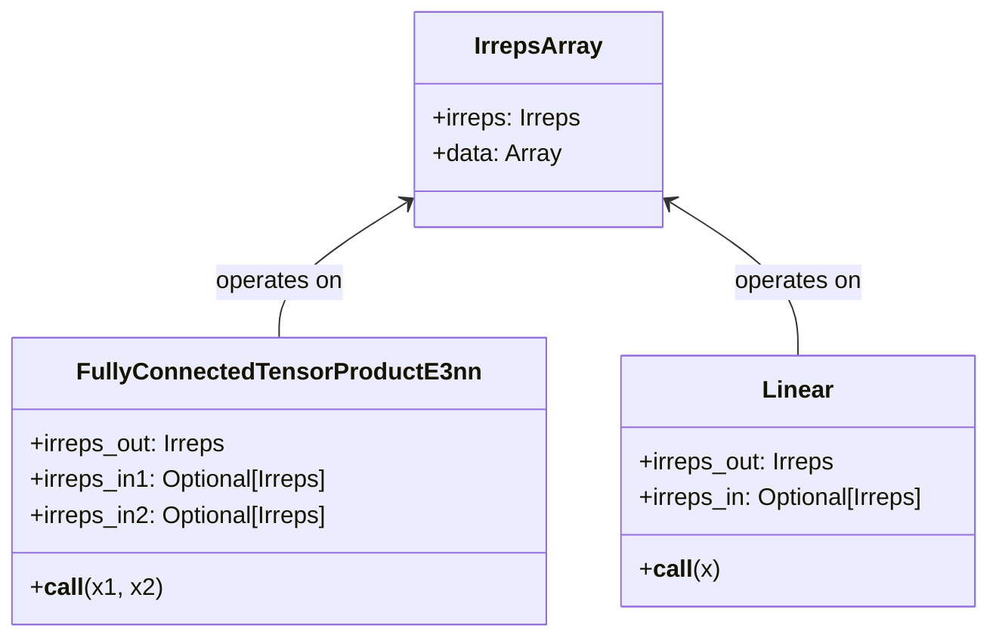
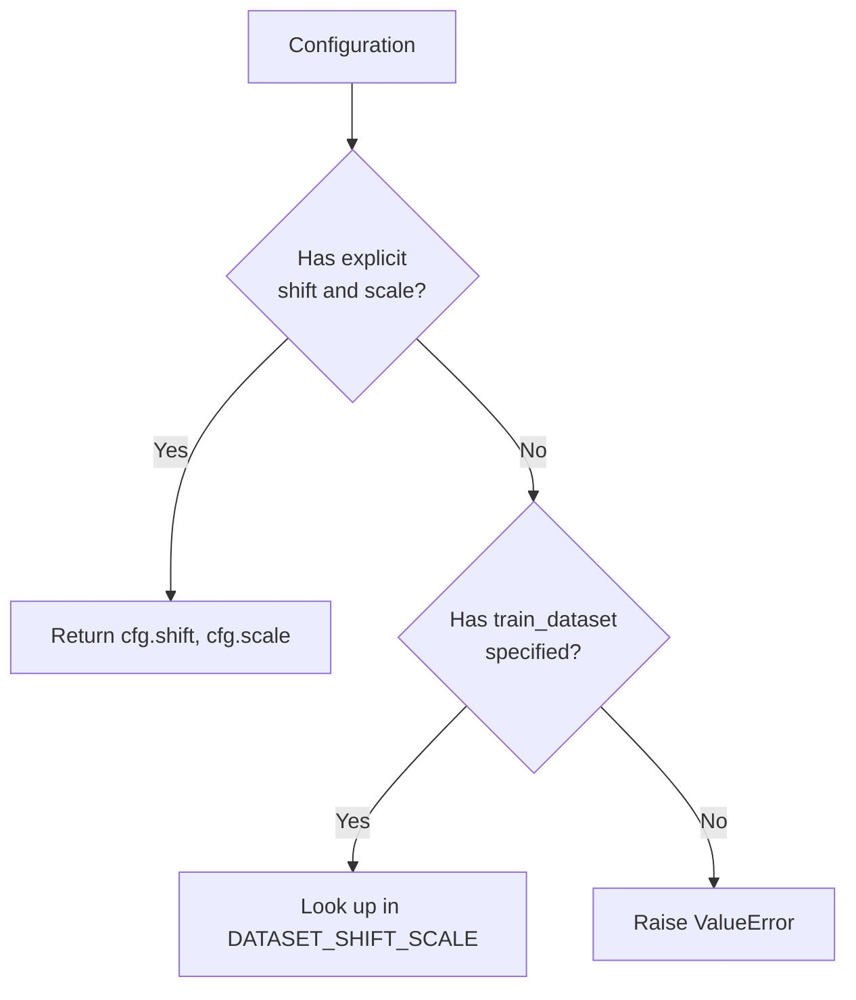
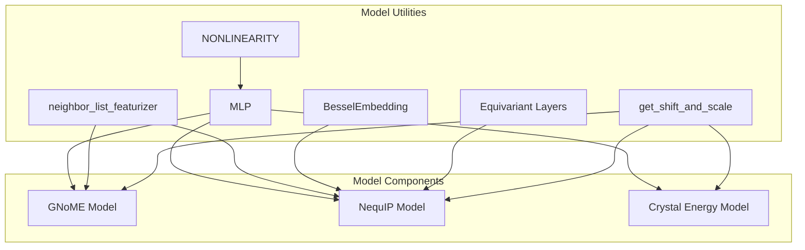

<!-- source: DeepWiki mcp.deepwiki.com · repo google-deepmind/materials_discovery · page 3.4 Model Utilities · fetched 2026-10-26 -->

# Model Utilities

Relevant source files

The following files were used as context for generating this wiki page:

- [model/e3nn_layer.py](model/e3nn_layer.py)
- [model/util.py](model/util.py)

## Overview

This page documents the utility functions and classes that support the machine learning models in the materials discovery pipeline. These utilities provide fundamental building blocks for constructing and operating the neural network architectures used in the [GNoME Model](#3.1), [NequIP Model](#3.2), and [Crystal Energy Model](#3.3).

The model utilities include neural network primitives, activation functions, feature encoding methods, and specialized components for equivariant neural networks that respect physical symmetries in materials representation.

Sources: [model/util.py:15-16]()

## Neural Network Primitives

### Nonlinearity Functions

The model framework offers a variety of activation functions (nonlinearities) that can be selected by name. These include standard functions like ReLU, sigmoid, and tanh, as well as more specialized functions like Swish and a parametric variant called BetaSwish.

BetaSwish is a learnable activation function that introduces a trainable parameter β for each feature dimension:

Sources: [model/util.py:42-71]()

### Multilayer Perceptron (MLP)

The `MLP` class implements a configurable multilayer perceptron with customizable layer widths, activation functions, and initialization options.

The `mlp` function provides a convenient wrapper that handles concatenated inputs for use with graph data structures.

Sources: [model/util.py:74-111]()

## Graph Featurizers

Featurizers transform raw atomic data into graph representations suitable for neural network processing. The `neighbor_list_featurizer` function creates a featurizer that:

1. Takes atoms, positions, and neighbor list information
2. Converts this data into a graph representation (jraph.GraphsTuple)
3. Computes displacement vectors between connected atoms
4. Returns the graph with displacement vectors as edge features

Sources: [model/util.py:114-132]()

## Distance Encodings with Bessel Functions

The `BesselEmbedding` module encodes interatomic distances using a set of radial basis functions based on spherical Bessel functions. This encoding is crucial for models like NequIP and SchNet that need to represent distance information in a way that respects rotational symmetry.

The implementation includes handling for numerical stability when distances approach zero and smooth cutoff functions to ensure continuous representations.

Sources: [model/util.py:137-168]()

## Equivariant Neural Network Layers

The model utilities include specialized neural network layers that maintain equivariance to rotations and translations, which is crucial for accurately representing 3D structures of materials.

These layers handle data represented as `IrrepsArray` objects that combine numerical values with their transformation properties under 3D rotations. This allows the neural networks to respect physical symmetries inherent in molecular and crystal structures.

Sources: [model/e3nn_layer.py:222-323]()

## Data Scaling and Normalization

The utilities provide functions for normalizing model inputs and outputs using dataset-specific shift and scale parameters. The `get_shift_and_scale` function retrieves appropriate normalization constants based on the configuration or dataset identifier.

A dictionary `DATASET_SHIFT_SCALE` contains predefined normalization parameters for known datasets, such as the "harder_silicon" dataset.

Sources: [model/util.py:171-181]()

## Integration with Model Components

The utility functions and classes described above are used throughout the model components in the materials discovery pipeline. The following diagram illustrates how these utilities integrate with the main model components:

These utilities form the foundational building blocks that enable the construction of sophisticated machine learning models for materials discovery, ensuring consistent implementation, physical relevance, and computational efficiency.

---

