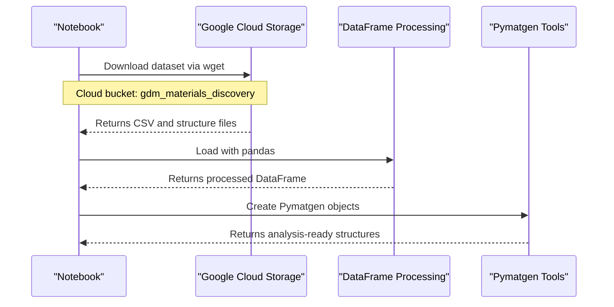

<!-- source: DeepWiki mcp.deepwiki.com · repo google-deepmind/materials_discovery · page 4 Analysis Tools · fetched 2026-10-26 -->

# Analysis Tools

<details>
<summary>Relevant source files</summary>

The following files were used as context for generating this wiki page:

- [notebooks/Air_Stability.ipynb](notebooks/Air_Stability.ipynb)
- [notebooks/Compute_Decomposition_Energies.ipynb](notebooks/Compute_Decomposition_Energies.ipynb)
- [notebooks/Exploring_Chemical_Systems.ipynb](notebooks/Exploring_Chemical_Systems.ipynb)
- [notebooks/Visualize_GNoME_Structures.ipynb](notebooks/Visualize_GNoME_Structures.ipynb)
- [notebooks/a2c_Explorer.ipynb](notebooks/a2c_Explorer.ipynb)

</details>


The GNoME (Graph Networks for Materials Exploration) project provides a set of Jupyter notebooks for analyzing and exploring the materials dataset. These notebooks enable researchers to investigate chemical systems, calculate stability metrics, visualize crystal structures, and explore amorphous-to-crystalline transformations.

## Overview of Analysis Tools

The analysis tools consist of five Jupyter notebooks, each designed for a specific analytical task:

```mermaid
flowchart TD
    classDef notebook fill:#f9f9f9,stroke:#333,stroke-width:1px

    Dataset["GNoME Dataset<br>(381,000+ stable materials)"] --> N1
    Dataset --> N2
    Dataset --> N3
    Dataset --> N4
    Dataset --> N5

    N1["Exploring_Chemical_Systems.ipynb<br>Chemical system exploration & phase diagrams"] :::notebook
    N2["Compute_Decomposition_Energies.ipynb<br>Stability analysis via decomposition energy"] :::notebook
    N3["Air_Stability.ipynb<br>Reactivity analysis in air environment"] :::notebook
    N4["Visualize_GNoME_Structures.ipynb<br>3D visualization of crystal structures"] :::notebook
    N5["a2c_Explorer.ipynb<br>Amorphous to crystalline transformation"] :::notebook
```

Sources: 
- `notebooks/Exploring_Chemical_Systems.ipynb`
- `notebooks/Compute_Decomposition_Energies.ipynb`
- `notebooks/Air_Stability.ipynb`
- `notebooks/Visualize_GNoME_Structures.ipynb`
- `notebooks/a2c_Explorer.ipynb`

## Common Data Processing Pattern

All analysis notebooks follow a similar pattern for accessing and processing the GNoME dataset:



Sources:
- `notebooks/Exploring_Chemical_Systems.ipynb:79-189`
- `notebooks/Compute_Decomposition_Energies.ipynb:79-195`
- `notebooks/Air_Stability.ipynb:79-114`

Each notebook contains a common pattern for accessing data:

```python
PUBLIC_LINK = "https://storage.googleapis.com/"
BUCKET_NAME = "gdm_materials_discovery"
FOLDER_NAME = "gnome_data"
FILES = ("stable_materials_summary.csv", ...)

# Download data
def download_from_link(link: str, output_dir: str):
    os.system(f"wget {link} -P {output_dir}")

# Load data
gnome_crystals = pd.read_csv('stable_materials_summary.csv', index_col=0)
```

## Exploring Chemical Systems

The `Exploring_Chemical_Systems.ipynb` notebook enables researchers to explore phase diagrams of specific chemical systems and compare GNoME entries with those from Materials Project.

### Key Features

1. Chemical system selection and filtering
2. Phase diagram generation using Pymatgen
3. Comparison with Materials Project data
4. Visualization of convex hulls

```mermaid
graph TD
    classDef dataStore fill:#f9f9f9,stroke:#333,stroke-width:1px
    classDef process fill:#f9f9f9,stroke:#333,stroke-width:1px
    classDef output fill:#f9f9f9,stroke:#333,stroke-width:1px

    GNoME["GNoME Crystals<br>DataFrame"] :::dataStore
    MP["Materials Project<br>DataFrame"] :::dataStore
    
    GNoME --> ProcessGNoME["annotate_chemical_system()<br>Group by chemical elements"] :::process
    MP --> ProcessMP["annotate_chemical_system()<br>Group by chemical elements"] :::process
    
    ProcessGNoME --> SelectSystem["Select chemical system<br>(e.g., Na-Zn-P)"] :::process
    ProcessMP --> SelectSystem
    
    SelectSystem --> PDEntries["collect_phase_diagram_entries()<br>Convert to Pymatgen entries"] :::process
    PDEntries --> PhaseDiagram["Generate PhaseDiagram<br>objects"] :::process
    
    PhaseDiagram --> PlotGNoME["Plot GNoME<br>Phase Diagram"] :::output
    PhaseDiagram --> PlotMP["Plot Materials Project<br>Phase Diagram"] :::output
    PhaseDiagram --> PlotJoint["Plot Joint<br>Phase Diagram"] :::output
```

Sources:
- `notebooks/Exploring_Chemical_Systems.ipynb:125-403`

### Example Usage

The notebook allows users to explore phase diagrams for specific chemical systems:

```python
# Select a chemical system
chemsys = 'Na-Zn-P'  # Specify elements separated by dashes

# Generate and plot phase diagram
gnome_phase_diagram_entries = collect_phase_diagram_entries(chemsys, grouped_entries, all_crystals)
gnome_phase_diagram = phase_diagram.PhaseDiagram(gnome_phase_diagram_entries)
gnome_pd_plot = phase_diagram.PDPlotter(gnome_phase_diagram)
gnome_pd_plot.get_plot()
```

## Computing Decomposition Energies

The `Compute_Decomposition_Energies.ipynb` notebook allows researchers to calculate decomposition energies of new structures relative to the GNoME dataset, determining if new materials are stable or how far they are from the convex hull.

### Key Components

1. Loading and processing GNoME dataset
2. Creating phase diagrams using Pymatgen
3. Computing decomposition energies for new structures
4. Evaluating stability of proposed materials

```mermaid
graph TD
    classDef dataComponent fill:#f9f9f9,stroke:#333,stroke-width:1px
    classDef processComponent fill:#f9f9f9,stroke:#333,stroke-width:1px
    classDef outputComponent fill:#f9f9f9,stroke:#333,stroke-width:1px

    GNoME["GNoME Dataset<br>stable_materials_summary.csv"] :::dataComponent
    External["External Dataset<br>external_materials_summary.csv"] :::dataComponent
    
    GNoME --> Process["Process Crystal Data<br>with pandas"] :::processComponent
    External --> Process
    
    Process --> Entries["Create Pymatgen<br>ComputedEntry objects"] :::processComponent
    
    Entries --> PD["Construct Phase Diagram<br>with pymatgen"] :::processComponent
    
    PD --> Hull["Generate Convex Hull"] :::processComponent
    
    NewStructure["New Material<br>Structure"] :::dataComponent --> ComputeEnergy["Calculate Energy<br>with same method"] :::processComponent
    
    ComputeEnergy --> DecompEnergy["Compute Decomposition<br>Energy Against Hull"] :::outputComponent
    Hull --> DecompEnergy
    
    DecompEnergy --> Stable{"Is Energy < 0?"}
    
    Stable -->|"Yes"| StableOutput["Material is Stable<br>Relative to Known Phases"] :::outputComponent
    Stable -->|"No"| UnstableOutput["Material is Unstable<br>Will Decompose to Hull Phases"] :::outputComponent
```

Sources:
- `notebooks/Compute_Decomposition_Energies.ipynb:196-261`

### Decomposition Energy Interpretation

| Decomposition Energy | Interpretation |
|----------------------|----------------|
| E < 0 | Structure is stable relative to the convex hull |
| E = 0 | Structure is on the convex hull (marginally stable) |
| E > 0 | Structure is unstable and will decompose to hull phases |

## Air Stability Analysis

The `Air_Stability.ipynb` notebook extends the zero-temperature stability analysis to account for reactivity with oxygen, water, and other components in air environments.

### Key Features

1. Grand potential phase diagram construction
2. Chemical potential adjustments for gas-phase species
3. Stability analysis under different environmental conditions
4. Reactivity predictions with air components

```mermaid
graph TD
    classDef dataComponent fill:#f9f9f9,stroke:#333,stroke-width:1px
    classDef processComponent fill:#f9f9f9,stroke:#333,stroke-width:1px
    classDef outputComponent fill:#f9f9f9,stroke:#333,stroke-width:1px

    GNoME["GNoME Dataset"] :::dataComponent
    EnvCond["Environmental Conditions<br>(T, P, pH, etc.)"] :::dataComponent
    
    GNoME --> ProcessData["Process Crystal Data<br>Create ComputedEntry objects"] :::processComponent
    EnvCond --> CalcPotential["Calculate Chemical Potentials<br>for O, H, etc."] :::processComponent
    
    ProcessData --> GrandPD["Create GrandPotentialPhaseDiagram<br>with pymatgen"] :::processComponent
    CalcPotential --> GrandPD
    
    GrandPD --> StabilityCalc["Calculate Pourbaix-like<br>Stability Regions"] :::processComponent
    
    StabilityCalc --> StabilityMap["Generate Stability Map<br>across conditions"] :::outputComponent
    
    StabilityCalc --> InterfaceAnalysis["InterfacialReactivity<br>Analysis"] :::processComponent
    
    InterfaceAnalysis --> ReactionProducts["Identify Likely<br>Reaction Products"] :::outputComponent
```

Sources:
- `notebooks/Air_Stability.ipynb:115-124`

The notebook leverages Pymatgen's `GrandPotentialPhaseDiagram` and `InterfacialReactivity` classes to model the impact of atmospheric components on material stability:

```python
# Create grand potential phase diagram with adjusted O2 chemical potential
entries = [...]  # ComputedEntry objects from GNoME dataset
chempots = {Element('O'): mu_o2}  # Chemical potential for oxygen
gpd = GrandPotentialPhaseDiagram(entries, chempots)

# Analyze stability
analyzer = PDAnalyzer(gpd)
decomp_e = analyzer.get_decomposition_energy(entry)
```

## Visualizing Crystal Structures

The `Visualize_GNoME_Structures.ipynb` notebook provides tools for exploring and visualizing the 3D structures of materials in the GNoME dataset.

### Key Features

1. Interactive 3D visualization of crystal structures
2. Element filtering and custom coloring
3. Multiple visualization backends (NGLView, ASE)
4. Crystal structure property examination

```mermaid
graph TD
    classDef dataComponent fill:#f9f9f9,stroke:#333,stroke-width:1px
    classDef processComponent fill:#f9f9f9,stroke:#333,stroke-width:1px
    classDef outputComponent fill:#f9f9f9,stroke:#333,stroke-width:1px

    GNoME["GNoME Dataset<br>stable_materials_summary.csv"] :::dataComponent
    ZipFile["CIF Structure Files<br>by_reduced_formula.zip"] :::dataComponent
    
    GNoME --> SelectMaterial["Select Material<br>by composition/properties"] :::processComponent
    
    SelectMaterial --> GetCIF["Extract CIF file<br>from zip archive"] :::processComponent
    ZipFile --> GetCIF
    
    GetCIF --> PymatgenStruct["Create Pymatgen<br>Structure object"] :::processComponent
    GetCIF --> ASEStruct["Create ASE<br>Atoms object"] :::processComponent
    
    PymatgenStruct --> NGLView["NGLView Visualization<br>Interactive 3D model"] :::outputComponent
    ASEStruct --> ASEVis["ASE Visualization<br>Alternative viewer"] :::outputComponent
    
    NGLView --> UIControls["UI Controls:<br>- Element filtering<br>- Color schemes<br>- Size adjustments"] :::outputComponent
```

Sources:
- `notebooks/Visualize_GNoME_Structures.ipynb:1456-1830`

### Visualization Options

The notebook supports multiple visualization backends with different capabilities:

| Visualization Method | Features | Best For |
|----------------------|----------|----------|
| NGLView | Interactive 3D, element filtering, custom colors | Detailed structure inspection |
| ASE | Simple visualization, publication-ready images | Quick overview, static images |
| Pymatgen plotters | 2D projections, bond analysis | Analyzing bonding patterns |

## Amorphous to Crystalline Explorer

The `a2c_Explorer.ipynb` notebook allows researchers to explore the amorphous-to-crystalline (a2c) structure prediction pipeline, examining the progression from generated amorphous structures to crystalline materials.

### Key Features

1. Exploration of a2c supporting data
2. Visualization of amorphous precursors and crystalline outcomes
3. Comparison between force field and DFT relaxations
4. Structure matching analysis

```mermaid
graph TD
    classDef dataComponent fill:#f9f9f9,stroke:#333,stroke-width:1px
    classDef processComponent fill:#f9f9f9,stroke:#333,stroke-width:1px
    classDef outputComponent fill:#f9f9f9,stroke:#333,stroke-width:1px

    a2cData["a2c_supporting_data.json"] :::dataComponent --> LoadData["Load and parse<br>JSON data"] :::processComponent
    
    LoadData --> ExtractStructures["Extract structure data<br>for specific campaign"] :::processComponent
    
    ExtractStructures --> Amorphous["Amorphous Structure<br>Starting point"] :::outputComponent
    ExtractStructures --> Subcells["Extracted Subcells<br>from amorphous phase"] :::outputComponent
    ExtractStructures --> FFRelaxed["Force-Field Relaxed<br>Final structure"] :::outputComponent
    ExtractStructures --> DFTRelaxed["DFT Relaxed<br>Final structure"] :::outputComponent
    
    Amorphous -- "Cut into subcells" --> Subcells
    Subcells -- "FF relaxation" --> FFRelaxed
    FFRelaxed -- "DFT validation" --> DFTRelaxed
    
    FFRelaxed --> StructureMatch["StructureMatcher<br>comparison with experiment"] :::processComponent
    DFTRelaxed --> StructureMatch
    
    StructureMatch --> MatchResults["Matching results<br>Analysis of transformation"] :::outputComponent
```

Sources:
- `notebooks/a2c_Explorer.ipynb:9-18`
- `notebooks/a2c_Explorer.ipynb:99-129`

The notebook provides functions to save structures for further analysis and visualizes the transformation pathway from amorphous to crystal:

```python
def get_saved_poscars_zip(merged_data, base_dir='a2c_supporting_data'):
    os.mkdir(base_dir)
    for k, data_dump in merged_data.items():
        path = os.path.join(base_dir, k)
        os.mkdir(path)
        
        # Save amorphous structure
        with open(os.path.join(path, 'a.vasp'), 'w') as f:
            f.write(data_dump['amorphous_structure'])
            
        # Save relaxed structures
        for a2c_match in data_dump['a2c_match_after_relax_example']:
            with open(os.path.join(path, 'a2c_match_{}_FF.vasp'.format(
                    a2c_match['index_in_a2c_initial_structures'])), 'w') as f:
                f.write(a2c_match['relaxed_ff'])
```

## Notebook Dependencies and Requirements

The analysis notebooks rely on several external Python libraries for data processing, analysis, and visualization:

```mermaid
graph TD
    classDef notebookComponent fill:#f9f9f9,stroke:#333,stroke-width:1px
    classDef libraryComponent fill:#f9f9f9,stroke:#333,stroke-width:1px

    Notebooks["GNoME Analysis<br>Notebooks"] :::notebookComponent
    
    Notebooks --> Pymatgen["pymatgen<br>Materials analysis toolkit"]:::libraryComponent
    Notebooks --> Pandas["pandas<br>Data processing"]:::libraryComponent
    Notebooks --> ASE["ASE<br>Atomic Simulation Environment"]:::libraryComponent
    Notebooks --> NGLView["nglview<br>3D visualization"]:::libraryComponent
    Notebooks --> Matplotlib["matplotlib<br>2D plotting"]:::libraryComponent
    
    Pymatgen --> PymatgenCore["Core structure handling<br>Element properties"]:::libraryComponent
    Pymatgen --> PymatgenAnalysis["Analysis modules<br>Phase diagrams, stability"]:::libraryComponent
    Pymatgen --> PymatgenIO["File I/O<br>CIF, POSCAR formats"]:::libraryComponent
    
    PymatgenAnalysis --> PhaseDiagram["PhaseDiagram<br>Convex hull construction"]:::libraryComponent
    PymatgenAnalysis --> PDPlotter["PDPlotter<br>Phase diagram visualization"]:::libraryComponent
    PymatgenAnalysis --> GrandPotential["GrandPotentialPhaseDiagram<br>Open system analysis"]:::libraryComponent
```

Sources:
- `notebooks/Exploring_Chemical_Systems.ipynb:40-62`
- `notebooks/Compute_Decomposition_Energies.ipynb:40-62`
- `notebooks/Air_Stability.ipynb:40-63`
- `notebooks/Visualize_GNoME_Structures.ipynb:1475-1612`

### Core Library Dependencies

| Library | Purpose | Used In |
|---------|---------|---------|
| pymatgen | Crystal structure manipulation, phase diagram analysis | All notebooks |
| pandas | Data processing and manipulation | All notebooks |
| matplotlib | 2D plotting and visualization | Chemical Systems, Decomposition |
| nglview | 3D interactive visualization | Structure Visualization |
| ASE | Alternative structure handling | Structure Visualization |
| zipfile | Handling compressed structure files | Structure Visualization |

## Integration with the GNoME Ecosystem

The analysis tools integrate with the broader GNoME ecosystem, consuming data produced by the machine learning models and providing insights into material properties:

```mermaid
graph TD
    classDef dataComponent fill:#f9f9f9,stroke:#333,stroke-width:1px
    classDef modelComponent fill:#f9f9f9,stroke:#333,stroke-width:1px
    classDef analysisComponent fill:#f9f9f9,stroke:#333,stroke-width:1px

    GNoMEData["GNoME Dataset<br>381,000+ materials"] :::dataComponent
    
    GNoMEData --> GNoMEModel["GNoME Model<br>Graph network model"] :::modelComponent
    GNoMEData --> NequIPModel["NequIP Model<br>Interatomic potentials"] :::modelComponent
    GNoMEData --> AnalysisTools["Analysis Tools<br>Jupyter notebooks"] :::analysisComponent
    
    GNoMEModel --> NewPredictions["New material<br>predictions"] :::dataComponent
    NequIPModel --> RelaxedStructures["Relaxed<br>structures"] :::dataComponent
    
    NewPredictions --> AnalysisTools
    RelaxedStructures --> AnalysisTools
    
    AnalysisTools --> ChemicalSystems["Chemical Systems<br>Explorer"] :::analysisComponent
    AnalysisTools --> DecompEnergy["Decomposition Energy<br>Calculator"] :::analysisComponent
    AnalysisTools --> AirStability["Air Stability<br>Analyzer"] :::analysisComponent
    AnalysisTools --> StructureViz["Structure<br>Visualizer"] :::analysisComponent
    AnalysisTools --> A2CExplorer["a2c Explorer<br>Amorphous to Crystal"] :::analysisComponent
    
    ChemicalSystems --> MaterialInsights["Material insights<br>and discoveries"] :::dataComponent
    DecompEnergy --> MaterialInsights
    AirStability --> MaterialInsights
    StructureViz --> MaterialInsights
    A2CExplorer --> MaterialInsights
```

Sources:
- All notebooks collectively

The analysis tools serve as the final stage in the GNoME workflow, enabling researchers to extract insights from the dataset and make informed decisions about which materials warrant experimental investigation.

---

