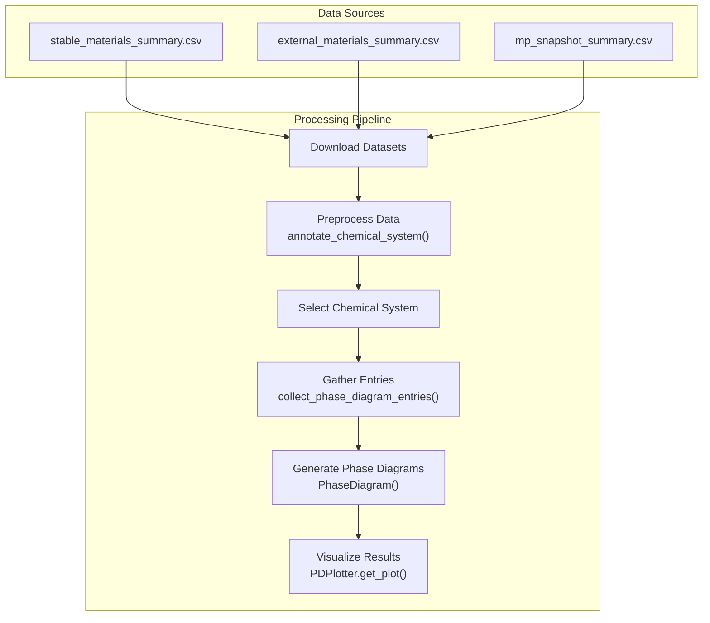
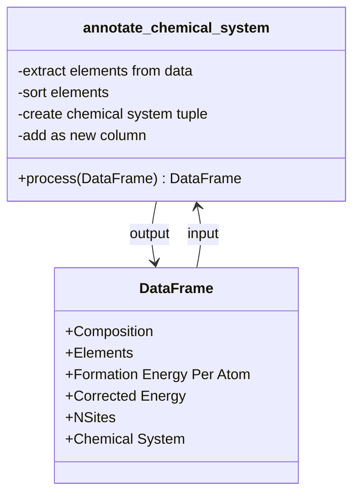
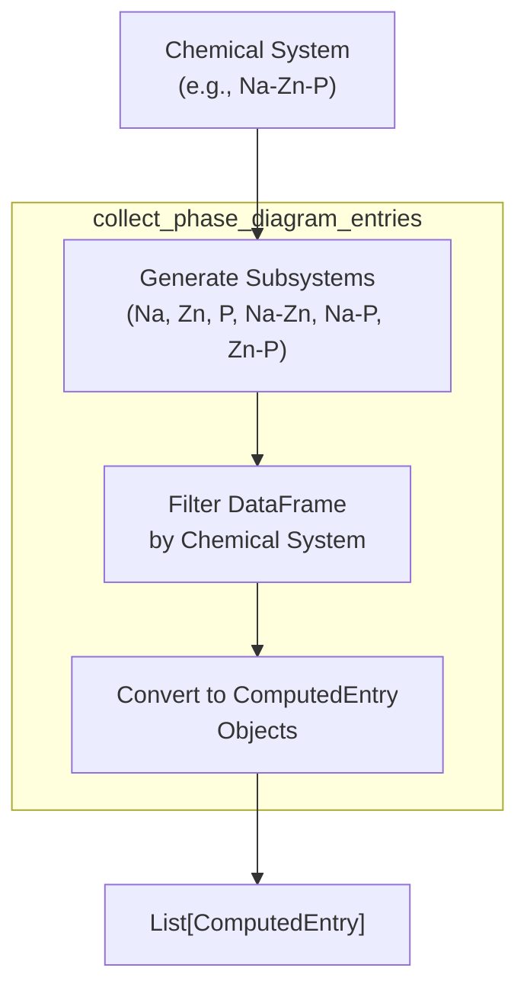
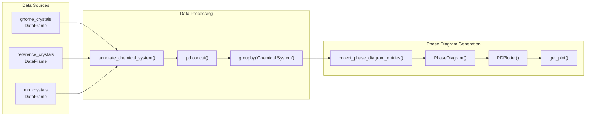

<!-- source: DeepWiki mcp.deepwiki.com · repo google-deepmind/materials_discovery · page 4.1 Exploring Chemical Systems · fetched 2026-10-26 -->

# Exploring Chemical Systems

<details>
<summary>Relevant source files</summary>

The following files were used as context for generating this wiki page:

- [notebooks/Exploring_Chemical_Systems.ipynb](notebooks/Exploring_Chemical_Systems.ipynb)

</details>


## Purpose and Scope

This document describes the Chemical Systems Explorer component of the GNoME (Graph Networks for Materials Exploration) materials discovery framework. The Explorer allows researchers to analyze and visualize phase diagrams for various chemical systems, enabling comparison between stable materials discovered by GNoME and existing entries from the Materials Project database. 

For information about calculating specific decomposition energies, see [Computing Decomposition Energies](#4.2). For analyzing stability in air, see [Air Stability Analysis](#4.3).

Sources: [notebooks/Exploring_Chemical_Systems.ipynb:19-23](/)

## System Overview

The Chemical Systems Explorer provides tools to explore the thermodynamic stability landscape of materials across different compositional spaces. It processes crystal structure data from the GNoME dataset and external sources, allows selection of specific chemical systems, and generates phase diagrams using pymatgen's analysis capabilities.



**Diagram: Chemical Systems Explorer Workflow**

Sources: [notebooks/Exploring_Chemical_Systems.ipynb:52-62](/)

## Data Sources

The Explorer utilizes three primary data sources:

| Data File | Description | Purpose |
|-----------|-------------|---------|
| `stable_materials_summary.csv` | Computationally stable materials discovered by GNoME | Main dataset of crystal structures |
| `external_materials_summary.csv` | Additional reference materials | Comparison dataset |
| `mp_snapshot_summary.csv` | Snapshot of Materials Project stable entries | Reference for established materials |

These files are downloaded from Google Cloud Storage at the beginning of the workflow.

Sources: [notebooks/Exploring_Chemical_Systems.ipynb:82-107](/)

## Key Components and Workflow

### 1. Data Preprocessing

The Explorer first annotates each material with its chemical system (the set of elements present):



**Diagram: Data Preprocessing Flow**

Sources: [notebooks/Exploring_Chemical_Systems.ipynb:165-172](/)

### 2. Chemical System Selection

Users can specify a chemical system to explore (e.g., "Na-Zn-P") or the system can select a random chemical system from the dataset. The selection is converted into a tuple of element symbols.

Sources: [notebooks/Exploring_Chemical_Systems.ipynb:234-248](/)

### 3. Entry Collection

The `collect_phase_diagram_entries` function gathers all relevant entries for a selected chemical system, including all subsystems, and converts them to pymatgen's `ComputedEntry` format for phase diagram calculation:



**Diagram: Entry Collection Process**

Sources: [notebooks/Exploring_Chemical_Systems.ipynb:268-290](/)

### 4. Phase Diagram Generation

The Explorer uses pymatgen's `PhaseDiagram` class to generate three thermodynamic phase diagrams:

1. GNoME entries only
2. Materials Project entries only 
3. Joint entries (combined GNoME and Materials Project)

Sources: [notebooks/Exploring_Chemical_Systems.ipynb:323-324](/)

### 5. Visualization

Phase diagrams are visualized using pymatgen's `PDPlotter` class, which creates interactive plots showing:

- Stable compositions (vertices on the convex hull)
- Unstable compositions (points above the hull)
- Tie lines connecting stable phases
- Hull facets representing stability regions

Sources: [notebooks/Exploring_Chemical_Systems.ipynb:344-345](/)

## Example Usage

Below is an example of how to use the Chemical Systems Explorer to visualize the Na-Zn-P chemical system:

```python
# Specify chemical system
chemsys = 'Na-Zn-P'
chemsys = tuple(re.split('\W+', chemsys))

# Gather entries and generate phase diagram
gnome_phase_diagram_entries = collect_phase_diagram_entries(chemsys, grouped_entries, all_crystals)
gnome_phase_diagram = phase_diagram.PhaseDiagram(gnome_phase_diagram_entries)

# Visualize phase diagram
gnome_pd_plot = phase_diagram.PDPlotter(gnome_phase_diagram)
gnome_pd_plot.get_plot()
```

Sources: [notebooks/Exploring_Chemical_Systems.ipynb:417-424](/)

## Data Flow Architecture

The following diagram illustrates the complete data flow in the Chemical Systems Explorer:



**Diagram: Complete Data Flow in Chemical Systems Explorer**

Sources: [notebooks/Exploring_Chemical_Systems.ipynb:180-218](/)

## Practical Applications

The Chemical Systems Explorer has several important applications in materials discovery:

1. **Identifying stable compositions**: Visualizing convex hulls helps identify thermodynamically stable compositions in a chemical system

2. **Comparing datasets**: The side-by-side comparison between GNoME and Materials Project data allows researchers to identify novel materials not present in existing databases

3. **Discovery targeting**: By exploring specific chemical systems of interest, researchers can focus computational and experimental efforts on promising regions of compositional space

4. **Thermodynamic analysis**: The phase diagrams provide insights into competitive phases and thermodynamic stability regions

Sources: [notebooks/Exploring_Chemical_Systems.ipynb:379-398](/)

---

